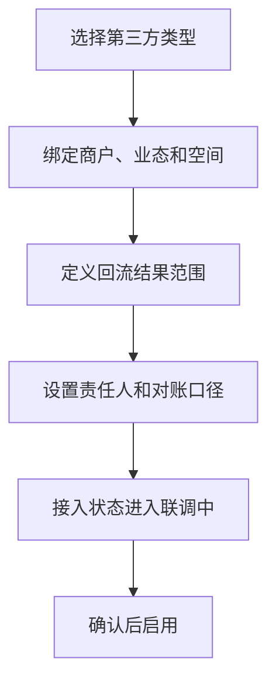
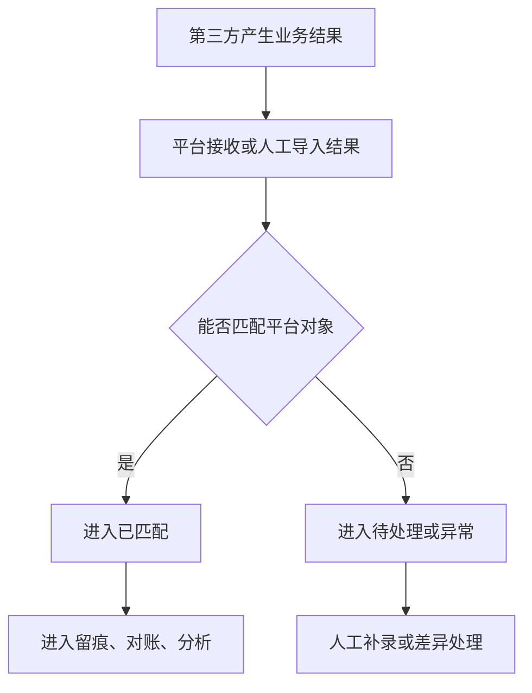
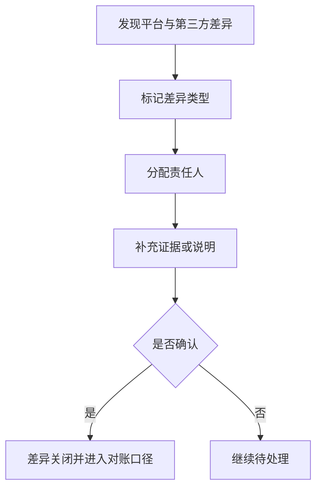

# 第三方业务接入产品 PRD V0.1

> 权限边界：本 PRD 只提供产品细化；三份业务 HTML 拥有最终业务解释权。其他文档、配置、代码和数据结构均不得覆盖 HTML；HTML 未记载的新规则须经用户批准并写入 HTML 后方可生效。

> 2026-08-01 业务口径修订：第三方渠道票同样遵守“售出门票原则上不退款”和按核销结算。域内通票不拆域；跨域组合通票整单渠道费只扣一次后拆域。未核销款按票种所属经营域处理，不统一归项目公司；渠道合同不得把 no-show 配成已核销或改变平台统一退款原则。

## 1. 文档定位

本文档按业务经营视角拆解第三方接入。它回答“哪些外部系统不自研、平台需要拿回什么经营结果、失败和差异怎么处理、如何进入留痕、对账和分析”。

本文档不是具体接入协议，不写回调细节、数据结构或实现方案。涉及第三方的具体接入细节在后续技术设计中再拆；本阶段只定义产品口径和业务边界。

## 2. P0 目标

> 修订说明（2026-06-07）：原 P0 目标把"餐饮/零售回流+对账+补录全闭环"全部当作 P0，与 `p0-implementation-task-list.md`、`third-party-integration-development-design.md` 第18节"P0 只做接入底座/接口预留、餐饮零售回流与对账闭环属 P1"冲突（依据 finding third-2）。现按统一口径收敛：**P0 = 接入关系/服务商登记+开放授权接口预留+企业微信每日会话同步与基础质检**；餐饮/零售的真实订单/核销回流、对账、补录差异闭环统一改标 **P1**。下文逐条标注归属。

P0 第三方接入目标：
- 【P0】建立第三方系统、商户、业态、合同和空间的接入关系，并完成服务商登记。
- 【P0】明确每类第三方最小回流结果范围（口径定义，不要求 P0 真实承接全部业务回流）。
- 【P0】对外开放授权方向：登记开放应用授权、数据权限范围、第三方取数/回写记录与调用审计入口（接口预留，详见 §3 接入矩阵"对外取数/回写"方向）。
- 【P0】企业微信每日会话同步 + 基础质检（绑定、每日同步、上传状态、基础关键词命中与复核）。
- 【P0】供应商未确定前按 `third-party-supplier-integration-kit-v0.1.md` 保留统一接口、适配器、字段映射占位、Webhook+轮询校验、对账和补偿策略，不把供应商私有字段写死进业务主模型。
- 【P1】能查看餐饮/零售回流成功、失败、延迟、重复和差异。
- 【P1】能把餐饮/零售第三方结果进入经营留痕、对账和分析。
- 【P1】能对餐饮/零售失败回流进行人工补录和复核。

## 3. 接入矩阵

> 修订说明（2026-06-07）：本节新增"数据方向（入站回流 / 对外取数·回写）"与"优先级"两列，显式区分两个方向（依据 finding third-1）：**入站回流**=第三方把业务结果送回平台；**对外取数/回写**=第三方在开放授权与数据权限范围内主动从平台取数或回写平台数据（复用开放平台动态鉴权，详见统一口径基准 D3 与开放平台文档）。优先级按 §2 收敛后口径标注：餐饮/零售真实回流=P1，团购售票渠道与企微基础质检=P0（finding third-2/third-3）。

### 3.1 入站回流方向（第三方 → 平台）

| 第三方类型 | 定位 | 回流结果 | 优先级 | 平台不做 |
|---|---|---|---|---|
| 团购售票渠道（美团/大众点评/抖音） | 渠道售票为主，平台统一对账核销 | 渠道订单回流、票码/券码核销、支付/退款结果、差异 | **P0** | 不做第三方营销玩法 |
| 企业微信 | 官方体系为主，平台做会话质检 | 会话关联、员工、游客/客户、投诉、基础质检结果 | **P0**（每日同步+基础质检） | 不替代企业微信 |
| 餐饮 POS | 第三方为主，平台统一看结果 | 订单级结果、券核销级结果、退款、日/半日/小时汇总；单店小数据量支持实时汇总 | P1 | 不自研完整餐饮 POS |
| 零售 POS | 第三方为主，平台统一看结果 | 订单级结果、券核销级结果、退款、日/半日/小时汇总；单店小数据量支持实时汇总，商品汇总可预留 | P1 | 不自研完整零售 POS |
| 机器人 | 第三方履约，平台看任务状态 | 任务创建、取货、配送、送达、失败 | P2 | 不做机器人调度内核 |
| 视频监控 | 第三方监控，平台做证据索引 | 点位、事件时间段、调阅记录、证据备注 | P2 | 不做完整监控平台 |
| 支付/渠道（非团购） | 第三方支付或其他售票渠道 | 支付结果、退款结果、渠道订单号、差异 | P1 | 不自研支付系统，不做第三方营销玩法 |
| **刷脸验证入场设备** | 第三方人脸算法与活体检测，平台只承接核验结果与通行记录 | **入场刷脸核验结果（是否通过、是否满 18 岁）、核验时间、设备点位、通行记录** | **P0（合规必备）** | **不自研人脸算法与活体检测**，按后台开关接入第三方供应商 |
| **聚合支付** | 各支付渠道统一接入，平台不沉淀资金 | 各渠道（微信、支付宝等）的**支付与退款结果、流水号、入账口径、对账明细** | P1（与「支付/渠道（非团购）」同一方向，按 HTML 单列一行） | **不自研支付通道、不沉淀资金** |
| **微信/支付宝登录** | 第三方授权登录，平台不替代其账号体系 | 客人授权登录后的**身份标识、可绑定手机号**（用于注册登录与账号打通） | 按客人端注册登录排期（见 `customer-app-miniapp-product-prd-v0.1.md`），本轮只补接入口径、不另定优先级 | **不替代微信/支付宝账号体系，只做授权登录** |
| **税务/电子发票平台** | 开票由第三方平台完成，平台只做状态对接与留痕 | **开票状态六态回流：待开票、开票中、已开票、已红冲、已作废、开票失败**；开票金额与凭证关联（开票金额 ≤ 已收 − 已退 − 已开，退款后先红冲再重开） | 按财务开票排期（见 `finance-settlement-product-prd-v0.1.md` §6D），本轮只补接入口径、不另定优先级 | **不自建开票引擎**（2026-06-26 裁决：开票走第三方对接） |

> 说明：团购售票渠道（美团/大众点评/抖音）单列为 P0 行，因票务系 P0 必须依赖其订单回流与核销对账（finding third-3/third-7）；其幂等键、对账对象、事件映射见 `third-party-integration-development-design.md` §4.1/§9/§12/§13 对齐项。
>
> **2026-08-04 PRD 同步 F5 补 4 类接入（依据 ENUM L139「接入的外部系统」，逐条对齐 BSM）**：
> - **刷脸验证入场设备**（BSM L1363-1365「刷脸验证入场设备」）：入场年龄核验是**合规必备**——全场 18 岁以上方可入场、未成年一律拒入，门口入场统一刷脸核验年龄（ENUM L30「年龄限制」）。**刷脸开关关闭期间靠现场制度查验兜底**，开关关闭**不等于**放宽 18 岁限制；全部售酒点都在入场核验范围内，售酒时**继承入场核验结果、不再逐单重复验龄**。
> - **聚合支付**（BSM L1358-1360「聚合支付」）：本行与既有「支付/渠道（非团购）」行是同一入站方向，按 HTML 单列；其回流的**支付通路与费率明细**是通路费计提与储值卡按通路分摊的取数来源（见 `finance-settlement-product-prd-v0.1.md` §3A）。
> - **微信/支付宝登录**（BSM L1373-1375「微信/支付宝登录」）：只做授权登录与账号打通，不替代其账号体系，不据此改变平台自身的实名与年龄核验要求。
> - **税务/电子发票平台**（BSM L1553「开票状态」、ENUM L134「开票状态」、ENUM L139 内 2026-06-26 裁决）：开票**走第三方对接、不自研开票引擎**，平台只做**六态状态对接与留痕**。
>
> 上述 4 类在真实供应商接口资料到位前，同样适用 §2 第 6 条与 §11 第 5/8 条口径：先建统一接口与适配器占位，不把供应商私有字段写进业务主模型。

### 3.2 对外取数/回写方向（平台 → 第三方授权调用）

> 本方向为 P0 接口预留：第三方在开放授权与数据权限范围内取数或回写，复用开放平台动态鉴权（统一口径基准 D3）。P0 不要求承接全部业务数据回写，只要求授权、权限范围与调用审计可建模可登记。

| 能力 | 定位 | 范围 | 优先级 |
|---|---|---|---|
| 开放应用授权 | 第三方应用获授权后方可访问平台 | 授权应用、状态、密钥、有效期 | P0（预留） |
| 数据权限范围 | 限定第三方可见/可写的商户、门店、项目、区域、对象 | data_scope 范围登记 | P0（预留） |
| 第三方取数/回写记录 | 第三方主动拉取或回写平台数据的明细 | 调用对象、方向（取数/回写）、数据范围、结果 | P0（预留） |
| 调用审计视图 | 对外调用全量留痕，供安全与合规复核 | 调用人/应用、时间、接口、数据范围、结果、审计 | P0（预留） |

## 4. 业务对象

| 对象 | 定义 | 关键关系 |
|---|---|---|
| 第三方系统 | 外部能力来源，如某 POS、机器人平台、监控平台 | 关联商户、业态、接入状态 |
| 接入关系 | 平台与第三方之间的业务绑定 | 关联商户、合同、空间、数据范围 |
| 回流记录 | 第三方返回的平台所需结果 | 关联订单、核销、任务、会话、事件 |
| 回流批次 | 一段时间内的一组同步结果 | 关联日结、对账、失败处理 |
| 差异记录 | 第三方口径与平台口径不一致 | 关联对账、人工补录、复核 |
| 接入异常 | 授权失败、延迟、重复、字段缺失、数据冲突 | 关联责任人、处理状态 |

## 5. 接入状态

| 状态 | 含义 |
|---|---|
| 待接入 | 已规划但未启用 |
| 联调中 | 正在确认回流口径 |
| 已启用 | 可正常回流业务结果 |
| 暂停 | 临时停止回流或使用 |
| 异常 | 存在失败、差异或授权问题 |
| 已停用 | 不再作为当前经营来源 |
| 归档 | 历史接入关系 |

## 6. 回流记录状态

| 状态 | 含义 |
|---|---|
| 待接收 | 平台尚未收到结果 |
| 已接收 | 平台已收到原始结果 |
| 已匹配 | 已与平台对象匹配 |
| 待处理 | 需要人工确认或补充 |
| 已入账口径 | 可进入对账/日结 |
| 已忽略 | 经确认不纳入经营口径 |
| 异常 | 失败、重复、冲突或缺字段 |

## 7. P0 流程

### 7.1 接入关系建立

### 7.2 第三方结果回流

### 7.3 差异处理

> 修订说明（2026-07-28，v7 审计 P0-E 对账旁路手填封堵）：差异的**金额一律由系统取数，任何角色都不能手工填写或修改**。
> - 差异的两个金额（平台侧、第三方侧）不接受人工输入：第三方侧按渠道订单号从已落库的回流里取数；平台侧只在系统自动对账（平台期望清单 × 第三方回流逐笔比对）时由系统落值。
> - 第三方那笔**根本没有回流落库**时，不允许凭对账单手打一条差异出来——先把回流按正规通道补进系统，再对账。这条是硬拒绝，不是提示。
> - 确有人工介入必要时，只能做「**登记差异**」这一件事：登记后差异强制进入**待复核**状态，并记录登记人；**登记人不能自己复核关闭**，须由另一位有对账处置权限的同事复核。
> - 差异一旦登记，后续处置只能改状态、责任人、结论与证据，**金额永远改不动**。
>
> 口径与财务域对账（决议 `R6-D07`）、业务 HTML 铁律 `RULE-FIN-SOURCE-01`（BSM L1549「取数规则：平台侧金额必须系统自动取数、不许手填；第三方侧接入前可人工录入但须标记并强制复核，且须上传渠道对账单原件、复核人比对签字，无原件的录入只能挂待补凭证、不得进入对账结论」；2026-08-04 F5 锚点更正：原记「业务:1340」指向无关条目）完全一致，两域不再各说各话。

## 8. 页面清单

> 修订说明（2026-06-07）：新增"对外取数/回写"方向的 4 个页面（开放应用授权/数据权限范围/取数回写记录/调用审计视图），承载 §3.2 对外方向（finding third-1）；回流记录页明确含团购售票渠道（渠道订单号/票码/支付退款/核销，finding third-7）。

| 页面 | 方向 | P0 内容 |
|---|---|---|
| 第三方接入总览 | 通用 | 已接入、异常、待处理、今日回流 |
| 接入关系管理 | 通用 | 第三方类型、商户、业态、空间、状态 |
| 回流记录 | 入站回流 | 订单、核销、退款、任务、会话、证据索引；团购渠道（渠道订单号、票码、支付/退款、核销状态、差异） |
| 回流批次 | 入站回流 | 批次时间、数量、成功、失败、差异 |
| 差异清单 | 入站回流 | 差异类型、金额/数量、责任方、处理状态 |
| 接入异常 | 通用 | 授权、延迟、重复、缺失、冲突 |
| 开放应用授权 | 对外取数/回写 | 授权应用、状态、密钥有效期、数据权限范围（复用开放平台口径 D3） |
| 数据权限范围 | 对外取数/回写 | 商户/门店/项目/区域/对象级 data_scope 登记 |
| 第三方取数/回写记录 | 对外取数/回写 | 调用应用、方向（取数/回写）、对象、数据范围、结果 |
| 调用审计视图 | 对外取数/回写 | 调用人/应用、时间、接口、数据范围、结果、审计追溯 |

## 9. P0 验收标准

> 修订说明（2026-06-07）：原"餐饮和零售 P0 同时承接订单级/券核销级/退款并支持汇总"在 P0 阶段无法实现，与任务清单/开发设计冲突（finding third-2）。现把餐饮/零售真实回流、对账、补录闭环改标 **P1 验收**，P0 仅保留接入登记、开放授权预留、团购售票渠道回流、企微每日同步+基础质检。机器人/视频改标 P2。

**P0 验收（接入底座+团购渠道+企微基础质检）：**
- 每个第三方接入必须绑定商户或运营主体。
- 每个第三方接入必须明确回流结果范围（口径定义）。
- 对外取数/回写方向：开放应用授权、数据权限范围、取数/回写记录与调用审计可登记可查询（接口预留，依据 §3.2、统一口径基准 D3）。
- 团购售票渠道（美团/大众点评/抖音）P0 能承接渠道订单回流、票码/券码核销与对账（与票务系 P0 对齐，finding third-3）。
- 企业微信 P0 至少能承接每日会话同步、上传状态、会话归属、投诉或基础关键词命中与复核。

**P1 验收（餐饮零售回流与对账闭环，与任务清单/开发设计一致）：**
- 餐饮和零售 P1 同时承接订单级、券核销级、退款结果，并支持日、半日、小时汇总；单店小数据量场景支持实时汇总。
- 餐饮/零售回流异常必须可进入补录、差异处理或忽略。

**P2 验收：**
- 机器人 P2 至少能承接任务状态和失败原因。
- 视频 P2 至少能承接事件关联点位和证据索引；调阅必须强制鉴权并写审计（见 §11 第7条）。

## 10. P1/P2

| 阶段 | 能力 |
|---|---|
| P1 | 更细字段回流、自动重试、厂商对账、机器人任务闭环、视频一键调阅、企微质检流程 |
| P2 | 接入健康评分、自动异常识别、AI 会话分析、自动证据推荐 |

## 11. 已确认规则和后续供应商依赖

已确认：

1. 餐饮/零售第三方回流同时支持订单级和券核销级。
2. 数据看板支持日、半日、小时汇总；单店小数据量场景可实时汇总。
3. 美团、大众点评、抖音 P0 只做团购购票、订单回流、核销和对账。其**对账口径**明确如下（消除"对账"是票券口径还是金额口径的歧义）：
   - **对账粒度（四元组）**：以 **渠道订单号 + 票码/券码 + 核销时间 + 金额** 作为对账主键，逐笔核对；票券维度与金额维度**同时核对**，不是二选一。
   - **渠道未核销票归属**：有效期内未核销不与提供方结算；到期后按门票所属经营域处理：酒吧域归娱乐平台公司，游乐域归游乐公司，演出域归传媒公司，跨域组合通票按已确定域份额分别处理。第三方渠道费只扣一次。
   - **no-show（客人未到店）**：未到店、忘记使用或主动放弃均不计核销，也不是退款理由；系统不得配置成已核销。合同不得改变平台“售出门票原则上不退款”的统一规则。只有票种规则明确允许、活动取消、无法履约、重复支付、法律要求或特殊审批时才可退款并完整冲正。
   - **失败重试 + 去重**：渠道回流失败允许重试拉取与人工文件兜底（`manual_import`）；去重以**渠道订单号 + 票码**为唯一键，同一票券重复回流只认一条、后到的作幂等丢弃并留痕，防止重复核销/重复计收入。
   - **退款**：渠道退款按 §6B（财务 PRD）团购券退款责任方走第三方口径处理，退款回流须能回溯到原对账四元组并冲正对应核销/收入。
4. **企业微信工作会话原文永久保存、不自动到期删除（2026-08-04 现行口径，依据 PGM L569「企业微信工作会话永久保存、不自动到期删除」/ PGM L570「查看会话原文必须写入访问审计」/ PGM L571「平台使用企业微信已有会话能力」/ PGM L863「已拍板：统一同步、永久存储、质检和审计」/ BSM L888「工作聊天每天自动上传、永久保存」/ BSM L1810「已拍板：企业微信会话原文永久保存」；2026-08-04 F5 锚点更正：原记 PGM L556 / PGM L850 / BSM L1803 三处均指向无关条目）**：
   - **平台使用企业微信已有会话能力，统一同步、永久存储（不自动到期删除）、质检和审计。**
   - **确需清理的，按「留痕清理」的同一规则执行**——**仅最高权限本人插入授权 U 盘密钥后可以手动执行**，**逐条填写理由**，**先试运行预览**，**清理动作本身另行留痕**。不存在按期自动销毁、自动匿名化或按策略批量到期删除的路径。
   - **完整原文仅限最小授权 + 审批的取证 / 质检场景**；**普通展示按权限隐去敏感信息**；**查看会话原文必须写入访问审计**。
   - **采集范围**：仅采集企业微信工作号的工作会话，不及员工私人沟通。
   > **口径变更说明（2026-08-04）**：本条原写「留存期限可配置、非无限期永久」，并附**配置权属（法务+安全双人审批）**、**默认值（如 180 天、由合规部门核定）**、**变更复核（PIA 前置、历史数据不追溯）**三小条，**整套已作废、不再适用**——2026-06-08 三轮收口把留存期改为可配置的处置已被用户裁决推翻。本条现与 `evidence-risk-control-product-prd-v0.1.md` §8.1 第 3 条**同一口径**，两处必须一致。
   > **遗留义务（未了事项）**：合规文件自身要求的**长期保存合法性论证尚未补齐**，属未了义务，完成后回写本处。见决策台账 **DEC-CFG-2026-08-03-10**。
5. 当前第三方供应商接口资料未确定，不阻塞自有系统开发。
6. 平台先建设开放 API、Webhook、SDK 示例和动态鉴权，让第三方在授权范围内获取或回写数据（对应 §3.2 对外取数/回写方向）。
7. 视频证据调阅为敏感操作：**必须经权限校验并强制写审计（记录调阅人、时间、关联事件）**，证据/截图/片段保存周期按合规分类留存（依据合规文档 §6 C5，视频证据=事件关联期+取证期后删除；finding third-9）。
8. 后续拿到第三方 SDK/API/接口资料后，再把第三方系统能力接入平台；必须经过适配器层做字段映射、状态映射、对账和异常补偿，不直接改变票务、酒吧、财务等业务主模型。

后续供应商依赖：

无方向性悬空事项。已确认按以下口径执行：

1. 第三方差异默认由平台运营发起处理；涉及商户责任的差异推送商户确认并留痕。
2. 视频证据 P0 保存索引 + 受控跳转/短期取证链接；平台内播放进入 P1，取决于视频平台 API、带宽、授权和留存成本。
3. 企业微信 P0 优先做投诉质检和风险留痕；销售转化质检进入 P2 深度 AI 质检。
4. 第三方回流失败允许人工导入文件兜底，但必须标记 `manual_import`，进入差异复核，并保留文件、导入人、重复识别和补偿记录。

## 11A. 重要事项短信通知与不可关闭清单（2026-08-04 新增，依据 BSM L1400-L1403「重要事项短信通知」）

> 短信平台是第三方能力，本节定义平台侧「什么事必须发、什么提醒不许关」的业务口径；具体通道对接与送达状态回流按 §3.1 第三方接入范式处理。**短信与手机应用推送均为提醒手段，发与不发、成功与否都不影响任何期限（如异议期）的起算与届满。**

### 11A.1 给客人的通知

| 场景 | 说明 |
|---|---|
| 存酒成功 | 登记成功即发 |
| 取酒成功 | 取酒完成即发 |
| 存酒即将到期 | 到期前提醒 |
| 存酒已过期 | 过期后告知 |
| **未核销票的到期提醒** | 在到期前通过官方 App 或小程序弹出到期提醒（**业务参数，按项目可配，出厂默认到期前二十四小时，须同时配置上下限**） |
| **金额变动** | 消费扣款、储值充值到账、储值消费扣款等金额变动一律通知 |

- **积分相关不发短信**（积分变动不进短信通道）。

### 11A.2 给商户的通知

| 场景 | 说明 |
|---|---|
| 房租 / 水电费 / 物业费 | 账单与催缴 |
| 合同即将到期 | 续约提醒 |
| **凡涉及商户应收应付金额发生变化的事项** | **一律短信通知**，包括：**结算金额出账与调整、对账差异认定结果、押金抵扣与退还、违约金计提、分红出单与发放** |

- 涉及金额变化的通知中必须**写明金额、原因与异议截止日期**。
- 默认发给**商户主要联系人**，可在后台改为指定接收人。

### 11A.3 不可关闭清单（硬约束）

管理员可在后台自行决定哪些提醒发短信，**但下列几类不在可关闭范围内，不得按类、也不得按条关闭**：

1. **涉及商户应收应付金额发生变化的通知**；
2. **未核销票的到期提醒**；
3. **涉及客人金额发生变化的通知**（储值消费扣款、储值充值到账、消费扣款）；
4. **存酒到期提醒**。

### 11A.4 验收

- 上述四类提醒在后台**没有关闭开关**；尝试按类或按条关闭一律拒绝并给出中文报错。
- 未核销票到期提醒的提前量为**按项目可配的业务参数**，出厂默认 24 小时，且**配置了上下限**，越界值拒绝保存。
- 积分变动**不触发短信**。
- 商户侧金额变化通知的报文含**金额、原因、异议截止日期**三要素，缺任一项不得发出。
- 短信发送失败**不改变**账单异议期的起算与届满时点。

## 12. 本版结论

第三方接入 P0 的核心不是“把外部系统全部做进来”，而是把关键经营结果收回来，进入统一留痕、对账和分析口径。第三方继续做专业系统，平台负责统一看清楚、对得上、追得回。

## 13. 变更日志

| 日期 | 类型 | 位置 | 内容 | 原因/依据 |
|---|---|---|---|---|
| 2026-06-07 | 改 | §2 P0 目标 | 把餐饮/零售回流+对账+补录改标 P1，P0 收敛为接入登记+开放授权预留+企微每日同步与基础质检 | finding third-2：PRD P0 与任务清单/开发设计冲突，统一口径 |
| 2026-06-07 | 增 | §3 接入矩阵 | 拆分"入站回流"与"对外取数/回写"两方向；新增对外方向 4 类能力（开放授权/数据权限范围/取数回写记录/调用审计） | finding third-1：对外开放授权方向此前完全未建模 |
| 2026-06-07 | 增 | §3.1 接入矩阵 | 新增"团购售票渠道（美团/大众点评/抖音）"=P0 行 | finding third-3/third-7：票务 P0 依赖团购渠道回流核销对账 |
| 2026-06-07 | 增 | §8 页面清单 | 新增对外取数/回写 4 页面；回流记录页含团购渠道字段 | finding third-1/third-7 |
| 2026-06-07 | 改 | §9 P0 验收标准 | 餐饮/零售回流与对账闭环改 P1 验收，机器人/视频改 P2 | finding third-2 |
| 2026-06-07 | 改 | §11 已确认规则 | 企微会话"永久"改"可配置留存"并补合规依据；新增视频调阅强制鉴权+写审计与保存周期 | finding third-6/third-9，合规文档 §4 C3/§6 C5、报告 A7 |
| 2026-07-04 | 改 | §11#4 企微留存 | 「可配」补齐配置权属（法务+安全双审批）、默认值（如180天，合规核定、后台可配）、变更复核（先做隐私影响评估；历史数据按原策略、新策略仅对后续生效） | 逻辑一致性修订：权属/默认值/变更复核此前未定 |
| 2026-07-04 | 改 | §11#3 团购对账 | 「对账」口径细化：对账粒度=渠道订单号+票码+核销时间+金额四元组；渠道未核销票归渠道方（按回流合同扣点/原路退）；no-show 默认不计核销（后台可配）；失败重试+去重（订单号+票码唯一键幂等）；退款走 §6B 第三方口径并回溯冲正 | 逻辑一致性修订：团购「对账」是票券还是金额、no-show/失败/退款口径此前不清 |
| 2026-08-04 PRD 同步 B5 | 改 | §11#4 企微留存 | 整条重写：删除「留存期限可配置、默认如 180 天由合规部门核定、法务+安全双人审批、PIA 前置、历史数据不追溯」全套旧口径，改为与 evidence PRD §8.1 相同的现行口径——会话原文永久保存不自动到期删除、清理走最高权限 U 盘密钥+逐条理由+试运行预览+清理留痕、完整原文限最小授权+审批的取证质检场景、查看写审计；保留长期保存合法性论证未了义务标注 | PGM L569/L570/L571、PGM L863、BSM L888、BSM L1810、DEC-CFG-2026-08-03-10（情况 2）（2026-08-04 F5 锚点更正：原记 PGM L556、PGM L850、BSM L1803） |
| 2026-08-04 PRD 同步 B5 | 增 | §11A | 新增「重要事项短信通知与不可关闭清单」：给客人（存酒成功/取酒成功/即将到期/已过期、未核销票到期前提醒[按项目可配、出厂 24 小时、须配上下限]、消费扣款与储值充值到账/储值消费扣款等金额变动；积分相关不发短信）；给商户（房租水电物业账单与催缴、合同到期续约提醒；凡应收应付金额变化一律通知——结算出账与调整/差异认定结果/押金抵扣退还/违约金计提/分红出单发放，写明金额原因异议截止日期）；不可关闭清单四类（商户应收应付金额变化、未核销票到期、客人金额变化、存酒到期） | BSM L1400-L1403「重要事项短信通知」、DEC-R3-2026-08-04-20（情况 1）（2026-08-04 F5 锚点更正：原记 BSM L1393-1400，实为视频监控段） |
| 2026-08-04 PRD 同步 F5 | 增 | §3.1 接入矩阵 | 补 4 类接入：刷脸验证入场设备（P0 合规必备，回流=是否通过/是否满 18 岁/核验时间/设备点位/通行记录，开关关闭期间现场制度兜底）、聚合支付、微信/支付宝登录、税务/电子发票平台（开票六态对接、不自研开票引擎） | ENUM L139「接入的外部系统」、ENUM L30「年龄限制」、BSM L1363-1365、BSM L1358-1360、BSM L1373-1375、BSM L1553、ENUM L134（情况 1） |
| 2026-08-04 PRD 同步 F5 | 改 | §7.3 修订说明、§11#4、§11A 标题、§13 两行 | 锚点全量复核更正：`业务:1340`→BSM L1549「取数规则」；PGM L556/L850、BSM L1803→PGM L569-571/L863、BSM L888/L1810；BSM L1393-1400→BSM L1400-L1403 | 基线 HTML 实测（行号偏移，旧引用指向无关条目） |
| 2026-08-01 | 落地 | §3.1/§11#3 团购售票渠道 | 批6 第三方通票适配落码（V382）：渠道订单回流→按渠道票种映射走既有出票主链落成本地票（幂等只出一次）；核销/冲正回传落出站队列；channel-auto 对账 ticket 系统取数；能力开关 integration.ticket_channel.sync 默认关（关=拒收）；映射维护页 ADM-INT-005；渠道费按 sales_channel=具体渠道走 V327/V381 解析。退款回流仅落台账进对账，本地退款走既有退款审批链（先审后行）；真实供应商适配器（验签/字段映射/回传执行器）待厂商资料 | 批6 开发交付（pending-development-backlog 批6b 消项） |
