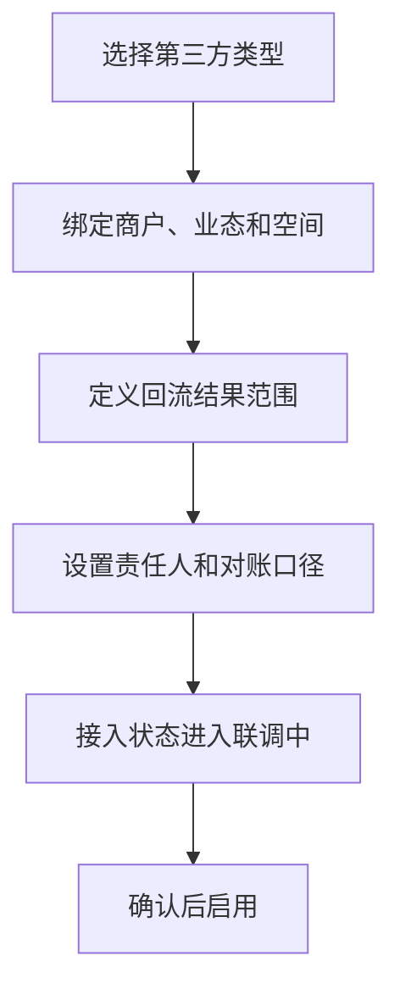
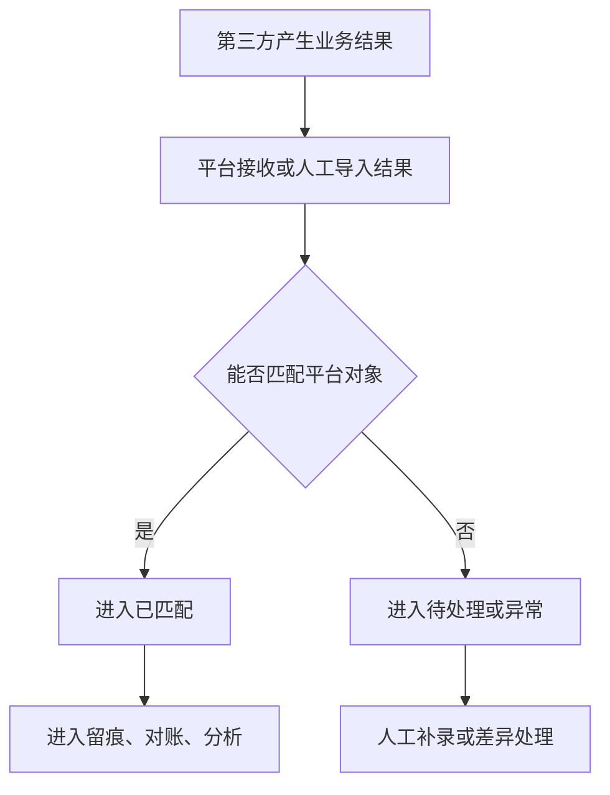
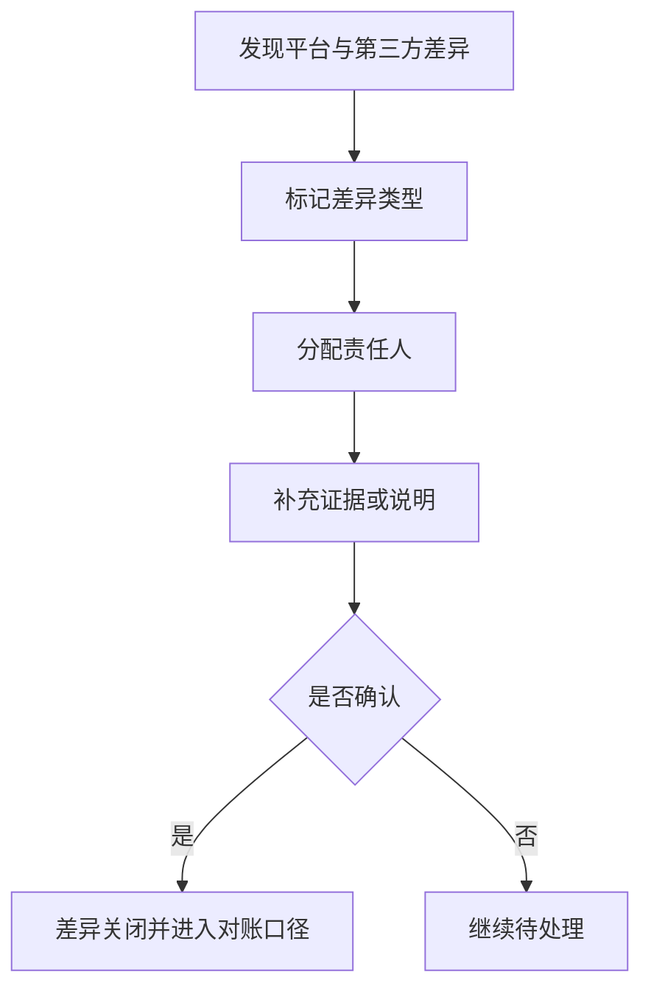

# 第三方业务接入产品 PRD V0.1

> 2026-07-04 逻辑一致性修订：①§11#4 企业微信会话留存「可配」补齐配置权属与变更复核——配置权限=法务+安全双人审批，默认值（如 180 天）由合规部门核定，变更须先做隐私影响评估，历史数据按变更前策略执行、新策略仅对后续会话生效；②§3.1/§11#3 团购渠道（美团/大众点评/抖音）「对账」口径细化——明确对账粒度（渠道订单号+票码+核销时间+金额四元组）、渠道未核销票归属（按回流合同扣点/原路退）、no-show 是否计核销、失败重试+去重规则。团购通票适用整套结算规则（权益拆分/按核销逐笔/未核销归项目公司/手续费预扣），回流营业额须能拆到商户/门店方可计入商户级。

## 1. 文档定位

本文档按业务经营视角拆解第三方接入。它回答“哪些外部系统不自研、平台需要拿回什么经营结果、失败和差异怎么处理、如何进入留痕、对账和分析”。

本文档不是具体接入协议，不写回调细节、数据结构或实现方案。涉及第三方的具体接入细节在后续技术设计中再拆；本阶段只定义产品口径和业务边界。

## 2. P0 目标

> 修订说明（2026-06-07）：原 P0 目标把"餐饮/零售回流+对账+补录全闭环"全部当作 P0，与 `p0-implementation-task-list.md`、`third-party-integration-development-design.md` 第18节"P0 只做接入底座/接口预留、餐饮零售回流与对账闭环属 P1"冲突（依据 finding third-2）。现按统一口径收敛：**P0 = 接入关系/服务商登记+开放授权接口预留+企业微信每日会话同步与基础质检**；餐饮/零售的真实订单/核销回流、对账、补录差异闭环统一改标 **P1**。下文逐条标注归属。

P0 第三方接入目标：
- 【P0】建立第三方系统、商户、业态、合同和空间的接入关系，并完成服务商登记。
- 【P0】明确每类第三方最小回流结果范围（口径定义，不要求 P0 真实承接全部业务回流）。
- 【P0】对外开放授权方向：登记开放应用授权、数据权限范围、第三方取数/回写记录与调用审计入口（接口预留，详见 §3 接入矩阵"对外取数/回写"方向）。
- 【P0】企业微信每日会话同步 + 基础质检（绑定、每日同步、上传状态、基础关键词命中与复核）。
- 【P0】供应商未确定前按 `third-party-supplier-integration-kit-v0.1.md` 保留统一接口、适配器、字段映射占位、Webhook+轮询校验、对账和补偿策略，不把供应商私有字段写死进业务主模型。
- 【P1】能查看餐饮/零售回流成功、失败、延迟、重复和差异。
- 【P1】能把餐饮/零售第三方结果进入经营留痕、对账和分析。
- 【P1】能对餐饮/零售失败回流进行人工补录和复核。

## 3. 接入矩阵

> 修订说明（2026-06-07）：本节新增"数据方向（入站回流 / 对外取数·回写）"与"优先级"两列，显式区分两个方向（依据 finding third-1）：**入站回流**=第三方把业务结果送回平台；**对外取数/回写**=第三方在开放授权与数据权限范围内主动从平台取数或回写平台数据（复用开放平台动态鉴权，详见统一口径基准 D3 与开放平台文档）。优先级按 §2 收敛后口径标注：餐饮/零售真实回流=P1，团购售票渠道与企微基础质检=P0（finding third-2/third-3）。

### 3.1 入站回流方向（第三方 → 平台）

| 第三方类型 | 定位 | 回流结果 | 优先级 | 平台不做 |
|---|---|---|---|---|
| 团购售票渠道（美团/大众点评/抖音） | 渠道售票为主，平台统一对账核销 | 渠道订单回流、票码/券码核销、支付/退款结果、差异 | **P0** | 不做第三方营销玩法 |
| 企业微信 | 官方体系为主，平台做会话质检 | 会话关联、员工、游客/客户、投诉、基础质检结果 | **P0**（每日同步+基础质检） | 不替代企业微信 |
| 餐饮 POS | 第三方为主，平台统一看结果 | 订单级结果、券核销级结果、退款、日/半日/小时汇总；单店小数据量支持实时汇总 | P1 | 不自研完整餐饮 POS |
| 零售 POS | 第三方为主，平台统一看结果 | 订单级结果、券核销级结果、退款、日/半日/小时汇总；单店小数据量支持实时汇总，商品汇总可预留 | P1 | 不自研完整零售 POS |
| 机器人 | 第三方履约，平台看任务状态 | 任务创建、取货、配送、送达、失败 | P2 | 不做机器人调度内核 |
| 视频监控 | 第三方监控，平台做证据索引 | 点位、事件时间段、调阅记录、证据备注 | P2 | 不做完整监控平台 |
| 支付/渠道（非团购） | 第三方支付或其他售票渠道 | 支付结果、退款结果、渠道订单号、差异 | P1 | 不自研支付系统，不做第三方营销玩法 |

> 说明：团购售票渠道（美团/大众点评/抖音）单列为 P0 行，因票务系 P0 必须依赖其订单回流与核销对账（finding third-3/third-7）；其幂等键、对账对象、事件映射见 `third-party-integration-development-design.md` §4.1/§9/§12/§13 对齐项。

### 3.2 对外取数/回写方向（平台 → 第三方授权调用）

> 本方向为 P0 接口预留：第三方在开放授权与数据权限范围内取数或回写，复用开放平台动态鉴权（统一口径基准 D3）。P0 不要求承接全部业务数据回写，只要求授权、权限范围与调用审计可建模可登记。

| 能力 | 定位 | 范围 | 优先级 |
|---|---|---|---|
| 开放应用授权 | 第三方应用获授权后方可访问平台 | 授权应用、状态、密钥、有效期 | P0（预留） |
| 数据权限范围 | 限定第三方可见/可写的商户、门店、项目、区域、对象 | data_scope 范围登记 | P0（预留） |
| 第三方取数/回写记录 | 第三方主动拉取或回写平台数据的明细 | 调用对象、方向（取数/回写）、数据范围、结果 | P0（预留） |
| 调用审计视图 | 对外调用全量留痕，供安全与合规复核 | 调用人/应用、时间、接口、数据范围、结果、审计 | P0（预留） |

## 4. 业务对象

| 对象 | 定义 | 关键关系 |
|---|---|---|
| 第三方系统 | 外部能力来源，如某 POS、机器人平台、监控平台 | 关联商户、业态、接入状态 |
| 接入关系 | 平台与第三方之间的业务绑定 | 关联商户、合同、空间、数据范围 |
| 回流记录 | 第三方返回的平台所需结果 | 关联订单、核销、任务、会话、事件 |
| 回流批次 | 一段时间内的一组同步结果 | 关联日结、对账、失败处理 |
| 差异记录 | 第三方口径与平台口径不一致 | 关联对账、人工补录、复核 |
| 接入异常 | 授权失败、延迟、重复、字段缺失、数据冲突 | 关联责任人、处理状态 |

## 5. 接入状态

| 状态 | 含义 |
|---|---|
| 待接入 | 已规划但未启用 |
| 联调中 | 正在确认回流口径 |
| 已启用 | 可正常回流业务结果 |
| 暂停 | 临时停止回流或使用 |
| 异常 | 存在失败、差异或授权问题 |
| 已停用 | 不再作为当前经营来源 |
| 归档 | 历史接入关系 |

## 6. 回流记录状态

| 状态 | 含义 |
|---|---|
| 待接收 | 平台尚未收到结果 |
| 已接收 | 平台已收到原始结果 |
| 已匹配 | 已与平台对象匹配 |
| 待处理 | 需要人工确认或补充 |
| 已入账口径 | 可进入对账/日结 |
| 已忽略 | 经确认不纳入经营口径 |
| 异常 | 失败、重复、冲突或缺字段 |

## 7. P0 流程

### 7.1 接入关系建立

### 7.2 第三方结果回流

### 7.3 差异处理

> 修订说明（2026-07-28，v7 审计 P0-E 对账旁路手填封堵）：差异的**金额一律由系统取数，任何角色都不能手工填写或修改**。
> - 差异的两个金额（平台侧、第三方侧）不接受人工输入：第三方侧按渠道订单号从已落库的回流里取数；平台侧只在系统自动对账（平台期望清单 × 第三方回流逐笔比对）时由系统落值。
> - 第三方那笔**根本没有回流落库**时，不允许凭对账单手打一条差异出来——先把回流按正规通道补进系统，再对账。这条是硬拒绝，不是提示。
> - 确有人工介入必要时，只能做「**登记差异**」这一件事：登记后差异强制进入**待复核**状态，并记录登记人；**登记人不能自己复核关闭**，须由另一位有对账处置权限的同事复核。
> - 差异一旦登记，后续处置只能改状态、责任人、结论与证据，**金额永远改不动**。
>
> 口径与财务域对账（决议 `R6-D07`）、业务 HTML 铁律 `RULE-FIN-SOURCE-01`（业务:1340）完全一致，两域不再各说各话。

## 8. 页面清单

> 修订说明（2026-06-07）：新增"对外取数/回写"方向的 4 个页面（开放应用授权/数据权限范围/取数回写记录/调用审计视图），承载 §3.2 对外方向（finding third-1）；回流记录页明确含团购售票渠道（渠道订单号/票码/支付退款/核销，finding third-7）。

| 页面 | 方向 | P0 内容 |
|---|---|---|
| 第三方接入总览 | 通用 | 已接入、异常、待处理、今日回流 |
| 接入关系管理 | 通用 | 第三方类型、商户、业态、空间、状态 |
| 回流记录 | 入站回流 | 订单、核销、退款、任务、会话、证据索引；团购渠道（渠道订单号、票码、支付/退款、核销状态、差异） |
| 回流批次 | 入站回流 | 批次时间、数量、成功、失败、差异 |
| 差异清单 | 入站回流 | 差异类型、金额/数量、责任方、处理状态 |
| 接入异常 | 通用 | 授权、延迟、重复、缺失、冲突 |
| 开放应用授权 | 对外取数/回写 | 授权应用、状态、密钥有效期、数据权限范围（复用开放平台口径 D3） |
| 数据权限范围 | 对外取数/回写 | 商户/门店/项目/区域/对象级 data_scope 登记 |
| 第三方取数/回写记录 | 对外取数/回写 | 调用应用、方向（取数/回写）、对象、数据范围、结果 |
| 调用审计视图 | 对外取数/回写 | 调用人/应用、时间、接口、数据范围、结果、审计追溯 |

## 9. P0 验收标准

> 修订说明（2026-06-07）：原"餐饮和零售 P0 同时承接订单级/券核销级/退款并支持汇总"在 P0 阶段无法实现，与任务清单/开发设计冲突（finding third-2）。现把餐饮/零售真实回流、对账、补录闭环改标 **P1 验收**，P0 仅保留接入登记、开放授权预留、团购售票渠道回流、企微每日同步+基础质检。机器人/视频改标 P2。

**P0 验收（接入底座+团购渠道+企微基础质检）：**
- 每个第三方接入必须绑定商户或运营主体。
- 每个第三方接入必须明确回流结果范围（口径定义）。
- 对外取数/回写方向：开放应用授权、数据权限范围、取数/回写记录与调用审计可登记可查询（接口预留，依据 §3.2、统一口径基准 D3）。
- 团购售票渠道（美团/大众点评/抖音）P0 能承接渠道订单回流、票码/券码核销与对账（与票务系 P0 对齐，finding third-3）。
- 企业微信 P0 至少能承接每日会话同步、上传状态、会话归属、投诉或基础关键词命中与复核。

**P1 验收（餐饮零售回流与对账闭环，与任务清单/开发设计一致）：**
- 餐饮和零售 P1 同时承接订单级、券核销级、退款结果，并支持日、半日、小时汇总；单店小数据量场景支持实时汇总。
- 餐饮/零售回流异常必须可进入补录、差异处理或忽略。

**P2 验收：**
- 机器人 P2 至少能承接任务状态和失败原因。
- 视频 P2 至少能承接事件关联点位和证据索引；调阅必须强制鉴权并写审计（见 §11 第7条）。

## 10. P1/P2

| 阶段 | 能力 |
|---|---|
| P1 | 更细字段回流、自动重试、厂商对账、机器人任务闭环、视频一键调阅、企微质检流程 |
| P2 | 接入健康评分、自动异常识别、AI 会话分析、自动证据推荐 |

## 11. 已确认规则和后续供应商依赖

已确认：

1. 餐饮/零售第三方回流同时支持订单级和券核销级。
2. 数据看板支持日、半日、小时汇总；单店小数据量场景可实时汇总。
3. 美团、大众点评、抖音 P0 只做团购购票、订单回流、核销和对账。其**对账口径**明确如下（消除"对账"是票券口径还是金额口径的歧义）：
   - **对账粒度（四元组）**：以 **渠道订单号 + 票码/券码 + 核销时间 + 金额** 作为对账主键，逐笔核对；票券维度与金额维度**同时核对**，不是二选一。
   - **渠道未核销票归属**：客人在渠道已购、到期未核销的票，**归渠道方**——按各渠道回流合同的**扣点规则结算**或**按渠道规则原路退**给客人，平台侧不计为综合体已实现收入（与结算口径「通票未核销归项目公司、第三方按其回流合同规则」一致：第三方渠道未核销票的归属以该渠道回流合同为准）。
   - **no-show（客人未到店）**：默认**不计核销、不计收入**，按上一条「未核销票归属」规则处理；是否计核销为**后台可配**（默认不计），个别渠道合同约定 no-show 计费的，以合同为准并单独标记。
   - **失败重试 + 去重**：渠道回流失败允许重试拉取与人工文件兜底（`manual_import`）；去重以**渠道订单号 + 票码**为唯一键，同一票券重复回流只认一条、后到的作幂等丢弃并留痕，防止重复核销/重复计收入。
   - **退款**：渠道退款按 §6B（财务 PRD）团购券退款责任方走第三方口径处理，退款回流须能回溯到原对账四元组并冲正对应核销/收入。
4. 企业微信工作会话**留存期限可配置（per 报告 A7），非无限期"永久"**：区分质检/取证所需最短留存与长期归档，到期归档/销毁/匿名化，并满足合法性基础与告知要求；不脱敏原文仅限最小授权 + 审批的取证/质检场景，普通展示按权限脱敏，查看原文必须写入审计（依据 `compliance-and-personal-information-protection-requirements-v0.1.md` §4 C3；finding third-6）。
   - **配置权属**：留存期限配置权限=**法务 + 安全双人审批**方可变更，普通运营/管理员无权单方调整；配置项与每次变更均留操作人、审批人、时间、前后值留痕。
   - **默认值**：默认留存期限（如 **180 天**）由**合规部门核定**，不硬编码为业务常量——后台可配，仅呈现「后台可配，默认合规核定值」这一口径。
   - **变更复核**：任何留存期限变更须先完成**隐私影响评估（PIA）**再生效；**历史数据按变更前策略执行、销毁/归档节奏不追溯，新留存策略仅对变更后新增会话生效**，避免缩短期限时对已留存数据造成合规回溯风险。
5. 当前第三方供应商接口资料未确定，不阻塞自有系统开发。
6. 平台先建设开放 API、Webhook、SDK 示例和动态鉴权，让第三方在授权范围内获取或回写数据（对应 §3.2 对外取数/回写方向）。
7. 视频证据调阅为敏感操作：**必须经权限校验并强制写审计（记录调阅人、时间、关联事件）**，证据/截图/片段保存周期按合规分类留存（依据合规文档 §6 C5，视频证据=事件关联期+取证期后删除；finding third-9）。
8. 后续拿到第三方 SDK/API/接口资料后，再把第三方系统能力接入平台；必须经过适配器层做字段映射、状态映射、对账和异常补偿，不直接改变票务、酒吧、财务等业务主模型。

后续供应商依赖：

无方向性悬空事项。已确认按以下口径执行：

1. 第三方差异默认由平台运营发起处理；涉及商户责任的差异推送商户确认并留痕。
2. 视频证据 P0 保存索引 + 受控跳转/短期取证链接；平台内播放进入 P1，取决于视频平台 API、带宽、授权和留存成本。
3. 企业微信 P0 优先做投诉质检和风险留痕；销售转化质检进入 P2 深度 AI 质检。
4. 第三方回流失败允许人工导入文件兜底，但必须标记 `manual_import`，进入差异复核，并保留文件、导入人、重复识别和补偿记录。

## 12. 本版结论

第三方接入 P0 的核心不是“把外部系统全部做进来”，而是把关键经营结果收回来，进入统一留痕、对账和分析口径。第三方继续做专业系统，平台负责统一看清楚、对得上、追得回。

## 13. 变更日志

| 日期 | 类型 | 位置 | 内容 | 原因/依据 |
|---|---|---|---|---|
| 2026-06-07 | 改 | §2 P0 目标 | 把餐饮/零售回流+对账+补录改标 P1，P0 收敛为接入登记+开放授权预留+企微每日同步与基础质检 | finding third-2：PRD P0 与任务清单/开发设计冲突，统一口径 |
| 2026-06-07 | 增 | §3 接入矩阵 | 拆分"入站回流"与"对外取数/回写"两方向；新增对外方向 4 类能力（开放授权/数据权限范围/取数回写记录/调用审计） | finding third-1：对外开放授权方向此前完全未建模 |
| 2026-06-07 | 增 | §3.1 接入矩阵 | 新增"团购售票渠道（美团/大众点评/抖音）"=P0 行 | finding third-3/third-7：票务 P0 依赖团购渠道回流核销对账 |
| 2026-06-07 | 增 | §8 页面清单 | 新增对外取数/回写 4 页面；回流记录页含团购渠道字段 | finding third-1/third-7 |
| 2026-06-07 | 改 | §9 P0 验收标准 | 餐饮/零售回流与对账闭环改 P1 验收，机器人/视频改 P2 | finding third-2 |
| 2026-06-07 | 改 | §11 已确认规则 | 企微会话"永久"改"可配置留存"并补合规依据；新增视频调阅强制鉴权+写审计与保存周期 | finding third-6/third-9，合规文档 §4 C3/§6 C5、报告 A7 |
| 2026-07-04 | 改 | §11#4 企微留存 | 「可配」补齐配置权属（法务+安全双审批）、默认值（如180天，合规核定、后台可配）、变更复核（先做隐私影响评估；历史数据按原策略、新策略仅对后续生效） | 逻辑一致性修订：权属/默认值/变更复核此前未定 |
| 2026-07-04 | 改 | §11#3 团购对账 | 「对账」口径细化：对账粒度=渠道订单号+票码+核销时间+金额四元组；渠道未核销票归渠道方（按回流合同扣点/原路退）；no-show 默认不计核销（后台可配）；失败重试+去重（订单号+票码唯一键幂等）；退款走 §6B 第三方口径并回溯冲正 | 逻辑一致性修订：团购「对账」是票券还是金额、no-show/失败/退款口径此前不清 |
