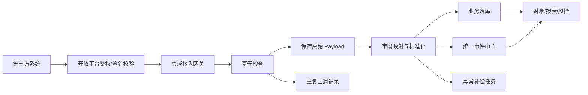
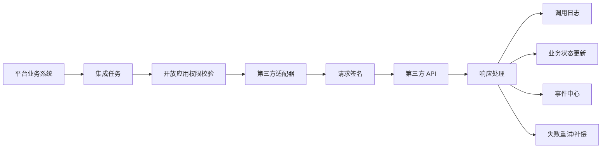
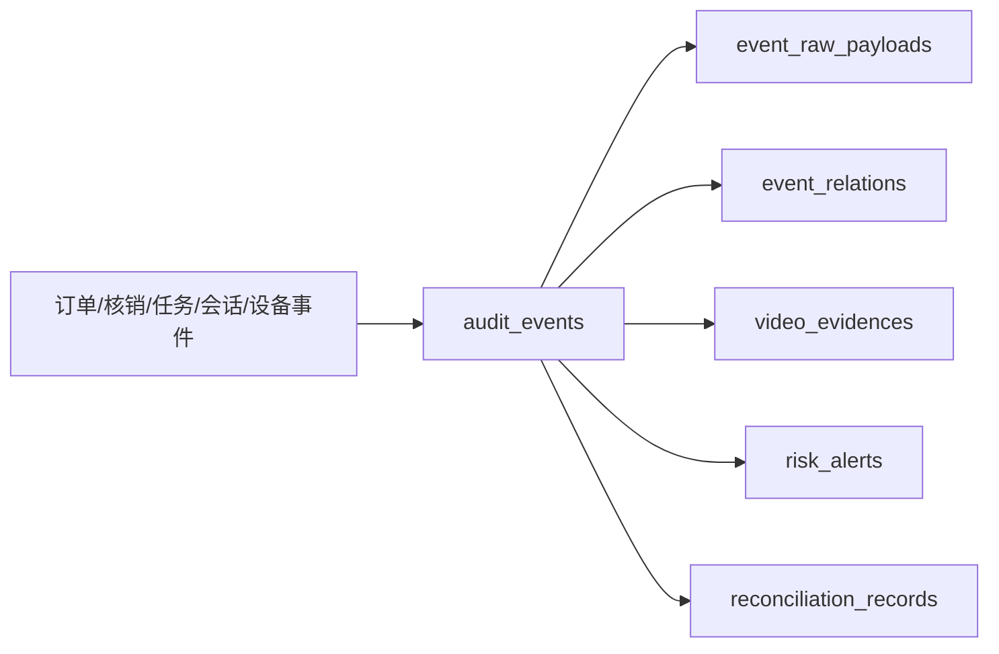
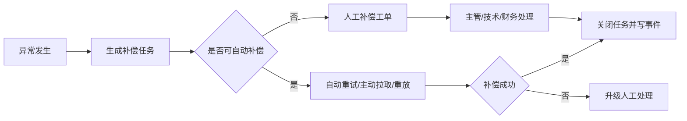

# 第三方集成开发设计：餐饮、零售、机器人、视频监控、企业微信、设备

## 1. 文档定位

本文档是【第三方集成：餐饮、零售、机器人、视频监控、企业微信、设备】专项开发设计文档，目标是把第三方系统接入方案拆到可以直接进入 Java 后端、数据库迁移、OpenAPI、Webhook、事件中心和后台页面开发的粒度。

本文档基于以下既有设计：

- `docs/system-development-spec.md`
- `docs/project-progress-dashboard.md`
- `docs/business-systems-breakdown.md`
- `docs/foundation-systems-breakdown.md`
- `docs/foundation-database-design.md`
- `docs/third-party-supplier-integration-kit-v0.1.md`

本系统不替代第三方成熟系统的核心功能。餐饮、零售、机器人、视频监控、企业微信、设备厂商继续负责各自业务系统；平台负责统一接入、动态鉴权、数据同步、权益核销、事件留痕、证据绑定、对账差异和异常补偿。

当前处于系统设计阶段，真实第三方供应商接口资料暂未确定，不阻塞自有系统开发。第三方接入已确认采用“双向开放”方案：

1. 平台把自有系统内容和数据通过开放 API、Webhook、SDK 示例、动态鉴权、权限范围和调用审计开放给第三方。
2. 平台后续接入第三方系统的 SDK、API 和接口资料，把机器人、视频、设备、餐饮/零售等外部能力接入平台。
3. Webhook + 定时轮询校验为默认同步形态：Webhook 负责实时事件，定时轮询负责补漏、对账和恢复。
4. 供应商未确定前，按 `third-party-supplier-integration-kit-v0.1.md` 只固化统一接口、适配器、字段映射占位、Webhook/轮询、对账和补偿策略；供应商字段、签名细节、错误码和对账文件到资料到位后补齐。

业务已确认：餐饮/零售第三方回流同时支持订单级和券核销级，并支持日、半日、小时汇总；单店小数据量场景可实时汇总。美团、大众点评、抖音在票务侧首批只接团购购票、订单回流、核销和对账，其他第三方营销玩法暂不纳入首批。

## 2. 设计原则

| 原则 | 说明 |
|---|---|
| 多商户隔离 | 所有第三方应用必须绑定商户、服务商、门店、项目或点位，不允许无归属调用 |
| 开放平台统一鉴权 | 第三方调用平台接口必须经过开放平台动态鉴权，使用短时效 Token、动态地址、签名、时间戳和 nonce |
| 事件优先 | 第三方订单、核销、退款、机器人状态、视频证据、企业微信会话、设备事件都必须进入事件中心 |
| 原始数据保留 | 第三方回调原始 payload 必须保存，标准化失败也要可追溯 |
| 幂等优先 | 所有 Webhook、同步、补偿、对账导入都必须支持幂等 |
| 自动留痕优先 | 自动接口、设备、二维码、NFC、视频索引优先；自动失败后进入人工补录或异常工单 |
| 对账闭环 | 第三方订单、平台权益、核销流水、支付/退款流水必须能对账并生成差异处理记录 |
| 可降级 | 第三方系统故障时，必须支持重试、补偿、暂停接入、人工补录和后续恢复同步 |

## 3. 系统边界

### 3.1 本系统负责

| 范围 | 内容 |
|---|---|
| 接入主体 | 服务商、第三方应用、接口权限、数据权限、回调地址、IP白名单 |
| 鉴权安全 | 动态 Token、动态调用地址、签名、防重放、失败锁定、人工解锁 |
| 数据接收 | 订单、核销、退款、机器人状态、视频证据、企微会话、设备事件 |
| 数据下发 | 券信息、核销校验、机器人任务、设备配置、Webhook通知 |
| 标准化 | 第三方字段映射为平台标准对象和事件 |
| 留痕审计 | 写入 `audit_events`、保存原始 payload、记录调用日志 |
| 异常处理 | 失败重试、死信队列、人工补偿、对账差异、异常工单 |
| 对账结算 | 第三方流水与平台订单、权益、核销、退款进行比对 |

### 3.2 本系统不负责

| 范围 | 说明 |
|---|---|
| 餐饮 POS 核心 | 不做菜品、后厨、排队叫号、外卖配送等完整餐饮系统 |
| 零售 POS 核心 | 不做完整商品进销存、收银硬件驱动、会员积分闭环 |
| 机器人调度算法 | 不做机器人路径规划、多机器人调度、避障算法 |
| 视频存储平台 | 不存储全量视频，只保存索引、截图、片段链接、调阅记录 |
| 企业微信官方平台 | 不绕过企业微信合规接口，不采集员工私人微信；工作手机只允许企业微信承接工作沟通 |
| 设备固件 | 不开发闸机、NFC读卡器、扫码枪等硬件固件 |

## 4. 接入矩阵

### 4.1 第三方系统接入矩阵

> 修订说明（2026-06-07）：(1) 新增"团购售票渠道（美团/大众点评/抖音）"=P0 行，因票务系 P0 必须依赖其订单回流与核销对账，原矩阵只有餐饮/零售POS（P1）未建模该 P0 接入对象（finding third-3/third-7）；其幂等键见 §9.1、对账对象见 §12.1、事件映射见 §13.7。(2) 企业微信原复合优先级"P0/P2"就地拆为 P0 能力（绑定/每日同步/上传状态/基础关键词命中/复核）与 P2 能力（AI深度质检/客户意图/服务评分），避免歧义（finding third-8）。

| 接入对象 | 第三方系统职责 | 平台接入职责 | 数据方向 | 优先级 |
|---|---|---|---|---|
| 团购售票渠道（美团/大众点评/抖音） | 渠道售票、订单、退款、票码/券码核销 | 渠道订单回流、票码/券码核销同步、支付/退款同步、对账、事件留痕 | 主要入站 | **P0** |
| 餐饮 POS | 点餐、出餐、收银、退款、餐饮券核销 | 券下发/校验、订单级同步、券核销级同步、退款同步、日/半日/小时/实时汇总、对账、事件留痕 | 双向 | P1 |
| 零售 POS | 商品、SKU、库存、收银、退款、零售券核销 | 券下发/校验、商品只读同步、订单级同步、券核销级同步、退款同步、日/半日/小时/实时汇总、对账 | 双向 | P1 |
| 企业微信 | 员工客户联系、会话存档、客户标签 | **P0：** 员工绑定、每日会话同步、上传状态、基础关键词风险命中、复核；**P2：** AI深度质检、客户意图识别、服务评分 | 主要入站 | **P0**（绑定/每日同步/上传状态/基础关键词命中/复核）＋**P2**（AI质检/客户意图/服务评分） |
| 机器人平台 | 机器人任务执行、路径、状态、异常 | 任务创建/下发、状态接收、签收确认、异常补偿、证据绑定 | 双向 | P2 |
| 视频监控平台 | 摄像头、录像、截图、片段、录像索引 | 摄像头点位同步、事件关联视频、调阅强制鉴权+审计、证据包 | 主要入站 | P2 |
| 闸机/NFC/扫码设备 | 读取票码、NFC、开闸、设备状态 | 设备注册、核销校验、开闸结果、离线队列、设备事件 | 双向 | P2 |

### 4.2 接入方式矩阵

| 接入方式 | 适用场景 | 说明 |
|---|---|---|
| 实时 API | 券校验、核销、单店小数据量实时汇总、机器人任务下发、设备核销 | 需要动态鉴权、签名、权限校验 |
| Webhook | 订单同步、退款同步、机器人状态、视频事件、企微会话 | 默认实时入口，需要回调签名、幂等、重试 |
| 定时轮询校验 | Webhook 补漏、历史订单、日/半日/小时汇总、日终对账、商品/SKU、视频索引 | 已确认作为 Webhook 兜底，支持分页、时间窗口、游标 |
| 文件导入 | 第三方无法实时 API 时 | CSV/JSON 文件进入导入任务和事件中心 |
| 设备上报 | 闸机、NFC、扫码枪、管理手机 | 可走设备网关或开放平台设备接口 |

### 4.3 供应商 SDK/API 适配占位规则

真实供应商未确定时，P0 不把供应商私有字段写入票务、酒吧、财务、库存等业务主模型。所有供应商能力统一经过适配器层：

| 适配点 | P0 固定内容 | 供应商到位后补齐 |
|---|---|---|
| 供应商能力 | payment、wecom、face、robot、video、device、ticket_channel 等 capability_code | 具体 provider_code、账号、环境 |
| 鉴权签名 | 统一出站签名接口、入站验签接口、密钥轮换台账 | 供应商签名算法、header 名、证书/密钥格式 |
| 字段映射 | request_mapping、response_mapping、status_mapping 占位 | 真实字段名、状态码、错误码 |
| Webhook | 统一接收、幂等、重试、日志 | 事件类型、重试次数、报文格式 |
| 轮询校验 | 定时轮询任务、游标、时间窗口、差异队列 | 查询接口、分页、速率限制 |
| 对账补偿 | 差异表、补偿任务、人工复核 | 对账文件格式、结算日、费用口径 |

该规则适用于聚合支付、企业微信、人脸/年龄核验、机器人、视频平台、设备厂商和团购售票渠道。

## 5. 总体数据流

### 5.1 入站数据流：第三方到平台



### 5.2 出站数据流：平台到第三方



### 5.3 事件证据流



## 6. 通用接口协议

### 6.1 请求头规范

所有第三方调用平台开放接口时，必须携带以下请求头。

| Header | 必填 | 说明 |
|---|---|---|
| `Authorization` | 是 | `Bearer {access_token}` |
| `X-Open-App-Code` | 是 | 第三方开放应用编码 |
| `X-Timestamp` | 是 | 毫秒时间戳 |
| `X-Nonce` | 是 | 随机字符串，短时间内不可重复 |
| `X-Signature` | 是 | 请求签名 |
| `X-Request-Id` | 是 | 第三方请求唯一 ID，用于幂等和追踪 |
| `X-Trace-Id` | 否 | 链路追踪 ID，没有则平台生成 |
| `Content-Type` | 是 | `application/json` |

### 6.2 签名字符串

第一版建议签名串：

```text
METHOD + "\n" +
PATH + "\n" +
TIMESTAMP + "\n" +
NONCE + "\n" +
SHA256(BODY)
```

签名算法：

```text
HMAC-SHA256(sign_string, app_secret)
```

### 6.3 时间窗口和防重放

| 项 | 规则 |
|---|---|
| 时间窗口 | 请求时间戳与平台当前时间差不得超过 5 分钟 |
| nonce | 同一开放应用同一 nonce 在 10 分钟内不可重复 |
| request_id | 同一开放应用同一业务接口同一 request_id 必须幂等 |
| 动态地址 | 第三方必须先获取短时效动态地址，再调用业务接口 |

### 6.4 通用响应格式

```json
{
  "success": true,
  "code": "OK",
  "message": "success",
  "requestId": "third-party-request-id",
  "traceId": "platform-trace-id",
  "data": {}
}
```

错误响应：

```json
{
  "success": false,
  "code": "SIGNATURE_INVALID",
  "message": "签名校验失败",
  "requestId": "third-party-request-id",
  "traceId": "platform-trace-id",
  "data": null
}
```

### 6.5 通用错误码

| 错误码 | HTTP | 说明 |
|---|---:|---|
| `AUTH_FAILED` | 401 | 鉴权失败 |
| `APP_LOCKED` | 423 | 开放应用被锁定 |
| `TOKEN_EXPIRED` | 401 | Token 过期 |
| `DYNAMIC_ENDPOINT_EXPIRED` | 401 | 动态地址过期 |
| `SIGNATURE_INVALID` | 401 | 签名错误 |
| `NONCE_REUSED` | 409 | nonce 重复 |
| `REQUEST_REPLAYED` | 409 | request_id 重复且请求体不一致 |
| `PERMISSION_DENIED` | 403 | 接口或数据权限不足 |
| `MERCHANT_SCOPE_DENIED` | 403 | 商户/门店/项目不在授权范围 |
| `IDEMPOTENT_REPLAY` | 200 | 幂等重复请求，返回历史结果 |
| `VALIDATION_ERROR` | 400 | 参数错误 |
| `BUSINESS_REJECTED` | 422 | 业务拒绝 |
| `THIRD_PARTY_UNAVAILABLE` | 503 | 第三方服务不可用 |
| `COMPENSATION_REQUIRED` | 202 | 已进入补偿队列 |

## 7. Webhook 规范

### 7.1 平台接收第三方 Webhook

第三方回调平台统一入口：

```text
POST /api/open/d/{endpoint_key}/webhooks/{provider}/{event}
```

示例：

```text
POST /api/open/d/dyn_abc123/webhooks/catering/order_paid
POST /api/open/d/dyn_abc123/webhooks/robot/task_status_changed
POST /api/open/d/dyn_abc123/webhooks/video/evidence_ready
```

### 7.2 Webhook 请求体通用结构

```json
{
  "eventId": "third-party-event-id",
  "eventType": "catering.order_paid",
  "occurredAt": "2026-06-05T10:00:00+08:00",
  "merchantExternalId": "m_001",
  "venueExternalId": "v_001",
  "payload": {},
  "signatureVersion": "v1"
}
```

### 7.3 平台返回约定

平台接收到 Webhook 后，不要求同步完成所有业务处理。原则是快速确认接收，复杂处理进入异步队列。

```json
{
  "success": true,
  "code": "ACCEPTED",
  "message": "event accepted",
  "eventId": "platform-event-id",
  "dedupStatus": "created"
}
```

`dedupStatus` 可选值：

| 值 | 说明 |
|---|---|
| `created` | 首次接收 |
| `replayed_same_payload` | 重复回调，payload一致 |
| `conflict_payload` | eventId相同但payload不同，进入异常 |

### 7.4 平台向第三方发送 Webhook

平台向第三方回调时使用第三方配置的 `callback_url`，并携带：

| Header | 说明 |
|---|---|
| `X-Platform-Event-Id` | 平台事件 ID |
| `X-Timestamp` | 毫秒时间戳 |
| `X-Nonce` | 随机字符串 |
| `X-Signature` | 平台签名 |
| `X-Retry-No` | 当前重试次数 |

### 7.5 Webhook + 定时轮询校验

已确认采用 Webhook + 定时轮询校验：

1. Webhook 实时接收第三方订单、退款、核销、机器人状态、视频事件、设备事件和企微同步状态。
2. 平台按供应商、商户、业务日期、事件类型定时轮询最近窗口，校验是否存在漏回调、重复回调、状态不一致或金额差异。
3. 轮询发现缺失数据时生成 `pull_missing_*` 补偿任务；发现状态冲突时生成对账差异。
4. Webhook 和轮询必须共享幂等键，避免补漏造成重复入账、重复核销或重复事件。
5. 供应商不支持 Webhook 时，轮询可作为该供应商主同步方式，但必须在接入关系中标注。

## 8. 动态鉴权关系

第三方集成复用【开放平台与安全鉴权系统】能力。

### 8.1 鉴权对象

| 对象 | 说明 |
|---|---|
| `open_app` | 第三方应用，例如某餐饮POS应用、某机器人平台应用 |
| `open_app_credential` | 应用账号、密码哈希、签名密钥 |
| `access_token` | 短时效访问令牌 |
| `dynamic_endpoint` | 短时效动态调用地址 |
| `api_permission` | 接口权限 |
| `data_scope` | 商户、门店、项目、区域数据范围 |

### 8.2 调用流程

1. 第三方使用应用账号密码请求鉴权。
2. 平台校验账号、密码、IP白名单、应用状态。
3. 连续 3 次失败锁定应用。
4. 成功后返回短时效 Token 和动态地址。
5. 第三方使用动态地址调用 API 或 Webhook。
6. 每次请求校验 Token、动态地址、签名、时间戳、nonce、权限和数据范围。
7. 鉴权、调用、失败、锁定、解锁全部写入事件中心。

### 8.3 第三方集成额外规则

| 场景 | 规则 |
|---|---|
| 餐饮/零售 POS | 必须绑定具体商户和门店范围 |
| 机器人平台 | 必须绑定服务商和可服务点位范围 |
| 视频监控平台 | 必须绑定摄像头设备和区域范围 |
| 企业微信 | 必须绑定企业ID、员工 UserID 和会话归属商户 |
| 闸机/NFC/扫码设备 | 必须绑定设备编号、点位、门店、操作范围 |

## 9. 回调幂等设计

### 9.1 幂等键规则

> 修订说明（2026-06-07）：新增团购售票渠道（美团/大众点评/抖音）三类幂等键（渠道订单/渠道退款/票码核销），原矩阵只覆盖 catering/retail 未覆盖团购票务渠道（finding third-3/third-7）。

| 类型 | 幂等键 |
|---|---|
| 通用 Webhook | `open_app_id + event_type + third_party_event_id` |
| 团购渠道订单 | `open_app_id + channel + external_channel_order_id + order_status` |
| 团购渠道退款 | `open_app_id + channel + external_channel_refund_id` |
| 团购票码核销 | `open_app_id + channel + external_voucher_code + verification_seq` |
| 餐饮订单 | `open_app_id + external_order_id + order_status` |
| 餐饮退款 | `open_app_id + external_refund_id` |
| 零售订单 | `open_app_id + external_order_id + order_status` |
| 券核销 | `open_app_id + external_verification_id` |
| 机器人任务事件 | `open_app_id + external_task_id + task_status + occurred_at` |
| 视频证据 | `open_app_id + external_video_id + start_time + end_time` |
| 企业微信会话 | `corp_id + msg_id` |
| 设备事件 | `device_id + event_seq` |

### 9.2 幂等结果处理

| 情况 | 处理 |
|---|---|
| 首次请求 | 正常处理并保存响应摘要 |
| 重复请求，payload一致 | 返回首次处理结果，不重复落业务数据 |
| 重复请求，payload不一致 | 标记 `idempotency_conflict`，进入异常补偿 |
| 处理失败但可重试 | 记录失败次数，进入重试队列 |
| 处理失败且不可重试 | 进入人工补偿或异常工单 |

## 10. 失败重试设计

### 10.1 重试分类

| 类型 | 示例 | 策略 |
|---|---|---|
| 网络失败 | 超时、连接失败、DNS错误 | 自动重试 |
| 第三方 5xx | 第三方服务异常 | 自动重试 |
| 平台 5xx | 内部处理异常 | 自动重试 |
| 429限流 | 被第三方限流 | 延迟重试 |
| 401/403 | 鉴权或权限失败 | 不自动重试，进入异常 |
| 400参数错误 | 字段错误、格式错误 | 不自动重试，进入异常 |
| 业务拒绝 | 券已核销、库存不足 | 不重试，进入业务差异 |

### 10.2 重试间隔

建议第一版：

| 第几次 | 延迟 |
|---:|---|
| 1 | 30 秒 |
| 2 | 2 分钟 |
| 3 | 10 分钟 |
| 4 | 30 分钟 |
| 5 | 2 小时 |
| 超过5次 | 进入死信队列/人工处理 |

### 10.3 重试记录

每次重试必须记录：

- 任务 ID
- 第三方应用 ID
- 接口/事件类型
- 请求摘要
- 响应摘要
- 错误码
- 重试次数
- 下一次重试时间
- 最终状态

## 11. 异常补偿设计

### 11.1 补偿类型

| 补偿类型 | 说明 |
|---|---|
| `pull_missing_order` | 主动拉取缺失订单 |
| `pull_missing_refund` | 主动拉取缺失退款 |
| `replay_webhook` | 重放第三方回调 |
| `resend_platform_callback` | 重新发送平台回调 |
| `manual_reconcile` | 人工对账处理 |
| `manual_event_fix` | 人工修正事件关联 |
| `manual_evidence_bind` | 人工绑定视频证据 |
| `manual_verification_confirm` | 人工确认核销 |
| `device_offline_sync` | 设备离线数据恢复同步 |
| `scheduled_poll_reconcile` | 定时轮询校验发现差异后生成补偿 |

### 11.2 补偿流程



## 12. 对账差异设计

### 12.1 对账对象

> 修订说明（2026-06-07）：新增团购售票渠道三类对账对象（渠道订单/票码核销/退款），覆盖票务 P0 渠道回流对账（finding third-3/third-7）。

| 对账对象 | 平台侧 | 第三方侧 |
|---|---|---|
| 团购渠道订单 | 平台票务订单/支付流水 | 美团/大众点评/抖音渠道订单 |
| 团购票码核销 | 平台权益核销流水 | 团购渠道票码/券码核销记录 |
| 团购渠道退款 | 平台退款/权益冲正流水 | 团购渠道退款记录 |
| 餐饮券核销 | 权益核销流水 | 餐饮POS券核销流水 |
| 餐饮订单 | 餐饮券/支付/商户结算流水 | 餐饮POS订单 |
| 零售券核销 | 权益核销流水 | 零售POS券核销流水 |
| 零售订单 | 零售券/支付/商户结算流水 | 零售POS订单 |
| 机器人任务 | 平台任务 | 机器人平台任务状态 |
| 视频证据 | 平台事件 | 视频平台证据索引 |
| 设备核销 | 平台核销流水 | 设备本地核销记录 |

### 12.2 差异类型

| 差异类型 | 说明 | 处理方式 |
|---|---|---|
| `missing_in_platform` | 第三方有，平台无 | 主动补拉或人工导入 |
| `missing_in_third_party` | 平台有，第三方无 | 重发或人工确认 |
| `amount_mismatch` | 金额不一致 | 财务复核 |
| `status_mismatch` | 状态不一致 | 按状态优先级修正 |
| `duplicate_record` | 重复流水 | 幂等合并或标记重复 |
| `merchant_mismatch` | 商户归属不一致 | 冻结结算并复核 |
| `time_window_mismatch` | 时间归属不同 | 归属到业务发生日或结算日 |
| `evidence_missing` | 证据缺失 | 生成证据补绑定任务 |

### 12.3 对账周期

| 周期 | 内容 |
|---|---|
| 实时 | 核销、单店小数据量订单/核销汇总、机器人任务、设备事件 |
| 小时级 | 餐饮/零售订单、券核销、退款、视频证据、企微会话 |
| 半日 | 餐饮/零售订单、券核销、退款、经营汇总 |
| 日终 | 餐饮/零售订单、券核销、退款、结算差异 |
| 月度 | 商户结算、服务商SLA、长期差异归档 |

## 13. 事件映射

### 13.1 餐饮事件

| 第三方事件 | 平台标准事件 | 事件类别 | 关联对象 |
|---|---|---|---|
| `catering.order.created` | `third_party.catering.order_created` | third_party | merchant、venue、order |
| `catering.order.paid` | `third_party.catering.order_paid` | third_party | merchant、venue、order、payment |
| `catering.order.refunded` | `third_party.catering.order_refunded` | third_party | order、refund |
| `catering.voucher.verified` | `third_party.catering.voucher_verified` | ticket | entitlement、verification、merchant |
| `catering.reconciliation.diff` | `third_party.catering.reconciliation_diff` | risk | reconciliation、merchant |

### 13.2 零售事件

| 第三方事件 | 平台标准事件 | 事件类别 | 关联对象 |
|---|---|---|---|
| `retail.sku.synced` | `third_party.retail.sku_synced` | third_party | merchant、venue、sku |
| `retail.order.paid` | `third_party.retail.order_paid` | third_party | merchant、venue、order |
| `retail.order.refunded` | `third_party.retail.order_refunded` | third_party | order、refund |
| `retail.voucher.verified` | `third_party.retail.voucher_verified` | ticket | entitlement、verification |
| `retail.reconciliation.diff` | `third_party.retail.reconciliation_diff` | risk | reconciliation |

### 13.3 机器人事件

| 第三方事件 | 平台标准事件 | 事件类别 | 关联对象 |
|---|---|---|---|
| `robot.task.accepted` | `robot.task_accepted` | robot | robot_task、device |
| `robot.task.pickup_arrived` | `robot.pickup_arrived` | robot | robot_task、location_point |
| `robot.task.picked_up` | `robot.picked_up` | robot | robot_task、inventory |
| `robot.task.delivery_arrived` | `robot.delivery_arrived` | robot | robot_task、location_point |
| `robot.task.signed` | `robot.signed` | robot | robot_task、staff/customer |
| `robot.task.exception` | `robot.exception` | robot | robot_task、risk |

### 13.4 视频监控事件

| 第三方事件 | 平台标准事件 | 事件类别 | 关联对象 |
|---|---|---|---|
| `video.camera.online` | `video.camera_online` | video | device、area |
| `video.camera.offline` | `video.camera_offline` | video | device、area |
| `video.snapshot.ready` | `video.snapshot_ready` | video | video_evidence、event |
| `video.clip.ready` | `video.clip_ready` | video | video_evidence、event |
| `video.evidence.missing` | `video.evidence_missing` | risk | event、camera |
| `video.viewed` | `video.viewed` | permission | staff、video_evidence |

### 13.5 企业微信事件

| 第三方事件 | 平台标准事件 | 事件类别 | 关联对象 |
|---|---|---|---|
| `wecom.message.received` | `conversation.wecom_message_received` | conversation | conversation、staff、customer |
| `wecom.daily_archive.synced` | `conversation.wecom_daily_archive_synced` | conversation | staff、business_date、sync_batch |
| `wecom.daily_archive.failed` | `conversation.wecom_daily_archive_failed` | risk | staff、business_date、integration_app |
| `wecom.customer.added` | `conversation.wecom_customer_added` | conversation | staff、customer |
| `wecom.risk.keyword_hit` | `conversation.risk_keyword_hit` | risk | conversation、staff |
| `wecom.customer.intent_detected` | `conversation.customer_intent_detected` | conversation | customer、conversation |
| `wecom.complaint.detected` | `conversation.complaint_detected` | risk | conversation、work_order |
| `wecom.non_whitelist_link.detected` | `conversation.non_whitelist_link_detected` | risk | conversation、staff |

### 13.6 设备事件

| 设备事件 | 平台标准事件 | 事件类别 | 关联对象 |
|---|---|---|---|
| `device.registered` | `device.registered` | device | device、venue、point |
| `device.online` | `device.online` | device | device |
| `device.offline` | `device.offline` | device | device |
| `device.scan.success` | `device.scan_success` | device | device、ticket |
| `device.nfc.read` | `device.nfc_read` | device | device、customer/ticket |
| `gate.opened` | `device.gate_opened` | device | gate、verification |
| `gate.open_failed` | `device.gate_open_failed` | risk | gate、verification |

### 13.7 团购售票渠道事件

> 修订说明（2026-06-07）：新增团购售票渠道（美团/大众点评/抖音）P0 事件映射，承接渠道订单/退款/票码核销/对账差异（finding third-3/third-7）。事件名遵循统一口径基准 D4（点+下划线、与平台标准事件字典一致），金额字段单位=分（D1）。`channel` 取值：`meituan`、`dianping`、`douyin`。

| 第三方事件 | 平台标准事件 | 事件类别 | 关联对象 |
|---|---|---|---|
| `channel.group_buy.order_created` | `third_party.channel.order_created` | third_party | merchant、channel、order |
| `channel.group_buy.order_paid` | `third_party.channel.order_paid` | third_party | merchant、channel、order、payment |
| `channel.group_buy.order_refunded` | `third_party.channel.order_refunded` | third_party | order、refund |
| `channel.group_buy.voucher_verified` | `third_party.channel.voucher_verified` | ticket | entitlement、verification、channel |
| `channel.group_buy.reconciliation_diff` | `third_party.channel.reconciliation_diff` | risk | reconciliation、channel |

## 14. 数据库表结构

以下表在地基表基础上新增或扩展。正式编码时使用 PostgreSQL + Flyway。

### 14.1 integration_providers 第三方服务商表

| 字段 | 类型 | 说明 |
|---|---|---|
| id | uuid | 主键 |
| provider_code | varchar(64) | 服务商编码，唯一 |
| provider_name | varchar(128) | 服务商名称 |
| provider_type | varchar(32) | catering_pos、retail_pos、payment、wecom、face、robot、video、device、ticket_channel、other |
| organization_id | uuid | 组织ID |
| service_provider_id | uuid | 地基服务商ID |
| contact_name | varchar(64) | 联系人 |
| contact_phone | varchar(32) | 联系电话 |
| support_mode | varchar(32) | api、webhook、file、manual |
| status | varchar(32) | active、suspended、terminated |
| created_at | timestamptz | 创建时间 |
| updated_at | timestamptz | 更新时间 |

### 14.2 integration_apps 第三方接入应用表

| 字段 | 类型 | 说明 |
|---|---|---|
| id | uuid | 主键 |
| open_app_id | uuid | 开放平台应用ID |
| provider_id | uuid | 服务商ID |
| merchant_id | uuid | 绑定商户 |
| venue_id | uuid | 绑定门店，可空 |
| project_id | uuid | 绑定项目，可空 |
| app_name | varchar(128) | 应用名称 |
| app_type | varchar(32) | catering、retail、payment、wecom、face、robot、video、device、ticket_channel |
| external_app_id | varchar(128) | 第三方应用ID |
| callback_url | text | 第三方回调地址 |
| platform_webhook_path | varchar(255) | 平台接收路径 |
| sync_mode | varchar(32) | realtime、scheduled、manual |
| business_status | varchar(32) | 接入关系业务状态：pending（待接入）、testing（联调中）、active（已启用）、paused（暂停）、abnormal（异常）、disabled（已停用）、archived（归档）。修订 2026-06-07：fielddb-9，与产品侧接入状态对齐 |
| status | varchar(32) | 鉴权安全态（与 `open_apps.status` 对齐，7 态 per 统一口径基准 D3）：draft、testing、active、suspended、locked、disabled、revoked |
| created_at | timestamptz | 创建时间 |
| updated_at | timestamptz | 更新时间 |

> 修订说明（2026-06-07）：原 `status` 把"业务接入生命周期"与"应用鉴权安全态"混为一字段，造成 finding fielddb-9 冲突（产品侧讲联调/归档，数据库侧讲锁定/吊销）。现按统一口径基准 D7 拆为**两组字段**：`business_status`=接入关系业务状态（与产品 PRD §5、字段字典对齐）；`status`=`open_apps` 鉴权安全态（7 态，由开放平台维护，本表只读引用）。中英映射见下表。

**接入关系业务状态 ↔ open_apps 鉴权状态映射（fielddb-9）：**

| 业务状态（business_status） | 中文 | 典型对应鉴权状态（open_apps.status） |
|---|---|---|
| pending | 待接入 | draft |
| testing | 联调中 | testing |
| active | 已启用 | active |
| paused | 暂停 | suspended |
| abnormal | 异常 | locked（鉴权锁定时）或 active（仅业务异常时） |
| disabled | 已停用 | disabled |
| archived | 归档 | revoked / disabled |

### 14.3 integration_endpoint_mappings 接口映射表

| 字段 | 类型 | 说明 |
|---|---|---|
| id | uuid | 主键 |
| integration_app_id | uuid | 接入应用ID |
| api_code | varchar(128) | 平台API编码 |
| third_party_endpoint | text | 第三方接口地址 |
| method | varchar(16) | GET、POST等 |
| direction | varchar(16) | inbound、outbound |
| request_mapping | jsonb | 请求字段映射 |
| response_mapping | jsonb | 响应字段映射 |
| enabled | boolean | 是否启用 |
| created_at | timestamptz | 创建时间 |
| updated_at | timestamptz | 更新时间 |

### 14.3a integration_provider_adapters 供应商适配器配置表（P0 占位）

| 字段 | 类型 | 说明 |
|---|---|---|
| id | uuid | 主键 |
| provider_id | uuid | 第三方服务商ID |
| capability_code | varchar(64) | payment、wecom、face、robot、video、device、ticket_channel 等 |
| provider_code | varchar(64) | 供应商编码；未确定时可为 mock |
| environment | varchar(32) | sandbox、production、mock |
| adapter_class | varchar(128) | 后端适配器实现标识 |
| request_mapping | jsonb | 请求字段映射占位 |
| response_mapping | jsonb | 响应字段映射占位 |
| status_mapping | jsonb | 供应商状态到平台状态映射 |
| supports_webhook | boolean | 是否支持回调 |
| supports_polling | boolean | 是否支持轮询校验 |
| supports_reconciliation | boolean | 是否支持对账 |
| credential_ref | varchar(128) | 密钥/证书保管引用，不存明文 |
| mock_enabled | boolean | 未定供应商时是否启用 mock |
| production_ready | boolean | 是否已具备生产接入条件 |
| status | varchar(32) | draft、testing、active、paused、disabled |
| created_at | timestamptz | 创建时间 |
| updated_at | timestamptz | 更新时间 |

> 适配器配置只保存映射、能力、状态和密钥引用，不保存生产密钥明文。酒吧人脸/年龄核验、支付等生产阻断能力必须在 `production_ready=true` 且供应商/设备配置有效后，业务模块才允许标记正式通过。

### 14.4 integration_raw_payloads 原始数据表

| 字段 | 类型 | 说明 |
|---|---|---|
| id | uuid | 主键 |
| integration_app_id | uuid | 接入应用ID |
| source_type | varchar(32) | webhook、api_pull、file、device |
| event_type | varchar(128) | 第三方事件类型 |
| external_event_id | varchar(128) | 第三方事件ID |
| payload_hash | varchar(128) | 原始内容哈希 |
| payload | jsonb | 原始内容 |
| received_at | timestamptz | 接收时间 |
| parse_status | varchar(32) | pending、parsed、failed |
| error_message | text | 解析错误 |

建议唯一索引：

```sql
unique (integration_app_id, event_type, external_event_id)
```

### 14.5 integration_idempotency_records 幂等记录表

| 字段 | 类型 | 说明 |
|---|---|---|
| id | uuid | 主键 |
| integration_app_id | uuid | 接入应用ID |
| idempotency_key | varchar(256) | 幂等键 |
| request_hash | varchar(128) | 请求体哈希 |
| response_code | varchar(64) | 首次响应业务码 |
| response_body | jsonb | 首次响应摘要 |
| status | varchar(32) | processing、success、failed、conflict |
| first_seen_at | timestamptz | 首次时间 |
| last_seen_at | timestamptz | 最近时间 |
| replay_count | int | 重放次数 |

唯一索引：

```sql
unique (integration_app_id, idempotency_key)
```

### 14.6 integration_retry_tasks 重试任务表

| 字段 | 类型 | 说明 |
|---|---|---|
| id | uuid | 主键 |
| integration_app_id | uuid | 接入应用ID |
| task_type | varchar(64) | webhook_process、api_push、api_pull、callback_delivery |
| business_key | varchar(128) | 业务键 |
| request_payload | jsonb | 请求内容 |
| last_response | jsonb | 最近响应 |
| retry_count | int | 重试次数 |
| max_retry_count | int | 最大次数 |
| next_retry_at | timestamptz | 下次重试 |
| status | varchar(32) | pending、running、success、failed、dead |
| last_error_code | varchar(64) | 最近错误码 |
| last_error_message | text | 最近错误 |
| created_at | timestamptz | 创建时间 |
| updated_at | timestamptz | 更新时间 |

### 14.7 integration_compensation_tasks 补偿任务表

| 字段 | 类型 | 说明 |
|---|---|---|
| id | uuid | 主键 |
| integration_app_id | uuid | 接入应用ID |
| compensation_type | varchar(64) | 补偿类型 |
| business_type | varchar(64) | order、refund、voucher、robot、video、device |
| business_id | uuid | 平台业务ID |
| external_business_id | varchar(128) | 第三方业务ID |
| reason | text | 补偿原因 |
| payload | jsonb | 补偿上下文 |
| assigned_to | uuid | 处理人 |
| status | varchar(32) | pending、processing、resolved、rejected、closed |
| resolved_at | timestamptz | 解决时间 |
| created_at | timestamptz | 创建时间 |
| updated_at | timestamptz | 更新时间 |

### 14.8 third_party_order_syncs 订单同步表

| 字段 | 类型 | 说明 |
|---|---|---|
| id | uuid | 主键 |
| integration_app_id | uuid | 接入应用ID |
| merchant_id | uuid | 商户 |
| venue_id | uuid | 门店 |
| business_type | varchar(32) | catering、retail |
| external_order_id | varchar(128) | 第三方订单ID |
| platform_order_id | uuid | 平台订单ID，可空 |
| order_no | varchar(128) | 第三方订单号 |
| order_status | varchar(32) | created、paid、refunded、cancelled |
| total_amount | bigint | 总金额，分 |
| paid_amount | bigint | 实付金额，分 |
| discount_amount | bigint | 优惠金额，分 |
| refund_amount | bigint | 退款金额，分 |
| paid_at | timestamptz | 支付时间 |
| refunded_at | timestamptz | 退款时间 |
| raw_payload_id | uuid | 原始数据ID |
| sync_status | varchar(32) | synced、pending、failed、conflict |
| created_at | timestamptz | 创建时间 |
| updated_at | timestamptz | 更新时间 |

唯一索引：

```sql
unique (integration_app_id, business_type, external_order_id)
```

### 14.9 third_party_voucher_verifications 券核销同步表

| 字段 | 类型 | 说明 |
|---|---|---|
| id | uuid | 主键 |
| integration_app_id | uuid | 接入应用ID |
| merchant_id | uuid | 商户 |
| venue_id | uuid | 门店 |
| business_type | varchar(32) | catering、retail |
| external_verification_id | varchar(128) | 第三方核销ID |
| platform_verification_id | uuid | 平台核销ID |
| entitlement_instance_id | uuid | 权益实例ID |
| voucher_code | varchar(128) | 券码 |
| verification_status | varchar(32) | success、failed、reversed |
| verified_at | timestamptz | 核销时间 |
| amount | bigint | 核销金额，分 |
| raw_payload_id | uuid | 原始数据ID |
| created_at | timestamptz | 创建时间 |
| updated_at | timestamptz | 更新时间 |

唯一索引：

```sql
unique (integration_app_id, external_verification_id)
```

### 14.10 robot_tasks 机器人任务表

| 字段 | 类型 | 说明 |
|---|---|---|
| id | uuid | 主键 |
| integration_app_id | uuid | 机器人接入应用 |
| merchant_id | uuid | 商户 |
| venue_id | uuid | 门店 |
| task_no | varchar(64) | 平台任务号 |
| external_task_id | varchar(128) | 机器人平台任务ID |
| task_type | varchar(64) | deliver_drink、deliver_food、restock、pickup_saved_bottle |
| pickup_point_id | uuid | 取货点 |
| delivery_point_id | uuid | 送达点 |
| business_order_id | uuid | 业务订单 |
| assigned_robot_code | varchar(128) | 机器人编号 |
| task_status | varchar(32) | created、sent、accepted、picking、delivering、arrived、signed、exception、cancelled |
| priority | int | 优先级 |
| requested_by | uuid | 发起人 |
| signed_by | uuid | 签收人，可空 |
| signed_at | timestamptz | 签收时间 |
| exception_reason | text | 异常原因 |
| created_at | timestamptz | 创建时间 |
| updated_at | timestamptz | 更新时间 |

### 14.11 robot_task_events 机器人任务事件表

| 字段 | 类型 | 说明 |
|---|---|---|
| id | uuid | 主键 |
| robot_task_id | uuid | 任务ID |
| integration_app_id | uuid | 接入应用 |
| external_event_id | varchar(128) | 第三方事件ID |
| event_type | varchar(64) | 状态事件 |
| event_status | varchar(32) | accepted、picked_up、arrived、signed、exception |
| location_point_id | uuid | 发生点位 |
| raw_payload_id | uuid | 原始数据ID |
| occurred_at | timestamptz | 发生时间 |
| created_at | timestamptz | 创建时间 |

### 14.12 camera_devices 摄像头设备表

| 字段 | 类型 | 说明 |
|---|---|---|
| id | uuid | 主键 |
| integration_app_id | uuid | 视频接入应用 |
| device_id | uuid | 平台设备ID |
| external_camera_id | varchar(128) | 第三方摄像头ID |
| camera_name | varchar(128) | 摄像头名称 |
| area_id | uuid | 区域 |
| location_point_id | uuid | 点位 |
| stream_url | text | 预览地址，可加密 |
| status | varchar(32) | online、offline、disabled |
| created_at | timestamptz | 创建时间 |
| updated_at | timestamptz | 更新时间 |

### 14.13 video_evidence_links 视频证据扩展表

地基已有 `video_evidences` 概念，第三方集成侧增加外部引用和业务绑定扩展。

| 字段 | 类型 | 说明 |
|---|---|---|
| id | uuid | 主键 |
| integration_app_id | uuid | 视频应用 |
| camera_device_id | uuid | 摄像头 |
| related_event_id | uuid | 关联事件 |
| external_video_id | varchar(128) | 第三方录像ID |
| external_clip_id | varchar(128) | 第三方片段ID |
| snapshot_url | text | 截图地址 |
| clip_url | text | 片段地址 |
| start_time | timestamptz | 开始时间 |
| end_time | timestamptz | 结束时间 |
| evidence_status | varchar(32) | available、missing、expired、restricted |
| retention_until | timestamptz | 证据保存到期时间（事件关联期+取证期，到期删除）；修订 2026-06-07：合规文档 §6 C5、finding third-9 |
| created_at | timestamptz | 创建时间 |

> 调阅说明（2026-06-07）：调阅 `snapshot_url`/`clip_url`/`stream_url` 必须经权限点 `integration.video.play` 校验并写审计（调阅人、时间、关联事件），见 §15.5、§19.3、§17（finding third-9）。

### 14.14 wecom_conversations 企业微信会话表

| 字段 | 类型 | 说明 |
|---|---|---|
| id | uuid | 主键 |
| integration_app_id | uuid | 企微应用 |
| corp_id | varchar(128) | 企业ID |
| conversation_id | varchar(128) | 会话ID |
| staff_id | uuid | 员工 |
| customer_id | uuid | 客户，可空 |
| external_user_id | varchar(128) | 外部联系人ID |
| merchant_id | uuid | 商户 |
| venue_id | uuid | 门店 |
| started_at | timestamptz | 首次会话时间 |
| last_message_at | timestamptz | 最近消息时间 |
| status | varchar(32) | active、archived、transferred |
| created_at | timestamptz | 创建时间 |
| updated_at | timestamptz | 更新时间 |

### 14.15 wecom_messages 企业微信消息表

| 字段 | 类型 | 说明 |
|---|---|---|
| id | uuid | 主键 |
| conversation_id | uuid | 会话ID |
| msg_id | varchar(128) | 企微消息ID |
| sender_type | varchar(32) | staff、customer、system |
| sender_id | varchar(128) | 发送方ID |
| msg_type | varchar(32) | text、image、voice、file、link |
| content_text | text | 文本内容；企业微信工作会话不脱敏原文仅限最小授权 + 审批的取证/质检场景，普通展示按权限脱敏，查看受权限控制并强制写审计。**留存期限可配置（per 报告 A7），非无限期"永久"**：按合规文档 §4 C3 设 `retention_policy_code`/`retention_days`(或 permanent_with_basis)/`disposal_action`(archive/delete/anonymize)/`legal_basis`/`employee_notice_id`，到期归档/销毁/匿名化（修订说明 2026-06-07：finding third-6，原"永久保存"无合规依据，改可配置留存；2026-06-08 复核补充不脱敏原文的最小授权边界） |
| content_ref | text | 附件对象存储引用 |
| sent_at | timestamptz | 发送时间 |
| raw_payload_id | uuid | 原始数据 |
| created_at | timestamptz | 创建时间 |

唯一索引：

```sql
unique (conversation_id, msg_id)
```

### 14.16 wecom_risk_hits 企业微信风险命中表

| 字段 | 类型 | 说明 |
|---|---|---|
| id | uuid | 主键 |
| conversation_id | uuid | 会话ID |
| message_id | uuid | 消息ID |
| staff_id | uuid | 员工 |
| merchant_id | uuid | 商户 |
| risk_type | varchar(64) | private_deal、private_payment、abuse、illegal_promise、complaint |
| keyword | varchar(128) | 命中词 |
| risk_level | varchar(32) | notice、suspicious、high |
| status | varchar(32) | open、reviewed、ignored、confirmed |
| created_at | timestamptz | 创建时间 |

### 14.17 device_integration_events 设备事件表

| 字段 | 类型 | 说明 |
|---|---|---|
| id | uuid | 主键 |
| integration_app_id | uuid | 设备接入应用 |
| device_id | uuid | 平台设备ID |
| external_device_id | varchar(128) | 第三方设备ID |
| event_seq | varchar(128) | 设备事件序列号 |
| event_type | varchar(64) | scan、nfc_read、gate_open、offline_sync |
| event_result | varchar(32) | success、failed、abnormal |
| business_id | uuid | 关联业务ID |
| raw_payload_id | uuid | 原始数据 |
| occurred_at | timestamptz | 发生时间 |
| created_at | timestamptz | 创建时间 |

唯一索引：

```sql
unique (device_id, event_seq)
```

### 14.18 reconciliation_batches 对账批次表

| 字段 | 类型 | 说明 |
|---|---|---|
| id | uuid | 主键 |
| integration_app_id | uuid | 接入应用 |
| merchant_id | uuid | 商户 |
| venue_id | uuid | 门店，可空 |
| business_type | varchar(32) | catering、retail、robot、device |
| recon_date | date | 对账日期 |
| source_type | varchar(32) | api、file、manual |
| platform_count | int | 平台记录数 |
| third_party_count | int | 第三方记录数 |
| platform_amount | bigint | 平台金额 |
| third_party_amount | bigint | 第三方金额 |
| diff_count | int | 差异数 |
| status | varchar(32) | pending、processing、matched、diff_found、closed |
| created_at | timestamptz | 创建时间 |
| updated_at | timestamptz | 更新时间 |

### 14.19 reconciliation_differences 对账差异表

| 字段 | 类型 | 说明 |
|---|---|---|
| id | uuid | 主键 |
| batch_id | uuid | 对账批次 |
| integration_app_id | uuid | 接入应用 |
| diff_type | varchar(64) | missing_in_platform、missing_in_third_party、amount_mismatch等 |
| business_type | varchar(32) | order、refund、voucher、robot、device |
| platform_business_id | uuid | 平台业务ID |
| external_business_id | varchar(128) | 第三方业务ID |
| platform_value | jsonb | 平台值 |
| third_party_value | jsonb | 第三方值 |
| risk_level | varchar(32) | notice、suspicious、high |
| status | varchar(32) | open、processing、resolved、ignored |
| assigned_to | uuid | 处理人 |
| resolution | text | 处理结果 |
| created_at | timestamptz | 创建时间 |
| updated_at | timestamptz | 更新时间 |

## 15. API 清单

> **执行口径（2026-06-11 收口，2026-06-13 示例与追溯闸口补强）：** 本章历史 `/api/integration/*` 表格保留为能力清单和后续 P1/P2 供应商资料到位后的拆解参考，不是 P0 正式后端路径。P0 可编码、可联调、可测试接口必须以 `docs/openapi/openapi-p0.yaml/json`、`p0-openapi-operation-acceptance-matrix-v0.1.md`、`p0-openapi-contract-closure-appendix-v0.1.md`、`verify:openapi-examples` 和 `verify:openapi-closure` 为准。
>
> 除 §15.0 明确列出的正式 OpenAPI operation 外，本章后续表格中的 `P0/P1/P2` 均为第三方能力阶段，不代表路径可直接生成 Controller、SDK/mock、接口自动化或供应商联调文档。供应商资料到位后必须先补 OpenAPI、字段映射、签名规则、Webhook/轮询策略、对账口径、异常补偿策略、权限、事件、终端/调用方限制和样例准入，并通过追溯附录校验后再进入开发。

### 15.0 P0 正式可编码接口

| 方法 | 路径 | operationId | 说明 | 认证/权限 |
|---|---|---|---|---|
| `POST` | `/api/open/auth/token` | `openAuthToken` | 开放应用获取短时效动态 Token | `x-auth-context=open-app-credential` |
| `POST` | `/api/open/d/{endpoint_key}/webhooks/{provider}/{event}` | `receiveOpenWebhook` | 第三方统一 Webhook 接收入口 | `x-auth-context=webhook-signature` |
| `GET` | `/api/open/d/{endpoint_key}/events/{event_id}` | `getOpenEventResult` | 第三方查询事件处理结果 | `x-auth-context=open-app-credential` |
| `GET` | `/api/v1/integration/provider-adapters` | `listProviderAdapters` | 查询供应商适配器配置、能力、环境和生产就绪状态 | `integration.provider_adapter.view` |
| `POST` | `/api/v1/integration/provider-adapters` | `createProviderAdapter` | 创建 mock 或真实供应商适配器占位 | `integration.provider_adapter.create` |
| `PUT` | `/api/v1/integration/provider-adapters/{id}` | `updateProviderAdapter` | 更新适配器能力、映射占位、轮询/回调开关和密钥引用 | `integration.provider_adapter.update` |
| `POST` | `/api/v1/integration/provider-adapters/{id}/test-mock` | `testProviderAdapterMock` | 使用 mock adapter 执行契约测试 | `integration.provider_adapter.test` |
| `POST` | `/api/v1/integration/provider-adapters/{id}/mark-production-ready` | `markProviderAdapterProductionReady` | 标记生产就绪，必须由 IT/采购/法务资料齐备后执行 | `integration.provider_adapter.production_ready` |

说明：

1. 支付、票务渠道、人脸年龄核验、企业微信、机器人、视频、设备厂商资料未到位前，只实现统一 Adapter、mock、Webhook、定时轮询校验、原始 payload、幂等、差异队列和补偿框架。
2. 供应商资料到位后，按 `third-party-supplier-integration-kit-v0.1.md` 补字段映射、签名参数、Webhook payload、轮询接口、对账口径、错误码和异常补偿策略。
3. 不得把供应商私有字段写死进票务、酒吧、财务、库存或游乐主模型。

### 15.1 第三方应用管理 API

> 本节为历史能力清单，不是 P0 正式后端契约。P0 服务商、应用、endpoint 和密钥能力由开放平台与供应商 Adapter 合并实现；正式路径见 §15.0。

| 方法 | 能力路径/正式路径 | 说明 | 能力阶段（正式性以 §15.0/OpenAPI 为准） |
|---|---|---|---|
| `POST` | `/api/integration/providers` | 创建服务商 | P0 |
| `GET` | `/api/integration/providers` | 服务商列表 | P0 |
| `POST` | `/api/integration/apps` | 创建接入应用并关联 open_app | P0 |
| `GET` | `/api/integration/apps` | 接入应用列表 | P0 |
| `GET` | `/api/integration/apps/{id}` | 接入应用详情 | P0 |
| `PUT` | `/api/integration/apps/{id}` | 修改应用配置 | P0 |
| `POST` | `/api/integration/apps/{id}/pause` | 暂停接入 | P1 |
| `POST` | `/api/integration/apps/{id}/resume` | 恢复接入 | P1 |
| `POST` | `/api/integration/apps/{id}/test-connection` | 联调测试 | P1 |

### 15.1a 供应商适配器占位 API

| 方法 | 能力路径/正式路径 | 说明 | 能力阶段（正式性以 §15.0/OpenAPI 为准） |
|---|---|---|---|
| `GET` | `/api/v1/integration/provider-adapters` | 查询供应商适配器配置、能力、环境和生产就绪状态 | P0 |
| `POST` | `/api/v1/integration/provider-adapters` | 创建 mock 或真实供应商适配器占位 | P0 |
| `PUT` | `/api/v1/integration/provider-adapters/{id}` | 更新适配器能力、映射占位、轮询/回调开关和密钥引用 | P0 |
| `POST` | `/api/v1/integration/provider-adapters/{id}/test-mock` | 使用 mock adapter 执行契约测试 | P0 |
| `POST` | `/api/v1/integration/provider-adapters/{id}/mark-production-ready` | 标记生产就绪，必须由 IT/采购/法务资料齐备后执行 | P0 |

### 15.2 Webhook 接收 API

> 正式 P0 只实现统一入口 `/api/open/d/{endpoint_key}/webhooks/{provider}/{event}`；下表 provider/event 枚举用于供应商资料到位后的测试场景和事件分类，不代表新增多个独立后端路径。

| 方法 | 能力路径/正式路径 | 说明 | 能力阶段（正式性以 §15.0/OpenAPI 为准） |
|---|---|---|---|
| `POST` | `/api/open/d/{endpoint_key}/webhooks/catering/{event}` | 餐饮回调 | P1 |
| `POST` | `/api/open/d/{endpoint_key}/webhooks/retail/{event}` | 零售回调 | P1 |
| `POST` | `/api/open/d/{endpoint_key}/webhooks/payment/{event}` | 支付/退款回调 | P0 |
| `POST` | `/api/open/d/{endpoint_key}/webhooks/face/{event}` | 人脸/年龄核验回调或结果通知 | P0 |
| `POST` | `/api/open/d/{endpoint_key}/webhooks/ticket_channel/{event}` | 团购票务渠道回流 | P0 |
| `POST` | `/api/open/d/{endpoint_key}/webhooks/robot/{event}` | 机器人回调 | P2 |
| `POST` | `/api/open/d/{endpoint_key}/webhooks/video/{event}` | 视频回调 | P2 |
| `POST` | `/api/open/d/{endpoint_key}/webhooks/wecom/{event}` | 企业微信回调：P0 接收每日会话同步状态和基础风险命中，P2 扩展 AI 质检回调 | P0/P2 |
| `POST` | `/api/open/d/{endpoint_key}/webhooks/device/{event}` | 设备回调 | P2 |

### 15.3 餐饮/零售同步 API

| 方法 | 能力路径/正式路径 | 说明 | 能力阶段（正式性以 §15.0/OpenAPI 为准） |
|---|---|---|---|
| `POST` | `/api/integration/catering/orders/sync` | 餐饮订单同步接收 | P1 |
| `POST` | `/api/integration/catering/refunds/sync` | 餐饮退款同步接收 | P1 |
| `POST` | `/api/integration/catering/vouchers/verify` | 餐饮券核销校验/确认 | P1 |
| `POST` | `/api/integration/retail/orders/sync` | 零售订单同步接收 | P1 |
| `POST` | `/api/integration/retail/refunds/sync` | 零售退款同步接收 | P1 |
| `POST` | `/api/integration/retail/vouchers/verify` | 零售券核销校验/确认 | P1 |
| `GET` | `/api/integration/retail/skus` | 商品SKU同步查询 | P2 |

### 15.4 机器人 API

| 方法 | 能力路径/正式路径 | 说明 | 能力阶段（正式性以 §15.0/OpenAPI 为准） |
|---|---|---|---|
| `POST` | `/api/integration/robot/tasks` | 创建机器人任务 | P2 |
| `GET` | `/api/integration/robot/tasks` | 任务列表 | P2 |
| `GET` | `/api/integration/robot/tasks/{id}` | 任务详情 | P2 |
| `POST` | `/api/integration/robot/tasks/{id}/cancel` | 取消任务 | P2 |
| `POST` | `/api/integration/robot/tasks/{id}/manual-sign` | 人工签收 | P2 |

### 15.5 视频监控 API

| 方法 | 能力路径/正式路径 | 说明 | 能力阶段（正式性以 §15.0/OpenAPI 为准） |
|---|---|---|---|
| `POST` | `/api/integration/video/cameras` | 摄像头登记 | P2 |
| `GET` | `/api/integration/video/cameras` | 摄像头列表 | P2 |
| `POST` | `/api/integration/video/evidences/bind` | 绑定视频证据 | P2 |
| `GET` | `/api/integration/video/evidences` | 视频证据查询 | P2 |
| `POST` | `/api/integration/video/evidences/{id}/view` | 调阅视频并留痕 | P2 |

### 15.6 企业微信 API

| 方法 | 能力路径/正式路径 | 说明 | 能力阶段（正式性以 §15.0/OpenAPI 为准） |
|---|---|---|---|
| `POST` | `/api/integration/wecom/bindings` | 绑定员工企微身份 | P0 |
| `POST` | `/api/integration/wecom/daily-sync` | 触发或补跑每日会话同步 | P0 |
| `GET` | `/api/integration/wecom/sync-status` | 查询每日上传状态和失败原因 | P0 |
| `POST` | `/api/integration/wecom/conversations/sync` | 同步会话 | P0 |
| `POST` | `/api/integration/wecom/messages/sync` | 同步消息 | P0 |
| `GET` | `/api/integration/wecom/risk-hits` | 风险命中列表 | P0 |
| `POST` | `/api/v1/integration/wecom/risk-hits/{id}/review` | 复核风险命中 | P0 |

### 15.7 设备 API

| 方法 | 能力路径/正式路径 | 说明 | 能力阶段（正式性以 §15.0/OpenAPI 为准） |
|---|---|---|---|
| `POST` | `/api/integration/devices/register` | 设备注册 | P2 |
| `POST` | `/api/integration/devices/heartbeat` | 设备心跳 | P2 |
| `POST` | `/api/integration/devices/events` | 设备事件上报 | P2 |
| `POST` | `/api/integration/devices/offline-sync` | 离线数据同步 | P2 |

### 15.8 重试、补偿、对账 API

| 方法 | 能力路径/正式路径 | 说明 | 能力阶段（正式性以 §15.0/OpenAPI 为准） |
|---|---|---|---|
| `GET` | `/api/integration/retry-tasks` | 重试任务列表 | P1 |
| `POST` | `/api/integration/retry-tasks/{id}/run-now` | 立即重试 | P1 |
| `GET` | `/api/integration/compensation-tasks` | 补偿任务列表 | P1 |
| `POST` | `/api/integration/compensation-tasks/{id}/resolve` | 处理补偿任务 | P1 |
| `POST` | `/api/integration/reconciliation/batches` | 创建对账批次 | P1 |
| `GET` | `/api/integration/reconciliation/batches` | 对账批次列表 | P1 |
| `GET` | `/api/integration/reconciliation/differences` | 差异列表 | P1 |
| `POST` | `/api/integration/reconciliation/differences/{id}/resolve` | 处理差异 | P1 |

## 16. 后台页面清单

| 页面 | 说明 | 优先级 |
|---|---|---|
| 第三方服务商列表 | 管理服务商主体 | P0 |
| 接入应用列表 | 查看餐饮、零售、机器人、视频、企微、设备应用 | P0 |
| 接入应用详情 | 配置权限、回调地址、IP白名单、状态 | P0 |
| Webhook接收日志 | 查看回调、幂等、失败原因 | P0 |
| 原始Payload查询 | 查看第三方原始数据和解析状态 | P0 |
| 餐饮订单同步 | 餐饮订单、退款、券核销流水 | P1 |
| 零售订单同步 | 零售订单、退款、券核销流水 | P1 |
| 对账批次 | 日终对账、差异统计 | P1 |
| 对账差异 | 差异处理、分派、关闭 | P1 |
| 重试任务 | 查看和触发重试 | P1 |
| 补偿任务 | 人工补偿闭环 | P1 |
| 机器人任务 | 任务状态、异常、签收 | P2 |
| 视频证据 | 摄像头、截图、片段、事件绑定 | P2 |
| 企业微信质检 | 会话、消息、每日上传状态、基础风险命中 | P0 |
| 设备接入 | 闸机、NFC、扫码枪、心跳、离线同步 | P2 |

## 17. 权限点清单

| 权限编码 | 说明 |
|---|---|
| `integration.provider.view` | 查看服务商 |
| `integration.provider.manage` | 管理服务商 |
| `integration.adapter.view` | 查看供应商适配器配置 |
| `integration.adapter.manage` | 管理供应商适配器、映射占位和生产就绪状态 |
| `integration.adapter.test` | 执行 mock adapter 或联调测试 |
| `integration.app.view` | 查看接入应用 |
| `integration.app.manage` | 管理接入应用 |
| `integration.app.pause` | 暂停/恢复接入 |
| `integration.payload.view` | 查看原始 payload |
| `integration.payload.view_sensitive` | 查看敏感原始数据 |
| `integration.webhook.view` | 查看 Webhook 日志 |
| `integration.retry.manage` | 管理重试任务 |
| `integration.compensation.manage` | 处理补偿任务 |
| `integration.reconciliation.view` | 查看对账 |
| `integration.reconciliation.resolve` | 处理对账差异 |
| `integration.video.view` | 查看视频证据 |
| `integration.video.play` | 调阅视频 |
| `integration.wecom.view` | 查看企微会话 |
| `integration.wecom.risk_review` | 复核企微风险 |
| `integration.device.manage` | 管理设备接入 |

## 18. P0/P1/P2 开发顺序

### 18.1 P0：接入底座

目标：第三方系统可以被安全登记、授权、调用，并且第三方事件可以进入事件中心。

> 编码闸口：P0 接入底座以 §15.0 的正式 OpenAPI operation 为准。下列数据库表和页面可以开发，但不得新增未进入 OpenAPI 的正式业务路径；如确需新增，必须先补 OpenAPI、权限矩阵、operation 验收矩阵和任务映射表。

1. 新增第三方集成数据库表第一批：
   - `integration_providers`
   - `integration_apps`
   - `integration_endpoint_mappings`
   - `integration_raw_payloads`
   - `integration_idempotency_records`
2. 接入开放平台动态鉴权：
   - 绑定 `open_app_id`
   - 复用 Token、动态地址、签名、nonce、失败锁定
3. 实现通用 Webhook 接收网关。
4. 实现原始 payload 保存。
5. 实现幂等检查。
6. 实现第三方事件标准化写入 `audit_events`。
7. 实现服务商/接入应用后台页面。
8. 实现 Webhook 日志和事件查询入口。
9. 实现企业微信员工绑定、每日会话同步、上传状态查询和基础风险命中。
10. 实现企业微信质检页面的 P0 版本：会话列表、消息摘要、风险命中、复核动作。
11. 实现供应商适配器 P0 占位：`integration_provider_adapters`、mock adapter、字段映射占位、生产就绪状态、Webhook + 定时轮询校验框架、差异队列和补偿入口。

### 18.2 P1：餐饮零售与对账闭环

目标：餐饮/零售可以同步订单级结果、券核销级结果、退款结果，并完成基础对账；看板按日、半日、小时汇总，单店小数据量场景可实时汇总。

1. 餐饮订单级同步、退款同步、券核销级同步和汇总同步。
2. 零售订单级同步、退款同步、券核销级同步和汇总同步。
3. 新增订单/核销同步表：
   - `third_party_order_syncs`
   - `third_party_voucher_verifications`
4. 新增重试和补偿：
   - `integration_retry_tasks`
   - `integration_compensation_tasks`
5. 新增对账：
   - `reconciliation_batches`
   - `reconciliation_differences`
6. 实现日终对账任务。
7. 实现差异处理页面。
8. 实现补偿任务页面。

### 18.3 P2：机器人、视频、企微 AI、设备

目标：形成完整现场自动留痕和服务质检能力。

1. 机器人任务下发、状态回传、签收、异常。
2. 视频摄像头、截图/片段索引、事件绑定、调阅留痕。
3. 企业微信 AI 深度质检、客户意图识别、员工服务评分。
4. 设备注册、心跳、扫码/NFC/闸机事件、离线同步。
5. 新增相关表：
   - `robot_tasks`
   - `robot_task_events`
   - `camera_devices`
   - `video_evidence_links`
   - `wecom_conversations`
   - `wecom_messages`
   - `wecom_risk_hits`
   - `device_integration_events`
6. 联动风控和数据分析线程。

## 19. 验收标准

### 19.1 P0 验收

- 可以创建第三方服务商和接入应用。
- 接入应用可以绑定开放平台应用。
- 第三方调用必须通过动态鉴权。
- Webhook 回调支持签名、nonce、request_id、幂等。
- 原始 payload 可查询。
- 标准化事件写入事件中心。
- 重复回调不会重复落业务数据。

### 19.2 P1 验收

- 餐饮订单级、券核销级、退款和日/半日/小时/实时汇总可以同步。
- 零售订单级、券核销级、退款和日/半日/小时/实时汇总可以同步。
- 同步失败可以进入重试任务。
- 不可自动修复的异常可以进入补偿任务。
- 日终对账可以生成批次和差异。
- 差异可以人工处理并留痕。

### 19.3 P2 验收

- 机器人任务状态可以完整留痕。
- 视频证据可以绑定业务事件。
- **视频证据调阅必须经权限校验（`integration.video.play`）并强制写审计（记录调阅人、时间、关联事件）——作为硬性验收条件（finding third-9）。**
- **视频证据/截图/片段设有保存期限（事件关联期+取证期，到期删除），不无限期保存（合规文档 §6 C5；finding third-9）。**
- 企业微信会话和风险命中可以查询。
- 设备扫码/NFC/闸机事件可以进入事件中心。
- 高风险事件可以进入风控预警。

## 20. 已确认执行口径与后续供应商依赖

| 事项 | 已确认口径 / 后续依赖 |
|---|---|
| 后续餐饮第三方接口资料何时提供 | 后续供应商依赖：P0 不阻塞；拿到资料后补字段映射、Webhook 格式、轮询校验、对账口径和异常补偿 |
| 后续零售第三方接口资料何时提供 | 后续供应商依赖：P0 不阻塞；拿到资料后补 SKU、订单、退款、券核销和库存/财务映射 |
| 企业微信最低管理成本方案 | 已确认：管理员一次性完成企业微信后台授权和密钥配置，系统自动做账号映射、同步、失败告警、基础规则质检和留存策略 |
| 视频监控平台供应商和开放能力 | 后续采购/供应商依赖：P0 先保存证据索引和人工上传；截图、片段、录像索引、摄像头状态按供应商能力接入 |
| 机器人平台是否支持任务 API 和状态回调 | 后续供应商依赖：P0/P1 只做人工/设备交接留痕；真实机器人调度按供应商 API 和状态回调能力列 P2 |
| 设备厂商是否支持统一协议 | 后续采购/供应商依赖：P0 先扫码核销；闸机/NFC/设备网关按厂商统一 API、签名和回调能力进入 P1/P2 |
| 酒吧人脸/年龄核验供应商 | 后续采购/供应商依赖：P0 先保留适配器接口和 mock；正式生产必须接入第三方人脸/年龄核验接口或等效设备后才允许标记核验通过 |
| 第三方服务是否允许平台主动拉取历史数据 | 已确认策略：Webhook + 定时轮询校验；如供应商支持历史拉取，则作为异常补偿和日终对账兜底 |
| 对账以业务发生日还是结算日为准 | 已确认：经营分析主口径按业务发生日；财务结算主口径按结算/入账日；差异表同时保留两类日期 |
| 原始 payload 保存周期 | 影响存储成本、合规和审计能力。**口径（2026-06-07）：按合规文档 §6 C5 个人信息分类留存表设定——含个人信息的 payload 取"成本/审计口径 ∩ PIPL 最短必要"取严，企微会话 payload 见 §14.15 可配置留存，视频证据见下行；不再作为悬空待决项，编码时按分类留存落地（finding third-6）** |
| 企业微信会话留存期限与处置 | **口径（2026-06-07）：可配置 `retention_days`（非永久），到期归档/销毁/匿名化，离职/争议关闭后按处置策略降级；合法性基础与告知见合规文档 §4 C3、报告 A7（finding third-6）** |
| 视频证据/截图/片段保存周期与调阅鉴权 | **口径（2026-06-07）：调阅必须经权限校验并强制写审计（调阅人/时间/关联事件，权限点 `integration.video.play`）；证据保存周期=事件关联期+取证期后删除（合规文档 §6 C5）；P0 不强制平台内播放，先保留证据索引/链接/附件，平台内直看按视频供应商能力进入 P1/P2。** |
| 第三方接口失败锁定是否按应用、账号、IP分别锁定 | 已确认：P0 按应用 + 账号维度锁定，IP 维度用于风控限流和人工复核，避免误伤同出口网络 |

## 21. 变更日志

| 日期 | 类型 | 位置 | 内容 | 原因/依据 |
|---|---|---|---|---|
| 2026-06-07 | 增 | §4.1 接入矩阵 | 新增"团购售票渠道（美团/大众点评/抖音）"=P0 行 | finding third-3/third-7：票务 P0 依赖团购渠道回流核销对账 |
| 2026-06-07 | 改 | §4.1 接入矩阵 | 企微"P0/P2"复合优先级就地拆为 P0 能力与 P2 能力 | finding third-8：复合优先级歧义 |
| 2026-06-07 | 增 | §9.1 幂等键 | 新增团购渠道订单/退款/票码核销三类幂等键 | finding third-3/third-7 |
| 2026-06-07 | 增 | §12.1 对账对象 | 新增团购渠道订单/票码核销/退款三类对账对象 | finding third-3/third-7 |
| 2026-06-07 | 增 | §13.7 | 新增团购售票渠道事件映射（遵循 D4 命名、D1 金额=分） | finding third-3/third-7，统一口径基准 D4/D1 |
| 2026-06-07 | 改 | §14.2 integration_apps | status 拆为 business_status（接入业务态）+ status（鉴权安全态），补中英映射 | finding fielddb-9，统一口径基准 D7 |
| 2026-06-07 | 改 | §14.13 video_evidence_links | 新增 retention_until 保存到期字段、调阅鉴权说明 | finding third-9，合规文档 §6 C5 |
| 2026-06-07 | 改 | §14.15 wecom_messages | content_text "永久"改可配置留存+合规字段 | finding third-6，合规文档 §4 C3、报告 A7 |
| 2026-06-07 | 改 | §19.3 P2 验收 | 视频调阅强制鉴权+写审计列为硬性验收，补保存期限 | finding third-9 |
| 2026-06-07 | 改 | §20 已确认执行口径 | payload/企微会话/视频证据保存周期由待决落为明确口径 | finding third-6/third-9，合规文档 §4 C3/§6 C5 |
| 2026-06-10 总控拍板 | 改 | §1/§4.2/§7.5/§11 | 第三方接入明确采用双向开放方案，默认 Webhook + 定时轮询校验 | 总控最新第三方接入拍板 |
| 2026-06-10 P0 执行矩阵补齐 | 增/改 | §1/§4.3/§7.1/§14.1-14.3a/§15.1a/§15.2/§17/§18/§20 | 补供应商 SDK/API 适配占位规则、适配器配置表、mock 测试 API、权限点和 P0 任务；Webhook 路径统一为 `/api/open/d/{endpoint_key}/webhooks/{provider}/{event}` | 用户要求供应商未确定时留好接口，资料到位后再补字段 |
| 2026-06-11 可编码收口 | 增/改 | §15/§18 | 新增 P0 正式可编码接口表；历史 `/api/integration/*` 清单降为能力参考；P0 以 OpenAPI operation 和供应商 Adapter 为准 | 防止旧路径和供应商未定字段污染正式 Java/OpenAPI 实现 |
| 2026-06-12 旧路径表头收口 | 改 | §15 | 将非 §15.0 表格表头改为能力路径/正式路径，并明确正式性以 §15.0 和 OpenAPI 为准 | 防止历史 `/api/integration/*` 被供应商或开发误读为 P0 正式联调路径 |
| 2026-06-13 OpenAPI 示例闸口 | 改 | §15 | P0 第三方正式联调除路径、operation 和适配器外，还必须通过 `verify:openapi-examples`；供应商 mock 不得在缺 request/response example 时推进 | 防止第三方接入只约束 schema 和签名、不提供可执行 payload 样例 |
| 2026-06-13 OpenAPI 追溯闸口 | 改 | §15 | P0 第三方正式联调必须能在 `p0-openapi-contract-closure-appendix-v0.1.md` 追溯 operation、权限、事件、任务簇、终端/调用方和样例准入，并通过 `verify:openapi-closure` | 防止历史 `/api/integration/*` 能力表直接变成供应商联调文档或正式 Controller |
