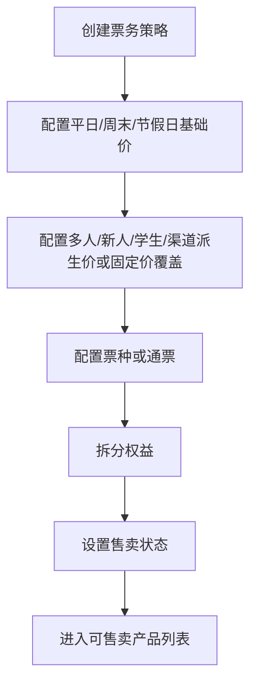
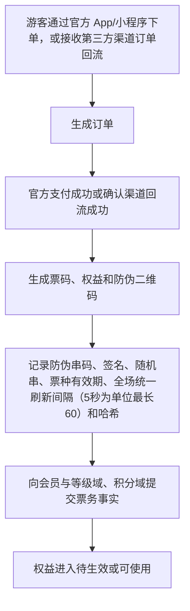
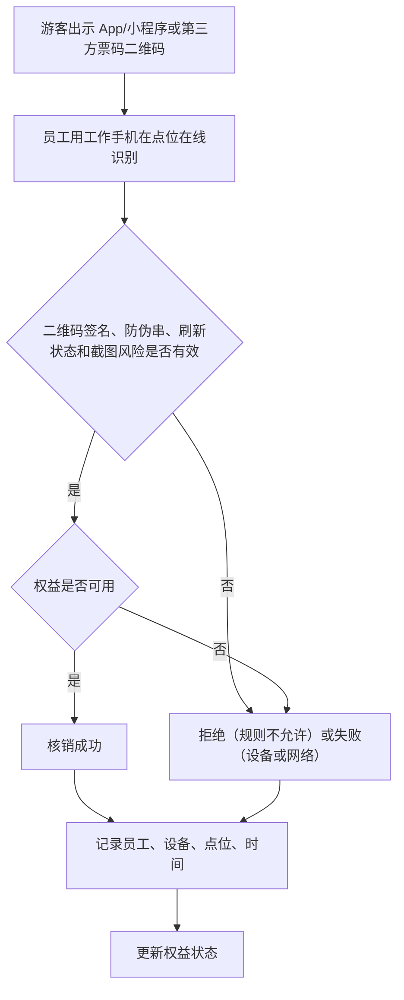
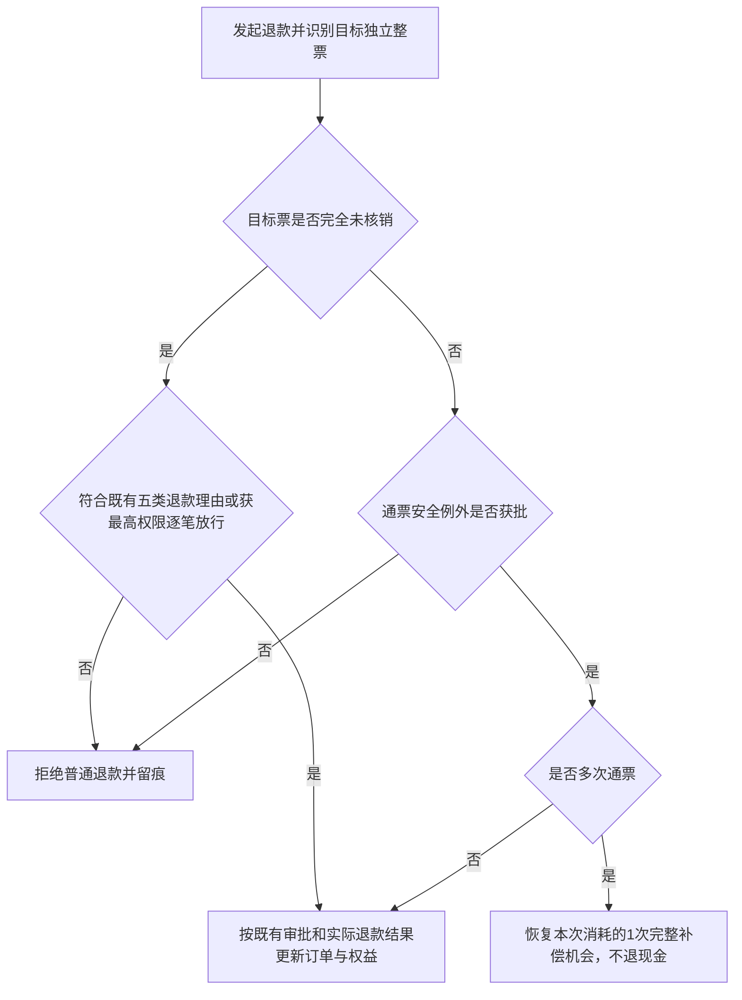
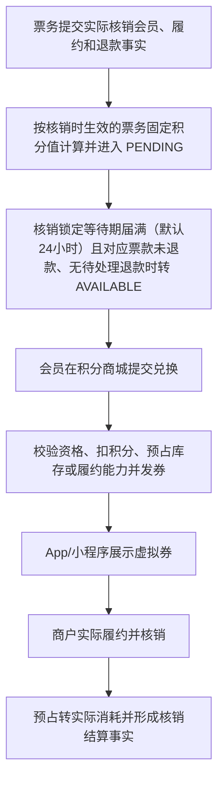

# 票务/通票/权益/核销产品 PRD V0.23

> 权限边界：本 PRD 只提供产品细化；三份业务 HTML 拥有最终业务解释权。其他文档、配置、代码和数据结构均不得覆盖 HTML。可追溯为 HTML 规则细化的内容留在开发文档、不写入 HTML；真正新增且无法追溯为细化的业务规则，须由 James 逐项裁决，未判前不删、不写 HTML。

## 1. 文档定位

本文档按业务经营动作拆解票务、通票、权益和核销能力。它回答“卖什么、卖给谁、包含什么权益、在哪里使用、使用后怎么留痕、退款和异常怎么处理”。

本文档不写技术实现，不定义数据库和接口。第三方售票平台、支付平台或渠道平台如需接入，本阶段只保留产品层面的渠道和回流口径。

**票务管理可拆分为可独立部署的系统（2026-08-05 R7 补，依据 DIFF-B-015；BSM「支持票务管理、酒吧管理、游乐设施管理拆分为可独立部署的系统」条原文）**：票务管理与酒吧管理、游乐设施管理一样，**支持拆分为可独立部署的系统**。**拆出去单独运营时各自独立、互不相关、不依赖基础系统**；**在综合体内则统一接入基础平台，按归属、合同和权限管理**。因此本 PRD 的票务能力**不得对基础平台形成不可拆的强依赖**，跨域协作一律走已定义的域间口径。

## 2. P0 目标

P0 票务目标是建立最小可运营闭环：
- 能配置不同票种和票务策略。
- 能把一个售卖产品拆成一个或多个权益。
- 能记录游客通过官方 App/小程序同步购买，或通过美团、大众点评、抖音团购渠道购买后的订单、票和权益。
- 能在现场按点位、员工、设备完成核销或拒绝。
- 能处理退款、撤销和异常补录（系统不提供人工放行，见 §7.4）。
- 能为酒吧赠饮、游乐核销、餐饮零售券核销预留权益关系。
- 能向会员与等级域、积分域提交订单、支付、履约、退款、冲正和核销事实，由两域按票务各自规则计算成长值和积分。

业务边界：
- 门票主路径由客人本人通过官方 App/小程序或第三方渠道购买；少量到店服务场景允许授权服务人员在售票型一体机上辅助下单并完整留痕。
- 酒吧门口或前台的售票型一体机只能售卖该酒吧单店门票，不得售卖综合体通票。
- **实现现状（2026-10-22 第十三批 ROOT-03 B 段 B-account，V540）**：一体机辅助购票必录客人手机号并当场短信核验——授权服务人员（`ticket.order.create`）经 `POST /api/v1/ticketing/kiosk-bind-codes` 给客人手机号发绑定验证码，下单（`sales_channel=kiosk`）带 `buyer_phone` 与 `sms_code`，缺失 400、验证码不对 401 `CUSTOMER_OTP_INVALID`，核验在扣库存之前（BSM「客人用手机号短信验证绑定，在官方 App/小程序查看门票」）；该手机号已注册会员的订单直接归本人，未注册的注册成功时按手机号归集。第三方渠道回流订单的购票手机号已是会员的直接归本人。短信供应商未接入时 prod 发码如实 409，不假成功。
- **单店门票的自助购买渠道（2026-08-07 补，依据 BSM「门票主路径是客人通过官方 App/小程序或第三方平台自助购买」条；REGX-01）**：**单个酒吧的单店门票允许客人在自己手机上的综合体官方小程序或 App 自助购买**。本条只承接售卖渠道口径，不改变单店门票的收款主体与收入归属（见 `settlement-rebuild-prd-v1.0.md` §4），也不放宽下一条「工作人员平板 App 不允许代客购买门票」的红线。
- 工作人员平板 App 不允许代客购买门票，不允许生成门票或游乐权益。
- 第三方渠道 P0 首批覆盖美团、大众点评、抖音，当前只做团购购票、订单回流、票码/券码核销和对账。

## 3. 角色

| 角色 | 关注重点 |
|---|---|
| 票务运营 | 票种、价格、规则、渠道、售卖状态 |
| 现场员工 | 快速识别游客资格，核销或拒绝 |
| 财务 | 订单、退款、核销和对账 |
| 酒吧运营 | 票务中赠送的酒水权益是否可用、是否已核销 |
| 游乐运营 | 游乐项目权益是否可用、容量是否允许 |
| 管理层 | 售票收入、核销率、客流和异常 |
| 会员运营 | 积分规则、会员等级、积分兑换和消费激励 |

## 4. P0 业务对象

| 对象 | 定义 | 关键关系 |
|---|---|---|
| 票务策略 | 决定票价、日期、人群、渠道、优惠和限制的规则 | 关联票种、渠道、有效期、权益 |
| 票种 | 被售卖的门票类型 | 平日票、周末票、节假日票、成人票、学生票、多人票、新人票、一人多次票、通票；派对票与活动票等价；包括单日票、夜场票；赠票作为票务产品类型 |
| 通票 | 一个销售包装，包含多个权益 | 支持酒吧通票、游乐通票、酒吧 + 游乐通票、含餐饮/零售优惠折扣的组合通票 |
| 权益 | 游客实际可使用的权利单位 | 关联游客、订单、核销记录、退款 |
| 销售渠道 | 票从哪里卖出，如官方 App/小程序、美团、大众点评、抖音等第三方平台 | 关联订单、价格策略、优惠规则 |
| 订单 | 售票交易结果 | 关联游客、票、支付、退款、权益 |
| 票码/权益码 | 游客用于现场识别的凭证 | 关联订单、权益、防伪串码、二维码签名、票种有效期、全场统一刷新间隔（5 秒为单位、最长 60 秒、默认 15）和核对记录 |
| 会员身份与等级（引用对象） | 全国唯一会员身份、成长值和等级状态，完整定义不在票务域 | 关联游客与订单；产品细化见 `member-and-tier-product-prd-v1.0.md` |
| 积分账户与流水（引用对象） | 待确认、可用、已使用、取消、过期积分及对应规则版本，票务域不自行计算 | 关联消费、履约、退款事实；产品细化见 `points-and-voucher-product-prd-v1.0.md` |
| 积分兑换订单与虚拟券（引用对象） | 积分商城兑换形成的订单及后续商品提取或服务履约资格 | 关联兑换 SKU、预占、核销和结算；产品细化见 `points-and-voucher-product-prd-v1.0.md` |
| 核销点位 | 现场执行核销的位置 | 关联空间、员工、设备和业务 |
| 核销记录 | 权益被使用、拒绝或撤销的事实 | 关联权益、员工、设备、点位、时间 |
| 退款记录 | 票或权益退款的经营记录 | 关联订单、权益、核销状态、财务 |
| 异常记录 | 现场核销失败、争议、重复使用等问题 | 关联核销记录和补录 |

> **实现待对齐登记（E-25，2026-08-04）**：二维码刷新间隔的业务口径为「全场统一、5 秒为单位、最长 60 秒、默认 15」（本 PRD §2/§10；配置端点 `openapi-p0.yaml` `refresh_interval_seconds` 已按 `minimum:5 / maximum:60`）。但 **OpenAPI 的 `TicketTypeRequest.refresh_interval_seconds` 仍是票种级 `enum [10, 15, 30, 60]`**，既未跟上 V320 的全场统一口径，也不覆盖 5/20/25 等合法取值——属**契约滞后的待改造缺口**，实现证据不得反向定义业务规则。

## 5. 票务策略

P0 必须支持的策略类型：

| 策略 | 示例 | P0 处理方式 |
|---|---|---|
| 日期价格策略 | 平日价、周末价、节假日价 | 最高优先级基础价格，按适用日期、场次和票种判断是否可售、可用 |
| 人群策略 | 学生票、成人票 | 记录适用人群和现场核验要求；学生票 P0 人工审核（证件 + 学信网），凭证留痕。 |
| 多人策略 | 双人票、团队票 | 记录可使用人数（`num_people`）和核销次数；P0 必须在同一场次内核销，同场次内可分别入场、不要求同一时刻一起核销。 |
| 新人策略 | 从未注册或首次购买用户优惠 | P0 以手机号为准、注册须短信验证，同号未享受过即判新人，系统自动判定 |
| 派生价格策略 | 多人票、新人票、学生票、渠道价 | 默认基于对应平日/周末/节假日基础价计算，可按折扣、减免、加价或固定金额生成 |
| 渠道策略 | 官方 App/小程序、美团、大众点评、抖音等 | 记录渠道、价格、核销和对账口径；渠道价可从基础价派生或固定价覆盖 |
| 固定价格覆盖 | 运营直接输入固定票价 | 覆盖自动计算价时必须记录来源、审批人、版本、生效期和订单快照 |
| 组合策略 | 门票 + 游乐 + 酒水赠送 | 拆成多个权益，分别核销 |
| 积分与成长值策略 | 票务积分与票务成长值分别计算 | P0 按票种或票务产品分别配置、审批和版本化；不得读取商户业态积分规则，也不得在两套规则间回落猜算 |

> 基础价模式取值口径（2026-07-28 收口）：日期价格策略只有「平日 / 周末 / 节假日三类基础价」这一种模式，对应机读取值固定为 `weekday_weekend_holiday`（票种字段 `base_calendar_price_mode`）。后台建票、接口契约、后端校验三处必须一致，后端按白名单拒绝其余取值。注意与派生价规则的 `price_mode`（`derive_from_calendar_price` / `fixed_price`）是两个不同字段，不可混用。

购票渠道边界：

| 渠道 | P0 处理方式 |
|---|---|
| 官方 App/小程序 | 同步建设，客人自助购票、支付、查询订单、展示二维码 |
| 美团/大众点评/抖音等第三方 | P0 只接团购购票，回流渠道订单、票码、支付/退款结果、核销状态 |
| 工作人员平板 App | 不允许售卖门票，只允许酒吧点酒下单 |

**票种发布上架闸（P0，2026-08-04 补；依据 ENUM「通票赠酒下限」条、ENUM「收费与免费权益结算」条）**：票种建成后固定为草稿，须经发布闸方可上架。下列任一条不满足的，**发布闸一律拒绝上架**，不得以「先上架后补」方式绕过：

1. 通票（酒吧通票或跨域组合通票）覆盖的**任一家酒吧**，赠酒杯数**低于后台配置的最低赠酒杯数**（业务参数，按票种可配，出厂默认 1 杯）；
2. 票面**未写明**该通票覆盖的各家酒吧分别赠几杯；
3. 票内任一**零元免费权益未逐项标注出资方**（详见 §6 权益拆分规则）。

### 5.1 资格规则 P0 口径（新人/学生/多人均 P0 落地）

> 修订说明（2026-06-07）：原 §5 新人策略写"P0 先保留规则定义和人工确认口径"、§11 把"多人拆分核销/复杂退款规则"列入 P1，与 §12 已确认第 8 条"系统自动判断"互相冲突。按《统一口径基准》D9（用户 2026-06-07 拍板）统一为：新人/学生/多人三类资格均 P0 落地，消除"自动/人工/P1"三处冲突。依据 finding ticket-1/2/3/4。

| 资格类型 | 判定主体 | 判定方式 | 凭证/留痕 | P级 |
|---|---|---|---|---|
| 新人优惠 | 手机号 | 系统自动判定：注册须登记手机号并短信验证；同一手机号未购买/未享受过即判新人，不符不可用 | 手机号、短信验证记录、历史订单 | P0 |
| 学生票 | 客户身份 | 人工审核：核验学生证件 + 学信网核验通过后方可购买/核销 | 学生凭证留痕（`verify_method`、`credential_ref`、`verified_by`、`result`、`verified_at`） | P0 |
| 多人票 | 票 | 必须在**同一场次**内核销（一个场次＝一次开门到关门）；同场次内不同人可在不同时间分别入场，**不要求同一时刻一起核销**；不能拆到不同场次或不同日期 | 核销记录放行人数（`verifiedPeople`）与场次约束 | P0 |

> **已裁决（原 E-13，2026-08-04 第三轮用户裁决 UD-08 / DEC-R6-11）**：**注销后重新注册默认不穿透历史**——新账户视为新人、可再享一次新人资格（与 ENUM「会员身份状态」条「新账户与原账户之间不建立任何关联」一致）。
> 反复套利以**异常预警**而非阻断注册的方式管控：**同一手机号一年内注销＋注册合计次数超过阈值触发异常预警**（业务参数、全平台统一可配、须同时配置上下限，**出厂默认一年内合计 3 次**）；预警**只作提示、不自动阻断注册**，汇入「异常预警页面」供风控岗查看处置，查看／转办／处置结论均留痕（页面承接见 `evidence-risk-control-product-prd-v0.1.md` 与 `business-dashboard-metrics-product-prd-v0.1.md`）。
> 实现改造列入排期：注销重注册计数与预警触发当前无承载（缺口登记见修复台账 §7.4）。

- 资格规则、人数、身份、渠道、时间等条件由后台规则定义；符合规则系统自动放行，不符合不允许使用（与 §12 已确认第 8/9 条一致）。
- 多人票的各个人次必须在**同一场次**内核销（一个场次＝一次开门到关门）：同场次内不同人可以在不同时间分别入场，系统**不要求同一时刻一起核销**；但不能拆到不同场次，也不能拆到不同日期。

### 5.1a 多次票 / 多次核销权益 P0 口径

> 补充定义(2026-07-04 用户):"多次票"能力代码早已落地(`issued_entitlements.total_times/used_times/remaining_times`,V006),此前散见于"多次权益/可用次数/游乐次数"表述,本节集中定义,与"多人票"并列区分。

- **定义**:一张票/权益含**多次核销额度**——`total_times>1`(一次票 `total_times=1`)。每核销一次 `used_times+1`、`remaining_times`(= total − used)递减;`remaining_times=0` 时权益置为「已使用」。
- **部分使用**:多次票可分次核销(用一部分、剩余仍可用),逐次核销留痕;权益台账可查剩余次数。
- **典型场景**:游乐次数票(玩 N 次、每玩扣一次)、游乐通玩(不限次)、多次入场票、酒吧场次内多次进出(见结算 PRD §5.4 核销记录状态与入场流程：同一场次内可持续进出、不重复消耗)。
- **与多人票区分**:多人票 = **同一张票含多个人次**(`num_people>1`,各人次须在同一场次内核销、同场次内可分别入场);多次票 = **多次核销**(`total_times>1`,可分次)。二者**可组合**:多人多次票 `total_times>1 且 num_people>1`。
- **退款原则**：门票售出原则上不退款，未到场、忘记使用或主动放弃不构成退款理由。可退情形穷举为五种：票种规则明确允许、活动或场次取消、平台或履约方无法提供服务、重复扣款、法律法规要求；「获授权特殊审批」不再作为退款理由。五种之外确需退款的，只能由持授权 U 盘密钥的最高权限逐笔放行，每次只对当前这一笔生效。已核销部分不得按未履约理由退款（唯一例外见 §8.4.1）。
- **P0 落地状态**:建表 total_times/used_times/remaining_times(V006)、核销 `atomicUseEntitlement` 逐次扣减、冲正回滚(V067)均已落;消耗窗口 `consumption_window`（per_use/per_session/per_day/unlimited_in_day）见 `settlement-rebuild-prd-v1.0.md` §6.2–§6.3。
- **实现现状（TK-06，2026-10-21，迁移 V525；依据 BSM「一人多次票/通票」条「购票人或被赠予人核销第一张起留存人脸，后续各次只允许同一人使用并以该人脸核对」、「采集证件、人脸、支付账号」条及 ENUM、PGM 同口径镜像句、台账 A-01、2026-10-21 操作员裁决第 1、2 条）**：
  - 购票、出票、柜台均不再采集人脸，不设「需要人脸照」的票种；单次票、多人票任何情况都不留人脸。
  - 一人多次票＝入场类权益（entry/admission）且父票一人（num_people=1）、多次（total_times>1）。人脸供应商可用时：该票尚未留存人脸的那次入场，客人须单独同意并现场拍照，不同意拒 `MULTI_USE_FACE_CONSENT_REQUIRED`、未拍照拒 `MULTI_USE_FACE_CAPTURE_REQUIRED`（均为「拒绝（规则不允许）」、不扣次，票仍未核销，可按现行未核销退款规则办理）；扣次成功后同事务落同意（主体为当前持有人——购票人或受赠人，版本 `multi_use_face_notice_v1`、时间与范围 `multi_use_ticket_face`）并加密绑定父票。已留存的票后续各次须拍照，由供应商比对，不是同一人拒 `MULTI_USE_HOLDER_MISMATCH`、不扣次。
  - 供应商不可用（开关关、未接入或当次故障）时不要求同意与拍照、不比对、照常核销；之后供应商可用且该票仍未留存人脸的，下一次入场按首次留脸处理。不做检票员目视核对。
  - 该票用完的那次核销同事务删除人脸；到期仍有剩余次数的由清理任务删除（同父票补偿补发的入场权益仍有效时顺延），不再「票失效后再留 N 天」。同意记录保留。
  - 注销与拉黑（2026-10-25 第十三批 C 段复核修复，V0.22 同版续记）：本人持有的未核销权益（含已开始使用的多次票剩余次数）一律作废、不退款，已用完的权益保持「已使用」、不改作废（ENUM「票/权益状态」中「已使用」「已作废」是两种状态）；一人多次票父票再无可用入场权益时人脸绑定随即删除。
  - 入口：核销预检返回 `face_binding`（capture / match，仅一人多次票且供应商可用时出现）；安卓检票终端据此显示同意勾选与拍照，核销请求带 `face_capture`、`face_consent_accepted`；后台「出票与核销追踪」页的核销预检只显示该提示（本页不提交核销）。留存人脸只供供应商比对，不提供取照查看接口（原 `GET /api/v1/ticketing/issued-entitlements/{entitlement_id}/face-photo` 已下线）。

### 5.2 实名规则配置 P0 口径（C7 合规）

> 修订说明（2026-06-10 总控收口）：实名规则仅作为国家法令强制场景的 P0 配置能力。除国家法令强制要求的票种/场次/场所外，普通门票、酒吧入场、游乐项目、团体/包场、活动票默认不强制实名；强制开关默认关闭，只有法令明确要求时才按场景启用。

实名规则由后台按维度配置。默认不强制实名；只有命中国家法令强制实名的票种/场次/场所时，购票/核销前才必须完成实名核验：

| 配置维度 | 说明 |
|---|---|
| 票种维度 | 按票种（如成人票/活动票/包场票）标记 `require_real_name`（是否强制实名） |
| 场次维度 | 按具体场次/活动场标记是否强制实名（大型活动场次可单独要求实名） |
| 场所维度 | 按场所/区域（如演出区、特定活动场地）标记是否强制实名 |

每条实名规则包含：

| 配置项 | 取值/说明 |
|---|---|
| `require_real_name` | 是否强制实名（true/false）；三个维度任一命中 true 即按强制实名处理（取严） |
| 核验方式（`real_name_verify_method`） | `id_card_ocr`（证件 OCR）、`id_card_manual`（人工核验证件）、`gov_auth`（公安实名接口/政务核验）、`phone_real_name`（手机号实名认证）；可单选或组合 |
| 失败处理（`real_name_fail_action`） | `block_purchase`（阻断购票）、`block_checkin`（阻断核销/入场）、`pending_manual`（转人工复核）、`allow_with_warn`（放行并预警，仅非强制场景） |
| 核验留痕 | 实名核验结果（成功/失败/待复核）、核验方式、核验时间、操作人/渠道写入留痕，敏感证件信息仅留不可逆哈希/凭证引用，不存原始明文（PIPL 数据最小化，须先取得单独同意，见客人端 PIPL 同意节点） |

P0 要求：

- 实名规则按票种/场次/场所配置；默认 `require_real_name=false`。仅国家法令强制要求时配置为 `true`，命中后购票或核销前必须先核验通过，失败按 `real_name_fail_action` 处理。
- 实名核验采集证件/人脸等敏感个人信息，必须先单独同意再采集，且仅持久化不可逆哈希/凭证引用（与 C2 PIPL 同意、C5 数据最小化一致）。
- 除国家法令强制要求的实名范围外，其它场景不强制实名，不得因运营便利扩大采集证件/人脸等敏感个人信息。

> 修订说明（2026-06-08 三轮收口）：上文"命中强制实名时购票/核销前必须先核验通过"的措辞已由真实校验节点支撑——校验节点已在开发设计 §5.0 购票资格流程与 §5.3 核销校验序列第 8 步接入（命中失败按 block_purchase/block_checkin/pending_manual），消除"有规则无触发"的 overclaim。依据 compliance-wired-1、合规 C7。

## 6. 权益拆分规则

一个票务产品售出后，可以生成一个或多个权益：

| 权益类型 | 使用场景 | 核销归属 |
|---|---|---|
| 入场权益 | 综合体或特定区域入场 | 入口核销点 |
| 游乐权益 | 指定项目、指定次数或指定场次 | 游乐项目核销点 |
| 酒水权益 | 赠送酒水、兑换券、酒吧权益 | 酒吧核销点 |
| 卡座预约入场名额 | 卡座预定者按卡座配置可携带的免通票入场人数 | **只授予所预定卡座对应的那一家酒吧的入场资格，不含任何赠酒或酒水权益**；持有人要进入其他酒吧，须另行购买该酒吧的门票或购买通票（依据 ENUM「权益类型」条）。不抵扣低消，不参与票务分账 |
| 餐饮权益 | 餐饮抵扣或优惠券；简餐套餐作为餐饮券或酒吧简餐权益。 | 第三方餐饮或平台核销记录 |
| 零售权益 | 零售抵扣或兑换券 | 第三方零售或平台核销记录 |
| 服务权益 | 机器人配送、导览 | 对应服务记录 |
| 礼物兑换权益 | 会员用积分兑换礼物或服务 | 触摸屏一体机或指定领取点 |

P0 要求：
- 权益必须有归属业务、有效期、可用次数、使用限制和状态。
- 权益核销后必须留下核销记录。
- 通票中的不同权益可以不同步使用。
- 已退款、已过期、已使用、已作废的权益不能再次使用。
- 门票到期生命周期（F-TXN-03）：**【H-24，2026-08-06】本条只适用于从未完成检票环节的票或人份**；已完成检票环节、但权益未在该场次内核销的，按场次终结制作为未核销份额进入分账减除，不走本条。**多人票中本人从未刷码的人份**，因各人须在同一场次内完成入场，同票已开启的那个场次一经结束即永无法入场，**于该场次结束时即按本条处理，不等票面有效期届满**；该人份票款按 ENUM「域归属对照」条逐域归属，与本条其余情形**同一立项、不另立名目**。实现口径：未核销款结算须以**人份（持有人维度）**为最小记账单位，触发挂在**场次结束事件**上，不能只挂有效期到期的定时作业。未实际核销的票到期后置为「已过期」，不自动退款、不产生提供商户核销结算，也不得配置成已核销；到期未核销款的财务处理另行留痕，不增设票/权益业务状态。未使用而到期作废且不退款的票或人份不发积分，积分发行成本为零；仅扣实际发生的通路费与适用的销售渠道费，各只扣一次，余额归对应域主管公司，不分给履约商户；酒吧相关归娱乐平台公司、纯游乐归游乐公司、演出归传媒公司、餐饮与零售归城市项目公司，跨域组合通票按既定域份额归属。`refundable` 仅表示客人可申请整票退款，不改变到期处理。**当前实现缺口**：现行 `JdbcTicketingRepository.forfeitEntitlement` 仍把到期未用权益写为技术值 `forfeited`，未映射为本节唯一业务态「已过期」；该实现不得反向新增第七个业务状态。
- 通票组合 P0 允许酒吧通票、游乐通票、酒吧 + 游乐通票，以及含餐饮/零售优惠折扣的组合通票；餐饮/零售只作为第三方优惠、折扣、券或权益进入平台。
- **通票赠酒下限（2026-08-04 补；依据 ENUM「通票赠酒下限」条、ENUM「收费与免费权益结算」条）**：
  - 一张酒吧通票或跨域组合通票覆盖的**每一家酒吧**，赠酒杯数**不得低于后台配置的最低赠酒杯数**（业务参数，按票种可配，**出厂默认 1 杯**，须同时配置上下限）。
  - 各家酒吧分别赠几杯，**必须在售票时写明票面**；**低于该下限的票种不得发布上架**（发布闸见 §5）。
  - 该最低赠酒杯数属**票面强制要求提供**的权益，**一律记为域主管公司出资**，核销后**按锁定的内部结算价**结算给该酒吧，不记为商户让利。
  - A 酒吧的赠酒**只能在 A 酒吧核销**，不得跨店占用（与 §8.3「核销顺序」的「一家一份、互不占用」一致）。
- **零元免费权益的出资方标注**：每一项零元免费权益在票种发布前必须**逐项标注出资方并锁定版本**——域主管公司在票面强制要求提供的记为域主管公司出资、核销后按锁定内部结算价结算；只有商户主动申请并**书面确认让利**的才记为商户让利、不结算。**未标注出资方的免费权益不得发布上架**；未核销不结算。

### 6.1 餐饮/零售第三方权益履约口径

餐饮和零售一定由第三方系统承接，平台在通票中只管理优惠资格、折扣或券权益，不自研餐饮/零售 POS。为避免“优惠折扣”和“券核销”混用，P0/P1 按以下两类定义：

| 权益履约类型 | 含义 | 是否需要第三方逐张核销回传 | 平台记录口径 |
|---|---|---|---|
| 折扣型权益（discount） | 客人在第三方餐饮/零售消费时享受折扣、满减或优惠资格 | **否**——但这不等于「平台不核销」：**核销在平台系统内完成、由平台生成核销记录**；商户只需在自身收银系统内录入折扣率或扣减对应金额即可，**不需要第三方系统向平台逐张回传** | 记录**平台侧核销记录**、适用商户/业态、优惠规则、折扣额或折扣说明 |
| 券核销型权益（voucher） | 客人持券到第三方餐饮/零售消费，第三方 POS 或平台核销点确认使用 | 是，P1 接第三方券核销级回流；未接入前可人工补录并复核 | 记录券码、核销时间、核销商户、核销金额、第三方核销单号和差异状态 |

> **口径更正（2026-08-04，依据 ENUM「餐饮/零售券两种用法」条）**：旧版把折扣型权益写成「不生成平台核销成功记录、待第三方订单回流后对账」，**方向写反了**。折扣型权益的核销**发生在平台系统内**，平台是核销记录的产生方；商户侧只做收银折扣录入，不承担逐张回传义务。只有**券核销型**才需要第三方逐张回传。

折扣型权益按收费与免费两类分别处理，**不另立规则**（ENUM「餐饮/零售券两种用法」条、ENUM「收费与免费权益结算」条）：

| 折扣券类别 | 定价与分配 | 结算 |
|---|---|---|
| **收费型折扣券** | **带价格，计入业态价格并参与通票池分配** | 平台按分账比例向商户付款 |
| **免费型折扣券**（零元免费权益） | 不带价格、不参与域间分配 | **须逐项标注出资方并锁定版本**：域主管公司在票面强制要求提供的记为域主管公司出资、核销后按锁定内部结算价结算；商户主动申请并书面确认让利的记为商户让利、不结算。**未标注出资方的免费权益不得发布上架**（见 §5 发布上架闸） |

P0 先保证通票可配置餐饮/零售优惠或券权益，并能在权益台账中区分 `discount` 与 `voucher`、区分收费型与免费型；真实餐饮/零售**订单级**回流与**券核销级**回流的对账闭环按第三方接入层统一排到 P1。

## 7. 状态模型

### 7.1 票务策略状态

| 状态 | 含义 |
|---|---|
| 草稿 | 规则未发布 |
| 待启用 | 规则已配置但未到生效时间 |
| 售卖中 | 当前可售卖 |
| 暂停售卖 | 临时停止售卖 |
| 已结束 | 售卖周期结束 |
| 归档 | 历史策略 |

> 枚举权威（2026-06-24 对齐；2026-08-04 补全）：本节状态值以业务枚举速查表 `business-enum-quick-reference-v0.1.html` §一（票务与权益）为最终口径，PRD 仅补充"含义"。下文 §7.2/§7.3/§7.4/§7.6 已对齐速查表。
>
> **有效期类型五值（ENUM「有效期类型」条，2026-08-04 补全；旧版只写三值，漏「按自然月」「按场次」）**：
>
> | 有效期类型 | 含义 |
> |---|---|
> | 永久 | 不设失效时间 |
> | 固定天数 | 自出票或生效之日起 N 天内有效 |
> | 按自然月 | 按自然月边界计算有效期 |
> | 按自然年 | 按自然年边界计算有效期 |
> | 按场次 | **一个场次＝一次开门到关门**。完成检票环节（刷码核销成功）后该票即绑定至当前场次，**不得再用于开启另一个场次**；同一场次内可以不限次数进出（重复进出仍须依次通过安检、年龄核验、检票三道环节，但**不再重复扣减票面入场次数**）。**场次终结制**：该票所含各项权益只能在完成检票环节所在的那一个场次内核销，**场次结束时仍未核销的权益即行终结**，不得顺延至下一场次、不得折现，按分账规则作为未核销份额处理并按 ENUM「域归属对照」条归属。**一人多次票与多次通票的剩余入场次数跨场次保留**至用尽或票面有效期届满，前后场次之间不得挪用权益（原写「过场即作废」**已废止**——作废的是本场未核销的权益，不是整张票的剩余次数）。**跨夜场次以该场次的实际闭店时间为准，不按自然日切分**（BSM「核销单位」条；与 §8.3.1 场次内进出口径一致） |
>
> 有效期按日票、周票、月票、年票等票种规则配置；票务二维码按日票、周票、月票、年票等票种设置有效期。
>
> **实现待对齐登记（E-36，2026-08-04；2026-08-30 James 裁决收口）**：本节「票务策略状态」是**票务策略（`ticket_price_rules`）**对象的 6 态（草稿/待启用/售卖中/暂停售卖/已结束/归档）；而 **`ticket_types`（票种）**在契约侧只有 4 态——`openapi-p0.yaml` `TicketTypeRequest.status` `enum [draft, active, paused, archived]`。**两者是不同业务对象、不是同一套状态机**，不得互相映射或覆盖；实现缺口只在于 `ticket_price_rules.status` 尚未完整承载策略六态，不给 `ticket_types` 追加「待启用/已结束」。

### 7.2 订单状态

> **下单与支付双时点（2026-08-07 补，依据 BSM「核销、退款与有效期规则·下单与支付时间」条；REGX-04）**：**每一笔购票订单都分别记录两个时间**——**下单时间**是客人提交这笔订单的时刻，**支付时间**是这笔钱支付成功的时刻。**两个时间各记各的，不能拿下单时间当支付时间用**；**还没付钱的，支付时间就空着**。这两个时间用于**对账、时效统计和全链追溯**。

| 状态 | 含义 |
|---|---|
| 待支付 | 已创建未支付 |
| 已支付 | 支付成功，待生成或已生成权益 |
| 已出票 | 权益/票码已生成 |
| 部分核销 | 部分权益已核销 |
| 已完成 | 全部权益已核销或已结束 |
| 退款中 | 退款申请处理中 |
| 部分退款 | 多张独立门票订单中，符合退款资格的部分完整票实例已退款；其他独立票可已核销，不表示单张票内拆人份或次数退款 |
| 已全退 | 整单退款 |
| 已取消 | 支付前取消 |
| 已关闭 | 超过支付时限系统自动关闭，无人工干预；支付时限为业务参数、全平台统一可配，出厂默认 5 分钟，上下限出厂为 1 至 30 分钟 |
| 异常 | 支付、渠道或权益生成存在问题 |

**派生视图声明（2026-08-04 补；依据 ENUM「订单状态」条）**：上表 11 个订单状态是**对客经营展示口径**，**不是一列独立的持久化枚举**。它是订单上 **`pay_status`（支付维）× `issue_status`（出票维）× `status`（生命周期维）三个正交列**的**派生视图**，其中「部分核销 / 已完成 / 退款中 / 部分退款 / 已全退」还需叠加**权益核销事实**与**退款单事实**（§7.6）共同判定。合法组合矩阵如下，**矩阵之外的组合一律非法**：

| 展示态 | `pay_status` | `issue_status` | `status`（生命周期） | 附加事实条件 |
|---|---|---|---|---|
| 待支付 | unpaid | not_issued | created | 未超过支付时限 |
| 已支付 | paid | not_issued / issuing | created | 权益尚未全部生成 |
| 已出票 | paid | issued | created | 无核销事实、无退款单 |
| 部分核销 | paid | issued | created | 部分权益已核销，且仍有可用权益 |
| 已完成 | paid | issued | created | 全部权益已核销，或权益已到期结束 |
| 退款中 | paid | issued / not_issued | created | 存在处于「已申请/审批中/已通过/处理中」的退款单 |
| 部分退款 | paid | issued | created | 存在「成功」退款单且累计退款额 < 订单金额；只表示多张独立门票订单中退了符合资格的部分**完整票实例**，不要求同订单其他票完全未核销，不表示单张票内退部分权益或金额 |
| 已全退 | paid | issued / not_issued | created | 「成功」退款额 = 订单金额 |
| 已取消 | unpaid | not_issued | cancelled | 支付前由客人或商户**主动撤单** |
| 已关闭 | unpaid | not_issued | cancelled | **超过支付时限系统自动关闭**，无人工干预；支付时限全平台统一可配，出厂默认 5 分钟，上下限出厂为 1 至 30 分钟 |
| 异常 | 任意 | 任意 | 任意 | 三列或叠加事实互相矛盾（如 paid + not_issued 且已超出出票时限、渠道回流与本地不一致、权益生成失败） |

> **实现缺口登记（不得反向定义业务规则，2026-08-04）**：
> - `ticket_orders` 建表（`V009__p0_ticketing_customer_orders_credentials.sql`）只对 `quantity`、`amount_cent`、`currency` 加 CHECK，**`pay_status` 与 `issue_status` 均为无约束的 `VARCHAR(32)`**；`V253__status_check_constraints.sql` 只加了 `chk_ticket_orders_status CHECK (status IN ('created','cancelled'))`，并在注释中明确「pay_status / issue_status 是独立列，不并入本约束」。
> - 后果一：**非法组合可被写入**（例如 `unpaid + issued`、`paid + not_issued + cancelled`），库层无法拦截，上表矩阵目前**只靠应用层自律**。
> - 后果二：`status` 生产枚举只有 `created / cancelled` 两值，**「已取消」（主动撤单）与「已关闭」（超时自动关闭）在库内不可区分**，无法据库还原对客展示态。
> - 上述两项均属**待改造缺口**：应补 `pay_status` / `issue_status` 的取值 CHECK、补跨列组合校验，并区分主动撤单与超时关闭。实现现状不得反向定义本节业务口径。
> - **支付时限实现缺口**：现行 `TicketOrderExpiryJob` 的 `ticket.order.expiry.unpaid-timeout-minutes` 缺省值仍为 30 分钟，生产配置未覆盖为 HTML 规定的出厂默认 5 分钟，也未承载 1 至 30 分钟的配置边界校验；须按本节业务口径修复，现行 30 分钟不得反向定义规则。

### 7.3 票/权益状态

| 状态 | 含义 |
|---|---|
| 未使用 | 权益尚未核销（含未到使用时间、当前可用） |
| 部分使用 | 多次权益已使用一部分 |
| 已使用 | 权益已核销完 |
| 已过期 | 超过有效期 |
| 已退款 | 权益对应金额已退款 |
| 已作废 | 风控或争议作废；到期只进入「已过期」 |

### 7.4 核销记录状态

> **现行口径（本轮按 ENUM「核销记录状态」同步）**：核销记录只保留成功／拒绝／失败／已冲正／异常五态，不设「预检通过」或独立「待复核」态；历史六态表述由本节替代，历史变更日志保留。
> **综合体入场由三道环节依次分开完成，不是一次性完成：安检环节（X 光查验）→ 年龄核验环节（人脸扫描确认满 18 周岁）→ 检票环节（二维码刷票并核销）。三道环节须逐道通过，前一道未通过的不得进入下一道；前两道环节不产生票务核销记录，核销记录状态只适用于检票环节。检票环节内部为一次动作：扫码即核销，不设先预检、后确认的两次操作，也不设「预检通过」中间态。**

- 安检环节设备（X 光）尚未安装或发生故障时，由现场人员以人工开包、目视方式查验，查验标准与设备安检一致；安检环节不产生按人记录，只记录设备状态、故障事件与维修工单。

| 状态 | 含义 |
|---|---|
| 成功 | 权益被正常使用 |
| 拒绝（规则不允许） | 不满足规则，系统拒绝放行 |
| 失败（设备或网络） | 设备或网络原因导致核销未完成 |
| 已冲正 | 原核销被冲正撤销 |
| 异常 | 平台已记录成功并扣次数，但现场未放行或实际权益交付有争议，需要主管核实；保留原成功与扣次事实 |

- **系统不提供人工放行**：核销要么成功、要么拒绝或失败；任何岗位、任何权限都不能以人工方式让一笔不满足规则的核销通过。

> **既有实现记录（CG-05，2026-10-17，迁移 V449）**：库 CHECK 收口为 `success / rejected / failed / reversed / anomaly`（`manual_overridden` 按 XM-M034-AB-001 仅历史行保留，任何核销链不再写入）。CG-05记录了规则拒绝与技术失败的分类、终端同步及在线签名/刷新窗口失败路径；这些记录不授权离线核销、预检或人工放行，也不把入口鉴权拒绝等同于某张票的核销异常。**本轮已明确的业务进入条件**是成功扣次后未放行或实际交付争议需要主管核实；普通规则拒绝仍用 rejected，明确设备或网络失败仍用 failed，不能把三者混成 anomaly。本轮只同步规则，相关入口、主管处置与日结联动仍须按实际实现验证，不宣称代码已齐备。

**异常复核与出口**：复核是异常的处置过程，不新增「待复核」核销状态；原六态表述中的独立待复核态及其专属时限不再作为当前开发依据。

- 主管按 ENUM「异常状态的统一出口」选择更正后恢复或作废并冲正，填写原因并留痕；异常未处理完，所属日结不得确认锁定。
- 主管核实后的冲正、恢复次数或补偿按既有规则办理；保留原成功记录及相关事实，进入异常本身不撤销成功、不补发权益、不自动退款。
- 复核与超时跟进沿既有适用规则办理，不以超时自动通过、自动作废或恢复人工放行。

> **实施边界**：预检、人工放行和离线核销仍受现行 HTML 禁止规则约束；旧 V067 状态说明不得推翻 V449 已登记的五态闭集。本轮未检查或修改相关代码，接口下线、留痕及本次异常进入条件须另行实施验证。

> **实现现状（TK-14，2026-10-21，迁移 V524）**：后台「出票与核销追踪」页的核销记录表对成功记录提起异常复核（`POST /api/v1/ticketing/verifications/{id}/anomaly`，权限 `verification.execute`，原因必填）：新增一条 `anomaly` 记录指向原成功记录，原成功记录与扣次不动，不发积分、结算、退款事件；拒绝、失败、已冲正记录不能提起，同一原记录同时只有一条待处置异常。主管（新权限 `ticket.verify.anomaly.resolve`，高风险，授予已持冲正权限的角色与模板）经 `POST /api/v1/ticketing/verification-anomalies/{id}/resolve` 二选一：`restored` 更正后恢复（只写处置留痕，原成功记录不变）或 `voided_reversed` 作废并冲正（先对原核销记录过与直接冲正相同的合同准入闸 `ticketing.verification_reverse`，商户生效合同经营范围不含票务时拦进复核 409 `ADMISSION_BLOCKED`；通过后同事务走既有核销冲正、恢复次数）；处置人、时间、原因写在异常记录上，两种处置都不退款。异常待处置期间普通冲正拒 `VERIFICATION_ANOMALY_OPEN`；原核销落在该营业日的待处置异常存在时，日结锁定拒 `DAY_CLOSE_ANOMALY_PENDING`（见财务 PRD §5.1）。

### 7.5 会员积分状态

本节只列票务页面需要识别的引用状态，完整状态机以 `points-and-voucher-product-prd-v1.0.md` §8 为准，票务域不得另建映射规则。

| 引用状态 | 票务侧含义 |
|---|---|
| `PENDING` | 对应人份/次份实际核销后计算积分，等待本次核销锁定期限届满（出厂默认24小时）及退款状态条件满足；待确认积分不可用，详见 §12A.1 |
| `AVAILABLE` | 本次核销锁定等待期已满，且对应票款未退款、无待处理退款申请，积分已确认可用；不以付款或购买时间起算 |
| `CONSUMED` | 积分已用于兑换 |
| `CANCELLED` | 退款、取消或纠错已撤销该笔积分 |
| `EXPIRED` | 超过账户活跃有效期，积分不可用 |

### 7.6 退款单状态（2026-08-04 新增，依据 ENUM「退款单状态」条）

退款单是与订单、权益并列的**独立单据**，有自己的状态机；此前 PRD 只在 §7.1 的注里提了一句枚举，未成表，故补齐。

| 状态 | 含义 |
|---|---|
| 已申请 | 退款申请已提交，等待受理 |
| 审批中 | 已进入审批流程，按金额与风险执行授权与复核（申请人不得审批自己的申请） |
| 已通过 | 已批准**并已发起不可逆兑付**；不可再撤回 |
| 已驳回 | 审批不通过，**终态** |
| 处理中 | 兑付通道处理中，结果未回 |
| 成功 | 资金已退回，**退款最终完成态** |
| 失败 | 兑付失败；须记录失败原因，可按原申请重试或另起单据 |
| 已取消 | 兑付发起前由申请方撤回或系统撤销 |

四条语义（必须同时成立）：

1. **只有「成功」计入已退金额**：「成功」是退款的最终完成态；「已通过」「处理中」等中间态**一律不得计入「已退金额」**，也不得据以冲减营业额、分账或积分。
2. **「已通过」＝已批准并已发起不可逆兑付**：一经「已通过」即不可逆，不得再退回「审批中」或「已申请」，如需终止只能按失败/差错流程另行处理。
3. **「已驳回」是终态、不再复议**：驳回后该退款单不得被重新激活，也不得在同一单据上改判。
4. **投诉不改变结论**：客人就驳回结果提出投诉的，**客户关怀部照常受理并纳入闭环**，但**处理结果仍为原驳回结论**，并须尽快告知客人；受理动作本身不得被理解为复议入口。

> 退款单状态与 §7.2 订单展示态的关系见 §7.2 派生视图矩阵：「退款中」对应存在「已申请/审批中/已通过/处理中」的退款单；「部分退款」「已全退」只按**「成功」**的退款单金额判定。

## 8. P0 业务流程

### 8.1 票务配置到售卖

- **购票前规则披露**：购票页面须以门票守则明确展示能否退款、有效期、年龄限制和可使用范围；与客人有关的规则必须在消费前告知。
  - **实现现状（2026-10-22 第十三批 ROOT-03 B 段 B-voucher-content，V541）**：客人端票种列表带门票守则字段（能否退、有效天数、可使用范围、所含权益名称、年龄限制）；未核销票到期提醒提前量按项目配置（`/api/v1/ticketing/expiry-reminder-policies/{project_id}`，读 `ticket.product.view`、改 `ticket.product.manage`，出厂 24 小时，值与上下限同配）。

### 8.2 购买到权益生成

- **支付与出票原子结果**：客人付款成功后必须出票，系统设计不得形成「付款成功但出票失败」的悬挂结果；确因出票失败的款项自动原路退回，支付渠道同时校验出票状态。 此一般出票要求不覆盖下文 §8.3.3 的全园故障停售规则：停售期间尚未受理的晚回流订单按该专条拒绝承接并核实原路退款，不以付款发生在故障前为例外；既已受理单的重复回调仍幂等。
  - **实现现状（2026-10-21 第十三批 ROOT-03 B 段）**：付款与出票同一事务——客人储值付足即自动出票，出票失败整笔回滚、余额不扣；在线付款经服务端向支付渠道查单成功才记已付，同一事务自动出票（与员工出票同一条出票逻辑，留痕 `ticket_order.auto_issued`／`ticket_order.auto_issue_failed`），出票失败时收款不回滚：已收各笔原路待退（储值笔回原卡、在线笔登记原路待退）、订单取消；订单已超时取消（不限全园故障）后才到账的一律登记原路待退，不再报错。一个订单可分多个渠道付（操作员原话「一个订单可分多个渠道支付，但最终必须完成一次支付才算完成」）：每笔须等于此刻待付金额，合计足额才置已付并出票，与待付金额不符的到账本笔原路待退；未付足超时取消的已收各笔原路退回。客人付完款没回前台的，由服务端结算作业每分钟向渠道查单入账出票，超时取消作业取消前也先查单。**复核修复（2026-10-22）**：客人重新发起付款时，同一订单尚未付款的旧在线付款单作废前先向渠道查单——渠道已收款的按同一确认内核到账出票、不再拉起新的一笔并返回那笔已成功的付款，渠道确认未付的才作废（不再出现已付旧单被作废后既不出票也不退款）。渠道资料到位前渠道开关保持关闭，在线确认一律不入账、不出票。

### 8.3 现场核销

- **年龄核验故障与误拒**：年龄核验设备未安装或故障时进入人工抽查，不得标记为已完成年龄核验；抽查期间未被拒入的视同通过，凭该时段设备不可用留痕豁免检票校验，设备恢复后自动恢复校验。人脸误拒经现场人工复核放行的，留复核时间、执行人员和放行结果，不保存证件信息、不留存客人身份记录；当场生成不含身份信息、核销即作废且不可复用的一次性放行凭据。学生票不等于成年，仍须满足 18 岁限制。

- **手环入场**：有手环则当前场次内允许入场；该规则不把 NFC 腕带改写为首次检票的票务凭证，首次完成检票环节仍按二维码刷票并核销。

**同一酒吧的核销顺序（2026-08-04 补；依据 ENUM「核销顺序」条）**：

- **不存在免核销入场的情形**：客人进入任何一家酒吧都必须核销入场——**不论入场资格来自邀请函（卡座免通票入场名额）、通票还是单张门票，一律须完成该店的入场核销**（依据 ENUM「权益类型」条）。
- 同一酒吧商户，客人**必须先核销这家酒吧的入场权益、再核销这家酒吧的酒水（赠饮）权益**；**不能跳过入场直接核酒水**。
- **未先核入场即核酒水的，一律拒绝**，按「拒绝（规则不允许）」记录并留痕，不进入待复核、不提供人工放行（见 §7.4）。
- **一家一份、互不占用**：一张通票覆盖几家酒吧，就为**每一家各发一份独立的入场权益与赠酒权益**；在 A 店核销入场**不影响**在 B、C 店另行核销各自的入场权益，A 店的赠酒也**只能在 A 店**核销。
- 核销顺序校验按酒吧商户维度独立判定，不按整张通票判定，也不因客人已在其他酒吧入场而放行。

#### 8.3.1 场次内进出与借票风控

- 完成检票环节后该票即**绑定至当前场次**（一个场次＝一次开门到关门），**不得再用于开启另一个场次**；在该场次内可以不限次数进出，重复进出仍须依次通过三道环节但不再重复扣减入场次数。
- **场次终结制**：票面附带的各项权益按完整一份配足、**仅限当场消耗**，场次结束即终结，不顺延、不折现，作为未核销份额按 ENUM「域归属对照」条归属（原写「过场即作废，第二场次不可再用」**已废止**）。**【H-24，2026-08-06】多人票中在该场次结束时仍从未完成检票环节的人份，不按本条的未核销份额处理**，而按 ENUM「到期未核销款」条于该场次结束时处理，**两者分别立项、不合并**。
- **一人多次票与多次通票**：每完成一次检票环节消耗一次入场次数并**开启一个独立场次窗口**；**剩余入场次数跨场次保留**至用尽或票面有效期届满，前后场次之间不得挪用权益（BSM「核销单位」条）。
- 对高频出入场的必须调看出入录像核查，以防止将票借给他人使用：一晚出入次数或连续两日出入合计次数达到后台配置的阈值即触发核查（**业务参数，按项目可配，出厂默认一晚 4 次、连续两日合计 7 次，须同时配置上下限**）。**【矛盾25，2026-08-06】其中「一晚」指一个营业日**（当日 10:00 至次日 10:00，起止时点沿用营业日配置），**「连续两日」指连续两个营业日**，均**不按自然日切分**。
- 由**系统自动预警**，**楼宇保安团队**据预警调阅录像；票务系统只提供出入次数事实与预警，不自行判定借票。
- 查实确系将票借给他人使用的：**关闭该客人账户、该账号作废，并将其列入黑名单不允许再进入**。关闭后该账户名下的储值本金退还本人，其余比照「账户注销」条处理（BSM「核销单位」）。
  > CG-06b 实现现状（2026-10-17）：平台拉黑客人账号（`POST /api/v1/customer-accounts/{customer_id}/blacklist`，即关闭账户）后，`CustomerService.blacklistCustomer` 同事务调用 `StoredValueService.closeGeneralCardsOnAccountClosure`：该客人名下每张综合体通用卡的未消费本金全额沿线上退款出账路径退还本人（退款打款登记到 `finance_refunds`，退款执行主体＝长沙项目公司），未使用赠送金作废留 `adjust` 流水，卡置 closed；商户级卡不动、由发卡商户按自设规则到店办理（柜台退卡路径保持可用）；重复拉黑不重复退。系统发起的退款不受客人黑名单闸拦截。

#### 8.3.2 门票检查/权益核验系统故障的营业兜底

- 大楼的门票检查或权益核验系统发生损坏、在**下一班次开始前仍未修复**的，进入营业兜底：**免票供所有人员进入**。
- 卡座与散台**不受影响**，因其另有下单记录。
- 兜底期间**通票客人的票不得兑换酒水权益**。
- 受影响的该时间或该场次按 BSM「核销单位」条的**大楼系统故障营业兜底补偿规则**办理；其原有权益、费用、有效期与留痕口径保持，不因下文游乐全园故障的新资格排除而改变。
  - 补偿在原票下关联受影响的人份或次份办理；未核销份额延期、已检票且本场次履约受影响份额的完整补偿，均以 BSM「核销单位」条为准，不再用「所有补偿只延期」覆盖原已核销完整补偿规则。
  - **补偿有效期是业务参数、按项目可配，出厂默认一年**（不得在规则或代码中写死一年）。
  - 补偿通票必须**关联原票、故障事件与发放原因**，防止重复补偿。
- 酒吧自身的部分设备损坏的，先寻找替代：由第三方供应商立即协助更换替代产品；属桌椅一类的从库房寻找替代；此类情形**不得出现超过一天仍未解决**的。

#### 8.3.3 游乐全园故障的票务处理

本批实施范围（TK-07、TK-08、TK-12）：V463 为新订单保存售票时的综合体快照 `projectId`，依据票种的商户／明确点位合法归属唯一确定；无候选时可取创建当时已验证的项目范围，不能覆盖多项目冲突。含游乐权益而仍无法唯一确定项目时，在扣库存及收款前阻止售票；支付、退款与核销沿用原快照，不随商户迁移或操作者变化。已有无快照数据不回填。客人选择综合体通用卡付款时，卡所属综合体须与订单原快照相同；不相同或订单归属未明均不得扣款，不能用当前操作者范围猜测。商户卡仍仅适用于原订单对应商户。客人页面同步筛选可用卡，任何储值卡均须通过下述停售检查。既有未付款订单在创建支付意向、储值扣款及后台未付款出票入口均重新校验停售。停售后才确认收到的款项保留收款事实、取消受理与释放预留库存，关联原付款形成财务原路待退；同一拒收单有多笔实际到账时，每笔原付款各自登记待退，故障解除后收到的后续款也不能遗漏。同一付款重复回调沿用原待退记录，不重复退款、不重复释放库存、不覆盖首次付款时间。渠道晚回流不出票，保留拒收结论和同一待退编号，解除故障后重复回流也不会重启该已拒收订单。已成功受理订单重复回调返回原结果。退款须核对原收款与实际执行凭证，由不同经办、复核人员办理，结果未明不记成功也不再次出款；来源综合体未明时保持待核实且不能执行退款。游乐相关核销在票务通用入口和游乐直接入口均被阻止，正常酒吧权益不受影响。补偿有效期配置在页面、服务与数据库均约束为 1～3650 天；其他补偿资格及逐份展示的缺口仍按实施台账单列。

- 全园故障由游乐公司负责人及工程或安全岗位共同确认生效与解除；生效期间停止纯游乐票及含游乐权益通票的新销售，同时只停止游乐相关核销，联合票中正常酒吧权益仍按原规则可用。
- 上述停售票种的待支付订单停止付款；停售期间新收到、尚未被平台成功受理的渠道回流订单，即使实际付款在故障生效前，也拒绝承接。核实已收款的按原支付路径退款，保存真实收退款凭证并持续跟踪至成功，不重复退款；此前已成功受理订单的重复回调返回原结果，不另建退款。
- 补偿按原票受影响人份或次份处理。故障解除后才完成本次原入场的，取消该事件下补偿资格；故障时有效未核票不保留该事件下的延期。故障时已原入场且履约受影响者，解除后使用获发补偿仍可，不属于取消对象。未核延期及延期后首次使用正常计分仅适用于仍符合资格者；不以本次排除自动作废正常原票、自动退款或追收已使用历史补偿。
- 仍符合资格的未核销份额只延长原核销权；已原入场受影响份额另补一次完整权益，酒水、礼品重新提供，原核销与结算不回改，不重复积分和成长值。补偿范围 1～3650 天、默认一年，自发放日起算；“我的票”按对应人份或次份显示补偿标注及实际有效期，不增加专用通知渠道。承担主体与实际履约时内部价沿 ENUM「全园故障与补偿通票」条。
- 本节新增资格排除仅用于游乐全园故障，不改变 §8.3.2 大楼故障兜底及多次通票安全事件恢复一次的既有规则。单个游乐项目实际清场后提前结束场次，也不终结整张综合体通票或正常酒吧权益；游乐营业日为每综合体统一一套。
- **既有实现记录（CG-08a/08b）**：CG-08a 已登记 `createTicketOrder` 对含游乐权益票种的停售闸；CG-08b 已登记 `issued_entitlements.compensation_item_id`、原票下完整补发、延长原权、补偿不重复计分及履约回写。旧对象快照、下单闸和原票展示不能证明本轮晚回流退款、原入场资格排除、权益级停核销及逐份补偿展示已实现；实施目标与验证依据分别见游乐 PRD §11B.3 和开发设计 §15A—C。
- **实现现状（TK-09、TK-10、TK-13，2026-10-21；依据 ENUM「全园故障与补偿通票」条、ENUM「有效期类型」条、BSM L862「「我的票」显示补偿标注及对应人份或次份的实际补偿有效期」、2026-10-21 操作员裁决补充第 3 条「没来的一律不延期」）**：全园故障补偿批次的对象快照只取故障时已入场核销且本场次履约受影响的人份（`full_reissue`）；故障期间没入场、持有效未核票的持票人一律不延期、原票照原有效期使用，原 `extend` 未核延期快照与发放（含原权益 `valid_to` 延长）已删除，批次不再有延期计数，审计与后台页（ADM-AMU-007）去掉延期计数与文案；场次提前结束（`session_early_end`）批次本就只有完整补发，不受影响。完整补发按票种每条权益绑定的票面份数各补一行，人数不展开（只补受影响这一人份、沿用原座次）；每行次数＝该绑定一个次份的次数——原票为多次票时按受影响原权益次数折算为单次份（如 3 次票各绑定次数 ÷3、至少 1），单次票取绑定全部次数。客人两条只读口（`GET /api/v1/customer/orders/{order_id}/tickets`、`GET /api/v1/customer/my-tickets`）每条票实例带 `compensation_kind`（`full_reissue`＝补偿补发行，其 `valid_to` 即该人份实际补偿有效期）；客人端「我的订单 / 我的票」按人份单列「补偿（第 N 人）· 补偿有效期至…」及出码按钮，补偿行不并入原票「剩余 x/y 次」；不新增通知渠道。

### 8.4 退款和撤销

> 修订说明（2026-06-07 收口）：调整小节顺序，使 §8.4 退款在前、§8.5 会员积分在后，编号与正文出现顺序一致。原文 §8.5 排在 §8.4 之前导致按编号检索定位错乱。依据 finding broken-ref-5。

> **现行退款单位（依据 ENUM「售票与退款原则」及 BSM「退款」条）**：普通退款只适用于完全未核销的**整张独立门票**，最高权限逐笔放行也不解除已开始核销后的普通退款禁止。同一订单买了多张独立门票时，符合既有理由的未使用整票可退，已核销的其他票不受影响，同一父订单可同时包含已核销票和已退款票；§7.2「部分退款」表示退了部分完整票实例。一张多人票不能按未使用人份拆退，一人多次票首次使用后的剩余次数不普通退款。核销或积分的人份、次份是计算单位，不因此成为独立退款单位。获准通票安全例外依 §8.4.1 分为多次通票恢复一次与其他非多次通票退款，不得混用。

> 修订说明（2026-06-07）：补退款粒度口径。按《统一口径基准》D9，P0 退款由客人侧按订单/票发起，系统内部按权益逐项冲正并做金额拆分；复杂退款规则引擎列 P1。依据 finding ticket-7。

#### 8.4.1 退款情形穷举与例外放行

- **可退情形穷举五种**：① 票种规则明确允许；② 活动或场次取消；③ 平台或履约方无法提供服务；④ 重复扣款；⑤ 法律法规要求。「获授权特殊审批」**不再作为退款理由**。
- **五种之外的放行**：确需在五种情形之外退款的，只能由持授权 U 盘密钥的最高权限逐笔放行，**每次只对当前这一笔生效**，不得作为常规通道或批量授权。
- **「票种规则明确允许退款」的开关口径**：该项在后台**出厂默认关闭**；要让某一个票种可以退款，必须**逐个票种单独开启**，每次开启都须经**高敏权限审批并留痕**，不得整批打开，也不得把原则与例外倒置。
- **通票安全例外**：客人出现重大情绪不稳定、安全问题或其他必要问题时，由**夜班值班经理及以上**批准，记录原因、批准人与当时情形。**多次通票不退现金，只恢复本次入场已消耗的1次使用机会**；此前正常使用的次数、其他未受影响剩余次数及其原有效期不变，原核销和恢复记录均保留。恢复机会关联原票、对应次份、原场次及事件，按 BSM「退款」条作为一次完整补偿，自发放日起使用补偿有效期，不受原场次或原票到期截断；再次使用提供完整权益并重新提供酒水、礼品，新增履约由决定恢复次数的域主管公司按实际补偿履约时生效价承担，原履约及结算不回改；不重复发积分或成长值，原积分及等待状态保持。同一事件对该次份只恢复一次，不得同时恢复原次数又另加补偿，不适用全园故障解除后才原入场的资格排除。**其他非多次通票**仍可批准免除其通票费用，即使已核销也可退款；普通退款单位及资格按上文执行。
- **已分账票的逐段冲回**：已完成分账的票发生退款时，按与结算**相反的顺序**逐段冲回——先冲回域内实际提供方已收份额，再冲回域间份额，最后处理第三方渠道费用；**门票退款以单张门票为单位，不存在一张门票的部分退款**。单一酒吧门票实际退款成功后，按 BSM「门票综合服务费」条重算原计费月总额并处理待收、补收或应退差额，不按退票逐张全额退服务费；酒吧通票及跨域组合通票中的酒吧部分仍按原不封顶逐票规则，所退票已计收服务费随票全额退回。已被第三方渠道扣走的渠道费用按原路追回。每一段冲回都生成一笔**反向结算记录**，不覆盖原归属、原计算与原结算记录。

- **混合支付退款实现现状（2026-10-21 第十三批 ROOT-03-R20）**：按 BSM「混合支付的退款按收款相反顺序逐笔原路退回」，退款审批生效时，本单之前已批准的退款先从最后收的一笔往前扣掉，本次退款接着往前分到各笔；分到储值笔的当场回原卡（先赠送金后本金），分到在线笔的按该笔渠道发打款待办、等财务确认拨付；只分到储值笔的退款单直接成功。**复核修复（2026-10-22，V542）**：分到在线笔、待财务打款的各笔（渠道×金额）落退款单 `payout_items`，退款列表随行返回；后台「出票与核销追踪」页确认拨付列表显示「待打款：渠道 金额；储值 金额 已回卡」，财务只按待打款明细打款，不按整笔金额重复打出已回卡的储值部分。

- **客人自助申请退票实现现状（2026-10-24 第十三批 ROOT-03 B 段，操作员裁决第十三批第 11 条「客人端自助申请」）**：客人端 `POST /api/v1/customer/ticket-refunds`（`{idempotency_key, ticket_instance_id}`）对本人名下（该票每个人份的持有人都是本人）、票种允许退款、整张未使用的票申请退票：理由固定为「票种规则明确允许」（`ticket_type_rule`），可退判定、金额与申请即冻结与员工发起同一条逻辑，发起人记客人编号；非本人 403 `CUSTOMER_ORDER_FORBIDDEN`，票种不可退、已开始核销、已在申请中、有在途转赠按员工退款既有错误码拒绝；同一幂等键重复提交返回同一申请（留痕 `customer.ticket_refund.requested`／`customer.ticket_refund.request_failed`）。申请进入后台「退款发起与审批」同一待审批列表，由员工批准或驳回；客人不填责任主体，批准时由审批员工补填——`POST /api/v1/ticketing/refunds/{refund_id}/approve` 请求体 `responsible_entity_id` 在退款单没有责任主体时必填（主体主数据中在用的法律主体，未填 400 `REFUND_RESPONSIBLE_ENTITY_REQUIRED`），已有责任主体的不改；批准后与员工发起的退款同样按收款相反顺序原路退回。客人查本人申请及状态 `GET /api/v1/customer/ticket-refunds`。客人 App／小程序页面在 C 段承接。
- **客人自助申请退票已撤回（2026-10-25 操作员更正，取代上条）**：操作员原话「即使注销，门票是不可以退的，除非碰上特殊安全情况」，第十三批第 11 条撤回——门票除通票安全例外不退，客人端不设退票入口。服务端已删除 `POST/GET /api/v1/customer/ticket-refunds`；退款批准 `POST /api/v1/ticketing/refunds/{refund_id}/approve` 恢复为通用状态变更请求体，不再补填责任主体（退款都由员工发起，发起时即填责任主体），后台「退款发起与审批」去掉补填栏。通票安全例外仍由夜班值班经理及以上批准、员工在后台办理；票种规则允许等五种情形的退款仍由员工在后台发起。客人注销时名下未核销的票一律作废、不退款（见 `docs/customer-app-miniapp-product-prd-v0.1.md` §3A）。

#### 8.4.2 退款留痕必记字段（2026-08-07 补，依据 BSM「退款授权与留痕」条；REGX-05）

BSM 现文：「系统完整记录退款原因、责任主体、发起人、审批人、适用规则版本、原路退回结果以及对应财务、积分、成长值和权益冲正。」逐项落为**必记字段**，**不新增 HTML 未写的字段**：

| 必记字段 | 口径 |
|---|---|
| 退款原因 | 本笔退款的事由（§8.4.1 可退情形五选一，或最高权限逐笔放行、非多次通票安全退款例外；多次通票安全恢复次数不建现金退款） |
| 责任主体 | 该笔退款的责任主体 |
| 发起人 | 发起本笔退款的人 |
| 审批人 | 批准本笔退款的人（申请人不得审批自己的申请） |
| 适用规则版本 | 判定本笔退款时所适用的规则版本 |
| 原路退回结果 | 原路退回的执行结果 |
| 对应冲正 | 对应的财务、积分、成长值和权益冲正 |

- **实现现状（TK-05，2026-10-21，迁移 V526；依据 BSM「退款」「退款原则」「退款授权与留痕」条、ENUM「售票与退款原则」「有效期类型」「全园故障与补偿通票」条、DEC-R7-20、DEC-R8-94-01、DEC-R4-2026-08-04-08、台账 §33 Q30B1/Q30B2、CG #42、2026-10-21 操作员裁决补充第 5 条「只退出事一人份」）**：
  - 普通退款（`POST /api/v1/ticketing/refunds`）理由类别 `reason_code` 必填且只收 `ticket_type_rule`（票种规则明确允许）/ `event_cancelled` / `service_unavailable` / `duplicate_charge` / `legal_requirement` / `master_override`（五种情形之外的最高权限逐笔放行），缺失或其他值 400 `REFUND_REASON_CODE_REQUIRED`；票种开关只约束 `ticket_type_rule`，其余理由不看开关；每笔退款（含 `ticket_type_rule`）都须填在用法律主体为责任主体 `responsible_entity_id`（否则 400 `REFUND_RESPONSIBLE_ENTITY_REQUIRED`）。所有理由仍只退完全未核销的整张票。`master_override` 不享额度内自助，审批人须为最高权限（否则 403 `MASTER_AUTHORITY_REQUIRED`）。退款单另记理由类别、责任主体与申请时票种开关快照（适用规则）。
  - 通票安全例外：`POST /api/v1/ticketing/safety-events` 登记到原票下出事客人那一人份（原因、当时情形、责任主体必填；只适用于通票，单一酒吧门票 409 `SAFETY_EXCEPTION_PASS_ONLY`），`POST /api/v1/ticketing/safety-events/{safety_event_id}/approve` 批准（申请人不得自批；批准人须为最高权限、本项目当前已发布排班的夜班值班经理，或组织层级中位于本项目夜班职责排班人（含顶班人、在职）之上的人员，否则 403 `NIGHT_DUTY_MANAGER_REQUIRED`；批准人及依据留痕），`GET /api/v1/ticketing/safety-events` 台账。登记、批准与台账的范围：挂商户的账号只办本商户受理的订单，不挂商户的项目员工（夜班值班经理、项目负责人等）按入口权限码可触及的项目办理（含客人自购、无受理商户的通票），平台与最高权限不限。
  - 非多次通票：批准即生成已批准退款单（`safety_exception`），金额＝该票出票分摊额按人数均分后该人份份额（尾差沿既有均分，前几人份多 1 分）；单人票整张退，多人票只退该人份——该人份未用权益冻结，已用权益与核销记录保留，父票与同票其他人份照常可用。之后照原路退回与确认拨付办理；退款成功只冲回该人份奖励（同票他人份的待确认奖励照常到期确认，不被该人份退款卡住），并对该人份已形成分账的核销逐段追加反向结算记录（见 `settlement-rebuild-prd-v1.0.md` §8）。
  - 多次通票：不退现金、不回改原核销与已用次数；批准即在原票下以安全事件补偿批次（`safety_restore`）补发完整票面一份（入场与酒水按单次份），关联本次事件、次份、原入场核销与原场次，自发放日起按项目补偿有效期，补发行带补偿标记（使用不重复积分成长值，新增履约向所填承担公司结算）；同一次入场只恢复一次，重复登记 409 `TICKET_SAFETY_EVENT_DUPLICATE`。
  - 后台「出票与核销追踪」页（ADM-TKT）新增「退款发起与审批」（选订单、理由类别、责任主体、所退票、说明；待审批退款批准/驳回）与「通票安全例外」（登记、待批准事件批准、已批准事件显示批准人与依据）。
  - 台账按项目隔离（第十六批第 4 条，2026-10-26；PGM「所有业务数据默认按项目隔离，普通岗位没有跨项目查看权」）：退款单台账（`GET /api/v1/ticketing/refunds`）与通票安全事件台账（`GET /api/v1/ticketing/safety-events`）——商户账号只见本商户受理订单的行；不挂商户的项目员工只见原订单在其按 `ticket.refund.view` 可触及项目内的行（可跨项目角色按所勾项目；原订单取不到项目的不给）；平台管理员与最高权限不限。

### 8.5 会员积分与兑换

## 9. 页面清单

| 页面 | P0 内容 |
|---|---|
| 票务经营总览 | 今日售票、核销、退款、异常、渠道分布 |
| 票务策略管理 | 日期、人群、渠道、优惠、售卖状态 |
| 票种/通票管理 | 票名称、价格、权益拆分、适用范围 |
| 权益台账 | 游客、订单、权益状态、有效期、剩余次数 |
| 订单列表 | 订单状态、支付、渠道、游客、金额 |
| 核销工作台 | 扫码/查码、权益判断、核销结果 |
| 核销记录 | 成功、拒绝（规则不允许）、失败（设备或网络）、已冲正、异常；成功扣次后的现场未放行或交付争议按 §7.4 进入复核，原成功事实保留 |
| 退款/撤销处理 | 退款申请、可退判断、复核和结果 |
| 票务异常队列 | 重复核销、渠道差异、权益生成失败 |
| 会员积分规则 | 后台消费积分、等级规则、兑换规则；客人端呈现见 `customer-app-miniapp-product-prd-v0.1.md` §3 |
| 会员积分账户 | 会员等级、积分余额、后台积分明细；客人端呈现见 `customer-app-miniapp-product-prd-v0.1.md` §3 |
| 积分兑换 | 后台/底层兑换扣库存记录和领取状态；客人端呈现见 `customer-app-miniapp-product-prd-v0.1.md` §3 |

> **口径统一（2026-08-04）**：本表原在上述三行标注「客人端积分明细 / 礼物列表 / 兑换发起与兑换记录**进入 P1**」，与本 PRD §10 验收「会员积分、会员等级和积分兑换记录能在 App/小程序展示」及 customer-app PRD §3「查看会员积分摘要、等级、**积分明细**、**礼物目录**、**自助兑换**、虚拟券与**兑换记录**」自相矛盾。现删除三处「进入 P1」标注，**客人端页面范围统一以 `customer-app-miniapp-product-prd-v0.1.md` §3 为准**，本表只负责后台侧页面。

## 10. P0 验收标准

- 能配置平日、周末、节假日基础价；多人票、新人票、学生票和渠道价必须基于基础价派生或输入固定价覆盖。
- 订单必须保存基础日历价、派生价规则、固定价覆盖标记、最终价、渠道、资格判定和审批快照。
- 门票主路径由客人通过官方 App/小程序或第三方渠道自助购买；少量到店服务场景下，授权服务人员可在启用售票能力的一体机上辅助购票。工作人员平板 App 不得代客购票。
- 美团、大众点评、抖音团购渠道订单、票码、支付、退款和核销结果能进入平台口径。
- 票码和权益码必须具备防伪串码、二维码签名、票种有效期、全场统一刷新间隔（5 秒为单位、最长 60 秒、默认 15）和哈希校验，截图无效，疑似变造必须拒绝或进入风险复核。
- 票码必须在线核验，不做离线核验；生成、刷新、核销、失败和异常可按订单、票号、员工、设备、点位和时间做事后核对。
- 一个通票可以拆出多个权益，且权益可分别核销；组合范围包括酒吧通票、游乐通票、酒吧 + 游乐通票，以及含餐饮/零售优惠折扣的组合通票。
- 现场核销必须记录员工、设备、点位、时间和结果。
- 现场门票和权益核销由员工工作手机扫码完成。
- 通票覆盖的每一家酒吧赠酒杯数不低于配置的最低赠酒杯数（默认 1 杯）、票面已写明各店杯数、票内每一项零元免费权益均已标注出资方；任一项不满足时**发布上架被拒绝**。
- 同一酒吧内必须先核入场再核酒水；未先核入场直接核酒水的一律被拒绝，且 A 店赠酒不能在 B 店核销、A 店入场核销不影响 B 店入场核销。
- 酒水赠送权益能进入酒吧核销视图。
- 游乐权益能进入游乐项目核销视图。
- 已退款、已失效、已使用权益不能被正常核销。
- 拒绝、失败和异常核销必须进入留痕和复核口径；系统不提供人工放行，不得以人工方式让不满足规则的核销通过。
- 会员积分、会员等级和积分兑换记录能在 App/小程序展示。
- 积分兑换的酒水、礼物或权益可在一体机扫码后展示可领取内容，并按规则扣减库存。
- 酒吧门口或前台的售票型一体机只展示并售卖本酒吧单店门票，不得展示或售卖综合体通票；门票为动态二维码，不提供取票功能。

- 票务积分不随会员等级调整，实际使用后按核销时生效的固定值计算并进入待确认；转为可用时才确认发行成本。费用由票种合同销售方单独承担，单店酒吧为销售酒吧商户，统一代收或第三方代售不改变归属；不从分域前票款或酒吧分配池统一扣，不减少其他参与方分账、不摊给仅履约商户。未使用作废票无积分成本。

## 11. P1/P2

| 阶段 | 能力 |
|---|---|
| P1 | ~~会员价~~（已落地，见 §12A.2，从 P1 移除）、~~动态定价~~（已落地，见 §12A.2，从 P1 移除）、渠道自动对账、复杂退款规则引擎、积分运营活动 `文档goalP1(2026-06-20)` |
| P2 | 黄牛识别、客流预测、跨业态权益优化 |

## 12. 已确认规则和后续细化事项

已确认：

1. 官方购票入口 App 和小程序同步建设；门票主路径由客人自己购买，少量到店服务场景可由授权服务人员在售票一体机上辅助购票。
2. 美团、大众点评、抖音 P0 只做团购购票、订单回流、核销和对账。
3. 通票支持酒吧通票、游乐通票、酒吧 + 游乐通票，以及含餐饮/零售优惠折扣的组合通票。
4. 餐饮和零售由第三方承接，平台只提供优惠、折扣、券或权益。
5. 积分兑换发券时扣积分并预占库存或履约能力，核销或领取时预占转为实际消耗；发券本身不形成商户补偿。
6. 票务二维码按票种设置有效期，动态码按后台全场统一设置的刷新间隔（5 秒为单位、最长 60 秒、默认 15）刷新，截图无效，必须在线核验，不做离线核验。
7. 票务域只提交订单、支付、履约、退款、冲正和核销事实。票务订单不读取商户业态积分规则；积分域按核销时已经公布并审批生效的票种或票务产品固定积分值计算，不随会员等级调整，会员与等级域按独立票务规则计算成长值，缺失时不得回落猜算。积分与成长值均归实际使用会员，按多人票各实际核销人份、多次票各实际核销次份记录，不因付款、购票或转赠归给付款人或转出人。人份、次份只用于核销、计分及对应冲正，不等于独立退款单位；普通退款按 §8.4 的整张独立门票规则执行。
8. 新人优惠、学生票、多人票由后台配置规则，符合规则时系统自动判断可用，不符合规则时不允许使用。
9. 学生票、多人票等所需凭证、人数、身份、渠道、时间等条件由后台规则定义。
10. **票务权益转赠**：按业务 HTML 规定的完整权益单位转赠；多人票可按单个人次的完整票务权益转赠，多次票首次核销前整票转赠、首次核销后绑定使用人。**二维码允许多人打开，由最先点击「确认领取」的人取得权益**（手机号转赠只允许被指定的人确认领取）；**转赠链接由持有人自行发出，其后被转发导致他人领取的风险由持有人自负**（依据 BSM「权益转赠」条；DEC-R4-88）。**发起转赠后不冻结该权益**：在接收人点击「确认领取」之前，原持有人仍然可以自己使用这份权益，也可以再次转赠给其他人。接收人确认领取、原持有人自行核销、原持有人再次转赠三者发生竞态时，**以先处理成功的那个动作为准，其余动作自动失效并提示**；确认领取后该权益归接收人，原持有人名下全部现存动态码及领取凭据立即失效，新持有人重新取码；原持有人先核销或先改转他人的，原转赠自动作废。**转赠不设自动到期时间**。接收人确认领取后可以继续按上述完整权益单位规则再次转赠，转赠次数不受限制。积分商城虚拟券遵循独立券种规则，默认不可转赠，不能套用票务权益转赠规则。
- **转赠完成后的码**：原持有人手里的码立即全部作废，新持有人使用自己的码。
- **实现现状（2026-10-22 第十三批 ROOT-03 B 段 B-voucher-content，V541）**：发起转赠后不冻结（BSM「发起转赠后不冻结该权益」）——原持有人仍可核销或再次转赠：任一核销路径消费成功即同事务作废该人份在途转赠（作废原因 holder_redeemed），再次转赠先作废前一笔（holder_retransferred）；领取与二者争同一人份权益行锁，后到的领取 409 `TICKET_TRANSFER_VOIDED`「原持有人已使用或已改转他人，本次转赠已失效」；再次转赠拿到人份行锁后才核对持有人（复核修复 2026-10-22），与对方领取并发时等到领取提交、票已归对方即 403 `TICKET_TRANSFER_NOT_HOLDER`，不留下可被第三人领走的在途转赠。多人票同票已有人入场的，发起结果、领取预览与转赠列表都带场次限制（限当场次入场、所在场次、场次已结束）；该场次已结束时领取 409 `TICKET_TRANSFER_SESSION_ENDED`「该权益所在场次已结束、权益已终结」，发起不因此被阻止。客人端页面在 C 段承接。
- **转赠窗口逐人计算，截止于该人完成检票环节（DEC-R8-35，2026-08-07）**：某一人一经完成检票环节（刷码核销成功），该人本人及其名下全部权益不得再行转赠；同一张多人票中尚未完成检票环节的人，其完整票务权益仍可整份转出。受赠人取得的是原持有人名下的这一份人份权益，同样受「多人票各人须在同一场次内完成入场」的约束——同票已有人完成检票环节的，受赠人只能在该人已开启的同一场次内完成入场，该场次结束后这份权益即告终结、不另行开窗；转出时系统须同时向转出人与受赠人明示这一场次限制。**【矛盾24，2026-08-06】受赠人打开转赠页面时，若该人份权益所绑定的场次已经结束，页面须明确提示「该权益所在场次已结束、权益已终结」，此时不发生领取、「确认领取」不可点击；转赠动作本身不因此被阻止**——场次状态校验做在**打开转赠页面**的展示层（转出接口不拦）。该人份权益按其自身状态处理：从未完成检票环节的按 ENUM「到期未核销款」条**于该场次结束时**处理，已完成检票环节而权益未核销的按场次终结制处理；**归属不因转赠动作改变**。**一人多次票不适用逐人窗口**：首次核销后即绑定首次使用人，剩余入场次数不得再转赠（依 BSM「权益转赠」条第 ③ 项）。实现口径：多人票按**人份**（持有人维度）锁、一人多次票按**整票**（`ticket_id` 维度）锁。

后续细化：

> 修订说明（2026-06-07）：原待确认第 1、4 条已由《统一口径基准》D9（用户拍板）定调，移入"已按 D9 确认"，避免与 §5.1 资格口径、§8 已确认第 8 条再次发散。依据 finding ticket-1/2/4。

1. 已确认：第三方渠道订单 P0 回流订单/券核销/退款/对账所需结果和关键摘要，平台可查外部订单号、渠道、金额、状态、核销记录和差异；完整外部订单明细以供应商后台为准，深度双向订单管理待供应商 API/SDK 到位后进入 P1/P2。

已按 D9 确认（原待确认项）：

1. 多人票核销：P0 必须在**同一场次**内核销（一个场次＝一次开门到关门）；同场次内不同人可在不同时间分别入场，不要求同一时刻一起核销；不能拆到不同场次或不同日期。
2. 退款原则：官方和第三方渠道门票售出原则上不退款；可退情形穷举为票种规则明确允许、活动或场次取消、平台或履约方无法服务、重复扣款、法律法规要求这五种，「获授权特殊审批」不再作为退款理由；五种之外只能由持授权 U 盘密钥的最高权限逐笔放行、每次只对当前一笔生效。退款按订单或票实例发起，并按权益冲正、金额拆分及积分和成长值人次记录完成全链留痕（完整口径见 §8.4.1）。

## 12A. 积分业务边界与动态定价/会员价能力补充 `文档goalP1(2026-06-20)`

> 三个最高业务解释权 HTML 是最终口径；积分产品细化见 `points-and-voucher-product-prd-v1.0.md`。票务域只提交订单、支付、履约、退款、冲正和核销事实。实现证据不得反向定义积分状态或确认时点。

### 12A.1 积分入账边界（产品细化：积分与虚拟券 PRD）

本节不再以当前实现、迁移号或旧三态引擎反向定义业务规则。积分状态、冻结、退款和追偿的产品细化见 `points-and-voucher-product-prd-v1.0.md` §8：

- 票务域提交订单、实际支付、履约、退款、冲正和核销事实，不提交商户业态作为票务积分计算依据，也不自行决定积分数量或可用时间。
- 票务积分在对应人份或次份**实际核销成功时**，按当时已提前公布并审批生效的固定积分数值计算，不随会员等级调整；记录实际使用会员、核销时点、规则版本和本次数值并进入 `PENDING`。允许有效票跨积分规则切换点，不以售票时规则替代核销时规则。每份自核销成功起，满本次锁定的等待期，且对应票款未退款、无待处理退款申请，才转为 `AVAILABLE`。等待期由全国积分结算中心统一配置，出厂默认24小时，须同时配置上下限；核销锁定期限及版本，后续配置变更不重置。待审核、已批待退、退款处理中或失败但仍需退款时，对应尚待确认积分继续待确认且不产生发行费；退款成功取消，驳回或撤销且确定不再退款后，仍按原核销时点和原期限判断，不重新计时。不冻结父订单其他独立票，不把已可用积分倒退为待确认。未使用或到期未用不发积分；完整补偿不重复发积分和成长值，原积分及等待状态保留；仍符合补偿资格且只是延期的未用票，首次实际核销仍正常计分并等待。
- 依既有退款资格实际完成退款时，按对应原核销发放记录、原获分会员及原积分数值冲回，不按退款时新规则重算、不改扣付款人或转出人：待确认积分取消，已可用积分从原获分会员扣回，不足部分按既有待追回积分规则处理，不把可用余额写成负数。成长值冲正沿其独立规则及原对应人次事实办理；积分冲回不新增退款资格、不改变退款单位，也不据此推定积分发行费退费政策。
- 同一消费、退款、冲正或核销事实重复提交时必须幂等；现有实现与本口径不一致之处属于待改造缺口，不能升级为产品规则。

### 12A.2 动态定价与会员价：由「P1 未做」移除并据实补小节 `文档goalP1(2026-06-20)`

会员价和动态定价正式纳入票务 P0；实现证据仅用于确认现状，业务优先级按下述已批准规则执行。

grep 实证：
- 价格变体集合 `PRICE_VARIANTS = {group, new_customer, student, channel, member}`（`TicketCatalogService`）——`member`（会员价）为五类派生价变体之一，基于平日/周末/节假日基础价派生或固定价覆盖（与 §5「派生价格策略」一致）。
- 动态定价规则引擎：迁移 `V036__p2_ticket_dynamic_pricing_rules.sql`（`ticket_dynamic_pricing_rules` 表 + `condition_rule_json` 条件规则）、`V041__ticket_order_dynamic_pricing_trace.sql`（订单侧动态定价命中留痕）；端点 `TicketingController` 提供动态定价规则的查询 / 维护 / 发布 / 模拟（`ticket.dynamic_pricing.view/manage/publish/simulate` 权限）。

业务规则：
- 先根据日期、时段、场次和容量计算当前动态公开价，再计算会员价、新人价、学生价、多人价和渠道价。
- **实现现状（2026-10-22 第十三批 ROOT-03 B 段 B-account，V540）**：学生资格由已通过的学生认证判定（ROOT-03-R28，见会员与等级 PRD §5.4）：资格有效期至（预计毕业日期）不早于下单当天的客人，学生价参与会员价、新人价与动态公开价取最低；过期即不再命中，不另设作业。
- 同一订单同时符合多个资格时不叠加，取符合条件的最低最终价格。
- 订单保存基础价、动态价、全部命中资格、最终采用价格和规则版本。
- **实现现状（2026-10-21 第十三批 ROOT-03 B 段，V538）**：客人自助下单不收价格规则，由系统判定本人资格：会员价对全部会员（各等级均有票务会员价购买资格）；新人价只给本账户没有已付门票订单、也没有已按新人价下单尚未取消的待付单的客人（复核修复 2026-10-22：同时挂几笔待付单不能都按新人价成交），且按 BSM「新人优惠」条，注销后重新注册与注销间隔不足一年的不算新人；学生价须学生资格（学生认证落地前无人符合）；团体价（需主管审批）与渠道价不对客人自助开放。动态公开价与各资格价都从日历基础价派生，不叠加、取最低；订单基础价、动态价照存，选中的资格价规则落 `price_rule_id`，全部命中资格价（规则、类型、单价、规则更新时刻作版本）存 `ticket_orders.price_hits`。员工与一体机代客下单仍按所选价格规则计价。§5.1「注销后重新注册默认不穿透历史」的旧口径已被 HTML 现文的一年间隔取代，以 HTML 为准。

验收口径要点：
- 配置 variant_type=member 的会员派生价 → 会员购票按会员价计、订单保存价格快照。
- 维护动态定价规则 → 模拟试算 → 发布生效 → 订单命中后留痕可核。

> 已裁决：会员价与动态定价均为 P0，价格计算顺序和最低价选择规则已写入三个 HTML，不再列为待确认。

## 12B. 跨结算周期维度（P2 文档闭合，2026-07-28）

> 闭合覆盖缺口：`cross_period`（BEQ-0014/0017、BSM-0042/0045/0059 等）。不改 HTML 真值；与 `finance-settlement` §4A 营业日/税法双轨一致。

### 12B.1 通票/权益结算跨周期

1. **核销才结算**：通票赠酒、通票餐饮优惠、组合通票分商户权益等，均 **按实际核销逐笔** 进入应付/结算，不因「购票落在上期」而在购票期预结全额。  
2. **未核销跨期**：权益有效期内跨自然月/结算期仍可核销；到期后未核销金额按票种经营域归属，跨域组合通票按既定域份额归属，不得统一写成归项目公司。
3. **过期未核销**：权益过期后不得再核销、不得再对承接商户产生新的核销结算；已核销历史保留。  
4. **跨期退款/冲正**：运营 `biz_day` 记退款发生营业日；资金与商户结算冲回按结算单规则；涉及开票/税属期走 `T-INVOICE-LINK`（finance §4A），**不得**用营业日切日改税期。  
5. **综合服务费跨月封顶**：只有单一酒吧门票的门票综合服务费可以按生效规则配置封顶；酒吧通票和跨域组合通票中的酒吧部分不得封顶，纯游乐票、纯游乐通票和演出票不收取娱乐平台公司的门票综合服务费。
6. **联合通票多商户**：各权益核销落在各自商户与各自结算周期；同一张票的不同权益可落入不同结算期。  
7. **权限/证据**：跨期调账、手工补结算须授权+原因+关联原核销/订单；结算单与流水可按期间筛选对账。

### 12B.2 渠道费用两层结构与积分发行成本

票务奖励必须可按原票、人份、次份、实际使用会员和核销事实双向追溯；出票、付款、重复入场及赠饮核销不替代实际使用事实。配置需先完成对应主体的审批，再提前公布适用票种、项目与生效时间，客人可查看公告。全国发行单价及等待期另行版本化；销售合同须绑定本票种及项目的真实合同附件和销售法律主体，不使用当前操作人的组织推算。

发行费转为可用时形成独立费用事实，按全国已审批账期自然月归集、次月公布账单，待异议期与真实付账日确定后进入往来台账。原始费用、账单、日历来源和异议记录保留，到账与待收分别显示；小额待追回豁免仍需单独补齐，不能以本段视为已完成实现；用户已排除的发行费特殊退款假定场景不新增算法，不据此改变正常退款资格。

渠道费用分两种，**性质不同、不可混用**，不得合并为一项「渠道费」：

| 层 | 名称 | 由谁收取 | 何时产生 | 承担方 | 扣除时点 |
|---|---|---|---|---|---|
| 第一层 | **通路费** | 银行、微信、支付宝等支付通路 | **所有支付都会产生**，官方渠道同样产生 | **各域按分配份额自然共担**，不由该笔业务的收款主体单独承担（DEC-R6-01） | 在拆分给各域**之前**从整单扣除 |
| 第二层 | **销售渠道费** | 第三方售票平台佣金 | **只有经第三方渠道售出**才产生 | 按渠道合同，在通路费之上**再扣一层** | 先从整单扣除且**只扣一次** |

- 任何票种经第三方渠道售出时，销售渠道费一律先从整单扣除且只扣一次；**域内通票（酒吧通票、纯游乐通票等）同样适用**，不因不做域间拆分而免扣。
- **官方渠道售出的票不扣销售渠道费，但仍扣通路费。**
- **票务积分发行成本**：票务积分为核销时生效的固定值，不含会员等级加成。积分转为可用时，按转为可用的积分数 × 全国统一积分发行单价确认费用，由**票种合同确认的销售方**作为自身成本单独列支；对应域公司销售的由该公司承担，单店酒吧票由销售酒吧商户承担，娱乐平台公司统一代收或第三方代售不改变出资归属。不从分域前票款或酒吧分配池统一扣除，不减少其他参与方应分份额，不向仅核销履约的提供商户再次分摊；收款方仍为全国积分结算中心，中心不是独立公司时为顶层平台公司，收款方不因此成为出资方。未使用而到期作废票不发积分、发行成本为零。
  - **历史记录，已被上述合同销售方承担口径替代**：2026-08-05 用户裁决：原"收款主体承担"表述与 HTML 整单预扣机制矛盾（二次计费），已更正为共担口径（DEC-R7 第二批裁决）。该记录保留当时裁决，不作为当前计算依据。
- 每笔分摊的结果与所用合同版本必须留痕；渠道合同只能约定佣金费率、收付款方式和对账方式，不得改变佣金的承担方式与分摊口径。

## 13. 本版结论

票务 P0 的核心不是“卖票页面”本身，而是“购票渠道 -> 票务策略 -> 订单 -> 权益 -> 会员积分 -> 核销 -> 退款/异常 -> 对账”的经营事实闭环。只要权益台账、积分记录和核销记录站稳，酒吧、游乐、餐饮零售、会员运营和财务对账才能继续往下拆。

## 14. 变更日志

| 日期 | 类型 | 位置 | 内容 | 原因/依据 |
|---|---|---|---|---|
| 2026-10-26 | 实现现状（V0.23） | 版本、§8.4.2 | 第十六批第 4 条：退款单台账与通票安全事件台账按项目隔离，不挂商户的项目员工只见本人可触及项目的行，商户账号仍只见本商户 | PGM「所有业务数据默认按项目隔离，普通岗位没有跨项目查看权」条；待开发清单 2026-10-25 第 4 条 |
| 2026-10-25 | 实现现状（V0.22） | 版本、§5.1a、§8.4.1 退款 | 按 2026-10-25 操作员更正撤回客人自助申请退票（客人端接口删除）与退款批准时补填责任主体；安全例外与票种规则允许的退款仍由员工在后台办理；注销与拉黑只作废未核销权益（含多次票剩余次数），已用完的不动 | 操作员原话「即使注销，门票是不可以退的，除非碰上特殊安全情况」；BSM「退款」条通票安全例外 |
| 2026-10-24 | 实现现状（V0.21 同版续记） | §8.4.1 退款 | 第十三批 B 段：客人自助申请退票（本人可退的未用票，走与员工退款同一套审批和原路退回）；客人不填责任主体，退款批准入口在退款单没有责任主体时由审批员工补填 | 操作员裁决第十三批第 11 条「客人端自助申请」；BSM「系统完整记录退款原因、责任主体」 |
| 2026-10-22 | 复核修复 | §8.2 购买到权益生成、§8.4.1 混合支付退款、§12 转赠、§12A.2 资格价 | 第十三批 B 段复核：重新发起付款前先向渠道查旧单（已付的按到账出票、不作废）；新人价把已按新人价下单未取消的待付单算作买过；再次转赠锁后核对持有人；组合支付退款待打款明细落退款单、确认拨付页按明细显示 | BSM 第 859 行「客人付款成功后必须出票」、第 781 行「同一手机号没买过才算新人」、第 809 行「以先处理成功的那个动作为准」、第 1749 行「混合支付的退款按收款相反顺序逐笔原路退回」 |
| 2026-10-22 | 实现现状 | §8.1 / §12 | 第十三批 ROOT-03 B 段 B-voucher-content：门票转赠发起后不冻结、先成功者为准、多人票场次限制向双方明示、场次已结束不可领取；门票守则字段；未核销票到期提醒提前量按项目配置 | BSM「发起转赠后不冻结该权益」；BSM「该权益所在场次已结束、权益已终结」；BSM「未核销的票在到期前通过官方 App 或小程序弹出的到期提醒」 |
| 2026-10-22 | 实现现状 | §2 一体机辅助购票、§8.4 资格价 | 第十三批 ROOT-03 B 段 B-account：一体机辅助购票客人手机号短信绑定、渠道票与一体机票按已验证手机号归集到本人、我的票使用记录；学生资格按已通过且未过预计毕业日期的学生认证判定 | BSM「客人用手机号短信验证绑定，在官方 App/小程序查看门票」；BSM「学生票要票务运营岗人工审核证件 + 学信网核验通过才可用」；BSM「核销后客人能看到使用记录」；操作员裁决第十三批第 1 条 |
| 2026-10-21 | 实现现状 | §8.2/§8.4/§13 动态价与会员价；版本 V0.21 | 第十三批 ROOT-03 B 段：付款即出票与出票失败、取消后到账原路待退；组合支付足额才完成、超时退回与退款倒序原路；客人购票资格价系统判定取最低并保存全部命中资格价 | BSM「客人付款成功后必须出票」；BSM「混合支付的退款按收款相反顺序逐笔原路退回」；BSM「多种资格价不叠加，选择最终价格最低的一项」；BSM「新人优惠」；操作员原话「一个订单可分多个渠道支付，但最终必须完成一次支付才算完成」 |
| 2026-10-21 | 改 | §5.1a/§7.4/§8.4.2 | 第十一批复核修正：取照查看接口下线（不做检票员目视核对）；作废并冲正先过与直接冲正相同的合同准入闸；每笔退款都须填责任主体；安全事件按商户或项目范围办理、「及以上」从夜班职责排班人起算；安全例外退一人份不卡同票他人份奖励确认 | 2026-10-21 操作员裁决补充第 1、5 条；BSM「退款授权与留痕」「退款」「把合同和基础定义变成准入规则」条；DEC-R4-2026-08-04-08 |
| 2026-10-21 | 增 | §8.4.2 | TK-05 实现现状：普通退款理由类别闭集与责任主体、票种开关只管票种规则、最高权限逐笔放行审批；通票安全例外登记与夜班值班经理及以上批准，非多次通票退该人份票款（多人票只退一人份）、多次通票恢复本次 1 次完整补偿使用机会；后台退款发起审批与安全例外入口 | BSM「退款」「退款原则」「退款授权与留痕」条；ENUM「售票与退款原则」条；DEC-R7-20、DEC-R8-94-01；台账 §33 Q30B1/Q30B2；2026-10-21 操作员裁决补充第 5 条；迁移 V526 |
| 2026-10-21 | 增 | §8.3.3 | TK-09/10/13 实现现状：全园故障补偿不建未核延期项、只补故障时已入场人份；完整补发按票面绑定份数与单次份次数；客人票投影 `compensation_kind` 与「我的票」逐份补偿标注及实际有效期、补偿行不并入原票总次数 | ENUM「全园故障与补偿通票」「有效期类型」条；BSM L862；2026-10-21 操作员裁决补充第 3 条 |
| 2026-10-21 | 增 | §5.1a | TK-06 一人多次票留脸实现现状：购票/出票/柜台不采人脸；首次核销单独同意+拍照、扣次后加密绑定父票；后续供应商比对不一致拒；供应商不可用照常核销、恢复后下一次按首次留脸；用完或到期删除；预检 face_binding 与安卓终端入口 | BSM「一人多次票/通票」「采集证件、人脸、支付账号」条及 ENUM、PGM 同口径镜像句；台账 A-01；2026-10-21 操作员裁决第 1、2 条；迁移 V525 |
| 2026-10-21 | 增 | 抬头 / §7.4 | V0.20：TK-14 核销异常复核实现现状——成功记录提起异常（保留原成功与扣次）、主管二选一处置（更正后恢复 / 作废并冲正，原因留痕，不退款）、待处置期间普通冲正被拒、所属日结不得锁定、后台核销记录页入口 | ENUM「核销记录状态」「异常状态的统一出口」条；BSM 现场核销条；CG #45；迁移 V524 |
| 2026-10-17 | 改 | §6—8、§10—12B | V0.15：同步未用票零积分成本、合同销售方承担积分、核销固定值及默认24小时等待和退款挂起、独立整票退款与多次安全恢复一次；单店服务费引用原计费月重算，保留历史裁决记录 | BSM「退款」「到期处理」「积分与成长值确认」及门票综合服务费条；Q26、Q30A/B、Q33最终裁决 |
| 2026-10-17 | 改/增 | §7.4、§8.1、§8.3.2—3、§9 | V0.14：核销五态及成功扣次后的履约争议异常；分开大楼兜底与全园故障规则，同步停售晚回流、仅停游乐核销、原入场资格排除、补偿范围和逐份展示；只同步文档，不宣称实现完成 | 本轮已批准 BSM/ENUM 对应条目，C03/C08/C09及附件32/35/40/43/45 |
| 2026-10-17 | 增 | 抬头 / §7.4 | 版本升至 V0.13；CG-05 核销记录状态闭集现状：CHECK 加 anomaly、拒绝（规则）与失败（技术）分开归类、离线同步落记录、异常进入条件待 HTML 补句 | ENUM「核销记录状态」「异常状态的统一出口」条；迁移 V449 |
| 2026-10-17 | 增 | 抬头 / §8.3.2 | 版本升至 V0.12；CG-08b 补偿通票票务侧实现现状：补偿补发行标记、只延长不加次数、核销不重复计分、履约锁定到补偿记录、用一次即用尽 | ENUM「全园故障与补偿通票」条；迁移 V447 |
| 2026-10-17 | 增 | 抬头 / §8.3.2 | 版本升至 V0.11；CG-08a 补全园故障售票闸实现现状：全园故障状态双岗位确认生效后，含游乐权益票种下单返回 409 `PARK_WIDE_FAULT_SALES_SUSPENDED`，酒吧票不受影响，解除确认后恢复 | ENUM「全园故障与补偿通票」条；分支 fix/CG-08a-park-wide-fault-status |
| 2026-08-30 | 改 | §7.2/§7.4/全文版本 | 版本升至 V0.10；登记支付时限仍默认 30 分钟，以及预检、人工放行、离线核销与核销状态约束仍未对齐 HTML 的现行实现缺口 | M03 Grok Build 最终全文交叉审计 |
| 2026-08-30 | 改 | §5.1a/全文版本 | 版本升至 V0.09；场次内多次进出的结算 PRD 引用由已失效的 §6.2 修正为现行 §5.4 | M03 最终全文全量审计 |
| 2026-08-30 | 改 | §5.1a/§7.1/§8.2/全文版本 | 版本升至 V0.08；补 `per_session` 并修正消耗窗口引用；承接日票/周票/月票/年票有效期；订单改为支付前生成 | M03 第二次全文全量双审 |
| 2026-08-30 | 改 | 全文 | 版本升至 V0.07；补购票前规则披露、支付成功必出票及失败原路退、年龄核验故障/误拒、转赠后原码作废、全园故障停售与双岗确认、一体机不取票；修正六态、整票退款粒度、到期实现缺口，并执行 J-032/J-033/J-034 裁决 | M03 全量再审与 James 裁决 |
| 2026-08-30 | 改 | §2/§6/§7.2/§7.4/§10 | 补简餐套餐、支付超时、安检设备故障人工开包且不留按人记录、一体机只售本酒吧单店门票；到期只落既有「已过期」状态，并按通路费、第三方销售渠道费、票务积分发行成本顺序各扣一次 | M03 全量交叉审计及切片再审修复；三份业务 HTML 现文 |
| 2026-08-07 | 增 | §2 业务边界 / §7.2 / §8.4.2（新增） | 零承接缺口照抄 HTML 现文补写：REGX-01 单店门票经综合体官方小程序/App 自助购买；REGX-04 购票订单下单与支付双时点；REGX-05 退款留痕七项必记字段表 | BSM「门票主路径是客人通过官方 App/小程序或第三方平台自助购买」条、BSM「核销、退款与有效期规则·下单与支付时间」条、BSM「退款授权与留痕」条；findings REGX-01/04/05 |
| 2026-08-06 | 改 | §7.4 | R8-H2 第二批落地：入场流程统一为「综合体入场由三道环节依次分开完成」（安检环节／年龄核验环节／检票环节），「一步完成」辖域限定在检票环节内部；「总入场核销」不作独立名词，一律改用「完成检票环节（刷码核销成功）」语式 | DEC-R8-31；ENUM「核销记录状态」条 |
| 2026-08-04 | 改 | §7.4 | 第三轮裁决落地：核销记录状态七态改六态（删「预检通过」及其有效期整段），补「扫码即核销、无预检环节；入场流＝安检→刷脸 18+→二维码过闸」；「待复核」超时时限补出厂默认（沿用异常首响分级 critical 15／high 30／其余 60 分钟，按项目可配） | 第三轮用户裁决 UD-11 / DEC-R6-08；ENUM「核销记录状态」条（CL R6B-02） |
| 2026-08-04 | 改 | §5.1 | 第三轮裁决落地：原 E-13 待裁决登记改裁决结论——注销重注册**默认不穿透**（可再享新人资格）；同一手机号一年内注销＋注册合计 >3 次（可配）触发异常预警、只提示不阻断，汇入异常预警页面 | 第三轮用户裁决 UD-08 / DEC-R6-11；ENUM「资格判定」「会员身份状态」条（CL R6B-03） |
| 2026-06-07 | 改 | §5 票务策略表 | 新人=手机号+短信验证自动判定；学生票=人工审核证件+学信网+留痕；多人票各人须在同一场次内完成入场、可分别核销并记录 `num_people` | 按基准 D9 拍板，消除新人票"自动/人工/P1"冲突；finding ticket-1/2/3/4 |
| 2026-06-07 | 增 | §5.1 资格规则 P0 口径 | 新增资格规则表（新人/学生/多人均 P0）与拆分核销 P0/P1 边界 | 把 D9 落到产品层，统一 §5/§11/§12 口径；finding ticket-1/2/4 |
| 2026-06-07 | 改 | §11 P1 表 | 明确“多人同一场次内分别核销=P0、拆到多场次禁止”；退款改“复杂退款规则引擎” | 与现行 HTML 的同一场次约束一致；finding ticket-2/7 |
| 2026-06-07 | 改 | §12 已确认/待确认 | 多人票核销、退款粒度两条从"待确认"移入"已按 D9 确认" | D9 已定调，避免再次发散；finding ticket-2/7 |
| 2026-06-10 总控拍板 | 改 | §5/§8/§11 | 票务价格改为“平日/周末/节假日基础价优先；多人/新人/学生/渠道价基于基础价派生或固定价覆盖；订单保存价格快照” | 总控最新票务策略拍板 |
| 2026-06-07 | 增 | §8.4 退款流程 | 补退款粒度口径说明（订单/票发起、内部按权益冲正） | 按 D9 落地退款 P0 默认粒度；finding ticket-7 |
| 2026-06-07 | 增 | §5.2 实名规则配置 | 新增"实名规则配置 P0 口径"：按票种/场次/场所维度 `require_real_name`、核验方式、失败处理与敏感信息最小化 | 落地合规 C7；finding compliance-land-4 |
| 2026-06-07 | 改 | §8.4/§8.5 顺序 | 调换小节顺序使 §8.4 退款在前、§8.5 会员积分在后，编号与正文出现顺序一致 | 修正编号乱序；finding broken-ref-5 |
| 2026-06-08 | 注 | §5.2 实名规则配置 | 注明"购票/核销前必须先核验通过"已由开发设计 §5.0/§5.3 接入的实名校验节点支撑，消除 overclaim | 实名规则有真实触发点；compliance-wired-1、合规 C7 |
| 2026-06-10 总控收口 | 改 | §5.2 实名规则配置 | 实名默认不强制，仅国家法令强制要求的票种/场次/场所启用；其余普通门票、酒吧入场、游乐项目、团体/包场和活动票默认不实名 | 用户最新口径 |
| 2026-06-20 `文档goalP1`（2026-08-01 会员积分重构收口） | 增/改 | §12A、§11 P1 表 | 历史上曾新增“积分入账引擎 pending→confirmed→deducted”与动态定价/会员价实现说明；现将旧积分三态降为实现历史，不再作为产品权威，积分业务状态改引 `points-and-voucher-product-prd-v1.0.md`。动态定价/会员价的既有交付证据保留。 | 文档goalP1；会员积分重构审计；动态定价实现证据 |
| 2026-07-19 `#172` | 改 | §2/§4/§10 二维码规则 | 动态码刷新间隔改为**全场统一**后台设置（5 秒为单位、最长 60 秒、默认 15），不再按票种各配一套；票种有效期仍按票种。凡出示验证类二维码（核销码/权益码/入场码）读同一套统一设置，纯扫码打开链接类不受影响；系统不生成付款出示码 | 用户 2026-07-19 拍板；配套 V320 + `ticket_qr_refresh_config` 单行配置 + `TicketingController` `GET/PUT /ticketing/qr-refresh-config`（`ticket.product.view/manage`） + 前端票务策略页页级选择器；抹平 AUD-004 口径矛盾，HTML #172 |

| 2026-07-28 | 增 | §12B | 通票/权益/服务费跨结算周期维度（P2 PARTIAL 闭合） |
| 2026-07-28 | 改 | §5 票务策略表 | 明确基础价模式机读取值固定为 `weekday_weekend_holiday`；后台建票原误传 `calendar`（接口枚举中不存在）、后端仅校验非空全盘放行，三层就地对齐并加后端白名单 | 契约/前端不一致修复；依据BSM「平日票、周末票、节假日票（基础价，优先级最高）」+ openapi `TicketTypeRequest` 枚举 |
| 2026-08-04 | 改/增 | §2/§5/§5.1/§5.1a/§7.4/§8.3.1/§8.3.2/§8.4.1/§9/§10/§11/§12/§12B.2 | 多人票统一为同一场次内核销、同场次内可分别入场；退款例外清单删除「授权特殊审批」并补 U 盘密钥逐笔放行；§7.4 删除「人工放行」态并补「系统不提供人工放行」；补「票种规则明确允许退款」出厂默认关闭与逐票种高敏审批；补免单退款唯一例外（夜班值班经理及以上）；补已分账票逐段冲回；补借票风控与营业兜底；补渠道费两层（通路费/销售渠道费）与票务积分发行成本扣除口径 | PRD 同步（2026-08-04）对齐三份业务 HTML@97240c7b：BSM「多人票」条/BSM「价格派生」条/BSM「退款原则」条/BSM「核销单位」条/BSM「退款」条、ENUM「资格判定」条/ENUM「核销记录状态」条/ENUM「售票与退款原则」条/ENUM「跨域通票分配」条/ENUM「积分与成长值来源」条；台账见 `docs/prd-sync-change-log-20260804.md` §8 B3-01~B3-10。**2026-08-04 F3 复核更正**：原记 BSM L766 / L783 / L785 三处均指向 `<tbody>` / `<table>` 结构行而非内容行，核对实际为 L769（多人票）、L786（核销单位·营业兜底）、L788（退款·免单唯一例外）；并补记 L775（退款原则）。ENUM 五处锚点复核无误 |
| 2026-08-04 F3 | 改 | §8.3.2 | 营业兜底补偿口径改写：补偿通票**不是独立新票**，只把原票/原次权益的核销权延长到补偿有效期内使用、**不改变原票核销次数**（单次票延期后仍只能核销一次、多人票按原人数次数规则、多次票只延长其中某一次）；补偿有效期改为「业务参数、按项目可配、出厂默认一年」，删除硬编码「自发放之日起一年内有效」 | ENUM「全园故障与补偿通票」条；与 amusement PRD §11B.3 同步 |
| 2026-08-04 F3 | 增 | §7.2 | 补「派生视图声明」：11 个订单展示态是 `pay_status × issue_status × status(lifecycle)` 三正交列的派生视图，给出合法组合矩阵与附加事实条件；登记实现缺口——`pay_status`/`issue_status` 无 CHECK、非法组合可表达，`status` 生产枚举只有 created/cancelled 使「已取消」与「已关闭」库内不可区分 | ENUM「订单状态」条；实读 `V009__p0_ticketing_customer_orders_credentials.sql` L34-42、`V253__status_check_constraints.sql` L5-10 |
| 2026-08-04 F3 | 改 | §8.4 / §8.4.1 | 退款流程图删除「部分使用→按规则部分退款或人工复核」分支，改为「部分使用/已使用→拒绝退款」，唯一例外＝§8.4.1 夜班值班经理及以上免单口径；「已使用」分支同步由「原则上不允许退款」收紧为「拒绝退款」；综合服务费「同额退回」改「按实退金额同比例退回」 | ENUM「售票与退款原则」条、ENUM「门票综合服务费」条、BSM「退款」条；与 finance-settlement PRD §3A 统一 |
| 2026-08-04 F3 | 改/增 | §6.1 | 折扣型权益方向反转更正：核销**在平台系统完成**、由平台生成核销记录，商户只在自身收银系统录入折扣率或扣减金额、**不需逐张回传**（删旧版「不生成平台核销成功记录」）；补收费型折扣券计入业态价格并参与通票池分配、免费型折扣券须逐项标注出资方、未标注不得发布上架 | ENUM「餐饮/零售券两种用法」条、ENUM「收费与免费权益结算」条 |
| 2026-08-04 F3 | 增 | §5 / §6 / §10 | 补两条整缺规则：①通票赠酒下限（每家酒吧不低于配置的最低赠酒杯数、出厂默认 1 杯、低于下限不得发布上架、票面写明各店杯数、记域主管公司出资并按锁定内部结算价结算、A 店赠酒只能 A 店核销）；②零元免费权益须逐项标注出资方，未标注不得上架。§5 新增「票种发布上架闸」三条拒绝条件，§10 补对应验收 | ENUM「通票赠酒下限」条、ENUM「收费与免费权益结算」条 |
| 2026-08-04 F3 | 增 | §8.3 | 补核销顺序规则：同一酒吧须先核入场再核酒水、未先核入场即核酒水一律拒绝（按「拒绝（规则不允许）」留痕、不进人工放行）；一张通票覆盖几家酒吧就各发一份独立入场与赠酒权益、一家一份互不占用 | ENUM「核销顺序」条 |
| 2026-08-04 F3 | 增 | §7.6 | 新增退款单状态表（已申请/审批中/已通过/已驳回/处理中/成功/失败/已取消 八态）与四条语义：仅「成功」计入已退金额、「已通过」＝已发起不可逆兑付、「已驳回」终态不复议、客关照常受理但结果仍为原结论 | ENUM「退款单状态」条 |
| 2026-08-04 F3 | 改 | §7.1 | 有效期类型由三值（永久/固定天数/按自然年）补全为五值（增「按自然月」「按场次」）；「按场次」补「跨夜以该场次实际闭店时间为准、不按自然日切分」 | ENUM「有效期类型」条 |
| 2026-08-04 F3 | 改 | §9 | 删除会员积分规则/会员积分账户/积分兑换三行的「进入 P1」客人端标注，统一指向 `customer-app-miniapp-product-prd-v0.1.md` §3；消除与本 PRD §10 验收「积分与兑换记录能在 App/小程序展示」的自相矛盾 | customer-app PRD §3；本 PRD §10 |
| 2026-08-04 F3 | 增 | §7.4 | 「待复核」补超时升级出口（可配时限、超时自动升级上一级主管并留痕、升级不改变核销结论不构成人工放行、最高级仍超时转异常） | ENUM「核销记录状态」条；本 PRD §7.4「系统不提供人工放行」 |
| 2026-08-04 F3 | 增 | §4 / §7.1 | 实现待对齐登记：E-25——OpenAPI `TicketTypeRequest.refresh_interval_seconds` 仍为票种级 `enum [10,15,30,60]`，落后于 V320 全场统一「5 秒为单位、5~60、默认 15」口径；E-36——「票务策略 6 态」与「票种 4 态（draft/active/paused/archived）」是两个不同业务对象，不得互相映射 | 实读 `docs/openapi/openapi-p0.yaml` L8385 / L29119 与 `TicketTypeRequest.status` |
| 2026-08-04 F3 | 增 | §5.1 | E-13 历史待裁决登记已由 2026-08-04 UD-08 裁决关闭：注销后重新注册默认不穿透历史，新账户可再享一次新人资格；现行结论见 §5.1 | ENUM「资格判定」条、ENUM「会员身份状态」条 |
| 2026-08-04 F3 | 改 | §14 变更日志 | 行号锚点复核更正为双锚点格式（行号+条目名）：BSM L766→L769、L783→L786、L785→L788，补记 L775；ENUM L35/L38/L41/L43/L59 复核无误并补条目名 | 实读 `business-system-map-for-operations-v0.1.html` L760-793、`business-enum-quick-reference-v0.1.html` L28-50 |
| 2026-08-06 R10 第四批 | 改 | §7 / §8.3.1 / §10 | H-24：到期未核销主语改**票或人份**，多人票中本人从未刷码的人份于**场次结束时**即处理、不等有效期届满，与场次终结制分别立项；矛盾25：反倒票阈值中的「一晚」＝**一个营业日**、「连续两日」＝连续两个营业日；矛盾24：受赠人打开转赠页面时若场次已结束须**明示已终结、不可确认领取**，但**不拦转赠**，归属不因转赠改变 | 第四批草案 §F 落点 17/18/19/20、§J.2；用户 2026-08-06 裁决 |
| 2026-08-10 | 改 | §10 / §12B.2 | 票务积分发行成本在域间拆分前整单只扣一次，由各经营域按订单份额共担；补 100−10 后按 60%／40% 得 54／36 的验收 | DEC-R8-87（R13-009） |
| 2026-10-17 | 改 | §8.3.1 | CG-06b：关闭账户（拉黑）后通用卡未消费本金退还本人、赠送金作废、商户级卡不动的实现现状；版本 V0.11 | BSM「核销单位」「储值预付卡 / 余额」原句；PR fix/CG-06b-blacklist-principal-refund |
