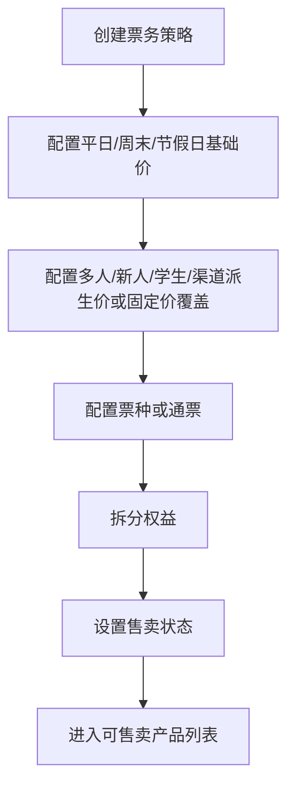
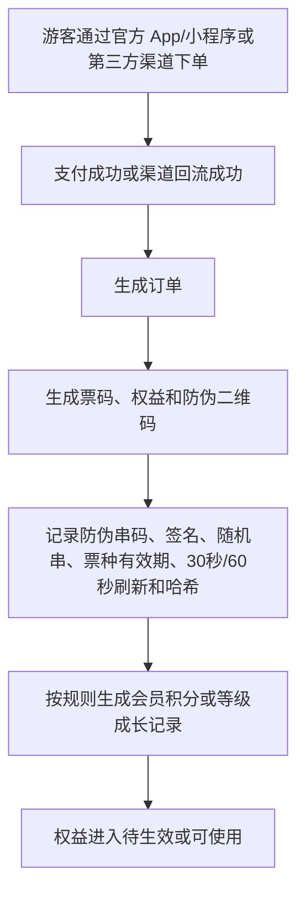
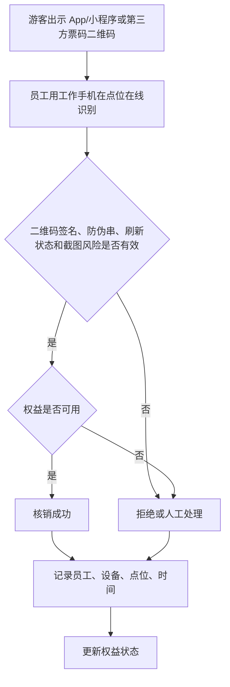
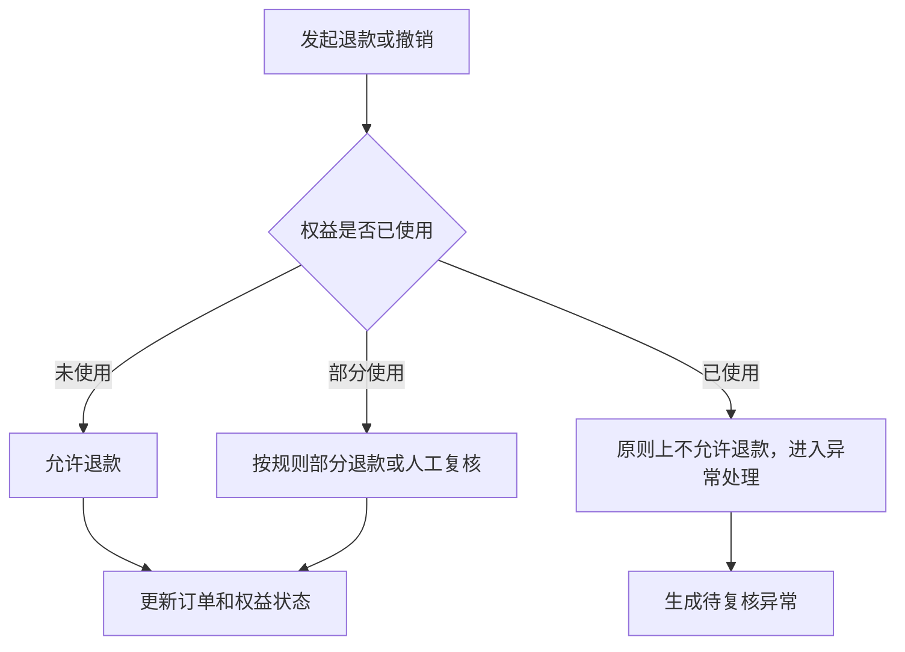
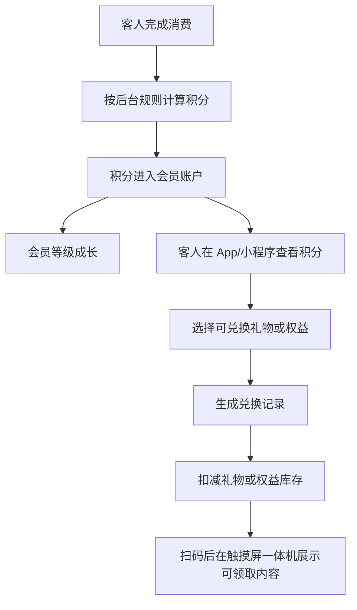

# 票务/通票/权益/核销产品 PRD V0.1

## 1. 文档定位

本文档按业务经营动作拆解票务、通票、权益和核销能力。它回答“卖什么、卖给谁、包含什么权益、在哪里使用、使用后怎么留痕、退款和异常怎么处理”。

本文档不写技术实现，不定义数据库和接口。第三方售票平台、支付平台或渠道平台如需接入，本阶段只保留产品层面的渠道和回流口径。

## 2. P0 目标

P0 票务目标是建立最小可运营闭环：
- 能配置不同票种和票务策略。
- 能把一个售卖产品拆成一个或多个权益。
- 能记录游客通过官方 App/小程序同步购买，或通过美团、大众点评、抖音团购渠道购买后的订单、票和权益。
- 能在现场按点位、员工、设备完成核销或拒绝。
- 能处理退款、撤销、人工放行和异常补录。
- 能为酒吧赠饮、游乐核销、餐饮零售券核销预留权益关系。
- 能按消费和后台规则形成会员积分、会员等级成长和积分兑换记录。

业务边界：
- 门票必须由客人本人通过官方 App/小程序或第三方渠道购买。
- 工作人员平板 App 不允许代客购买门票，不允许生成门票或游乐权益。
- 第三方渠道 P0 首批覆盖美团、大众点评、抖音，当前只做团购购票、订单回流、票码/券码核销和对账。

## 3. 角色

| 角色 | 关注重点 |
|---|---|
| 票务运营 | 票种、价格、规则、渠道、售卖状态 |
| 现场员工 | 快速识别游客资格，核销或拒绝 |
| 财务 | 订单、退款、核销和对账 |
| 酒吧运营 | 票务中赠送的酒水权益是否可用、是否已核销 |
| 游乐运营 | 游乐项目权益是否可用、容量是否允许 |
| 管理层 | 售票收入、核销率、客流和异常 |
| 会员运营 | 积分规则、会员等级、积分兑换和消费激励 |

## 4. P0 业务对象

| 对象 | 定义 | 关键关系 |
|---|---|---|
| 票务策略 | 决定票价、日期、人群、渠道、优惠和限制的规则 | 关联票种、渠道、有效期、权益 |
| 票种 | 被售卖的门票类型 | 关联票务策略、通票、权益 |
| 通票 | 一个销售包装，包含多个权益 | 支持酒吧通票、游乐通票、酒吧 + 游乐通票、含餐饮/零售优惠折扣的组合通票 |
| 权益 | 游客实际可使用的权利单位 | 关联游客、订单、核销记录、退款 |
| 销售渠道 | 票从哪里卖出，如官方 App/小程序、美团、大众点评、抖音等第三方平台 | 关联订单、价格策略、优惠规则 |
| 订单 | 售票交易结果 | 关联游客、票、支付、退款、权益 |
| 票码/权益码 | 游客用于现场识别的凭证 | 关联订单、权益、防伪串码、二维码签名、票种有效期、30 秒/60 秒刷新和核对记录 |
| 会员积分账户 | 游客会员的积分余额和等级信息 | 关联游客、订单、消费、兑换 |
| 积分规则 | 后台定义的消费积分、等级成长和兑换规则 | 关联渠道、票种、消费类型 |
| 积分兑换记录 | 会员使用积分兑换礼物或权益的记录 | 关联会员、礼物、权益、领取状态和库存扣减 |
| 核销点位 | 现场执行核销的位置 | 关联空间、员工、设备和业务 |
| 核销记录 | 权益被使用、拒绝、撤销或人工处理的事实 | 关联权益、员工、设备、点位、时间 |
| 退款记录 | 票或权益退款的经营记录 | 关联订单、权益、核销状态、财务 |
| 异常记录 | 现场核销失败、争议、重复使用等问题 | 关联核销记录和补录 |

## 5. 票务策略

P0 必须支持的策略类型：

| 策略 | 示例 | P0 处理方式 |
|---|---|---|
| 日期价格策略 | 平日价、周末价、节假日价 | 最高优先级基础价格，按适用日期、场次和票种判断是否可售、可用 |
| 人群策略 | 学生票、儿童票、成人票 | 记录适用人群和现场核验要求；学生票 P0 人工审核（证件 + 学信网），凭证留痕 |
| 多人策略 | 双人票、家庭票、团队票 | 记录可使用人数（`num_people`）和核销次数；P0 同一时段全部核销 |
| 新人策略 | 从未注册或首次购买用户优惠 | P0 以手机号为准、注册须短信验证，同号未享受过即判新人，系统自动判定 |
| 派生价格策略 | 多人票、新人票、学生票、渠道价 | 默认基于对应平日/周末/节假日基础价计算，可按折扣、减免、加价或固定金额生成 |
| 渠道策略 | 官方 App/小程序、美团、大众点评、抖音等 | 记录渠道、价格、核销和对账口径；渠道价可从基础价派生或固定价覆盖 |
| 固定价格覆盖 | 运营直接输入固定票价 | 覆盖自动计算价时必须记录来源、审批人、版本、生效期和订单快照 |
| 组合策略 | 门票 + 游乐 + 酒水赠送 | 拆成多个权益，分别核销 |
| 积分策略 | 消费获得积分、等级成长、指定票种额外积分 | P0 先支持后台定义规则并记录积分结果 |

购票渠道边界：

| 渠道 | P0 处理方式 |
|---|---|
| 官方 App/小程序 | 同步建设，客人自助购票、支付、查询订单、展示二维码 |
| 美团/大众点评/抖音等第三方 | P0 只接团购购票，回流渠道订单、票码、支付/退款结果、核销状态 |
| 工作人员平板 App | 不允许售卖门票，只允许酒吧点酒下单 |

### 5.1 资格规则 P0 口径（新人/学生/多人均 P0 落地）

> 修订说明（2026-06-07）：原 §5 新人策略写"P0 先保留规则定义和人工确认口径"、§11 把"多人拆分核销/复杂退款规则"列入 P1，与 §12 已确认第 8 条"系统自动判断"互相冲突。按《统一口径基准》D9（用户 2026-06-07 拍板）统一为：新人/学生/多人三类资格均 P0 落地，消除"自动/人工/P1"三处冲突。依据 finding ticket-1/2/3/4。

| 资格类型 | 判定主体 | 判定方式 | 凭证/留痕 | P级 |
|---|---|---|---|---|
| 新人优惠 | 手机号 | 系统自动判定：注册须登记手机号并短信验证；同一手机号未购买/未享受过即判新人，不符不可用 | 手机号、短信验证记录、历史订单 | P0 |
| 学生票 | 客户身份 | 人工审核：核验学生证件 + 学信网核验通过后方可购买/核销 | 学生凭证留痕（`verify_method`、`credential_ref`、`verified_by`、`result`、`verified_at`） | P0 |
| 多人票 | 票 | 同一时段全部核销（同一晚同场次一次或集中核销，不可拆到不同日期/场次） | 核销记录放行人数（`verifiedPeople`）与时段约束 | P0 |

- 资格规则、人数、身份、渠道、时间等条件由后台规则定义；符合规则系统自动放行，不符合不允许使用（与 §12 已确认第 8/9 条一致）。
- 多人票"是否允许拆分多人多次核销"在 P0 明确为否：必须同一时段全部核销；拆分核销列 P1（见 §11）。

### 5.2 实名规则配置 P0 口径（C7 合规）

> 修订说明（2026-06-10 总控收口）：实名规则仅作为国家法令强制场景的 P0 配置能力。除国家法令强制要求的票种/场次/场所外，普通门票、酒吧入场、游乐项目、团体/包场、活动票默认不强制实名；强制开关默认关闭，只有法令明确要求时才按场景启用。

实名规则由后台按维度配置。默认不强制实名；只有命中国家法令强制实名的票种/场次/场所时，购票/核销前才必须完成实名核验：

| 配置维度 | 说明 |
|---|---|
| 票种维度 | 按票种（如成人票/活动票/包场票）标记 `require_real_name`（是否强制实名） |
| 场次维度 | 按具体场次/活动场标记是否强制实名（大型活动场次可单独要求实名） |
| 场所维度 | 按场所/区域（如演出区、特定活动场地）标记是否强制实名 |

每条实名规则包含：

| 配置项 | 取值/说明 |
|---|---|
| `require_real_name` | 是否强制实名（true/false）；三个维度任一命中 true 即按强制实名处理（取严） |
| 核验方式（`real_name_verify_method`） | `id_card_ocr`（证件 OCR）、`id_card_manual`（人工核验证件）、`gov_auth`（公安实名接口/政务核验）、`phone_real_name`（手机号实名认证）；可单选或组合 |
| 失败处理（`real_name_fail_action`） | `block_purchase`（阻断购票）、`block_checkin`（阻断核销/入场）、`pending_manual`（转人工复核）、`allow_with_warn`（放行并预警，仅非强制场景） |
| 核验留痕 | 实名核验结果（成功/失败/待复核）、核验方式、核验时间、操作人/渠道写入留痕，敏感证件信息仅留不可逆哈希/凭证引用，不存原始明文（PIPL 数据最小化，须先取得单独同意，见客人端 PIPL 同意节点） |

P0 要求：

- 实名规则按票种/场次/场所配置；默认 `require_real_name=false`。仅国家法令强制要求时配置为 `true`，命中后购票或核销前必须先核验通过，失败按 `real_name_fail_action` 处理。
- 实名核验采集证件/人脸等敏感个人信息，必须先单独同意再采集，且仅持久化不可逆哈希/凭证引用（与 C2 PIPL 同意、C5 数据最小化一致）。
- 除国家法令强制要求的实名范围外，其它场景不强制实名，不得因运营便利扩大采集证件/人脸等敏感个人信息。

> 修订说明（2026-06-08 三轮收口）：上文"命中强制实名时购票/核销前必须先核验通过"的措辞已由真实校验节点支撑——校验节点已在开发设计 §5.0 购票资格流程与 §5.3 核销校验序列第 8 步接入（命中失败按 block_purchase/block_checkin/pending_manual），消除"有规则无触发"的 overclaim。依据 compliance-wired-1、合规 C7。

## 6. 权益拆分规则

一个票务产品售出后，可以生成一个或多个权益：

| 权益类型 | 使用场景 | 核销归属 |
|---|---|---|
| 入场权益 | 综合体或特定区域入场 | 入口核销点 |
| 游乐权益 | 指定项目、指定次数或指定场次 | 游乐项目核销点 |
| 酒水权益 | 赠送酒水、兑换券、酒吧权益 | 酒吧核销点 |
| 卡座预约入场名额 | 卡座预定者按卡座配置可携带的免通票入场人数 | 仅限预定卡座所在酒吧，不抵扣低消，不参与票务分账 |
| 餐饮权益 | 餐饮抵扣或套餐券 | 第三方餐饮或平台核销记录 |
| 零售权益 | 零售抵扣或兑换券 | 第三方零售或平台核销记录 |
| 服务权益 | 机器人配送、导览、会员服务等 | 对应服务记录 |
| 礼物兑换权益 | 会员用积分兑换礼物或服务 | 触摸屏一体机或指定领取点 |

P0 要求：
- 权益必须有归属业务、有效期、可用次数、使用限制和状态。
- 权益核销后必须留下核销记录。
- 通票中的不同权益可以不同步使用。
- 已退款、已失效、已核销完的权益不能再次使用。
- 通票组合 P0 允许酒吧通票、游乐通票、酒吧 + 游乐通票，以及含餐饮/零售优惠折扣的组合通票；餐饮/零售只作为第三方优惠、折扣、券或权益进入平台。

### 6.1 餐饮/零售第三方权益履约口径

餐饮和零售一定由第三方系统承接，平台在通票中只管理优惠资格、折扣或券权益，不自研餐饮/零售 POS。为避免“优惠折扣”和“券核销”混用，P0/P1 按以下两类定义：

| 权益履约类型 | 含义 | 是否需要第三方逐张核销回传 | 平台记录口径 |
|---|---|---|---|
| 折扣型权益（discount） | 客人在第三方餐饮/零售消费时享受折扣、满减或优惠资格 | 否，P0/P1 只记录优惠资格、使用条件和结算抵扣口径；真实折扣结果待第三方订单回流后对账 | 记录权益生成、适用商户/业态、优惠规则、预计折扣额或折扣说明，不生成平台核销成功记录 |
| 券核销型权益（voucher） | 客人持券到第三方餐饮/零售消费，第三方 POS 或平台核销点确认使用 | 是，P1 接第三方券核销级回流；未接入前可人工补录并复核 | 记录券码、核销时间、核销商户、核销金额、第三方核销单号和差异状态 |

P0 先保证通票可配置餐饮/零售优惠或券权益，并能在权益台账中区分 `discount` 与 `voucher`；真实餐饮/零售订单级、券核销级回流和对账闭环按第三方接入层统一排到 P1。

## 7. 状态模型

### 7.1 票务策略状态

| 状态 | 含义 |
|---|---|
| 草稿 | 规则未发布 |
| 待启用 | 规则已配置但未到生效时间 |
| 售卖中 | 当前可售卖 |
| 暂停售卖 | 临时停止售卖 |
| 已结束 | 售卖周期结束 |
| 归档 | 历史策略 |

### 7.2 订单状态

| 状态 | 含义 |
|---|---|
| 待支付 | 已创建未支付 |
| 已支付 | 支付成功，待生成或已生成权益 |
| 部分退款 | 部分权益或金额已退款 |
| 已退款 | 整单退款 |
| 已关闭 | 超时、取消或无效 |
| 异常 | 支付、渠道或权益生成存在问题 |

### 7.3 权益状态

| 状态 | 含义 |
|---|---|
| 待生效 | 权益未到使用时间 |
| 可使用 | 当前可被核销 |
| 已部分使用 | 多次权益已使用一部分 |
| 已使用 | 权益已核销完 |
| 已失效 | 超过有效期或不满足规则 |
| 已退款 | 权益对应金额已退款 |
| 已冻结 | 因异常、风控或争议暂停使用 |

### 7.4 核销状态

| 状态 | 含义 |
|---|---|
| 成功 | 权益被正常使用 |
| 拒绝 | 不满足规则，未放行 |
| 人工放行 | 由员工人工确认放行 |
| 已撤销 | 原核销被撤销 |
| 待复核 | 核销结果需要主管确认 |
| 异常 | 设备、网络、规则或凭证异常 |

### 7.5 会员积分状态

| 状态 | 含义 |
|---|---|
| 待入账 | 消费已发生但积分尚未确认 |
| 已入账 | 积分已进入会员账户 |
| 已兑换 | 积分已用于兑换礼物或权益 |
| 已撤销 | 因退款、冲正或风控撤销积分 |
| 异常 | 积分规则、订单或会员身份存在问题 |

## 8. P0 业务流程

### 8.1 票务配置到售卖

### 8.2 购买到权益生成

### 8.3 现场核销

### 8.4 退款和撤销

> 修订说明（2026-06-07 收口）：调整小节顺序，使 §8.4 退款在前、§8.5 会员积分在后，编号与正文出现顺序一致。原文 §8.5 排在 §8.4 之前导致按编号检索定位错乱。依据 finding broken-ref-5。

> 修订说明（2026-06-07）：补退款粒度口径。按《统一口径基准》D9，P0 退款由客人侧按订单/票发起，系统内部按权益逐项冲正并做金额拆分；复杂退款规则引擎列 P1。依据 finding ticket-7。

### 8.5 会员积分与兑换

## 9. 页面清单

| 页面 | P0 内容 |
|---|---|
| 票务经营总览 | 今日售票、核销、退款、异常、渠道分布 |
| 票务策略管理 | 日期、人群、渠道、优惠、售卖状态 |
| 票种/通票管理 | 票名称、价格、权益拆分、适用范围 |
| 权益台账 | 游客、订单、权益状态、有效期、剩余次数 |
| 订单列表 | 订单状态、支付、渠道、游客、金额 |
| 核销工作台 | 扫码/查码、权益判断、核销结果 |
| 核销记录 | 成功、拒绝、人工放行、撤销、异常 |
| 退款/撤销处理 | 退款申请、可退判断、复核和结果 |
| 票务异常队列 | 重复核销、渠道差异、权益生成失败 |
| 会员积分规则 | 后台消费积分、等级规则、兑换规则；客人端 P0 只展示积分摘要 |
| 会员积分账户 | 会员等级、积分余额、后台积分明细；客人端积分明细进入 P1 |
| 积分兑换 | 后台/底层兑换扣库存记录和领取状态；客人端礼物列表、兑换发起和兑换记录进入 P1 |

## 10. P0 验收标准

- 能配置平日、周末、节假日基础价；多人票、新人票、学生票和渠道价必须基于基础价派生或输入固定价覆盖。
- 订单必须保存基础日历价、派生价规则、固定价覆盖标记、最终价、渠道、资格判定和审批快照。
- 门票只能由客人通过官方 App/小程序、售票型一体机或第三方渠道自助购买，工作人员平板 App 不得代客购票。
- 美团、大众点评、抖音团购渠道订单、票码、支付、退款和核销结果能进入平台口径。
- 票码和权益码必须具备防伪串码、二维码签名、票种有效期、30 秒/60 秒刷新和哈希校验，截图无效，疑似变造必须拒绝或进入风险复核。
- 票码必须在线核验，不做离线核验；生成、刷新、核销、失败和异常可按订单、票号、员工、设备、点位和时间做事后核对。
- 一个通票可以拆出多个权益，且权益可分别核销；组合范围包括酒吧通票、游乐通票、酒吧 + 游乐通票，以及含餐饮/零售优惠折扣的组合通票。
- 现场核销必须记录员工、设备、点位、时间和结果。
- 现场门票和权益核销由员工工作手机扫码完成。
- 酒水赠送权益能进入酒吧核销视图。
- 游乐权益能进入游乐项目核销视图。
- 已退款、已失效、已使用权益不能被正常核销。
- 人工放行和异常核销必须进入留痕和复核口径。
- 会员积分、会员等级和积分兑换记录能在 App/小程序展示。
- 积分兑换的酒水、礼物或权益可在一体机扫码后展示可领取内容，并按规则扣减库存。

## 11. P1/P2

| 阶段 | 能力 |
|---|---|
| P1 | 预约票、排队票、动态容量、~~会员价~~（已落地，见 §12A.2，从 P1 移除）、~~动态定价~~（已落地，见 §12A.2，从 P1 移除）、渠道自动对账、多人拆分核销（同一时段全部核销为 P0，拆到多场次/多次为 P1）、复杂退款规则引擎、积分运营活动 `文档goalP1(2026-06-20)` |
| P2 | 智能推荐票种、自动风控、黄牛识别、客流预测、跨业态权益优化 |

## 12. 已确认规则和后续细化事项

已确认：

1. 官方购票入口 App 和小程序同步建设；门票只能由客人自己购买。
2. 美团、大众点评、抖音 P0 只做团购购票、订单回流、核销和对账。
3. 通票支持酒吧通票、游乐通票、酒吧 + 游乐通票，以及含餐饮/零售优惠折扣的组合通票。
4. 餐饮和零售由第三方承接，平台只提供优惠、折扣、券或权益。
5. 积分兑换礼物需要扣减库存。
6. 票务二维码按票种设置有效期，30 秒或 60 秒刷新，截图无效，必须在线核验，不做离线核验。
7. 会员积分、等级成长和兑换规则由后台定义；消费金额只是可配置条件之一。
8. 新人优惠、学生票、多人票由后台配置规则，符合规则时系统自动判断可用，不符合规则时不允许使用。
9. 学生票、多人票等所需凭证、人数、身份、渠道、时间等条件由后台规则定义。
10. **P0 不支持权益转赠**：通票赠饮及其他权益均绑定购票人本人（权益归属购票人 `customer_id`），不提供把权益转移给他人的能力；转赠（含原持有人/受让人/转赠时间留痕与防套利约束）若有业务需要列 P1 评估。

> 修订说明（2026-06-07 收口）：新增第 10 条对"赠饮权益是否允许转赠"给最小裁决，P0 显式不支持，原始需求隐含项不再悬空；开发设计同步不引入转赠流程/字段。依据 finding critic-12。

后续细化：

> 修订说明（2026-06-07）：原待确认第 1、4 条已由《统一口径基准》D9（用户拍板）定调，移入"已按 D9 确认"，避免与 §5.1 资格口径、§8 已确认第 8 条再次发散。依据 finding ticket-1/2/4。
>
> 修订说明（2026-06-07 收口）：原待确认第 1 条"通票中赠饮权益是否允许转赠"给出最小 P0 裁决——**P0 不支持权益转赠**（见下方"已确认"第 10 条），从待确认移除，避免该原始需求隐含项长期悬空。依据 finding critic-12。

1. 已确认：第三方渠道订单 P0 回流订单/券核销/退款/对账所需结果和关键摘要，平台可查外部订单号、渠道、金额、状态、核销记录和差异；完整外部订单明细以供应商后台为准，深度双向订单管理待供应商 API/SDK 到位后进入 P1/P2。

已按 D9 确认（原待确认项）：

1. 多人票核销：P0 必须同一时段全部核销（一次或集中核销），不允许拆到不同日期/场次；拆分多人多次核销列 P1。
2. 退款优先粒度：P0 客人侧按订单/票发起，内部按权益冲正与金额拆分；复杂退款规则引擎列 P1（详见 dev-design §5.6/§14）。

## 12A. 积分入账引擎与动态定价/会员价能力补充 `文档goalP1(2026-06-20)`

> 本节为产品语言的能力描述 + 业务规则 + 验收口径要点；可开发 + 可验收的权威细节（迁移号、operationId、`x-permission`、事件常量、幂等约束、G/W/T）以 `docs/v099-v124-feature-implementation-and-acceptance-spec-v0.1.md` 为准（本节对应该文第 2 项「积分入账引擎」、动态定价见下文 grep 实证）。先经 grep 后端/迁移核实功能真实存在再写。

### 12A.1 积分入账引擎 pending → confirmed → deducted（权威：spec §2，V100 + V101）

能力描述：把 §7.5「会员积分状态」（待入账/已入账/已撤销）落到**三态入账引擎**，明确积分在订单生命周期各节点的状态流转与可用性，消除"消费即到账、退款不冲减"的口径含糊。经 grep 实证落于 `LoyaltyService`（`earnPointsPending` / `confirmPoints` / `deductPoints`，状态常量 PENDING/CONFIRMED/REVERSED）。

业务规则（三态状态机）：
- **支付入 pending（待入账）**：会员订单支付成功 → 触发积分计算，写一条 `pending` 流水，积分**不可用**（对应 §7.5「待入账」）。
- **履约转 confirmed（已入账）**：订单履约/核销完成 → pending → `confirmed`，积分方可用（对应「已入账」）；重复触发为幂等空操作。
- **退款按比例 deduct（已撤销）**：发生退款 → 按已 confirmed 积分的退款比例冲减，写 deduct 流水、状态置 reversed（对应「已撤销」）。
- 幂等：同一单据流水（来源单据类型 + 单据号 + 变动类型）至多一条，退款重放不重复冲减。

验收口径要点（细化 G/W/T 见 spec §2）：
- 会员订单支付成功 → 写 pending 积分流水、积分不可用。
- 该单履约完成 → pending → confirmed、积分可用；重复触发幂等。
- 已 confirmed 100 积分发生 50% 退款 → 冲减 50、写 reversed 流水；同退款单重放不重复冲减。

### 12A.2 动态定价与会员价：由「P1 未做」移除并据实补小节 `文档goalP1(2026-06-20)`

口径更正：原 §11 P1 表把「会员价」「渠道自动对账」「动态容量」等列入 P1。经 grep 实证，**票务动态定价规则引擎与会员价（member 价格变体）已落地**，故将「会员价」与「动态定价（容量/时段动态价规则引擎）」从 §11「P1 未做」清单移除并据实补本小节。

grep 实证：
- 价格变体集合 `PRICE_VARIANTS = {group, new_customer, student, channel, member}`（`TicketCatalogService`）——`member`（会员价）为五类派生价变体之一，基于平日/周末/节假日基础价派生或固定价覆盖（与 §5「派生价格策略」一致）。
- 动态定价规则引擎：迁移 `V036__p2_ticket_dynamic_pricing_rules.sql`（`ticket_dynamic_pricing_rules` 表 + `condition_rule_json` 条件规则）、`V041__ticket_order_dynamic_pricing_trace.sql`（订单侧动态定价命中留痕）；端点 `TicketingController` 提供动态定价规则的查询 / 维护 / 发布 / 模拟（`ticket.dynamic_pricing.view/manage/publish/simulate` 权限）。

业务规则：
- 会员价作为派生价变体（variant_type=member）：与多人/新人/学生/渠道价并列，默认基于对应基础价派生，可固定价覆盖；订单须保存基础价 + 派生规则 + 最终价快照（与 §10 验收一致）。
- 动态定价规则引擎：按条件规则（`condition_rule_json`，如时段/容量/场次维度）生成动态价；规则有状态（草稿 → 发布），发布前可**模拟**试算；命中规则在订单侧留痕（V041）以备核对。

验收口径要点：
- 配置 variant_type=member 的会员派生价 → 会员购票按会员价计、订单保存价格快照。
- 维护动态定价规则 → 模拟试算 → 发布生效 → 订单命中后留痕可核。

> 待业务确认（ticketing）：会员价 / 动态定价已落库且暴露端点，但本 PRD 主体（§5/§10）尚未把「会员价 / 动态定价规则」作为正式 P0 验收项列入；是否将其口径正式纳入 P0 验收（而非 §11 P1 规划），以及动态价与基础价/派生价的优先级覆盖关系（最高优先级），需业务最终确认。本节据 grep 据实标注「已落地」，不主张 P 级归属变更。

## 13. 本版结论

票务 P0 的核心不是“卖票页面”本身，而是“购票渠道 -> 票务策略 -> 订单 -> 权益 -> 会员积分 -> 核销 -> 退款/异常 -> 对账”的经营事实闭环。只要权益台账、积分记录和核销记录站稳，酒吧、游乐、餐饮零售、会员运营和财务对账才能继续往下拆。

## 14. 变更日志

| 日期 | 类型 | 位置 | 内容 | 原因/依据 |
|---|---|---|---|---|
| 2026-06-07 | 改 | §5 票务策略表 | 新人=手机号+短信验证自动判定；学生票=人工审核证件+学信网+留痕；多人票=同一时段全部核销+`num_people` | 按基准 D9 拍板，消除新人票"自动/人工/P1"冲突；finding ticket-1/2/3/4 |
| 2026-06-07 | 增 | §5.1 资格规则 P0 口径 | 新增资格规则表（新人/学生/多人均 P0）与拆分核销 P0/P1 边界 | 把 D9 落到产品层，统一 §5/§11/§12 口径；finding ticket-1/2/4 |
| 2026-06-07 | 改 | §11 P1 表 | 明确"多人同一时段全部核销=P0、拆到多场次=P1"；退款改"复杂退款规则引擎" | 与 D9 一致，消除"多人拆分核销"笼统列 P1 的歧义；finding ticket-2/7 |
| 2026-06-07 | 改 | §12 已确认/待确认 | 多人票核销、退款粒度两条从"待确认"移入"已按 D9 确认" | D9 已定调，避免再次发散；finding ticket-2/7 |
| 2026-06-10 总控拍板 | 改 | §5/§8/§11 | 票务价格改为“平日/周末/节假日基础价优先；多人/新人/学生/渠道价基于基础价派生或固定价覆盖；订单保存价格快照” | 总控最新票务策略拍板 |
| 2026-06-07 | 增 | §8.4 退款流程 | 补退款粒度口径说明（订单/票发起、内部按权益冲正） | 按 D9 落地退款 P0 默认粒度；finding ticket-7 |
| 2026-06-07 | 增 | §5.2 实名规则配置 | 新增"实名规则配置 P0 口径"：按票种/场次/场所维度 `require_real_name`、核验方式、失败处理与敏感信息最小化 | 落地合规 C7；finding compliance-land-4 |
| 2026-06-07 | 改 | §8.4/§8.5 顺序 | 调换小节顺序使 §8.4 退款在前、§8.5 会员积分在后，编号与正文出现顺序一致 | 修正编号乱序；finding broken-ref-5 |
| 2026-06-07 | 改 | §12 已确认/待确认 | "通票赠饮权益是否允许转赠"给最小裁决：P0 显式不支持权益转赠，从待确认移除，新增已确认第 10 条 | 消除原始需求隐含项悬空；finding critic-12 |
| 2026-06-08 | 注 | §5.2 实名规则配置 | 注明"购票/核销前必须先核验通过"已由开发设计 §5.0/§5.3 接入的实名校验节点支撑，消除 overclaim | 实名规则有真实触发点；compliance-wired-1、合规 C7 |
| 2026-06-10 总控收口 | 改 | §5.2 实名规则配置 | 实名默认不强制，仅国家法令强制要求的票种/场次/场所启用；其余普通门票、酒吧入场、游乐项目、团体/包场和活动票默认不实名 | 用户最新口径 |
| 2026-06-20 `文档goalP1` | 增/改 | §12A、§11 P1 表 | 新增「积分入账引擎与动态定价/会员价能力补充」：①积分入账引擎 pending→confirmed→deducted（V100/V101，支付入 pending、履约转 confirmed、退款按比例 deduct，幂等）②动态定价/会员价据 grep 实证（PRICE_VARIANTS 含 member、V036/V041 动态定价规则引擎+端点）由 §11「P1 未做」移除并补小节。权威指向 v099-v124-feature-implementation-and-acceptance-spec-v0.1.md §2 | 文档goalP1；grep 实证 LoyaltyService（earn/confirm/deductPoints）+ TicketCatalogService（PRICE_VARIANTS member）+ V036/V041 dynamic-pricing |
