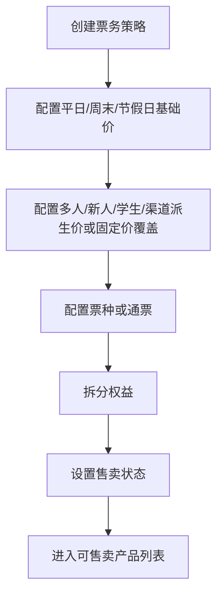
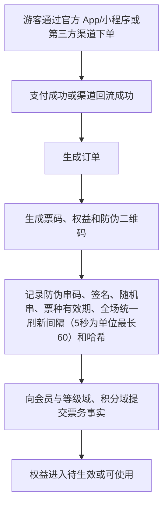
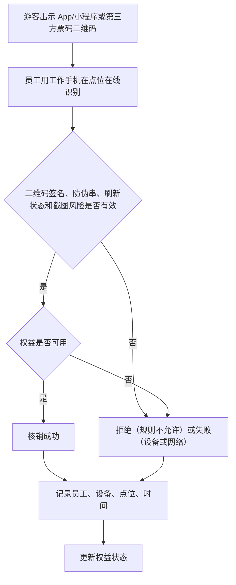
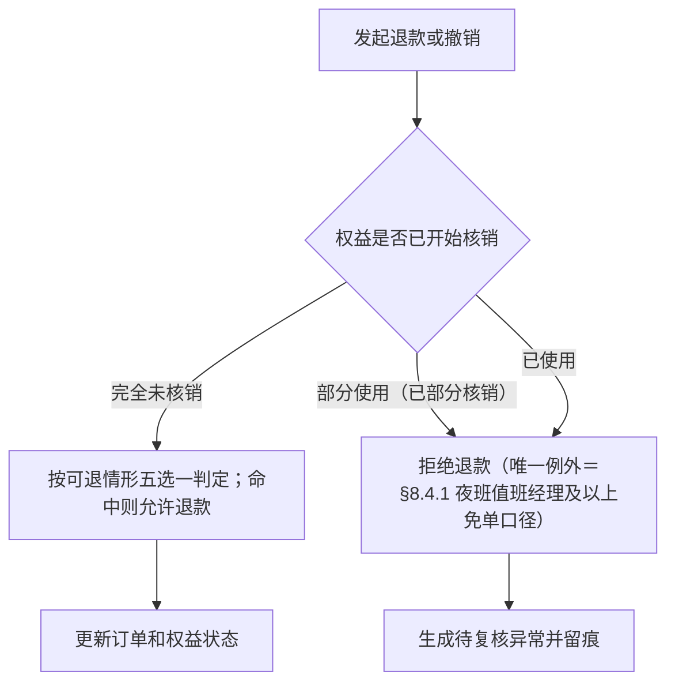
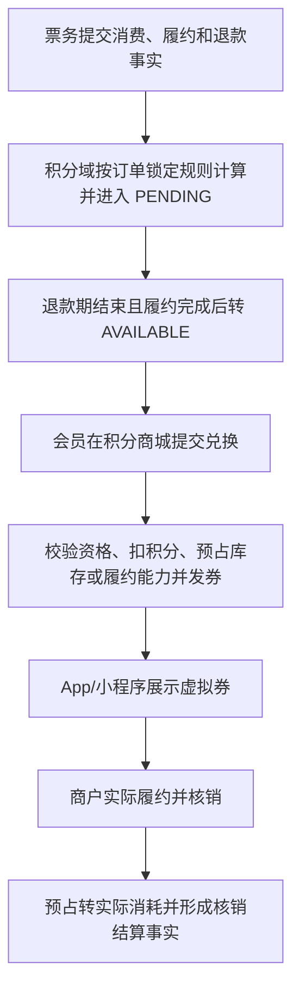

# 票务/通票/权益/核销产品 PRD V0.1

> 权限边界：本 PRD 只提供产品细化；三份业务 HTML 拥有最终业务解释权。其他文档、配置、代码和数据结构均不得覆盖 HTML；HTML 未记载的新规则须经用户批准并写入 HTML 后方可生效。**三份 HTML 之间若出现冲突，不预设先后顺序，必须逐项重新裁决**（2026-08-05 R7 补，依据 DIFF-A-051、PGM「解释权声明」条）。

## 1. 文档定位

本文档按业务经营动作拆解票务、通票、权益和核销能力。它回答“卖什么、卖给谁、包含什么权益、在哪里使用、使用后怎么留痕、退款和异常怎么处理”。

本文档不写技术实现，不定义数据库和接口。第三方售票平台、支付平台或渠道平台如需接入，本阶段只保留产品层面的渠道和回流口径。

**票务管理可拆分为可独立部署的系统（2026-08-05 R7 补，依据 DIFF-B-015；BSM「支持票务管理、酒吧管理、游乐设施管理拆分为可独立部署的系统」条原文）**：票务管理与酒吧管理、游乐设施管理一样，**支持拆分为可独立部署的系统**。**拆出去单独运营时各自独立、互不相关、不依赖基础系统**；**在综合体内则统一接入基础平台，按归属、合同和权限管理**。因此本 PRD 的票务能力**不得对基础平台形成不可拆的强依赖**，跨域协作一律走已定义的域间口径。

## 2. P0 目标

P0 票务目标是建立最小可运营闭环：
- 能配置不同票种和票务策略。
- 能把一个售卖产品拆成一个或多个权益。
- 能记录游客通过官方 App/小程序同步购买，或通过美团、大众点评、抖音团购渠道购买后的订单、票和权益。
- 能在现场按点位、员工、设备完成核销或拒绝。
- 能处理退款、撤销和异常补录（系统不提供人工放行，见 §7.4）。
- 能为酒吧赠饮、游乐核销、餐饮零售券核销预留权益关系。
- 能向会员与等级域、积分域提交订单、支付、履约、退款、冲正和核销事实，由两域按票务各自规则计算成长值和积分。

业务边界：
- 门票主路径由客人本人通过官方 App/小程序或第三方渠道购买；少量到店服务场景允许授权服务人员在售票型一体机上辅助下单并完整留痕。
- 工作人员平板 App 不允许代客购买门票，不允许生成门票或游乐权益。
- 第三方渠道 P0 首批覆盖美团、大众点评、抖音，当前只做团购购票、订单回流、票码/券码核销和对账。

## 3. 角色

| 角色 | 关注重点 |
|---|---|
| 票务运营 | 票种、价格、规则、渠道、售卖状态 |
| 现场员工 | 快速识别游客资格，核销或拒绝 |
| 财务 | 订单、退款、核销和对账 |
| 酒吧运营 | 票务中赠送的酒水权益是否可用、是否已核销 |
| 游乐运营 | 游乐项目权益是否可用、容量是否允许 |
| 管理层 | 售票收入、核销率、客流和异常 |
| 会员运营 | 积分规则、会员等级、积分兑换和消费激励 |

## 4. P0 业务对象

| 对象 | 定义 | 关键关系 |
|---|---|---|
| 票务策略 | 决定票价、日期、人群、渠道、优惠和限制的规则 | 关联票种、渠道、有效期、权益 |
| 票种 | 被售卖的门票类型 | 关联票务策略、通票、权益 |
| 通票 | 一个销售包装，包含多个权益 | 支持酒吧通票、游乐通票、酒吧 + 游乐通票、含餐饮/零售优惠折扣的组合通票 |
| 权益 | 游客实际可使用的权利单位 | 关联游客、订单、核销记录、退款 |
| 销售渠道 | 票从哪里卖出，如官方 App/小程序、美团、大众点评、抖音等第三方平台 | 关联订单、价格策略、优惠规则 |
| 订单 | 售票交易结果 | 关联游客、票、支付、退款、权益 |
| 票码/权益码 | 游客用于现场识别的凭证 | 关联订单、权益、防伪串码、二维码签名、票种有效期、全场统一刷新间隔（5 秒为单位、最长 60 秒、默认 15）和核对记录 |
| 会员身份与等级（引用对象） | 全国唯一会员身份、成长值和等级状态，完整定义不在票务域 | 关联游客与订单；产品细化见 `member-and-tier-product-prd-v1.0.md` |
| 积分账户与流水（引用对象） | 待确认、可用、已使用、取消、过期积分及对应规则版本，票务域不自行计算 | 关联消费、履约、退款事实；产品细化见 `points-and-voucher-product-prd-v1.0.md` |
| 积分兑换订单与虚拟券（引用对象） | 积分商城兑换形成的订单及后续商品提取或服务履约资格 | 关联兑换 SKU、预占、核销和结算；产品细化见 `points-and-voucher-product-prd-v1.0.md` |
| 核销点位 | 现场执行核销的位置 | 关联空间、员工、设备和业务 |
| 核销记录 | 权益被使用、拒绝、撤销或人工处理的事实 | 关联权益、员工、设备、点位、时间 |
| 退款记录 | 票或权益退款的经营记录 | 关联订单、权益、核销状态、财务 |
| 异常记录 | 现场核销失败、争议、重复使用等问题 | 关联核销记录和补录 |

> **实现待对齐登记（E-25，2026-08-04）**：二维码刷新间隔的业务口径为「全场统一、5 秒为单位、最长 60 秒、默认 15」（本 PRD §2/§10；配置端点 `openapi-p0.yaml` `refresh_interval_seconds` 已按 `minimum:5 / maximum:60`）。但 **OpenAPI 的 `TicketTypeRequest.refresh_interval_seconds` 仍是票种级 `enum [10, 15, 30, 60]`**，既未跟上 V320 的全场统一口径，也不覆盖 5/20/25 等合法取值——属**契约滞后的待改造缺口**，实现证据不得反向定义业务规则。

## 5. 票务策略

P0 必须支持的策略类型：

| 策略 | 示例 | P0 处理方式 |
|---|---|---|
| 日期价格策略 | 平日价、周末价、节假日价 | 最高优先级基础价格，按适用日期、场次和票种判断是否可售、可用 |
| 人群策略 | 学生票、成人票 | 记录适用人群和现场核验要求；学生票 P0 人工审核（证件 + 学信网），凭证留痕。<!-- 2026-06-24 删儿童票：全场 18+，无儿童票（用户取消） --> |
| 多人策略 | 双人票、团队票 | 记录可使用人数（`num_people`）和核销次数；P0 必须在同一场次内核销，同场次内可分别入场、不要求同一时刻一起核销。<!-- 2026-06-24 删家庭票：全场 18+，无家庭票（用户取消） --> |
| 新人策略 | 从未注册或首次购买用户优惠 | P0 以手机号为准、注册须短信验证，同号未享受过即判新人，系统自动判定 |
| 派生价格策略 | 多人票、新人票、学生票、渠道价 | 默认基于对应平日/周末/节假日基础价计算，可按折扣、减免、加价或固定金额生成 |
| 渠道策略 | 官方 App/小程序、美团、大众点评、抖音等 | 记录渠道、价格、核销和对账口径；渠道价可从基础价派生或固定价覆盖 |
| 固定价格覆盖 | 运营直接输入固定票价 | 覆盖自动计算价时必须记录来源、审批人、版本、生效期和订单快照 |
| 组合策略 | 门票 + 游乐 + 酒水赠送 | 拆成多个权益，分别核销 |
| 积分与成长值策略 | 票务积分与票务成长值分别计算 | P0 按票种或票务产品分别配置、审批和版本化；不得读取商户业态积分规则，也不得在两套规则间回落猜算 |

> 基础价模式取值口径（2026-07-28 收口）：日期价格策略只有「平日 / 周末 / 节假日三类基础价」这一种模式，对应机读取值固定为 `weekday_weekend_holiday`（票种字段 `base_calendar_price_mode`）。后台建票、接口契约、后端校验三处必须一致，后端按白名单拒绝其余取值。注意与派生价规则的 `price_mode`（`derive_from_calendar_price` / `fixed_price`）是两个不同字段，不可混用。

购票渠道边界：

| 渠道 | P0 处理方式 |
|---|---|
| 官方 App/小程序 | 同步建设，客人自助购票、支付、查询订单、展示二维码 |
| 美团/大众点评/抖音等第三方 | P0 只接团购购票，回流渠道订单、票码、支付/退款结果、核销状态 |
| 工作人员平板 App | 不允许售卖门票，只允许酒吧点酒下单 |

**票种发布上架闸（P0，2026-08-04 补；依据 ENUM L31「通票赠酒下限」、ENUM L45「收费与免费权益结算」）**：票种建成后固定为草稿，须经发布闸方可上架。下列任一条不满足的，**发布闸一律拒绝上架**，不得以「先上架后补」方式绕过：

1. 通票（酒吧通票或跨域组合通票）覆盖的**任一家酒吧**，赠酒杯数**低于后台配置的最低赠酒杯数**（业务参数，按票种可配，出厂默认 1 杯）；
2. 票面**未写明**该通票覆盖的各家酒吧分别赠几杯；
3. 票内任一**零元免费权益未逐项标注出资方**（详见 §6 权益拆分规则）。

### 5.1 资格规则 P0 口径（新人/学生/多人均 P0 落地）

> 修订说明（2026-06-07）：原 §5 新人策略写"P0 先保留规则定义和人工确认口径"、§11 把"多人拆分核销/复杂退款规则"列入 P1，与 §12 已确认第 8 条"系统自动判断"互相冲突。按《统一口径基准》D9（用户 2026-06-07 拍板）统一为：新人/学生/多人三类资格均 P0 落地，消除"自动/人工/P1"三处冲突。依据 finding ticket-1/2/3/4。

| 资格类型 | 判定主体 | 判定方式 | 凭证/留痕 | P级 |
|---|---|---|---|---|
| 新人优惠 | 手机号 | 系统自动判定：注册须登记手机号并短信验证；同一手机号未购买/未享受过即判新人，不符不可用 | 手机号、短信验证记录、历史订单 | P0 |
| 学生票 | 客户身份 | 人工审核：核验学生证件 + 学信网核验通过后方可购买/核销 | 学生凭证留痕（`verify_method`、`credential_ref`、`verified_by`、`result`、`verified_at`） | P0 |
| 多人票 | 票 | 必须在**同一场次**内核销（一个场次＝一次开门到关门）；同场次内不同人可在不同时间分别入场，**不要求同一时刻一起核销**；不能拆到不同场次或不同日期 | 核销记录放行人数（`verifiedPeople`）与场次约束 | P0 |

> **已裁决（原 E-13，2026-08-04 第三轮用户裁决 UD-08 / DEC-R6-11）**：**注销后重新注册默认不穿透历史**——新账户视为新人、可再享一次新人资格（与 ENUM L57「新账户与原账户之间不建立任何关联」一致）。
> 反复套利以**异常预警**而非阻断注册的方式管控：**同一手机号一年内注销＋注册合计次数超过阈值触发异常预警**（业务参数、全平台统一可配、须同时配置上下限，**出厂默认一年内合计 3 次**）；预警**只作提示、不自动阻断注册**，汇入「异常预警页面」供风控岗查看处置，查看／转办／处置结论均留痕（页面承接见 `evidence-risk-control-product-prd-v0.1.md` 与 `business-dashboard-metrics-product-prd-v0.1.md`）。
> 实现改造列入排期：注销重注册计数与预警触发当前无承载（缺口登记见修复台账 §7.4）。

- 资格规则、人数、身份、渠道、时间等条件由后台规则定义；符合规则系统自动放行，不符合不允许使用（与 §12 已确认第 8/9 条一致）。
- 多人票的各个人次必须在**同一场次**内核销（一个场次＝一次开门到关门）：同场次内不同人可以在不同时间分别入场，系统**不要求同一时刻一起核销**；但不能拆到不同场次，也不能拆到不同日期。

### 5.1a 多次票 / 多次核销权益 P0 口径

> 补充定义(2026-07-04 用户):"多次票"能力代码早已落地(`issued_entitlements.total_times/used_times/remaining_times`,V006),此前散见于"多次权益/可用次数/游乐次数"表述,本节集中定义,与"多人票"并列区分。

- **定义**:一张票/权益含**多次核销额度**——`total_times>1`(一次票 `total_times=1`)。每核销一次 `used_times+1`、`remaining_times`(= total − used)递减;`remaining_times=0` 时权益置 `exhausted`。
- **部分使用**:多次票可分次核销(用一部分、剩余仍可用),逐次核销留痕;权益台账可查剩余次数。
- **典型场景**:游乐次数票(玩 N 次、每玩扣一次)、游乐通玩(不限次)、多次入场票、酒吧场次内多次进出(见结算 PRD §6.2 场次入场:同一场次内可持续进出、不重复消耗)。
- **与多人票区分**:多人票 = **同一张票含多个人次**(`num_people>1`,各人次须在同一场次内核销、同场次内可分别入场);多次票 = **多次核销**(`total_times>1`,可分次)。二者**可组合**:多人多次票 `total_times>1 且 num_people>1`。
- **退款原则**：门票售出原则上不退款，未到场、忘记使用或主动放弃不构成退款理由。可退情形穷举为五种：票种规则明确允许、活动或场次取消、平台或履约方无法提供服务、重复扣款、法律法规要求；「获授权特殊审批」不再作为退款理由。五种之外确需退款的，只能由持授权 U 盘密钥的最高权限逐笔放行，每次只对当前这一笔生效。已核销部分不得按未履约理由退款（唯一例外见 §8.4.1）。
- **P0 落地状态**:建表 total_times/used_times/remaining_times(V006)、核销 `atomicUseEntitlement` 逐次扣减、冲正回滚(V067)均已落;不限次的消耗窗口 `consumption_window`(per_use/per_day/unlimited_in_day)见结算 PRD §6.3。

### 5.2 实名规则配置 P0 口径（C7 合规）

> 修订说明（2026-06-10 总控收口）：实名规则仅作为国家法令强制场景的 P0 配置能力。除国家法令强制要求的票种/场次/场所外，普通门票、酒吧入场、游乐项目、团体/包场、活动票默认不强制实名；强制开关默认关闭，只有法令明确要求时才按场景启用。

实名规则由后台按维度配置。默认不强制实名；只有命中国家法令强制实名的票种/场次/场所时，购票/核销前才必须完成实名核验：

| 配置维度 | 说明 |
|---|---|
| 票种维度 | 按票种（如成人票/活动票/包场票）标记 `require_real_name`（是否强制实名） |
| 场次维度 | 按具体场次/活动场标记是否强制实名（大型活动场次可单独要求实名） |
| 场所维度 | 按场所/区域（如演出区、特定活动场地）标记是否强制实名 |

每条实名规则包含：

| 配置项 | 取值/说明 |
|---|---|
| `require_real_name` | 是否强制实名（true/false）；三个维度任一命中 true 即按强制实名处理（取严） |
| 核验方式（`real_name_verify_method`） | `id_card_ocr`（证件 OCR）、`id_card_manual`（人工核验证件）、`gov_auth`（公安实名接口/政务核验）、`phone_real_name`（手机号实名认证）；可单选或组合 |
| 失败处理（`real_name_fail_action`） | `block_purchase`（阻断购票）、`block_checkin`（阻断核销/入场）、`pending_manual`（转人工复核）、`allow_with_warn`（放行并预警，仅非强制场景） |
| 核验留痕 | 实名核验结果（成功/失败/待复核）、核验方式、核验时间、操作人/渠道写入留痕，敏感证件信息仅留不可逆哈希/凭证引用，不存原始明文（PIPL 数据最小化，须先取得单独同意，见客人端 PIPL 同意节点） |

P0 要求：

- 实名规则按票种/场次/场所配置；默认 `require_real_name=false`。仅国家法令强制要求时配置为 `true`，命中后购票或核销前必须先核验通过，失败按 `real_name_fail_action` 处理。
- 实名核验采集证件/人脸等敏感个人信息，必须先单独同意再采集，且仅持久化不可逆哈希/凭证引用（与 C2 PIPL 同意、C5 数据最小化一致）。
- 除国家法令强制要求的实名范围外，其它场景不强制实名，不得因运营便利扩大采集证件/人脸等敏感个人信息。

> 修订说明（2026-06-08 三轮收口）：上文"命中强制实名时购票/核销前必须先核验通过"的措辞已由真实校验节点支撑——校验节点已在开发设计 §5.0 购票资格流程与 §5.3 核销校验序列第 8 步接入（命中失败按 block_purchase/block_checkin/pending_manual），消除"有规则无触发"的 overclaim。依据 compliance-wired-1、合规 C7。

## 6. 权益拆分规则

一个票务产品售出后，可以生成一个或多个权益：

| 权益类型 | 使用场景 | 核销归属 |
|---|---|---|
| 入场权益 | 综合体或特定区域入场 | 入口核销点 |
| 游乐权益 | 指定项目、指定次数或指定场次 | 游乐项目核销点 |
| 酒水权益 | 赠送酒水、兑换券、酒吧权益 | 酒吧核销点 |
| 卡座预约入场名额 | 卡座预定者按卡座配置可携带的免通票入场人数 | 仅限预定卡座所在酒吧，不抵扣低消，不参与票务分账 |
| 餐饮权益 | 餐饮抵扣或套餐券 | 第三方餐饮或平台核销记录 |
| 零售权益 | 零售抵扣或兑换券 | 第三方零售或平台核销记录 |
| 服务权益 | 机器人配送、导览、会员服务等 | 对应服务记录 |
| 礼物兑换权益 | 会员用积分兑换礼物或服务 | 触摸屏一体机或指定领取点 |

P0 要求：
- 权益必须有归属业务、有效期、可用次数、使用限制和状态。
- 权益核销后必须留下核销记录。
- 通票中的不同权益可以不同步使用。
- 已退款、已失效、已核销完、已作废（forfeited）的权益不能再次使用。
- 门票到期生命周期（F-TXN-03）：未实际核销的票到期后仍记录为未核销，不自动退款、不产生提供商户核销结算，也不得配置成已核销。第三方渠道费用只扣一次，余额按票种经营域归属；跨域组合通票按既定域份额归属。**（2026-08-03 已在代码收口：到期作业只作废 `forfeited`，不再对 `refundable` 票种触发自动退款；`refundable` 仅表示客人可申请整票退款。）**
- 通票组合 P0 允许酒吧通票、游乐通票、酒吧 + 游乐通票，以及含餐饮/零售优惠折扣的组合通票；餐饮/零售只作为第三方优惠、折扣、券或权益进入平台。
- **通票赠酒下限（2026-08-04 补；依据 ENUM L31「通票赠酒下限」、ENUM L45「收费与免费权益结算」）**：
  - 一张酒吧通票或跨域组合通票覆盖的**每一家酒吧**，赠酒杯数**不得低于后台配置的最低赠酒杯数**（业务参数，按票种可配，**出厂默认 1 杯**，须同时配置上下限）。
  - 各家酒吧分别赠几杯，**必须在售票时写明票面**；**低于该下限的票种不得发布上架**（发布闸见 §5）。
  - 该最低赠酒杯数属**票面强制要求提供**的权益，**一律记为域主管公司出资**，核销后**按锁定的内部结算价**结算给该酒吧，不记为商户让利。
  - A 酒吧的赠酒**只能在 A 酒吧核销**，不得跨店占用（与 §8.3「核销顺序」的「一家一份、互不占用」一致）。
- **零元免费权益的出资方标注**：每一项零元免费权益在票种发布前必须**逐项标注出资方并锁定版本**——域主管公司在票面强制要求提供的记为域主管公司出资、核销后按锁定内部结算价结算；只有商户主动申请并**书面确认让利**的才记为商户让利、不结算。**未标注出资方的免费权益不得发布上架**；未核销不结算。

### 6.1 餐饮/零售第三方权益履约口径

餐饮和零售一定由第三方系统承接，平台在通票中只管理优惠资格、折扣或券权益，不自研餐饮/零售 POS。为避免“优惠折扣”和“券核销”混用，P0/P1 按以下两类定义：

| 权益履约类型 | 含义 | 是否需要第三方逐张核销回传 | 平台记录口径 |
|---|---|---|---|
| 折扣型权益（discount） | 客人在第三方餐饮/零售消费时享受折扣、满减或优惠资格 | **否**——但这不等于「平台不核销」：**核销在平台系统内完成、由平台生成核销记录**；商户只需在自身收银系统内录入折扣率或扣减对应金额即可，**不需要第三方系统向平台逐张回传** | 记录**平台侧核销记录**、适用商户/业态、优惠规则、折扣额或折扣说明 |
| 券核销型权益（voucher） | 客人持券到第三方餐饮/零售消费，第三方 POS 或平台核销点确认使用 | 是，P1 接第三方券核销级回流；未接入前可人工补录并复核 | 记录券码、核销时间、核销商户、核销金额、第三方核销单号和差异状态 |

> **口径更正（2026-08-04，依据 ENUM L34「餐饮/零售券两种用法」）**：旧版把折扣型权益写成「不生成平台核销成功记录、待第三方订单回流后对账」，**方向写反了**。折扣型权益的核销**发生在平台系统内**，平台是核销记录的产生方；商户侧只做收银折扣录入，不承担逐张回传义务。只有**券核销型**才需要第三方逐张回传。

折扣型权益按收费与免费两类分别处理，**不另立规则**（ENUM L34、ENUM L45「收费与免费权益结算」）：

| 折扣券类别 | 定价与分配 | 结算 |
|---|---|---|
| **收费型折扣券** | **带价格，计入业态价格并参与通票池分配** | 平台按分账比例向商户付款 |
| **免费型折扣券**（零元免费权益） | 不带价格、不参与域间分配 | **须逐项标注出资方并锁定版本**：域主管公司在票面强制要求提供的记为域主管公司出资、核销后按锁定内部结算价结算；商户主动申请并书面确认让利的记为商户让利、不结算。**未标注出资方的免费权益不得发布上架**（见 §5 发布上架闸） |

P0 先保证通票可配置餐饮/零售优惠或券权益，并能在权益台账中区分 `discount` 与 `voucher`、区分收费型与免费型；真实餐饮/零售**订单级**回流与**券核销级**回流的对账闭环按第三方接入层统一排到 P1。

## 7. 状态模型

### 7.1 票务策略状态

| 状态 | 含义 |
|---|---|
| 草稿 | 规则未发布 |
| 待启用 | 规则已配置但未到生效时间 |
| 售卖中 | 当前可售卖 |
| 暂停售卖 | 临时停止售卖 |
| 已结束 | 售卖周期结束 |
| 归档 | 历史策略 |

> 枚举权威（2026-06-24 对齐；2026-08-04 补全）：本节状态值以业务枚举速查表 `business-enum-quick-reference-v0.1.html` §一（票务与权益）为最终口径，PRD 仅补充"含义"。下文 §7.2/§7.3/§7.4/§7.6 已对齐速查表。
>
> **有效期类型五值（ENUM L40「有效期类型」，2026-08-04 补全；旧版只写三值，漏「按自然月」「按场次」）**：
>
> | 有效期类型 | 含义 |
> |---|---|
> | 永久 | 不设失效时间 |
> | 固定天数 | 自出票或生效之日起 N 天内有效 |
> | 按自然月 | 按自然月边界计算有效期 |
> | 按自然年 | 按自然年边界计算有效期 |
> | 按场次 | 一次开门到关门为一场；核销入场后**只在当前场次有效**，该场次内可不限次数进出，**过场即作废**。**跨夜场次以该场次的实际闭店时间为准，不按自然日切分**（与 §8.3.1 场次内进出口径一致） |
>
> **实现待对齐登记（E-36，2026-08-04）**：本节「票务策略状态」是**票务策略（`ticket_price_rules`）**这一对象的 6 态（草稿/待启用/售卖中/暂停售卖/已结束/归档）；而 **`ticket_types`（票种）**在契约侧只有 4 态——`openapi-p0.yaml` `TicketTypeRequest.status` `enum [draft, active, paused, archived]`。**两者是两个不同的业务对象、不是同一套状态机**，不得互相映射或互相覆盖。票种 4 态与本节策略 6 态的对应关系、以及票种是否需要「待启用/已结束」两态，属**待改造/待对齐缺口**。

### 7.2 订单状态

| 状态 | 含义 |
|---|---|
| 待支付 | 已创建未支付 |
| 已支付 | 支付成功，待生成或已生成权益 |
| 已出票 | 权益/票码已生成 |
| 部分核销 | 部分权益已核销 |
| 已完成 | 全部权益已核销或已结束 |
| 退款中 | 退款申请处理中 |
| 部分退款 | 部分权益或金额已退款 |
| 已全退 | 整单退款 |
| 已取消 | 支付前取消 |
| 已关闭 | 超时或无效关闭 |
| 异常 | 支付、渠道或权益生成存在问题 |

**派生视图声明（2026-08-04 补；依据 ENUM L36「订单状态」）**：上表 11 个订单状态是**对客经营展示口径**，**不是一列独立的持久化枚举**。它是订单上 **`pay_status`（支付维）× `issue_status`（出票维）× `status`（生命周期维）三个正交列**的**派生视图**，其中「部分核销 / 已完成 / 退款中 / 部分退款 / 已全退」还需叠加**权益核销事实**与**退款单事实**（§7.6）共同判定。合法组合矩阵如下，**矩阵之外的组合一律非法**：

| 展示态 | `pay_status` | `issue_status` | `status`（生命周期） | 附加事实条件 |
|---|---|---|---|---|
| 待支付 | unpaid | not_issued | created | 未超过支付时限 |
| 已支付 | paid | not_issued / issuing | created | 权益尚未全部生成 |
| 已出票 | paid | issued | created | 无核销事实、无退款单 |
| 部分核销 | paid | issued | created | 部分权益已核销，且仍有可用权益 |
| 已完成 | paid | issued | created | 全部权益已核销，或权益已到期结束 |
| 退款中 | paid | issued / not_issued | created | 存在处于「已申请/审批中/已通过/处理中」的退款单 |
| 部分退款 | paid | issued | created | 存在「成功」退款单且累计退款额 < 订单金额；按 ENUM L41 只对**完全未核销**的票/权益成立 |
| 已全退 | paid | issued / not_issued | created | 「成功」退款额 = 订单金额 |
| 已取消 | unpaid | not_issued | cancelled | 支付前由客人或商户**主动撤单** |
| 已关闭 | unpaid | not_issued | cancelled | **超过支付时限系统自动关闭**，无人工干预 |
| 异常 | 任意 | 任意 | 任意 | 三列或叠加事实互相矛盾（如 paid + not_issued 且已超出出票时限、渠道回流与本地不一致、权益生成失败） |

> **实现缺口登记（不得反向定义业务规则，2026-08-04）**：
> - `ticket_orders` 建表（`V009__p0_ticketing_customer_orders_credentials.sql`）只对 `quantity`、`amount_cent`、`currency` 加 CHECK，**`pay_status` 与 `issue_status` 均为无约束的 `VARCHAR(32)`**；`V253__status_check_constraints.sql` 只加了 `chk_ticket_orders_status CHECK (status IN ('created','cancelled'))`，并在注释中明确「pay_status / issue_status 是独立列，不并入本约束」。
> - 后果一：**非法组合可被写入**（例如 `unpaid + issued`、`paid + not_issued + cancelled`），库层无法拦截，上表矩阵目前**只靠应用层自律**。
> - 后果二：`status` 生产枚举只有 `created / cancelled` 两值，**「已取消」（主动撤单）与「已关闭」（超时自动关闭）在库内不可区分**，无法据库还原对客展示态。
> - 上述两项均属**待改造缺口**：应补 `pay_status` / `issue_status` 的取值 CHECK、补跨列组合校验，并区分主动撤单与超时关闭。实现现状不得反向定义本节业务口径。

### 7.3 票/权益状态

| 状态 | 含义 |
|---|---|
| 未使用 | 权益尚未核销（含未到使用时间、当前可用） |
| 部分使用 | 多次权益已使用一部分 |
| 已使用 | 权益已核销完 |
| 已过期 | 超过有效期 |
| 已退款 | 权益对应金额已退款 |
| 已作废 | 到期作废、风控或争议作废 |

### 7.4 核销记录状态

> **2026-08-04 第三轮用户裁决（UD-11 / DEC-R6-08）：核销无预检环节，七态改六态。** 核销记录状态删除「预检通过」，保留成功／拒绝／失败／已冲正／待复核／异常六态。
> **入场流程＝安全检查（X 光）→ 刷脸核验 18+ → 二维码过闸机入场；扫码即核销、一步完成，不设预检确认环节。** 实现侧若已落 `预检通过` 持久值，须按本条移除（缺口登记见修复台账 §7.4）。

| 状态 | 含义 |
|---|---|
| 成功 | 权益被正常使用 |
| 拒绝（规则不允许） | 不满足规则，系统拒绝放行 |
| 失败（设备或网络） | 设备或网络原因导致核销未完成 |
| 已冲正 | 原核销被冲正撤销 |
| 待复核 | 核销结果需主管确认 |
| 异常 | 设备、网络、规则或凭证异常 |

- **系统不提供人工放行**：核销要么成功、要么拒绝或失败；任何岗位、任何权限都不能以人工方式让一笔不满足规则的核销通过。

**「待复核」的超时升级出口（2026-08-04 补）**：「待复核」不得成为无出口的终点，必须有超时升级路径。

- 「待复核」记录须在**可配的复核时限**内由主管处置；**该时限与逐级升级的间隔均为业务参数、按项目可配，须同时配置上限与下限**；**出厂默认沿用异常首响分级时限——critical 15 分钟、high 30 分钟、其余 60 分钟**（2026-08-04 第三轮用户裁决 UD-11 / DEC-R6-08，已写入 ENUM「核销记录状态」条）。
- 超时未处置的，**自动升级到上一级主管**并保留原记录、原时间与原责任人；每次升级都留痕（升级时间、原受理人、新受理人、升级原因＝超时）。
- 升级**不改变核销结论**：升级只解决「谁来处置」，不构成人工放行；复核结果仍只能落到「成功（原核销成立）」「拒绝」「失败」「已冲正」之一。
- 逐级升级到最高一级仍超时的，转「异常」并按 §9「票务异常队列」处置，不得自动通过、不得自动作废。

### 7.5 会员积分状态

本节只列票务页面需要识别的引用状态，完整状态机以 `points-and-voucher-product-prd-v1.0.md` §8 为准，票务域不得另建映射规则。

| 引用状态 | 票务侧含义 |
|---|---|
| `PENDING` | 消费事实已提交，关联积分在退款期内冻结、不可用 |
| `AVAILABLE` | 履约完成且退款期结束，积分已确认、可用于积分商城 |
| `CONSUMED` | 积分已用于兑换 |
| `CANCELLED` | 退款、取消或纠错已撤销该笔积分 |
| `EXPIRED` | 超过账户活跃有效期，积分不可用 |

### 7.6 退款单状态（2026-08-04 新增，依据 ENUM L39「退款单状态」）

退款单是与订单、权益并列的**独立单据**，有自己的状态机；此前 PRD 只在 §7.1 的注里提了一句枚举，未成表，故补齐。

| 状态 | 含义 |
|---|---|
| 已申请 | 退款申请已提交，等待受理 |
| 审批中 | 已进入审批流程，按金额与风险执行授权与复核（申请人不得审批自己的申请） |
| 已通过 | 已批准**并已发起不可逆兑付**；不可再撤回 |
| 已驳回 | 审批不通过，**终态** |
| 处理中 | 兑付通道处理中，结果未回 |
| 成功 | 资金已退回，**退款最终完成态** |
| 失败 | 兑付失败；须记录失败原因，可按原申请重试或另起单据 |
| 已取消 | 兑付发起前由申请方撤回或系统撤销 |

四条语义（必须同时成立）：

1. **只有「成功」计入已退金额**：「成功」是退款的最终完成态；「已通过」「处理中」等中间态**一律不得计入「已退金额」**，也不得据以冲减营业额、分账或积分。
2. **「已通过」＝已批准并已发起不可逆兑付**：一经「已通过」即不可逆，不得再退回「审批中」或「已申请」，如需终止只能按失败/差错流程另行处理。
3. **「已驳回」是终态、不再复议**：驳回后该退款单不得被重新激活，也不得在同一单据上改判。
4. **投诉不改变结论**：客人就驳回结果提出投诉的，**客户关怀部照常受理并纳入闭环**，但**处理结果仍为原驳回结论**，并须尽快告知客人；受理动作本身不得被理解为复议入口。

> 退款单状态与 §7.2 订单展示态的关系见 §7.2 派生视图矩阵：「退款中」对应存在「已申请/审批中/已通过/处理中」的退款单；「部分退款」「已全退」只按**「成功」**的退款单金额判定。

## 8. P0 业务流程

### 8.1 票务配置到售卖

### 8.2 购买到权益生成

### 8.3 现场核销

**同一酒吧的核销顺序（2026-08-04 补；依据 ENUM L47「核销顺序」）**：

- 同一酒吧商户，客人**必须先核销这家酒吧的入场权益、再核销这家酒吧的酒水（赠饮）权益**；**不能跳过入场直接核酒水**。
- **未先核入场即核酒水的，一律拒绝**，按「拒绝（规则不允许）」记录并留痕，不进入待复核、不提供人工放行（见 §7.4）。
- **一家一份、互不占用**：一张通票覆盖几家酒吧，就为**每一家各发一份独立的入场权益与赠酒权益**；在 A 店核销入场**不影响**在 B、C 店另行核销各自的入场权益，A 店的赠酒也**只能在 A 店**核销。
- 核销顺序校验按酒吧商户维度独立判定，不按整张通票判定，也不因客人已在其他酒吧入场而放行。

#### 8.3.1 场次内进出与借票风控

- 通票核销入场后**只在当前场次（一次开门到关门）有效**，在该场次内可以不限次数进出；过场即作废，第二场次不可再用。
- 对高频出入场的必须调看出入录像核查，以防止将票借给他人使用：一晚出入次数或连续两日出入合计次数达到后台配置的阈值即触发核查（**业务参数，按项目可配，出厂默认一晚 4 次、连续两日合计 7 次，须同时配置上下限**）。
- 由**系统自动预警**，**楼宇保安团队**据预警调阅录像；票务系统只提供出入次数事实与预警，不自行判定借票。
- 查实确系将票借给他人使用的：**关闭该客人账户、该账号作废，并将其列入黑名单不允许再进入**。

#### 8.3.2 门票检查/权益核验系统故障的营业兜底

- 大楼的门票检查或权益核验系统发生损坏、在**下一班次开始前仍未修复**的，进入营业兜底：**免票供所有人员进入**。
- 卡座与散台**不受影响**，因其另有下单记录。
- 兜底期间**通票客人的票不得兑换酒水权益**。
- 受影响的该时间或该场次**比照游乐全园故障的补偿规则**处理（口径以 ENUM L101「全园故障与补偿通票」为准，与 `amusement-business-operations-product-prd-v0.1.md` §11B.3 同步）：
  - **补偿通票不是独立的新票**。它**只是把原票／原次权益的核销权延长**到补偿有效期内使用，**不改变原票的核销次数**：
    - **单次票**：延期后**仍然只能核销一次**——补偿有效期内任何时间可核销一次，核销后即用尽；
    - **家庭票／多人票**：按**原票的人数与次数规则**执行，不额外增加人数或次数；
    - **多次票**：只是把**其中某一次**权益延长到补偿有效期内，这一次同样**只能核销一次**，其余次数不受影响也不被复制。
  - **补偿有效期是业务参数、按项目可配，出厂默认一年**（不得在规则或代码中写死一年）。
  - 补偿通票必须**关联原票、故障事件与发放原因**，防止重复补偿。
- 酒吧自身的部分设备损坏的，先寻找替代：由第三方供应商立即协助更换替代产品；属桌椅一类的从库房寻找替代；此类情形**不得出现超过一天仍未解决**的。

### 8.4 退款和撤销

> 修订说明（2026-06-07 收口）：调整小节顺序，使 §8.4 退款在前、§8.5 会员积分在后，编号与正文出现顺序一致。原文 §8.5 排在 §8.4 之前导致按编号检索定位错乱。依据 finding broken-ref-5。

> **口径收紧（2026-08-04，依据 ENUM L41「售票与退款原则」、BSM L788「退款」）**：旧版流程图把「部分使用」引向「按规则部分退款或人工复核」，与 HTML「**门票或权益一经开始核销（含部分核销）即不可退款**」直接冲突，已删除该分支。现行口径为：**只要开始核销（含部分核销）一律拒绝退款**，**唯一例外**是 §8.4.1 的免单退款（客人出现重大情绪不稳定、安全问题或其他必要问题，由**夜班值班经理及以上**批准免除通票费用，此时即使已核销也予以退款，须记原因、批准人与当时情形）。因此**不存在同一张订单既「部分核销」又「部分退款」**的情形；§7.2 的「部分退款」只对**完全未核销**的票/权益成立。

> 修订说明（2026-06-07）：补退款粒度口径。按《统一口径基准》D9，P0 退款由客人侧按订单/票发起，系统内部按权益逐项冲正并做金额拆分；复杂退款规则引擎列 P1。依据 finding ticket-7。

#### 8.4.1 退款情形穷举与例外放行

- **可退情形穷举五种**：① 票种规则明确允许；② 活动或场次取消；③ 平台或履约方无法提供服务；④ 重复扣款；⑤ 法律法规要求。「获授权特殊审批」**不再作为退款理由**。
- **五种之外的放行**：确需在五种情形之外退款的，只能由持授权 U 盘密钥的最高权限逐笔放行，**每次只对当前这一笔生效**，不得作为常规通道或批量授权。
- **「票种规则明确允许退款」的开关口径**：该项在后台**出厂默认关闭**；要让某一个票种可以退款，必须**逐个票种单独开启**，每次开启都须经**高敏权限审批并留痕**，不得整批打开，也不得把原则与例外倒置。
- **免单退款唯一例外**：客人出现重大情绪不稳定、安全问题或其他必要问题时，由**夜班值班经理及以上**批准免除其通票费用，此时**即使已核销也予以退款**，须记录原因、批准人与当时情形。除该例外情形外，退款只可能发生在**完全未核销**的票上，因此不存在同一张订单既「部分核销」又「部分退款」的情形。
- **已分账票的逐段冲回**：已完成分账的票发生退款时，按与结算**相反的顺序**逐段冲回——先冲回域内实际提供方已收份额，再冲回域间份额，最后处理第三方渠道费用；**门票退款以单张门票为单位，不存在一张门票的部分退款**，退哪张票、该张票已计收的门票综合服务费**随票全额退回**（2026-08-05 R7 同步，依据 DEC-R7-07；ENUM「门票综合服务费」条与 BSM「退款」条现行文字。原「按实退金额同比例退回（全额退款则全额退回）」表述已作废）；已被第三方渠道扣走的渠道费用按原路追回。每一段冲回都生成一笔**反向结算记录**，不覆盖原归属、原计算与原结算记录。

### 8.5 会员积分与兑换

## 9. 页面清单

| 页面 | P0 内容 |
|---|---|
| 票务经营总览 | 今日售票、核销、退款、异常、渠道分布 |
| 票务策略管理 | 日期、人群、渠道、优惠、售卖状态 |
| 票种/通票管理 | 票名称、价格、权益拆分、适用范围 |
| 权益台账 | 游客、订单、权益状态、有效期、剩余次数 |
| 订单列表 | 订单状态、支付、渠道、游客、金额 |
| 核销工作台 | 扫码/查码、权益判断、核销结果 |
| 核销记录 | 成功、拒绝（规则不允许）、失败（设备或网络）、撤销/冲正、待复核、异常 |
| 退款/撤销处理 | 退款申请、可退判断、复核和结果 |
| 票务异常队列 | 重复核销、渠道差异、权益生成失败 |
| 会员积分规则 | 后台消费积分、等级规则、兑换规则；客人端呈现见 `customer-app-miniapp-product-prd-v0.1.md` §3 |
| 会员积分账户 | 会员等级、积分余额、后台积分明细；客人端呈现见 `customer-app-miniapp-product-prd-v0.1.md` §3 |
| 积分兑换 | 后台/底层兑换扣库存记录和领取状态；客人端呈现见 `customer-app-miniapp-product-prd-v0.1.md` §3 |

> **口径统一（2026-08-04）**：本表原在上述三行标注「客人端积分明细 / 礼物列表 / 兑换发起与兑换记录**进入 P1**」，与本 PRD §10 验收「会员积分、会员等级和积分兑换记录能在 App/小程序展示」及 customer-app PRD §3「查看会员积分摘要、等级、**积分明细**、**礼物目录**、**自助兑换**、虚拟券与**兑换记录**」自相矛盾。现删除三处「进入 P1」标注，**客人端页面范围统一以 `customer-app-miniapp-product-prd-v0.1.md` §3 为准**，本表只负责后台侧页面。

## 10. P0 验收标准

- 能配置平日、周末、节假日基础价；多人票、新人票、学生票和渠道价必须基于基础价派生或输入固定价覆盖。
- 订单必须保存基础日历价、派生价规则、固定价覆盖标记、最终价、渠道、资格判定和审批快照。
- 门票主路径由客人通过官方 App/小程序或第三方渠道自助购买；少量到店服务场景下，授权服务人员可在启用售票能力的一体机上辅助购票。工作人员平板 App 不得代客购票。
- 美团、大众点评、抖音团购渠道订单、票码、支付、退款和核销结果能进入平台口径。
- 票码和权益码必须具备防伪串码、二维码签名、票种有效期、全场统一刷新间隔（5 秒为单位、最长 60 秒、默认 15）和哈希校验，截图无效，疑似变造必须拒绝或进入风险复核。
- 票码必须在线核验，不做离线核验；生成、刷新、核销、失败和异常可按订单、票号、员工、设备、点位和时间做事后核对。
- 一个通票可以拆出多个权益，且权益可分别核销；组合范围包括酒吧通票、游乐通票、酒吧 + 游乐通票，以及含餐饮/零售优惠折扣的组合通票。
- 现场核销必须记录员工、设备、点位、时间和结果。
- 现场门票和权益核销由员工工作手机扫码完成。
- 通票覆盖的每一家酒吧赠酒杯数不低于配置的最低赠酒杯数（默认 1 杯）、票面已写明各店杯数、票内每一项零元免费权益均已标注出资方；任一项不满足时**发布上架被拒绝**。
- 同一酒吧内必须先核入场再核酒水；未先核入场直接核酒水的一律被拒绝，且 A 店赠酒不能在 B 店核销、A 店入场核销不影响 B 店入场核销。
- 酒水赠送权益能进入酒吧核销视图。
- 游乐权益能进入游乐项目核销视图。
- 已退款、已失效、已使用权益不能被正常核销。
- 拒绝、失败和异常核销必须进入留痕和复核口径；系统不提供人工放行，不得以人工方式让不满足规则的核销通过。
- 会员积分、会员等级和积分兑换记录能在 App/小程序展示。
- 积分兑换的酒水、礼物或权益可在一体机扫码后展示可领取内容，并按规则扣减库存。

## 11. P1/P2

| 阶段 | 能力 |
|---|---|
| P1 | 预约票、排队票、动态容量、~~会员价~~（已落地，见 §12A.2，从 P1 移除）、~~动态定价~~（已落地，见 §12A.2，从 P1 移除）、渠道自动对账、复杂退款规则引擎、积分运营活动 `文档goalP1(2026-06-20)` |
| P2 | 智能推荐票种、自动风控、黄牛识别、客流预测、跨业态权益优化 |

## 12. 已确认规则和后续细化事项

已确认：

1. 官方购票入口 App 和小程序同步建设；门票主路径由客人自己购买，少量到店服务场景可由授权服务人员在售票一体机上辅助购票。
2. 美团、大众点评、抖音 P0 只做团购购票、订单回流、核销和对账。
3. 通票支持酒吧通票、游乐通票、酒吧 + 游乐通票，以及含餐饮/零售优惠折扣的组合通票。
4. 餐饮和零售由第三方承接，平台只提供优惠、折扣、券或权益。
5. 积分兑换发券时扣积分并预占库存或履约能力，核销或领取时预占转为实际消耗；发券本身不形成商户补偿。
6. 票务二维码按票种设置有效期，动态码按后台全场统一设置的刷新间隔（5 秒为单位、最长 60 秒、默认 15）刷新，截图无效，必须在线核验，不做离线核验。
7. 票务域只提交订单、支付、履约、退款、冲正和核销事实。票务订单不读取商户业态积分规则；积分域按票种或票务产品已审批生效的规则计算票务积分，会员与等级域按独立票务规则计算成长值，缺失时不得回落猜算。多人票每一人次、多次票每一次有效核销人次均视为一张完整票，退款、冲正和重复核销按对应人次处理。
8. 新人优惠、学生票、多人票由后台配置规则，符合规则时系统自动判断可用，不符合规则时不允许使用。
9. 学生票、多人票等所需凭证、人数、身份、渠道、时间等条件由后台规则定义。
10. **票务权益转赠**：按业务 HTML 规定的完整权益单位转赠；多人票可按单个人次的完整票务权益转赠，多次票首次核销前整票转赠、首次核销后绑定使用人。**发起转赠后不冻结该权益**：在接收人点击「确认领取」之前，原持有人仍然可以自己使用这份权益，也可以再次转赠给其他人。接收人确认领取、原持有人自行核销、原持有人再次转赠三者发生竞态时，**以先处理成功的那个动作为准，其余动作自动失效并提示**；确认领取后该权益归接收人，原持有人先核销或先改转他人的，原转赠自动作废。**转赠不设自动到期时间**。接收人确认领取后可以继续按上述完整权益单位规则再次转赠，转赠次数不受限制。积分商城虚拟券遵循独立券种规则，默认不可转赠，不能套用票务权益转赠规则。

后续细化：

> 修订说明（2026-06-07）：原待确认第 1、4 条已由《统一口径基准》D9（用户拍板）定调，移入"已按 D9 确认"，避免与 §5.1 资格口径、§8 已确认第 8 条再次发散。依据 finding ticket-1/2/4。

1. 已确认：第三方渠道订单 P0 回流订单/券核销/退款/对账所需结果和关键摘要，平台可查外部订单号、渠道、金额、状态、核销记录和差异；完整外部订单明细以供应商后台为准，深度双向订单管理待供应商 API/SDK 到位后进入 P1/P2。

已按 D9 确认（原待确认项）：

1. 多人票核销：P0 必须在**同一场次**内核销（一个场次＝一次开门到关门）；同场次内不同人可在不同时间分别入场，不要求同一时刻一起核销；不能拆到不同场次或不同日期。
2. 退款原则：官方和第三方渠道门票售出原则上不退款；可退情形穷举为票种规则明确允许、活动或场次取消、平台或履约方无法服务、重复扣款、法律法规要求这五种，「获授权特殊审批」不再作为退款理由；五种之外只能由持授权 U 盘密钥的最高权限逐笔放行、每次只对当前一笔生效。退款按订单或票实例发起，并按权益冲正、金额拆分及积分和成长值人次记录完成全链留痕（完整口径见 §8.4.1）。

## 12A. 积分业务边界与动态定价/会员价能力补充 `文档goalP1(2026-06-20)`

> 三个最高业务解释权 HTML 是最终口径；积分产品细化见 `points-and-voucher-product-prd-v1.0.md`。票务域只提交订单、支付、履约、退款、冲正和核销事实。实现证据不得反向定义积分状态或确认时点。

### 12A.1 积分入账边界（产品细化：积分与虚拟券 PRD）

本节不再以当前实现、迁移号或旧三态引擎反向定义业务规则。积分状态、冻结、退款和追偿的产品细化见 `points-and-voucher-product-prd-v1.0.md` §8：

- 票务域提交订单、实际支付、履约、退款、冲正和核销事实，不提交商户业态作为票务积分计算依据，也不自行决定积分数量或可用时间。
- 消费积分先进入 `PENDING`，在对应业务退款期内冻结；只有履约完成且退款期结束后才转为 `AVAILABLE`。
- 发生允许退款的例外时，按原订单锁定的票务积分规则、票务成长值规则和对应人次重新计算；确认后的特殊退款、拒付、欺诈或系统纠错进入追偿流程，不允许把可用积分余额写成负数。
- 同一消费、退款、冲正或核销事实重复提交时必须幂等；现有实现与本口径不一致之处属于待改造缺口，不能升级为产品规则。

### 12A.2 动态定价与会员价：由「P1 未做」移除并据实补小节 `文档goalP1(2026-06-20)`

会员价和动态定价正式纳入票务 P0；实现证据仅用于确认现状，业务优先级按下述已批准规则执行。

grep 实证：
- 价格变体集合 `PRICE_VARIANTS = {group, new_customer, student, channel, member}`（`TicketCatalogService`）——`member`（会员价）为五类派生价变体之一，基于平日/周末/节假日基础价派生或固定价覆盖（与 §5「派生价格策略」一致）。
- 动态定价规则引擎：迁移 `V036__p2_ticket_dynamic_pricing_rules.sql`（`ticket_dynamic_pricing_rules` 表 + `condition_rule_json` 条件规则）、`V041__ticket_order_dynamic_pricing_trace.sql`（订单侧动态定价命中留痕）；端点 `TicketingController` 提供动态定价规则的查询 / 维护 / 发布 / 模拟（`ticket.dynamic_pricing.view/manage/publish/simulate` 权限）。

业务规则：
- 先根据日期、时段、场次和容量计算当前动态公开价，再计算会员价、新人价、学生价、多人价和渠道价。
- 同一订单同时符合多个资格时不叠加，取符合条件的最低最终价格。
- 订单保存基础价、动态价、全部命中资格、最终采用价格和规则版本。

验收口径要点：
- 配置 variant_type=member 的会员派生价 → 会员购票按会员价计、订单保存价格快照。
- 维护动态定价规则 → 模拟试算 → 发布生效 → 订单命中后留痕可核。

> 已裁决：会员价与动态定价均为 P0，价格计算顺序和最低价选择规则已写入三个 HTML，不再列为待确认。

## 12B. 跨结算周期维度（P2 文档闭合，2026-07-28）

> 闭合覆盖缺口：`cross_period`（BEQ-0014/0017、BSM-0042/0045/0059 等）。不改 HTML 真值；与 `finance-settlement` §4A 营业日/税法双轨一致。

### 12B.1 通票/权益结算跨周期

1. **核销才结算**：通票赠酒、通票餐饮优惠、组合通票分商户权益等，均 **按实际核销逐笔** 进入应付/结算，不因「购票落在上期」而在购票期预结全额。  
2. **未核销跨期**：权益有效期内跨自然月/结算期仍可核销；到期后未核销金额按票种经营域归属，跨域组合通票按既定域份额归属，不得统一写成归项目公司。
3. **过期未核销**：权益过期后不得再核销、不得再对承接商户产生新的核销结算；已核销历史保留。  
4. **跨期退款/冲正**：运营 `biz_day` 记退款发生营业日；资金与商户结算冲回按结算单规则；涉及开票/税属期走 `T-INVOICE-LINK`（finance §4A），**不得**用营业日切日改税期。  
5. **综合服务费跨月封顶**：只有单一酒吧门票的门票综合服务费可以按生效规则配置封顶；酒吧通票和跨域组合通票中的酒吧部分不得封顶，纯游乐票、纯游乐通票和演出票不收取娱乐平台公司的门票综合服务费。
6. **联合通票多商户**：各权益核销落在各自商户与各自结算周期；同一张票的不同权益可落入不同结算期。  
7. **权限/证据**：跨期调账、手工补结算须授权+原因+关联原核销/订单；结算单与流水可按期间筛选对账。

### 12B.2 渠道费用两层结构与积分发行成本

渠道费用分两种，**性质不同、不可混用**，不得合并为一项「渠道费」：

| 层 | 名称 | 由谁收取 | 何时产生 | 承担方 | 扣除时点 |
|---|---|---|---|---|---|
| 第一层 | **通路费** | 银行、微信、支付宝等支付通路 | **所有支付都会产生**，官方渠道同样产生 | **各域按分配份额自然共担**，不由该笔业务的收款主体单独承担（DEC-R6-01） | 在拆分给各域**之前**从整单扣除 |
| 第二层 | **销售渠道费** | 第三方售票平台佣金 | **只有经第三方渠道售出**才产生 | 按渠道合同，在通路费之上**再扣一层** | 先从整单扣除且**只扣一次** |

- 任何票种经第三方渠道售出时，销售渠道费一律先从整单扣除且只扣一次；**域内通票（酒吧通票、纯游乐通票等）同样适用**，不因不做域间拆分而免扣。
- **官方渠道售出的票不扣销售渠道费，但仍扣通路费。**
- **票务订单产生的积分发行成本**（基础积分与等级加成积分）——该发行成本在域间拆分之前从整单扣除且只扣一次，由各域按分配份额自然共担，不由该笔业务的收款主体单独承担，也不向核销环节的提供商户另行分摊（与通路费同机制，照 ENUM「跨域通票分配」条）。
  - 2026-08-05 用户裁决：原"收款主体承担"表述与 HTML 整单预扣机制矛盾（二次计费），已更正为共担口径（DEC-R7 第二批裁决）
- 每笔分摊的结果与所用合同版本必须留痕；渠道合同只能约定佣金费率、收付款方式和对账方式，不得改变佣金的承担方式与分摊口径。

## 13. 本版结论

票务 P0 的核心不是“卖票页面”本身，而是“购票渠道 -> 票务策略 -> 订单 -> 权益 -> 会员积分 -> 核销 -> 退款/异常 -> 对账”的经营事实闭环。只要权益台账、积分记录和核销记录站稳，酒吧、游乐、餐饮零售、会员运营和财务对账才能继续往下拆。

## 14. 变更日志

| 日期 | 类型 | 位置 | 内容 | 原因/依据 |
|---|---|---|---|---|
| 2026-08-04 | 改 | §7.4 | 第三轮裁决落地：核销记录状态七态改六态（删「预检通过」及其有效期整段），补「扫码即核销、无预检环节；入场流＝安检→刷脸 18+→二维码过闸」；「待复核」超时时限补出厂默认（沿用异常首响分级 critical 15／high 30／其余 60 分钟，按项目可配） | 第三轮用户裁决 UD-11 / DEC-R6-08；ENUM「核销记录状态」条（CL R6B-02） |
| 2026-08-04 | 改 | §5.1 | 第三轮裁决落地：原 E-13 待裁决登记改裁决结论——注销重注册**默认不穿透**（可再享新人资格）；同一手机号一年内注销＋注册合计 >3 次（可配）触发异常预警、只提示不阻断，汇入异常预警页面 | 第三轮用户裁决 UD-08 / DEC-R6-11；ENUM「资格判定」「会员身份状态」条（CL R6B-03） |
| 2026-06-07 | 改 | §5 票务策略表 | 新人=手机号+短信验证自动判定；学生票=人工审核证件+学信网+留痕；多人票=同一时段全部核销+`num_people` | 按基准 D9 拍板，消除新人票"自动/人工/P1"冲突；finding ticket-1/2/3/4 |
| 2026-06-07 | 增 | §5.1 资格规则 P0 口径 | 新增资格规则表（新人/学生/多人均 P0）与拆分核销 P0/P1 边界 | 把 D9 落到产品层，统一 §5/§11/§12 口径；finding ticket-1/2/4 |
| 2026-06-07 | 改 | §11 P1 表 | 明确"多人同一时段全部核销=P0、拆到多场次=P1"；退款改"复杂退款规则引擎" | 与 D9 一致，消除"多人拆分核销"笼统列 P1 的歧义；finding ticket-2/7 |
| 2026-06-07 | 改 | §12 已确认/待确认 | 多人票核销、退款粒度两条从"待确认"移入"已按 D9 确认" | D9 已定调，避免再次发散；finding ticket-2/7 |
| 2026-06-10 总控拍板 | 改 | §5/§8/§11 | 票务价格改为“平日/周末/节假日基础价优先；多人/新人/学生/渠道价基于基础价派生或固定价覆盖；订单保存价格快照” | 总控最新票务策略拍板 |
| 2026-06-07 | 增 | §8.4 退款流程 | 补退款粒度口径说明（订单/票发起、内部按权益冲正） | 按 D9 落地退款 P0 默认粒度；finding ticket-7 |
| 2026-06-07 | 增 | §5.2 实名规则配置 | 新增"实名规则配置 P0 口径"：按票种/场次/场所维度 `require_real_name`、核验方式、失败处理与敏感信息最小化 | 落地合规 C7；finding compliance-land-4 |
| 2026-06-07 | 改 | §8.4/§8.5 顺序 | 调换小节顺序使 §8.4 退款在前、§8.5 会员积分在后，编号与正文出现顺序一致 | 修正编号乱序；finding broken-ref-5 |
| 2026-06-08 | 注 | §5.2 实名规则配置 | 注明"购票/核销前必须先核验通过"已由开发设计 §5.0/§5.3 接入的实名校验节点支撑，消除 overclaim | 实名规则有真实触发点；compliance-wired-1、合规 C7 |
| 2026-06-10 总控收口 | 改 | §5.2 实名规则配置 | 实名默认不强制，仅国家法令强制要求的票种/场次/场所启用；其余普通门票、酒吧入场、游乐项目、团体/包场和活动票默认不实名 | 用户最新口径 |
| 2026-06-20 `文档goalP1`（2026-08-01 会员积分重构收口） | 增/改 | §12A、§11 P1 表 | 历史上曾新增“积分入账引擎 pending→confirmed→deducted”与动态定价/会员价实现说明；现将旧积分三态降为实现历史，不再作为产品权威，积分业务状态改引 `points-and-voucher-product-prd-v1.0.md`。动态定价/会员价的既有交付证据保留。 | 文档goalP1；会员积分重构审计；动态定价实现证据 |
| 2026-07-19 `#172` | 改 | §2/§4/§10 二维码规则 | 动态码刷新间隔改为**全场统一**后台设置（5 秒为单位、最长 60 秒、默认 15），不再按票种各配一套；票种有效期仍按票种。凡出示验证类二维码（核销码/权益码/入场码/付款码）读同一套统一设置，纯扫码打开链接类不受影响 | 用户 2026-07-19 拍板；配套 V320 + `ticket_qr_refresh_config` 单行配置 + `TicketingController` `GET/PUT /ticketing/qr-refresh-config`（`ticket.product.view/manage`） + 前端票务策略页页级选择器；抹平 AUD-004 口径矛盾，HTML #172 |

| 2026-07-28 | 增 | §12B | 通票/权益/服务费跨结算周期维度（P2 PARTIAL 闭合） |
| 2026-07-28 | 改 | §5 票务策略表 | 明确基础价模式机读取值固定为 `weekday_weekend_holiday`；后台建票原误传 `calendar`（接口枚举中不存在）、后端仅校验非空全盘放行，三层就地对齐并加后端白名单 | 契约/前端不一致修复；依据业务系统地图「平日票、周末票、节假日票（基础价，优先级最高）」+ openapi `TicketTypeRequest` 枚举 |
| 2026-08-04 | 改/增 | §2/§5/§5.1/§5.1a/§7.4/§8.3.1/§8.3.2/§8.4.1/§9/§10/§11/§12/§12B.2 | 多人票由「同一时段全部核销」改为「同一场次内核销、同场次内可分别入场」；退款例外清单删除「授权特殊审批」并补 U 盘密钥逐笔放行；§7.4 删除「人工放行」态并补「系统不提供人工放行」；补「票种规则明确允许退款」出厂默认关闭与逐票种高敏审批；补免单退款唯一例外（夜班值班经理及以上）；补已分账票逐段冲回；补借票风控与营业兜底；补渠道费两层（通路费/销售渠道费）与票务积分发行成本扣除口径 | PRD 同步（2026-08-04）对齐三份业务 HTML@97240c7b：BSM L769「多人票」/ L772「价格派生」/ L775「退款原则」/ L786「核销单位」/ L788「退款」、ENUM L35「资格判定」/ L38「核销记录状态」/ L41「售票与退款原则」/ L43「跨域通票分配」/ L59「积分与成长值来源」；台账见 `docs/prd-sync-change-log-20260804.md` §8 B3-01~B3-10。**2026-08-04 F3 复核更正**：原记 BSM L766 / L783 / L785 三处均指向 `<tbody>` / `<table>` 结构行而非内容行，核对实际为 L769（多人票）、L786（核销单位·营业兜底）、L788（退款·免单唯一例外）；并补记 L775（退款原则）。ENUM 五处锚点复核无误 |
| 2026-08-04 F3 | 改 | §8.3.2 | 营业兜底补偿口径改写：补偿通票**不是独立新票**，只把原票/原次权益的核销权延长到补偿有效期内使用、**不改变原票核销次数**（单次票延期后仍只能核销一次、家庭/多人票按原人数次数规则、多次票只延长其中某一次）；补偿有效期改为「业务参数、按项目可配、出厂默认一年」，删除硬编码「自发放之日起一年内有效」 | ENUM L101「全园故障与补偿通票」；与 amusement PRD §11B.3 同步 |
| 2026-08-04 F3 | 增 | §7.2 | 补「派生视图声明」：11 个订单展示态是 `pay_status × issue_status × status(lifecycle)` 三正交列的派生视图，给出合法组合矩阵与附加事实条件；登记实现缺口——`pay_status`/`issue_status` 无 CHECK、非法组合可表达，`status` 生产枚举只有 created/cancelled 使「已取消」与「已关闭」库内不可区分 | ENUM L36「订单状态」；实读 `V009__p0_ticketing_customer_orders_credentials.sql` L34-42、`V253__status_check_constraints.sql` L5-10 |
| 2026-08-04 F3 | 改 | §8.4 / §8.4.1 | 退款流程图删除「部分使用→按规则部分退款或人工复核」分支，改为「部分使用/已使用→拒绝退款」，唯一例外＝§8.4.1 夜班值班经理及以上免单口径；「已使用」分支同步由「原则上不允许退款」收紧为「拒绝退款」；综合服务费「同额退回」改「按实退金额同比例退回」 | ENUM L41「售票与退款原则」、ENUM L49「门票综合服务费」、BSM L788「退款」；与 finance-settlement PRD §3A 统一 |
| 2026-08-04 F3 | 改/增 | §6.1 | 折扣型权益方向反转更正：核销**在平台系统完成**、由平台生成核销记录，商户只在自身收银系统录入折扣率或扣减金额、**不需逐张回传**（删旧版「不生成平台核销成功记录」）；补收费型折扣券计入业态价格并参与通票池分配、免费型折扣券须逐项标注出资方、未标注不得发布上架 | ENUM L34「餐饮/零售券两种用法」、ENUM L45「收费与免费权益结算」 |
| 2026-08-04 F3 | 增 | §5 / §6 / §10 | 补两条整缺规则：①通票赠酒下限（每家酒吧不低于配置的最低赠酒杯数、出厂默认 1 杯、低于下限不得发布上架、票面写明各店杯数、记域主管公司出资并按锁定内部结算价结算、A 店赠酒只能 A 店核销）；②零元免费权益须逐项标注出资方，未标注不得上架。§5 新增「票种发布上架闸」三条拒绝条件，§10 补对应验收 | ENUM L31「通票赠酒下限」、ENUM L45「收费与免费权益结算」 |
| 2026-08-04 F3 | 增 | §8.3 | 补核销顺序规则：同一酒吧须先核入场再核酒水、未先核入场即核酒水一律拒绝（按「拒绝（规则不允许）」留痕、不进人工放行）；一张通票覆盖几家酒吧就各发一份独立入场与赠酒权益、一家一份互不占用 | ENUM L47「核销顺序」 |
| 2026-08-04 F3 | 增 | §7.6 | 新增退款单状态表（已申请/审批中/已通过/已驳回/处理中/成功/失败/已取消 八态）与四条语义：仅「成功」计入已退金额、「已通过」＝已发起不可逆兑付、「已驳回」终态不复议、客关照常受理但结果仍为原结论 | ENUM L39「退款单状态」 |
| 2026-08-04 F3 | 改 | §7.1 | 有效期类型由三值（永久/固定天数/按自然年）补全为五值（增「按自然月」「按场次」）；「按场次」补「跨夜以该场次实际闭店时间为准、不按自然日切分」 | ENUM L40「有效期类型」 |
| 2026-08-04 F3 | 改 | §9 | 删除会员积分规则/会员积分账户/积分兑换三行的「进入 P1」客人端标注，统一指向 `customer-app-miniapp-product-prd-v0.1.md` §3；消除与本 PRD §10 验收「积分与兑换记录能在 App/小程序展示」的自相矛盾 | customer-app PRD §3；本 PRD §10 |
| 2026-08-04 F3 | 增 | §7.4 | 「预检通过」补有效期（业务参数、按项目可配、须配上下限、出厂默认值待 HTML 授权，超时自动失效需重新预检）；「待复核」补超时升级出口（可配时限、超时自动升级上一级主管并留痕、升级不改变核销结论不构成人工放行、最高级仍超时转异常） | ENUM L38「核销记录状态」；本 PRD §7.4「系统不提供人工放行」 |
| 2026-08-04 F3 | 增 | §4 / §7.1 | 实现待对齐登记：E-25——OpenAPI `TicketTypeRequest.refresh_interval_seconds` 仍为票种级 `enum [10,15,30,60]`，落后于 V320 全场统一「5 秒为单位、5~60、默认 15」口径；E-36——「票务策略 6 态」与「票种 4 态（draft/active/paused/archived）」是两个不同业务对象，不得互相映射 | 实读 `docs/openapi/openapi-p0.yaml` L8385 / L29119 与 `TicketTypeRequest.status` |
| 2026-08-04 F3 | 增 | §5.1 | 待用户裁决登记 E-13：ENUM L57 规定已注销手机号可重新注册且新旧账户不建立任何关联，与新人判定「同号未享受过即判新人」冲突——注销后重注册是否穿透历史享新人价尚未裁决，实现不得自行选定 | ENUM L35「资格判定」、ENUM L57「会员身份状态」 |
| 2026-08-04 F3 | 改 | §14 变更日志 | 行号锚点复核更正为双锚点格式（行号+条目名）：BSM L766→L769、L783→L786、L785→L788，补记 L775；ENUM L35/L38/L41/L43/L59 复核无误并补条目名 | 实读 `business-system-map-for-operations-v0.1.html` L760-793、`business-enum-quick-reference-v0.1.html` L28-50 |
