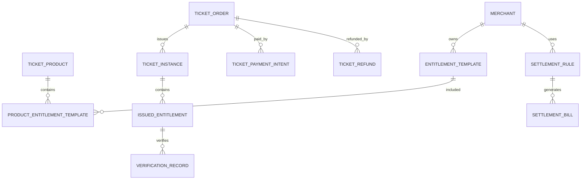

# 票务、通票、权益与结算专项拆分 V0.10

> **口径修订（2026-08-06 R10）：「场次容量」已废止**——BSM「容量控制」条 明确「**只按单个游乐项目的实时在玩人数控制容量，不再按场次/时段或点位/设备另设容量；排队人数不占用容量**」（DEC-R5-2026-08-04-04；R8 用户裁决 D-02）。本文原「场次容量」一律改称「**项目容量（实时在玩人数）**」；双阈值不变（运营容量软上限告警放行、安全容量硬上限阻断并自动停运）。仍按场次/时段或点位/设备维度罗列的页面、接口、组件与字段只作历史结构参考，容量口径一律以本条为准，相关字段待代码轮下线，期间不得据以新增受控维度。

本文档是【业务系统：票务、通票、权益、结算】专项维护文档。

> **权威提示**：三份冻结业务 HTML 是本文件唯一业务来源与最终判断标准；其他 PRD、设计、配置、代码和数据结构只能细化，不能覆盖三份 HTML。

范围包括：

- 票种
- 通票
- 权益项
- 商户权益归属
- 核销规则
- 渠道售票
- 订单支付
- 退款
- 分账
- 对账
- 结算

核心原则：

1. 平台可以统一售票，但权益必须拆分到具体归属方。
2. 酒吧和游乐设施是不同经营主体，不能混账。
3. 一张通票可以包含多个商户权益，但每个权益项都要独立核销、独立留痕、独立结算；P0 支持酒吧通票、游乐通票、酒吧 + 游乐通票，以及含餐饮/零售优惠折扣的组合通票。
4. 所有售票、支付、退款、核销、分账、对账、结算动作都必须写入事件中心。
5. 第三方渠道、餐饮、零售、酒吧、游乐公司接入时，必须通过开放平台与安全鉴权系统。

执行口径：本文是票务、通票、权益与结算专项拆分文档，负责业务对象和结算语义，不直接冻结正式后端路径。票务 P0 Controller、客人端/一体机/工作手机 API client、SDK/mock 和接口自动化必须以 `docs/openapi/openapi-p0.yaml/json`、`p0-openapi-operation-acceptance-matrix-v0.1.md` 和 `p0-openapi-contract-closure-appendix-v0.1.md` 为准；未进入追溯附录并通过 `verify:openapi-closure` 的售票、核销、权益、退款、分账或结算能力，不得作为正式联调或验收依据。

## 1. 系统边界

### 1.1 本系统负责

| 范围 | 说明 |
|---|---|
| 票种定义 | 单日票、夜场票、酒吧票、游乐票、派对票/活动票（两者等价）、通票和组合通票 |
| 通票定义 | 一个可售产品包含多个权益项，支持酒吧、游乐、酒吧 + 游乐和含餐饮/零售优惠折扣的组合 |
| 权益拆分 | 将通票拆成入园、酒吧、游乐、餐饮、零售等权益 |
| 权益归属 | 每个权益项按票种经营域绑定域主管公司和实际提供商户 |
| 库存容量 | 控制票种库存；游乐容量只按单个项目的实时在玩人数控制（原「场次容量」已废止，见文首口径） |
| 售票订单 | 自营渠道订单、第三方渠道订单 |
| 支付记录 | 微信、支付宝、银行卡、现金、企业转账等支付流水 |
| 核销记录 | 在线二维码由工作手机或检票设备扫码核销，第三方履约结果按授权接口回传；有手环则当前场次内允许入场 |
| 退款规则 | 售出原则上不退；普通退款仅限完全未核销票的五种情形及最高权限逐笔例外；已开始核销仅保留通票安全例外 |
| 分账规则 | 按已审批生效的固定金额、比例或核销规则分账；需要组合时组合既有规则 |
| 对账结算 | 支付流水、订单流水、核销流水、第三方流水对账 |

酒吧门口或前台的售票型一体机只能售卖本酒吧单店门票，不得售卖综合体通票，也不得提供取票功能。

### 1.2 本系统不直接负责

| 范围 | 说明 |
|---|---|
| 餐饮POS完整点餐 | 由第三方餐饮系统负责 |
| 零售POS完整收银 | 由第三方零售系统负责 |
| 酒吧完整库存和点单 | 由酒吧经营系统负责，但票务权益要接入 |
| 游乐排队和设备巡检 | 由游乐运营系统负责，但票务核销要接入 |
| 第三方支付清结算底层 | 由支付机构负责，本系统记录和对账 |

## 2. 领域模型

### 2.1 核心领域对象

| 对象 | 中文名 | 说明 |
|---|---|---|
| TicketProduct | 票务产品 | 可售卖的票种 |
| TicketPackage | 通票 | 一个组合通票，可包含多个权益 |
| Entitlement | 权益项 | 票内可被核销或兑换的具体权益 |
| EntitlementRule | 权益规则 | 权益可用时间、次数、范围、限制 |
| TicketInventory | 票库存 | 票种总量与已售数量；现行实现直接落在 `ticket_types`，不另建库存表 |
| SalesChannel | 销售渠道 | 官方 App/小程序同步建设；P0 第三方只接美团、大众点评、抖音团购渠道 |
| TicketOrder | 票务订单 | 游客购票订单 |
| TicketInstance | 父票实例 | 一个订单中每购买一张票形成一个父票实例 |
| IssuedEntitlement | 已发放权益实例 | 每张票拆出的权益实例 |
| VerificationRecord | 核销记录 | 权益使用记录 |
| TicketPaymentIntent | 支付意图 | 官方线上、第三方渠道或现场支付的票务支付记录 |
| TicketRefund | 退款单 | 针对订单中的完整票实例发起；内部展开被选父票下全部权益明细 |
| SettlementRule | 结算规则 | 商户收入分配规则 |
| SettlementBill | 结算单 | 按周期生成的商户结算单 |
| ReconciliationRecord | 对账记录 | 支付、订单、核销、第三方流水比对 |

### 2.2 对象关系

## 3. 产品与权益设计

### 3.1 票务产品分类

| 类型 | 示例 | 特点 |
|---|---|---|
| 单日票、夜场票、节假日票 | 单日票、夜场票、节假日票 | 按票种所属经营域归属，不归顶层平台 |
| 酒吧票 | 酒吧入场票、派对票/活动票 | 派对票与活动票等价；单一酒吧门票归对应酒吧商户，酒吧通票归酒吧域规则 |
| 游乐票 | 单项目票、游乐通票 | 票款和游乐核销收入归游乐公司，具体权益绑定实际游乐项目 |
| 演出票 | 演出场次 | 定价、售票、收入归传媒公司 |
| 联合通票 / 综合通票 | 酒吧 + 游乐，或酒吧 + 游乐 + 餐饮/零售优惠折扣券 | 多商户权益组合，餐饮/零售由第三方承接。**定价（2026-07-28 A）**：售价 =（游乐价 + 酒吧价 + 收费的餐饮/零售价）× 票种折扣，**免费的（票面价 0）不计入价值**；**分账见 §7.1 综合／联合通票行** |
| 多人票（团队票） | 企业团建、团队 | 记录可用人数；价格按基础价派生或固定额覆盖；各人须在同一场次内完成入场，可分别核销 |
| 赠票 | 赠票 | 赠票作为票务产品类型；其中每项零元免费权益仍须逐项标注出资方并按收费与免费权益结算规则处理 |

票务产品分类还须覆盖平日票、周末票、节假日票、成人票、学生票、新人票、一人多次票和通票，不得因数据库枚举缺项而删减 HTML 票种。

有效期按日票、周票、月票、年票等票种规则配置；票务二维码按日票、周票、月票、年票等票种设置有效期。

### 3.2 权益项分类

| 权益类型 | 示例 | 核销方式 | 归属 |
|---|---|---|---|
| 入园权益 | 园区入场一次 | 在线二维码完成检票环节；有手环则当前场次内允许入场 | 按票种经营域 |
| 酒吧入场 | 酒吧夜场入场 | 酒吧入口核销 | 酒吧商户 |
| 酒水兑换 | 指定酒水1杯 | 吧台在线扫码 | 酒吧商户 |
| 卡座预约入场名额 | 卡座预定者按卡座配置携客免通票入场 | 酒吧入口/开台校验，仅限预定卡座所在酒吧 | 酒吧商户 |
| 游乐次数 | 某项目玩1次 | 项目入口核销 | 游乐商户 |
| 游乐通玩 | 多项目不限次或限次 | 项目入口扣次 | 游乐商户 |
| 餐饮券 | 折扣型、券核销型 | 折扣型由平台完成核销且第三方 POS 不逐张回传；券核销型由第三方 POS 逐张回传 | 餐饮商户 |
| 酒吧简餐权益 | 简餐套餐 | 酒吧核销 | 酒吧商户 |
| 零售券 | 折扣型、券核销型 | 折扣型由平台完成核销且第三方 POS 不逐张回传；券核销型由第三方 POS 逐张回传 | 零售商户 |
| 服务权益 | 机器人配送、导览 | 对应服务记录 | 实际提供商户 |
| 积分兑换虚拟券 | 积分商城兑换形成的虚拟券 | 按履约通道核销 | 按冻结 HTML 的积分兑换与收费/免费权益规则 |

简餐套餐作为餐饮券或酒吧简餐权益。

### 3.3 权益必须具备的字段

每个权益项必须明确：

| 字段 | 说明 |
|---|---|
| 权益名称 | 例如酒吧入场、游乐项目A一次 |
| 权益类型 | 入园、酒吧、游乐、餐饮、零售等 |
| 权益归属主体 | 按票种经营域和实际提供方记录，不得笼统归顶层平台 |
| 可核销地点 | 闸机、酒吧入口、吧台、游乐项目、第三方POS |
| 可用时间 | 固定日期、购买后N天、指定场次、指定时段 |
| 可用次数 | 1次、多次、每日一次、不限次 |
| 是否可退款 | 按完整票实例配置；一张票不得拆分退款，部分退款只表示同一完全未核销订单中退回部分完整票实例 |
| 结算方式 | 固定金额、比例分成、按核销，或组合既有固定金额与比例规则 |
| 成本归属 | 谁承担该权益成本 |
| 留痕要求 | 是否需要视频、设备、第三方回传；自动留痕不足时由人工补充原因和证据，不构成人工放行 |

## 4. 多商户归属与混账防控

### 4.1 通票拆分示例

一张“全场夜玩通票”售价 399 元，包含：

| 权益 | 归属方 | 核销点 | 结算方式 |
|---|---|---|---|
| 园区夜场入场 | 按票种经营域归属 | 园区入口 | 按票种经营域规则结算 |
| 游乐项目3次 | 游乐公司A | 项目入口 | 按核销每次30元 |
| 酒吧入场 | 酒吧公司B | 酒吧入口 | 按酒吧通票可分配池的两段规则结算 |
| 指定酒水1杯 | 酒吧公司B | 吧台 | 按核销每杯25元 |
| 餐饮代金券30元 | 餐饮商户C | 餐饮POS | 按实际核销结算 |

销售时只有一个订单，但出票后必须拆成多个权益实例。

### 4.2 防混账规则

| 规则 | 说明 |
|---|---|
| 票务产品和权益项均按票种经营域记录归属；权益项还须绑定实际提供商户 |
| 核销记录必须绑定权益实例，不能只绑定订单 |
| 结算不能只按订单金额分，需要按权益规则或核销结果分 |
| 酒吧和游乐权益不能共用一个商户ID |
| 第三方回传核销必须带开放应用ID、商户ID、权益实例ID或券码 |
| 平台后台可看全局，商户后台只能看自己权益、核销、结算 |

## 5. 核销规则

### 5.1 核销类型

| 类型 | 说明 |
|---|---|
| 一次性核销 | 权益只能用一次 |
| 多次扣次 | 权益有总次数，每核销一次扣一次 |
| 限时核销 | 只能在指定时间窗口使用 |
| 场次核销 | 必须绑定具体场次 |
| 第三方回传核销 | 餐饮、零售、机器人等第三方系统回传 |

### 5.2 核销校验顺序

1. 工作手机或检票设备在线扫描动态二维码；有手环时只校验是否属于当前场次。
2. 找到对应已发放权益。
3. 校验权益状态是否可用。
4. 校验当前核销点是否允许使用该权益。
5. 校验当前时间是否在可用时间内。
6. 校验剩余次数或库存。
7. 校验商户归属和员工权限。
8. 写入核销记录。
9. 更新权益状态或剩余次数。
10. 写入事件中心。
11. 向结算交易流水（`settlement_transactions`）追加不可变交易事实；账期汇总时才生成 `settlement_bills` / `settlement_items`。

### 5.3 票务策略状态

票务策略状态为：草稿（规则未发布）、待启用（规则已配置但未到生效时间）、售卖中（当前可售卖）、暂停售卖（临时停止售卖）、已结束（售卖周期结束）、归档（历史策略）。

### 5.3A 票/权益状态

| 状态 | 说明 |
|---|---|
| unused | 未使用 |
| partially_used | 部分使用 |
| used | 已使用 |
| expired | 已过期 |
| refunded | 已退款 |
| voided | 已作废 |

退款、风控或争议期间的临时不可用由独立阻断字段和对应业务单据表达，不改变上述六种票/权益业务状态。

### 5.4 核销记录状态与入场流程

核销记录中文业务态仅为成功、拒绝（规则不允许）、失败（设备或网络原因）、已冲正、待复核、异常。逐级升级到最高一级仍超时的，转「异常」并按「票务异常队列」处置，不得自动通过、不得自动作废。综合体入场依次经过安检、年龄核验、检票三道环节；前两道不产生票务核销记录，检票环节内部扫码即核销，不设先预检后确认，也不提供人工放行。年龄核验未通过不得进入检票环节；设备尚未安装或故障时改为人工抽查且不得标记为已完成年龄核验；人脸误拒经现场人工复核放行的，当场生成不含身份信息、核销即作废且不可复用的一次性放行凭据。学生票不等于成年，仍须满足 18 岁限制。

> **当前实现缺口**：V067 的 `ticket_verifications.status` 仍保留 `manual_overridden` 且缺 `pending_review/exception`；Java 仍暴露核销 `preview`、`manual-override`，终端 `offline_verification` 仍进入核销。须移除或禁用这些旧入口并迁移状态约束；现行代码不得反向定义本节业务六态和在线扫码即核销规则。

安检环节设备（X 光）尚未安装或发生故障时，由现场人员以人工开包、目视方式查验，查验标准与设备安检一致；不生成按人安检记录，只记录设备状态、故障事件与维修工单。

一个场次是一次开门到关门，跨夜场次以实际闭店时间为准、不按自然日切分。完成检票后票绑定当前场次，同一场次内可重复进出且不重复扣减入场次数；多人票各人在同一场次内可分别入场；有手环则当前场次内允许入场。场次结束时，已完成检票但未核销的附带权益按场次终结制处理；多人票中从未完成检票的人份按「到期未核销款」于该场次结束时处理，两者分别立项、不合并；多次票剩余未开启的入场次数按冻结 HTML 保留。

- **营业兜底与异常出入**：大楼门票检查或权益核验系统损坏、下一班次开始前仍未修复时，免票供所有人员进入；卡座与散台不受影响，兜底期间通票不得兑换酒水权益，受影响时段或场次按全园故障补偿规则延长原票核销权，不发新票、不改变原票核销次数。游乐全园故障批量发放补偿通票前，须由游乐公司负责人与工程或安全岗位共同确认；故障状态生效后，立即停止所有纯游乐门票和所有包含游乐权益通票的新销售。高频出入达到配置阈值时由系统自动预警，楼宇保安团队调阅出入录像核查疑似借票；查实借票后关闭该客人账户、账号作废，并列入黑名单不允许再进入。
- **权益转赠**：只允许按完整权益单位转赠；接收人确认领取、原持有人自行核销、原持有人再次转赠三者以最先成功为准。确认领取前不冻结权益；转赠窗口逐人计算，截止于该人完成检票环节，并继承同一场次限制；场次已结束时确认领取不可点击，但转赠动作本身不因此被阻止；一人多次票首次核销后不得再转赠剩余次数。接收人确认领取成功后，原持有人的旧动态码及旧领取凭据立即失效。

## 6. 订单、支付与退款

### 6.1 订单状态

下表是对客订单展示态，由支付、出票、生命周期、核销和退款事实派生，不得落成一列独立持久化枚举。

| 状态 | 说明 |
|---|---|
| pending_payment | 待支付 |
| paid | 已支付 |
| ticket_issued | 已出票 |
| partially_verified | 部分核销 |
| completed | 已完成 |
| refunding | 退款中 |
| partially_refunded | 部分退款 |
| refunded | 已全额退款 |
| cancelled | 已取消 |
| closed | 已关闭：超过支付时限系统自动关闭，无人工干预 |
| exception | 异常 |

支付时限是全平台统一可配的业务参数，出厂默认 5 分钟，上下限出厂为 1 至 30 分钟。

> **当前实现缺口**：`TicketOrderExpiryJob` 的 `ticket.order.expiry.unpaid-timeout-minutes` Java 缺省值仍为 30 分钟，生产配置未覆盖为出厂默认 5 分钟，也未实现 1 至 30 分钟配置边界校验；须按上句修复。

购票前必须向客人展示票种适用条件、有效期、退款限制、转赠限制、核销规则及包含的权益；客人确认后方可支付。

### 6.2 支付状态

| 状态 | 说明 |
|---|---|
| pending | 待支付 |
| processing | 支付中 |
| success | 支付成功 |
| failed | 支付失败 |
| cancelled | 已取消 |
| reversed | 已冲正 |

支付成功后必须出票并发放权益；支付成功但出票失败时，系统自动按原支付路径全额退款，不得形成已收款未出票的悬挂订单。

### 6.3 退款规则

| 场景 | 规则 |
|---|---|
| 完全未核销 | 售出原则上不退；只有票种规则明确允许、活动或场次取消、平台或履约方无法提供服务、重复扣款、法律法规要求五种情形才可退款；五种情形外须最高权限逐笔放行 |
| 已开始核销（含部分核销） | 不可退款，不存在同一订单既部分核销又部分退款；唯一例外为通票安全例外 |
| 已核销后的冲正 | 只撤销原核销事实并生成反向记录，不扩展成普通退款入口 |

同一完全未核销订单可选择一个或多个完整票实例退款；对客显示的“部分退款”仅指本次只退了订单中的部分完整票实例，不得拆分单张票、单个权益或部分次数退款。

> 修订说明（2026-06-07）：补退款粒度口径。按《统一口径基准》D9，P0 客人侧按订单/票发起退款，系统内部按权益逐项冲正与金额拆分（单位：分）；复杂退款规则引擎列 P1。依据 finding ticket-7。

退款必须触发：

1. 退款申请记录。
2. 人工申请、额度内自助和系统批量三条发起路径均进入同一授权与复核链；申请人不得审批自己的申请。
3. 支付机构退款。
4. 权益状态更新。
5. 结算冲正。
6. 事件中心留痕。

## 7. 分账、对账与结算

### 7.1 分账方式

| 方式 | 示例 |
|---|---|
| 固定金额 | 酒吧通票第一段按已审批生效的固定金额分配 |
| 比例分成 | 某票种销售额酒吧分20% |
| 按核销结算 | 游乐项目每核销一次结算30元 |
| 按内部结算价 | 免费权益核销后按票种发布时锁定的内部结算价结算 |
| 固定金额与比例组合 | 组合使用已审批生效的固定金额、固定单价或比例规则 |
| 域主管公司承担差额 | 域主管公司将权益对客价格或域内分配价格定得低于内部结算价时，由该域主管公司承担差额 |
| 商户让利 | 只有商户主动申请并书面确认让利的零元免费权益由商户承担，且不结算 |

> 以下分账具体口径只认三份冻结 HTML；到期未核销票款和场次终结未核销份额均按票种经营域归属，不一律归项目公司。

| 客人付款 | 收款/分账主体 | 具体口径 |
|---|---|---|
| 通票（单业态，纯酒吧通票） | 娱乐平台公司 + 各酒吧商户 | 整单先扣一次通路费；经第三方渠道售出的再扣一次销售渠道费；再扣一次票务积分发行成本；酒吧份额继续扣赠送权益预估成本与门票综合服务费（同一项只扣一次，归娱乐平台公司，后台可配且须配置上下限）；剩余进入酒吧通票可分配池并按已生效的两段规则分配 |
| **综合／联合通票（多业态）** | 各域主管公司 + 实际提供商户 | 整单先扣通路费；经第三方渠道售出的再扣销售渠道费；再扣一次票务积分发行成本；然后按各业态价格占比拆域。游乐份额归游乐公司，餐饮/零售域主管公司为城市项目公司，演出归传媒公司；仅酒吧份额继续扣赠送权益预估成本与门票综合服务费。收款主体按已审批规则与实际提供商户结算，不把域份额直接确认为商户收入 |
| 订台低消 / 二次消费 / 额外酒水 | **各酒吧商户** | 按实际消费/销售逐笔入账 |
| 非散台服务费（仅包厢/卡座） | **对应酒吧商户代收** | 服务费率出厂默认 10%、后台可配且须配置上下限；计费基数细化为实际低消加二次消费，散台不收。月结定格的应发部分作代收代付、不计商户收入，扣留部分才计入商户收入 |
| 向商户供货的货款 | **中央餐饮公司** | 供应链主体：向各商户供货并收货款，主要面向内部及参股商户，少量第三方商户 |
| 游乐票 | 游乐公司 | 已核销部分按规则结算给游乐公司；未核销部分按票种经营域归属 |
| 演出票 | 传媒公司 | 已核销部分按规则结算给传媒公司；未核销部分按票种经营域归属 |
| 场地租金 / 商业租金 | **长沙项目公司**（= 资产公司，同一主体两个叫法） | 向第三方商户收取租金与相关物业费用；资产业态不单设主体 |

> **收款与收入归属**：娱乐平台公司统一收取单一酒吧门票和跨域组合通票票款，但收款主体不等于收入归属主体。拆分后属于其他经营域的份额，自收款之日起即为应付对应域主管公司的款项，不得确认为娱乐平台公司收入、不得挪用；每项权益还须绑定实际提供商户。
>
> **门票综合服务费**：只适用于酒吧相关票务并归娱乐平台公司。单一酒吧门票按每张票在比例或固定金额中二选一，可设月度封顶；比例计费基数为订单保存的最终选中价，不先扣第三方渠道费。单一酒吧门票的配置按物理项目分别维护，初始为空且不继承酒吧通票默认比例；发布前必须选定方式并填写数值，否则不得发布。酒吧通票和跨域酒吧份额不得封顶；纯游乐票、纯游乐通票和演出票不收。
>
> **单店现金/银行卡票款**：单一酒吧门票以现金或银行卡支付的，票款形成酒吧商户对娱乐平台公司的应付款，沿用自然月计费、次月出账，并落在后台统一配置的三个付账日之一。门票综合服务费另列账单行，同样落在三个付账日；票款与服务费分别按总额入账，不得净额轧差。
>
> **组合通票定价与尾差**：售价 = 各经营域价格之和 × 票种折扣，零元免费权益不计入价值。折后整数尾数允许集合为业务参数，出厂默认 8、9、0；允许误差为业务参数，出厂默认 5 元并须配置上下限。超过允许误差的价格不得发布；允许范围内的差额按各域原价占比分摊，尾差单独留痕，并与票种版本一并锁定。
>
> **酒吧票演出加价**：酒吧票包含演出加价时，仍由娱乐平台公司收款，再按生效规则把演出加价分配给传媒公司；传媒公司独立销售的演出票由传媒公司收款。
> 赠送权益：票内加赠的酒水/小食/餐饮/零售每样都是独立权益，绑定实际提供商户并在对应点位核销。商户让利型零元权益不结算；域主管公司出资型按锁定内部结算价核销后结算，由对应域主管公司承担差额，不一律由娱乐平台公司结算。
> **可分配池两段分配（2026-07-28 D，替代原「排名档位/每客单价/固定额三选一」）**：第一段——「每客单价 / 固定额」的酒吧按约定**绝对金额先拿**；第二段——**余额**（= 池 − 第一段合计）由其余「排名档位」酒吧按档位比例**分尽**；**拿了第一段的不再参与第二段**。
> 第一段配置生效前，必须按当前最不利组合试算最低可能可分配池；第一段合计不得超过该池。确需超池的，须事前取得项目之上的平台权限批准，超出部分由娱乐平台公司承担，短期激励初始有效期上限出厂默认三个月、后台可配且须有上下限；结算时不再追加“超池待审批”。第二段按本张票的参与家数读取对应档位行，行内比例合计必须为 100%；缺少对应行时该票暂挂并生成补配待办，不得就近套用其他行。排名按本张票第二段参与酒吧的当期核销入场人数确定；并列者共同占用连续名次并取这些档位比例的算术平均值。未核销酒吧的应分比例从池中减除并按票种经营域单列归属，不由其余酒吧重新分配。第一段名单、金额/单价和第二段档位表变更均须提前通告，通告期出厂默认一个月、后台可配且须有上下限，只对通告生效后新售出票适用；仅因缺行暂挂的既售出票在补配行生效后按该行续算。没有第一段对象时全池进入第二段；没有第二段参与者时，余额单列为未分配池并归娱乐平台公司。
> **免费权益成本承担（2026-08-30）**：票面价 0 的免费权益按成本承担方分两类——①**商户让利型**：商户主动申请并书面确认让利，不结算；②**域主管公司出资型**：由对应域主管公司按锁定内部结算价与实际提供商户结算并承担差额。两类均不参与份额拆分；承担方须在票种配置标明。
> **实现状态（如实标注）**：综合／联合通票的业态份额拆分层、两段分配、免费权益成本承担方字段，**代码均未实现**，见 `settlement-rebuild-prd-v1.0.md` §5.0c ⑤ / §5.1 / §6.6。

### 7.2 对账维度

| 维度 | 说明 |
|---|---|
| 订单流水 | 系统订单金额 |
| 支付流水 | 支付机构成功金额 |
| 出票流水 | 实际出票数量 |
| 核销流水 | 实际使用权益 |
| 退款流水 | 退款金额和退款权益 |
| 第三方流水 | 餐饮、零售、渠道回传 |
| 结算流水 | 应结、已结、冲正、扣款 |

### 7.3 结算单状态

| 状态 | 说明 |
|---|---|
| draft | 草稿 |
| pending_review | 待复核 |
| confirmed | 已确认 |
| adjusted | 已调整 |
| archived | 已归档 |

## 8. 现行数据库映射与实现缺口

> 本章按仓库现行 Flyway 和 Java 实现记录物理载体，不再把早期草案表名写成已建表。三份冻结业务 HTML 决定业务语义；物理表只能承载，不能缩减票种、渠道、价格资格或结算规则。

### 8.1 票种、权益、库存与渠道

| 业务对象 | 现行物理载体 | 当前口径 |
|---|---|---|
| 票务产品 | `ticket_types` | 使用 `id`、`ticket_name`、平日/周末/节假日价格、状态、有效期及刷新周期等字段；`stock_quantity` 为空表示不限量，`sold_quantity` 记录已售数量 |
| 产品权益配置 | `ticket_type_entitlements` | `ticket_type_id` 绑定 `entitlement_template_id`，记录数量、次数、价值及生效规则 |
| 权益模板 | `entitlement_templates` | 记录权益名称、类型、默认次数、默认价值和状态；商户、场地、项目等实际归属落在发放后的权益实例 |
| 票库存 | `ticket_types.stock_quantity`、`ticket_types.sold_quantity` | 现行没有 `ticket_inventories` 物理表；不得再引用已删除的原型迁移 |
| 销售渠道 | `ticket_orders.sales_channel` | 现行没有 `sales_channels` 物理表。P0 第三方渠道为 `meituan`、`dianping`、`douyin`；官方 App/小程序同步建设，一体机仅承接获授权的本酒吧单店门票 |

票务产品必须覆盖平日票、周末票、节假日票、成人票、学生票、多人票、新人票、会员价票、渠道价票、动态价票、一人多次票、单日票、夜场票、酒吧票、游乐票、派对票/活动票、酒吧通票、游乐通票、跨域组合通票、赠票和演出票。现行 `ticket_types.ticket_category` 只承载标准/新人/学生分类，不是完整 `product_type` 枚举；不得用该字段删减业务票种。

价格快照必须保存最终选中价及其命中的全部资格和规则版本，覆盖多人、新人、学生、会员、渠道、动态等条件，不得只记录一个互斥的 `derived_price_type`。

### 8.2 订单、出票、凭证与核销

| 业务对象 | 现行物理载体 | 当前口径 |
|---|---|---|
| 订单 | `ticket_orders` | 记录票种、数量、渠道、金额、支付态、出票态及订单生命周期；对客展示态仍由支付、出票、核销、到期和退款事实派生 |
| 订单明细 | 无 | `ticket_order_items` 已由 V283 删除，任何文档和代码不得再依赖该表 |
| 父票实例 | `ticket_instances` | 一个订单中每购买一张票形成一行，以 `order_id + seq_in_order` 唯一；记录票号、票种、人数、次数、持有人及首次使用事实 |
| 权益实例 | `issued_entitlements` | 通过 `parent_ticket_id` 和 `slot_index` 归入父票及人员权益组；每个权益独立记录商户、场地、点位、次数、价值、有效期与业务状态 |
| 动态凭证 | `ticket_credentials` | 保存凭证哈希、nonce、刷新窗口、HMAC 签名与版本；现行写入时不持久化二维码明文 token，失效或消费后也清空明文 |
| 核销记录 | `ticket_verifications` | 通过 `entitlement_id` 关联权益实例，记录凭证类型、设备、点位、员工、商户、nonce、窗口与签名校验结果以及核销状态 |
| 支付意图 | `ticket_payment_intents` | 通过 `business_order_type + business_order_id` 关联业务订单，记录金额、渠道和支付状态 |

`ticket_instances.status` 的 `active/refund_pending/refunded/forfeited/transferring` 是退款、到期、转赠流程使用的内部技术态，不得当成第 5.3A 节的六种票/权益中文业务态。现行到期任务写入 `forfeited`，与业务“已过期”展示映射尚未收口，必须作为实现缺口保留；不得反向把业务态改成“没收”。

### 8.3 退款物理映射

| 业务对象 | 现行物理载体 | 当前口径 |
|---|---|---|
| 退款单 | `ticket_refunds` | `target_id` 关联原订单，记录金额、原因、渠道、状态、申请人、审批人、受理商户及成功时间 |
| 退款明细 | `ticket_refund_lines` | 通过 `refund_id` 关联退款单，并记录订单、权益、行类型、退款金额和退款前次数快照 |
| 退款选择粒度 | `ticket_instances` + `issued_entitlements.parent_ticket_id` | 请求中的 `ticket_instance_ids` 必须解析为完整父票实例；每个被选父票下的全部权益一并进入退款处理，不得选择单个权益或部分次数 |

退款业务分类保留 `full`、`partial`、`entitlement`；现行 `ticket_refunds` 尚无 `refund_type` 物理字段，属于实现缺口。对客“部分退款”只能表示同一完全未核销订单退回部分完整票实例，不能解释为拆分一张票、一个权益、部分次数或部分金额。

人工申请、额度内自助和系统批量三条路径必须共用授权与复核链，申请人不得审批自己的申请。现行分级授权的自助完成路径可能把 `requested_by` 与 `approved_by` 写成同一主体，属于职责分离实现缺口。只有 `success` 计入已退金额；退款成功后须触发权益冻结/失效、按已批准路径退回资金、结算冲正与事件留痕。

### 8.4 结算物理映射

| 业务对象 | 现行物理载体 | 当前口径 |
|---|---|---|
| 收入归属规则 | `merchant_revenue_attribution_rules` | 记录责任主体与收入归属；收款主体与收入主体必须分开 |
| 平台留存、赠送成本与酒吧分配配置 | `platform_retention_rules`、`giveaway_cost_configs`、`ticket_distribution_configs`、`ticket_distribution_rank_tiers`、`ticket_distribution_merchant_rates` | 只承载已审批并版本化的规则；不得以旧表字段覆盖第 7.1 节的两段池规则 |
| 核销与未核销结算流水 | `settlement_transactions` | 溯源权益、订单、票种和核销记录；现行直接类型为核销结算与到期未核销归属，不得由售票成功直接生成商户结算收入。现行 `unverified_expired + beneficiary_type=project` 不能表达各票种经营域归属，属于实现缺口 |
| 月度结算单及明细 | `settlement_bills`、`settlement_items` | 记录账期、池金额、各商户分配和过账状态；业务展示状态仍按第 7.3 节映射 |
| 结算对账 | `settlement_reconciliation_status` | 比较新旧结算口径并留存差异；第三方渠道、餐饮和零售流水还须进入统一对账链 |
| 发票与内部结算价 | `settlement_invoice_items`、`internal_price_catalog` | 分别承载结算发票明细和经审批的内部结算价版本 |

餐饮和零售必须先区分折扣型权益与券核销型权益：折扣型由平台完成核销并写平台核销记录，商户只在自身 POS 录入折扣率或扣减金额，不需要第三方逐张回传；券核销型由第三方 POS 逐张回传核销结果。两类再按收费或免费、归属主体及内部结算价进入结算。票务售卖成功只形成收款、出票与价格快照，不直接确认实际提供商户的核销收入。

## 9. 核心接口清单第一版

> 2026-06-13 执行口径：本章 `/api/ticket-products`、`/api/ticket-orders`、`/api/entitlement-templates`、`/api/verifications` 等路径是早期票务能力拆解草案，只作为理解票务产品、订单、权益、核销、退款和结算能力边界的历史能力路径，不是 P0 正式 Java Controller、SDK/mock、接口自动化或供应商联调路径。P0 正式接口必须以 `docs/openapi/openapi-p0.yaml/json`、`p0-openapi-operation-acceptance-matrix-v0.1.md` 和 `p0-task-api-permission-event-acceptance-map-v0.1.md` 为准；未进入 OpenAPI 且未通过 `npm run verify:p0-contract` 的能力不得标记为 P0 可联调。

### 9.1 票务产品接口

| 接口 | 说明 |
|---|---|
| `POST /api/ticket-products` | 创建票务产品 |
| `GET /api/ticket-products` | 查询票务产品 |
| `GET /api/ticket-products/{id}` | 查看票务产品详情 |
| `PUT /api/ticket-products/{id}` | 修改票务产品 |
| `POST /api/ticket-products/{id}/publish` | 上架票务产品 |
| `POST /api/ticket-products/{id}/pause` | 暂停售卖 |

### 9.2 权益接口

| 接口 | 说明 |
|---|---|
| `POST /api/entitlement-templates` | 创建权益模板 |
| `GET /api/entitlement-templates` | 查询权益模板 |
| `POST /api/ticket-products/{id}/entitlements` | 给票务产品配置权益 |
| `GET /api/issued-entitlements` | 查询已发放权益 |

### 9.3 售票订单接口

| 接口 | 说明 |
|---|---|
| `POST /api/ticket-orders` | 创建订单 |
| `POST /api/ticket-orders/{id}/pay` | 发起支付 |
| `POST /api/ticket-orders/{id}/issue` | 支付后出票 |
| `GET /api/ticket-orders/{id}` | 查看订单详情 |
| `GET /api/ticket-orders` | 查询订单 |

### 9.4 核销接口

| 接口 | 说明 |
|---|---|
| `POST /api/verifications` | 执行扫码即核销的一次动作 |
| `POST /api/verifications/{id}/reverse` | 核销冲正 |
| `GET /api/verifications` | 查询核销记录 |
| `POST /api/open/verifications/callback` | 第三方核销回传 |

### 9.5 退款接口

| 接口 | 说明 |
|---|---|
| `POST /api/refunds` | 创建退款申请 |
| `POST /api/refunds/{id}/approve` | 审批退款 |
| `POST /api/refunds/{id}/reject` | 驳回退款 |
| `POST /api/refunds/{id}/execute` | 执行退款 |
| `GET /api/refunds` | 查询退款单 |

### 9.6 结算接口

| 接口 | 说明 |
|---|---|
| `POST /api/settlement-rules` | 创建结算规则 |
| `GET /api/settlement-items` | 查询待结算明细 |
| `POST /api/settlement-bills/generate` | 生成结算单 |
| `POST /api/settlement-bills/{id}/confirm` | 确认结算单 |
| `POST /api/settlement-bills/{id}/archive` | 归档已完成确认的结算单 |
| `GET /api/settlement-bills` | 查询结算单 |

## 10. 事件清单

| 事件 | 说明 |
|---|---|
| `ticket_product.created` | 创建票务产品 |
| `ticket_product.published` | 票务产品上架 |
| `ticket_order.created` | 创建订单 |
| `ticket_order.paid` | 订单支付成功 |
| `ticket.issued` | 出票成功 |
| `entitlement.issued` | 权益发放 |
| `entitlement.verified` | 权益核销成功 |
| `entitlement.verify_failed` | 权益核销失败 |
| `refund.requested` | 发起退款 |
| `refund.approved` | 退款审批通过 |
| `refund.executed` | 退款执行成功 |
| `settlement_item.created` | 生成待结算明细 |
| `settlement_bill.generated` | 生成结算单 |
| `settlement_bill.confirmed` | 结算单确认 |
| `settlement_bill.archived` | 结算单已归档 |
| `reconciliation.different` | 对账差异 |

## 11. 当前实现边界

仓库已存在票种与权益配置、订单与支付意图、父票实例、动态凭证 HMAC、在线核销、退款、结算流水和结算单的 Java/Flyway 实现；本文件不再把这些能力写成“下一步设计”。正式联调仍以第 9 章列明的 OpenAPI 闸口为准。

当前实现缺口只按本轮代码与三份冻结 HTML 的差异登记：

1. 到期任务仍写入内部态 `forfeited`，须与业务“已过期”展示映射收口。
2. 退款须阻止“同一订单已有任一票核销后，仍退其他未用票”的路径，并修正自助完成路径的申请/审批职责分离。
3. 票种、渠道与价格快照须完整承载演出票、大众点评以及会员/渠道/动态等全部命中资格。
4. 酒吧通票两段池、组合通票域间拆分、免费权益成本承担、服务费、尾差和收款/收入分离须按第 7.1 节补齐并验收。

## 12. 开发收口顺序

1. 先修票与退款状态、整票退款边界和职责分离，并用现有集成测试覆盖。
2. 再补票种/渠道/价格快照缺口，保持现有表与 OpenAPI 同步。
3. 最后按第 7.1 节逐项收口结算规则，并用金额守恒、尾差、未核销归属和退款冲正用例验证。

## 13. 变更日志

| 日期 | 类型 | 位置 | 内容 | 原因/依据 |
|---|---|---|---|---|
| 2026-08-30 | 改 | §5.2/§8.2/全文版本 | 版本升至 V0.10；结算交易改为追加不可变事实；票实例技术态的业务六态引用修正为 §5.3A | M03 Grok Build FULL3 修复切片复审 |
| 2026-08-30 | 改 | §5.2–§6.1/全文版本 | 版本升至 V0.09；核销阶段明确只写 `settlement_transactions`；拆开票务策略与票/权益状态标题；登记核销旧入口、状态值域和支付超时默认值实现缺口 | M03 Grok Build 最终全文交叉审计 |
| 2026-08-30 | 改 | §3.1/§7.1/全文版本 | 版本升至 V0.08；承接日票/周票/月票/年票有效期；执行门票综合服务费“出厂默认 20%”去、不写 HTML 裁决 | M03 第二次全文全量双审与 James 裁决 |
| 2026-08-30 | 改 | §5.3–§5.4/全文版本 | 版本升至 V0.07；补齐票务策略六态及最高级复核超时转异常出口 | M03 Grok Build 修复切片审计 ADV-S-001/003；James 已判 J-032/J-033 |
| 2026-08-30 | 改 | 全文，重点 §5–§8/§11–§12 | 对齐购票披露、支付出票、验龄、全园故障、转赠旧码、整票退款、收款与收入、组合定价尾差、单店现金/银行卡、服务费、演出加价和酒吧两段池；以现行 Flyway/Java 重写物理表映射并登记真实缺口 | M03 全量再审与 Grok Build 交叉审计；三份冻结 HTML、James 裁决及仓库现行实现 |
| 2026-08-30 | 改 | §1/§3/§5/§6/§8 | 补完整票种与权益枚举、简餐套餐、支付超时、安检人工开包、一体机边界；移除售罄及冻结独立业务态，修正退款票实例/权益实例关系与已删除迁移引用 | M03 全量交叉审计修复；三份业务 HTML 现文及 James 裁决 |
| 2026-06-07 | 历史 | 原 §8.5 sales_channels | 曾标注携程/旅行社为 P1+ 预留；现行无 `sales_channels` 物理表，P0 渠道见 §8.1 | 渠道 P0/P1 边界对齐 PRD §2、gap-analysis §4.1；finding ticket-6 |
| 2026-06-07 | 历史 | 原 §8.3/§8.9/§8.10 | 早期草案曾向 `product_entitlement_templates`、`issued_entitlements` 和核销记录添加多人字段；现行父票/人员组模型见 §8.2 | 多人票各人须在同一场次内完成入场并可分别核销；finding ticket-4 |
| 2026-08-30 | 改 | §1/§3/§4/§8/§9/§10/§11 | 归属统一到票种经营域；二维码刷新、手环当前场次、多人票、核销六态、结算五态和在线扫码即核销口径对齐三份业务 HTML；核销仅保留在线扫码一次动作 | M03 第一轮审计修复 |
| 2026-06-10 总控拍板 | 改 | §8.2 | 票务订单价格字段补基础日历价、派生价类型和固定价覆盖口径 | 总控最新票务策略拍板 |
| 2026-06-07 | 改 | §6.3 退款规则 | 补退款 P0 默认粒度（订单/票发起、内部按权益冲正） | D9 退款口径；finding ticket-7 |
| 2026-06-07 | 改 | §8.1–§8.16 金额字段 | 全部金额字段统一标注"单位分(D1)" | 金额单位统一 D1；finding devtech-3、fielddb-7 |
| 2026-06-08 | 历史 | 原 §8.4 ticket_inventories | 早期草案曾设计独立库存表；现行库存字段位于 `ticket_types`，见 §8.1 | 票务库存并发承载；R1、finding newtable-fk-1 |
| 2026-06-08 | 历史 | 原 §8.12 refund_orders | 早期草案曾设计 `refund_orders`；现行退款载体为 `ticket_refunds`、`ticket_refund_lines`，见 §8.3 | 退款资金流向与状态留痕；R2、finding fix2-conflict-2 |
| 2026-06-13 | 增 | §9 | 将早期 `/api/ticket-*`、`/api/entitlement-*`、`/api/verifications` 接口清单明确降级为历史能力路径；P0 正式联调以 OpenAPI、operation 验收矩阵、任务映射表和示例闸口为准 | 防止旧票务拆解路径被误作正式 Java Controller 或供应商联调路径 |
