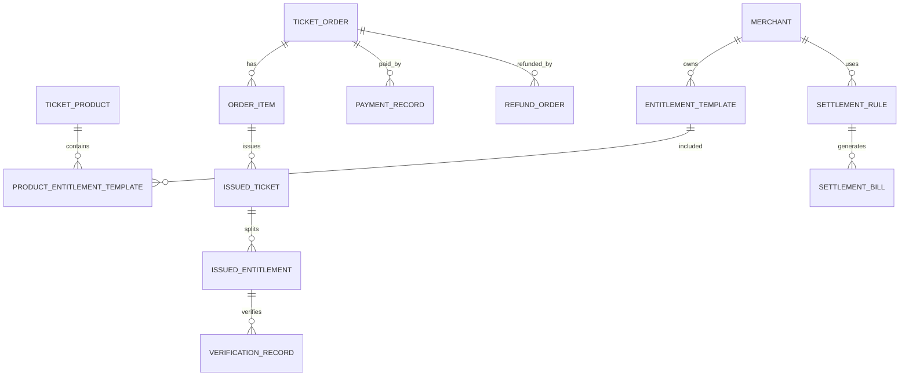

# 票务、通票、权益与结算专项拆分

本文档是【业务系统：票务、通票、权益、结算】专项维护文档。

> 2026-07-04 逻辑一致性修订：§7 补通票 6 主体分账口径表并标注权威来源；全文分账口径以 `settlement-rebuild-prd-v1.0.md` 为准，本文档为旧版拆分说明。

> **权威提示**：分账/结算的最终口径以 **`settlement-rebuild-prd-v1.0.md`（通票权益结算重构 PRD）** 为准。本文档 §7 为早期通用拆分，已按 PRD 补齐 6 主体口径；若两者冲突，以结算 PRD 为准。

范围包括：

- 票种
- 通票
- 权益项
- 商户权益归属
- 核销规则
- 渠道售票
- 订单支付
- 退款
- 分账
- 对账
- 结算

核心原则：

1. 平台可以统一售票，但权益必须拆分到具体归属方。
2. 酒吧和游乐设施是不同经营主体，不能混账。
3. 一张通票可以包含多个商户权益，但每个权益项都要独立核销、独立留痕、独立结算；P0 支持酒吧通票、游乐通票、酒吧 + 游乐通票，以及含餐饮/零售优惠折扣的组合通票。
4. 所有售票、支付、退款、核销、分账、对账、结算动作都必须写入事件中心。
5. 第三方渠道、餐饮、零售、酒吧、游乐公司接入时，必须通过开放平台与安全鉴权系统。

执行口径：本文是票务、通票、权益与结算专项拆分文档，负责业务对象和结算语义，不直接冻结正式后端路径。票务 P0 Controller、客人端/一体机/工作手机 API client、SDK/mock 和接口自动化必须以 `docs/openapi/openapi-p0.yaml/json`、`p0-openapi-operation-acceptance-matrix-v0.1.md` 和 `p0-openapi-contract-closure-appendix-v0.1.md` 为准；未进入追溯附录并通过 `verify:openapi-closure` 的售票、核销、权益、退款、分账或结算能力，不得作为正式联调或验收依据。

## 1. 系统边界

### 1.1 本系统负责

| 范围 | 说明 |
|---|---|
| 票种定义 | 单日票、夜场票、酒吧票、游乐票、活动票、套餐票 |
| 通票定义 | 一个可售产品包含多个权益项，支持酒吧、游乐、酒吧 + 游乐和含餐饮/零售优惠折扣的组合 |
| 权益拆分 | 将通票拆成入园、酒吧、游乐、餐饮、零售等权益 |
| 权益归属 | 每个权益项绑定平台或具体商户 |
| 库存容量 | 控制票种库存、权益库存、场次容量、项目容量 |
| 售票订单 | 自营渠道订单、第三方渠道订单 |
| 支付记录 | 微信、支付宝、银行卡、现金、企业转账等支付流水 |
| 核销记录 | 二维码、NFC、闸机、手持机、第三方回传核销 |
| 退款规则 | 全退、部分退、权益已核销后退、过期不可退 |
| 分账规则 | 按固定金额、比例、核销、保底、合同规则分账 |
| 对账结算 | 支付流水、订单流水、核销流水、第三方流水对账 |

### 1.2 本系统不直接负责

| 范围 | 说明 |
|---|---|
| 餐饮POS完整点餐 | 由第三方餐饮系统负责 |
| 零售POS完整收银 | 由第三方零售系统负责 |
| 酒吧完整库存和点单 | 由酒吧经营系统负责，但票务权益要接入 |
| 游乐排队和设备巡检 | 由游乐运营系统负责，但票务核销要接入 |
| 第三方支付清结算底层 | 由支付机构负责，本系统记录和对账 |

## 2. 领域模型

### 2.1 核心领域对象

| 对象 | 中文名 | 说明 |
|---|---|---|
| TicketProduct | 票务产品 | 可售卖的票种或套餐 |
| TicketPackage | 通票/套餐 | 一个组合票，可包含多个权益 |
| Entitlement | 权益项 | 票内可被核销或兑换的具体权益 |
| EntitlementRule | 权益规则 | 权益可用时间、次数、范围、限制 |
| TicketInventory | 票库存 | 票务产品可售库存 |
| EntitlementInventory | 权益库存 | 某权益可核销或可兑换库存 |
| SalesChannel | 销售渠道 | 官方 App/小程序同步建设；P0 第三方只接美团、大众点评、抖音团购渠道 |
| TicketOrder | 票务订单 | 游客购票订单 |
| OrderItem | 订单明细 | 一个订单中购买的票务产品 |
| IssuedTicket | 已出票实例 | 每张实际发给游客的票 |
| IssuedEntitlement | 已发放权益实例 | 每张票拆出的权益实例 |
| VerificationRecord | 核销记录 | 权益使用记录 |
| PaymentRecord | 支付流水 | 官方线上支付、第三方渠道支付或退款流水 |
| RefundOrder | 退款单 | 针对订单或权益的退款申请 |
| SettlementRule | 结算规则 | 商户收入分配规则 |
| SettlementBill | 结算单 | 按周期生成的商户结算单 |
| ReconciliationRecord | 对账记录 | 支付、订单、核销、第三方流水比对 |

### 2.2 对象关系

## 3. 产品与权益设计

### 3.1 票务产品分类

| 类型 | 示例 | 特点 |
|---|---|---|
| 平台入园票 | 单日票、夜场票、节假日票 | 权益归属平台 |
| 酒吧票 | 酒吧入场票、派对票、卡座票 | 权益归属酒吧商户 |
| 游乐票 | 单项目票、游乐通票、快速通道票 | 权益归属游乐商户 |
| 活动票 | DJ活动、主题夜、演出场次 | 可归属平台或商户 |
| 联合通票 | 酒吧 + 游乐，或酒吧 + 游乐 + 餐饮/零售优惠折扣券 | 多商户权益组合，餐饮/零售由第三方承接 |
| 团体票 | 企业团建、旅行社团队 | 可能按合同价结算 |
| 会员权益票 | 生日票、积分兑换票、赠票 | 可能无现金收入但有成本归属 |

### 3.2 权益项分类

| 权益类型 | 示例 | 核销方式 | 归属 |
|---|---|---|---|
| 入园权益 | 园区入场一次 | 闸机/手持机/NFC | 平台 |
| 酒吧入场 | 酒吧夜场入场 | 酒吧入口核销 | 酒吧商户 |
| 酒水兑换 | 指定酒水1杯 | 吧台扫码/NFC | 酒吧商户 |
| 卡座预约入场名额 | 卡座预定者按卡座配置携客免通票入场 | 酒吧入口/开台校验，仅限预定卡座所在酒吧 | 酒吧商户 |
| 游乐次数 | 某项目玩1次 | 项目入口核销 | 游乐商户 |
| 游乐通玩 | 多项目不限次或限次 | 项目入口扣次 | 游乐商户 |
| 快速通道 | 指定项目优先入场 | 项目入口核销 | 游乐商户 |
| 餐饮券 | 代金券、套餐券 | 第三方POS回传 | 餐饮商户 |
| 零售券 | 折扣券、兑换券 | 第三方POS回传 | 零售商户 |

### 3.3 权益必须具备的字段

每个权益项必须明确：

| 字段 | 说明 |
|---|---|
| 权益名称 | 例如酒吧入场、游乐项目A一次 |
| 权益类型 | 入园、酒吧、游乐、餐饮、零售等 |
| 权益归属商户 | 平台、酒吧公司、游乐公司、餐饮商户 |
| 可核销地点 | 闸机、酒吧入口、吧台、游乐项目、第三方POS |
| 可用时间 | 固定日期、购买后N天、指定场次、指定时段 |
| 可用次数 | 1次、多次、每日一次、不限次 |
| 是否可拆分退款 | 可退、不可退、核销后不可退 |
| 结算方式 | 固定金额、比例分成、按核销、按保底 |
| 成本归属 | 谁承担该权益成本 |
| 留痕要求 | 是否需要视频、设备、人工确认、第三方回传 |

## 4. 多商户归属与混账防控

### 4.1 通票拆分示例

一张“全场夜玩通票”售价 399 元，包含：

| 权益 | 归属方 | 核销点 | 结算方式 |
|---|---|---|---|
| 园区夜场入场 | 平台 | 园区入口 | 平台留存 |
| 游乐项目3次 | 游乐公司A | 项目入口 | 按核销每次30元 |
| 酒吧入场 | 酒吧公司B | 酒吧入口 | 固定50元 |
| 指定酒水1杯 | 酒吧公司B | 吧台 | 按核销每杯25元 |
| 餐饮代金券30元 | 餐饮商户C | 餐饮POS | 按实际核销结算 |

销售时只有一个订单，但出票后必须拆成多个权益实例。

### 4.2 防混账规则

| 规则 | 说明 |
|---|---|
| 票务产品可归属平台，但权益项必须有归属商户 |
| 核销记录必须绑定权益实例，不能只绑定订单 |
| 结算不能只按订单金额分，需要按权益规则或核销结果分 |
| 酒吧和游乐权益不能共用一个商户ID |
| 第三方回传核销必须带开放应用ID、商户ID、权益实例ID或券码 |
| 平台后台可看全局，商户后台只能看自己权益、核销、结算 |

## 5. 核销规则

### 5.1 核销类型

| 类型 | 说明 |
|---|---|
| 一次性核销 | 权益只能用一次 |
| 多次扣次 | 权益有总次数，每核销一次扣一次 |
| 限时核销 | 只能在指定时间窗口使用 |
| 场次核销 | 必须绑定具体场次 |
| 预约后核销 | 先预约，再核销入场 |
| 第三方回传核销 | 餐饮、零售、机器人等第三方系统回传 |
| 离线核销 | P1 预留；P0 必须在线核验，不做离线核验 |

### 5.2 核销校验顺序

1. 校验票码或NFC身份是否有效。
2. 找到对应已发放权益。
3. 校验权益状态是否可用。
4. 校验当前核销点是否允许使用该权益。
5. 校验当前时间是否在可用时间内。
6. 校验剩余次数或库存。
7. 校验商户归属和员工权限。
8. 写入核销记录。
9. 更新权益状态或剩余次数。
10. 写入事件中心。
11. 触发结算待入账记录。

### 5.3 核销状态

| 状态 | 说明 |
|---|---|
| unused | 未使用 |
| partially_used | 部分使用 |
| used | 已使用 |
| expired | 已过期 |
| frozen | 已冻结 |
| refunded | 已退款 |
| voided | 已作废 |

## 6. 订单、支付与退款

### 6.1 订单状态

| 状态 | 说明 |
|---|---|
| pending_payment | 待支付 |
| paid | 已支付 |
| ticket_issued | 已出票 |
| partially_verified | 部分核销 |
| completed | 已完成 |
| refunding | 退款中 |
| partially_refunded | 部分退款 |
| refunded | 已全额退款 |
| cancelled | 已取消 |
| closed | 已关闭 |

### 6.2 支付状态

| 状态 | 说明 |
|---|---|
| pending | 待支付 |
| processing | 支付中 |
| success | 支付成功 |
| failed | 支付失败 |
| cancelled | 已取消 |
| reversed | 已冲正 |

### 6.3 退款规则

| 场景 | 规则 |
|---|---|
| 未出票 | 可全额退款 |
| 已出票未核销 | 按票种规则退款 |
| 部分权益已核销 | 只退未使用权益，或按规则不可退 |
| 酒吧入场已核销 | 酒吧入场权益一般不可退 |
| 酒水已兑换 | 酒水权益不可退 |
| 游乐次数部分使用 | 可按剩余次数折算或不可部分退 |
| 餐饮/零售券已第三方核销 | 不可退或需第三方冲正 |
| 活动票临近开始 | 可设置截止时间后不可退 |

> 修订说明（2026-06-07）：补退款粒度口径。按《统一口径基准》D9，P0 客人侧按订单/票发起退款，系统内部按权益逐项冲正与金额拆分（单位：分）；复杂退款规则引擎列 P1。依据 finding ticket-7。

退款必须触发：

1. 退款申请记录。
2. 退款审批，视金额和规则决定是否需要。
3. 支付机构退款。
4. 权益状态更新。
5. 结算冲正。
6. 事件中心留痕。

## 7. 分账、对账与结算

### 7.1 分账方式

| 方式 | 示例 |
|---|---|
| 固定金额 | 酒吧入场每核销一次结算50元 |
| 比例分成 | 某票种销售额酒吧分20% |
| 按核销结算 | 游乐项目每核销一次结算30元 |
| 按权益包成本 | 酒水兑换券按成本价或协议价结算 |
| 保底加分成 | 月保底10万，超过部分按比例分 |
| 平台补贴 | 平台活动补贴商户差价 |
| 商户补贴 | 商户承担优惠券成本 |

> 以下为地产综合体 6 主体分账具体口径（以 `settlement-rebuild-prd-v1.0.md` 为权威，按实际核销逐笔结算，未核销的部分归项目公司）：

| 客人付款 | 收款/分账主体 | 具体口径 |
|---|---|---|
| 通票 | 娱乐运营平台 + 各酒吧 SPV | 娱乐运营平台先留存综合服务费（默认 20%，可配）；余额 80% 按核销分账给各酒吧 SPV。SPV 段先留赠酒成本（默认 3 元/点位，补偿酒水进货），剩余按各酒吧协议“每进一客给几元”（`by_venue_per_guest`，按门店可配）分账 |
| 订台低消 / 二次消费 / 额外酒水 | 中央餐饮公司（开关关→归对应酒吧） | 按实际消费/销售逐笔入账；中央餐饮开关默认开，借酒吧场地卖酒按可配场地返佣返给对应酒吧 SPV |
| 非散台服务费（仅包厢/卡座） | 酒吧 SPV | 服务费率（默认 10%，可配）×（实际低消+二次消费），散台不收 |
| 游乐票 | 游乐公司 | 按核销结算给游乐公司 |
| 演出票 | 传媒公司 | 按核销结算给传媒公司 |
| 商业租金 | 资产公司 | 外部商铺/市集租金 |

> 说明：通票分账不受中央餐饮开关影响，始终按“留存%+余额分账”规则走；所有门票（含通票）都过平台留存这一道综合服务费，费率按票种/商户各自洽谈可配。

### 7.2 对账维度

| 维度 | 说明 |
|---|---|
| 订单流水 | 系统订单金额 |
| 支付流水 | 支付机构成功金额 |
| 出票流水 | 实际出票数量 |
| 核销流水 | 实际使用权益 |
| 退款流水 | 退款金额和退款权益 |
| 第三方流水 | 餐饮、零售、渠道回传 |
| 结算流水 | 应结、已结、冲正、扣款 |

### 7.3 结算单状态

| 状态 | 说明 |
|---|---|
| draft | 草稿 |
| pending_confirm | 待确认 |
| confirmed | 已确认 |
| paying | 打款中 |
| paid | 已打款 |
| disputed | 有争议 |
| adjusted | 已调整 |
| cancelled | 已取消 |

## 8. 数据库表结构第一版

### 8.1 ticket_products 票务产品表

| 字段 | 说明 |
|---|---|
| id | 产品ID |
| product_code | 产品编码 |
| product_name | 产品名称 |
| product_type | platform_ticket、bar_ticket、amusement_ticket、event_ticket、package、group_ticket |
| owner_merchant_id | 产品归属商户，可为空表示平台 |
| sales_start_at | 销售开始时间 |
| sales_end_at | 销售结束时间 |
| valid_type | fixed_date、date_range、after_purchase、session |
| valid_start_at | 有效开始时间 |
| valid_end_at | 有效结束时间 |
| price_amount | 最终售价，单位分；由平日/周末/节假日基础价 + 派生价策略生成，或由固定价覆盖 |
| base_price_amount | 平日/周末/节假日基础价，单位分 |
| calendar_price_type | 日期价格类型：weekday/weekend/holiday |
| derived_price_type | 派生价格类型：multi_people/new_customer/student/channel/none |
| fixed_override_amount | 固定价覆盖金额，单位分，可为空 |
| currency | 币种 |
| status | draft、active、paused、sold_out、archived |

### 8.2 entitlement_templates 权益模板表

| 字段 | 说明 |
|---|---|
| id | 权益模板ID |
| merchant_id | 权益归属商户 |
| venue_id | 可用场地 |
| project_id | 游乐项目，可为空 |
| entitlement_type | entry、bar_entry、drink_redeem、amusement_once、amusement_pass、fast_pass、catering_coupon、retail_coupon |
| name | 权益名称 |
| default_total_times | 默认次数 |
| default_value_amount | 面值或协议价，单位分（D1） |
| settlement_rule_id | 默认结算规则 |
| status | active、inactive |

### 8.3 product_entitlement_templates 产品权益配置表

| 字段 | 说明 |
|---|---|
| id | 主键 |
| ticket_product_id | 票务产品ID |
| entitlement_template_id | 权益模板ID |
| quantity | 发放数量 |
| total_times | 每个权益可用次数 |
| num_people | 多人票核销人数，默认 1；多人票同一时段全部核销（D9） |
| value_amount | 面值或协议价，单位分（D1） |
| sort_order | 排序 |

### 8.4 ticket_inventories 票库存表

| 字段 | 说明 |
|---|---|
| id | 库存ID |
| ticket_product_id | 票务产品ID |
| inventory_date | 库存日期 |
| total_quantity | 总库存 |
| sold_quantity | 已售数量 |
| locked_quantity | 锁定数量 |
| refunded_quantity | 已退数量 |
| version | 乐观锁版本号，库存扣减/锁定/释放并发控制（int，默认 0，每次更新 +1） |
| status | active、closed |

> 修订说明（2026-06-08 三轮收口）：本表 `ticket_inventories`（复数）为**票务库存唯一权威**（迁移 002），foundation §6B.6 仅作"指针：以本表为权威，不重复建表"。新增 `version` 乐观锁字段承载库存桶并发口径（dev-design §6.3"库存扣减"/"权益扣次"乐观锁），字段名沿用本表既有口径（`ticket_product_id`/`inventory_date`/`total_quantity`/`sold_quantity`/`locked_quantity`）。依据 R1、finding newtable-fk-1。

### 8.5 sales_channels 销售渠道表

| 字段 | 说明 |
|---|---|
| id | 渠道ID |
| channel_code | 渠道编码 |
| channel_name | 渠道名称 |
| channel_type | self_miniapp、offline_counter、douyin、meituan、ctrip、travel_agency、open_api（携程 `ctrip`/旅行社 `travel_agency` 为 P1+ 预留枚举；P0 第三方仅 `meituan`/`dianping`/`douyin`） |
| merchant_id | 渠道归属商户或平台 |
| open_app_id | 第三方开放应用ID |
| status | active、inactive |

> 修订说明（2026-06-07）：标注渠道枚举的 P0/P1 边界。`channel_type` 保留携程/旅行社枚举值便于后续扩展，但 P0 第三方渠道仅美团、大众点评、抖音三家（与 PRD §2、gap-analysis §4.1 一致）。携程、旅行社为 P1+ 预留，P0 不接入。依据 finding ticket-6。

### 8.6 ticket_orders 票务订单表

| 字段 | 说明 |
|---|---|
| id | 订单ID |
| order_no | 订单编号 |
| customer_id | 游客ID |
| channel_id | 销售渠道 |
| total_amount | 订单总金额，单位分（D1） |
| discount_amount | 优惠金额，单位分（D1） |
| payable_amount | 应付金额，单位分（D1） |
| paid_amount | 实付金额，单位分（D1） |
| refund_amount | 已退金额，单位分（D1） |
| currency | 币种 |
| status | 订单状态 |
| created_at | 创建时间 |
| paid_at | 支付时间 |

### 8.7 order_items 订单明细表

| 字段 | 说明 |
|---|---|
| id | 明细ID |
| order_id | 订单ID |
| ticket_product_id | 票务产品ID |
| quantity | 数量 |
| unit_price_amount | 单价，单位分（D1） |
| discount_amount | 明细优惠，单位分（D1） |
| payable_amount | 明细应付，单位分（D1） |
| status | normal、refunded、cancelled |

### 8.8 issued_tickets 已出票表

| 字段 | 说明 |
|---|---|
| id | 已出票ID |
| ticket_no | 票号 |
| order_id | 订单ID |
| order_item_id | 订单明细ID |
| ticket_product_id | 票务产品ID |
| customer_id | 游客ID |
| qr_code | 二维码内容或索引；必须包含防伪签名、随机串、30 秒/60 秒刷新和截图失效口径 |
| nfc_binding_id | NFC绑定ID，可为空 |
| valid_start_at | 有效开始 |
| valid_end_at | 有效结束 |
| status | unused、partially_used、used、expired、frozen、refunded、voided |

票务二维码有效期按票种规则配置，例如日票、周票、月票、年票；P0 必须在线核验，不做离线核验，事后可按订单、票号、员工、设备、点位和时间核对。

### 8.9 issued_entitlements 已发放权益表

| 字段 | 说明 |
|---|---|
| id | 权益实例ID |
| issued_ticket_id | 所属票 |
| entitlement_template_id | 权益模板 |
| merchant_id | 权益归属商户 |
| venue_id | 可用场地 |
| project_id | 可用项目 |
| entitlement_type | 权益类型 |
| total_times | 总次数 |
| used_times | 已使用次数 |
| remaining_times | 剩余次数 |
| num_people | 多人票应核销总人数，默认 1；多人票同一时段全部核销（D9） |
| value_amount | 面值或协议价，单位分（D1） |
| valid_start_at | 有效开始 |
| valid_end_at | 有效结束 |
| status | unused、partially_used、used、expired、frozen、refunded、voided |

### 8.10 verification_records 核销记录表

| 字段 | 说明 |
|---|---|
| id | 核销记录ID |
| verification_no | 核销编号 |
| issued_entitlement_id | 权益实例 |
| issued_ticket_id | 票实例 |
| merchant_id | 核销商户 |
| venue_id | 核销场地 |
| project_id | 核销项目 |
| location_point_id | 核销点位 |
| staff_id | 核销员工 |
| device_id | 核销设备 |
| open_app_id | 第三方应用，可为空 |
| verification_method | qr、nfc、gate、manual、third_party |
| verify_times | 本次扣减次数 |
| verified_people | 本次核销放行人数；多人票必须等于 `num_people`，同一时段全部核销（D9） |
| result | success、failed、reversed |
| failure_reason | 失败原因 |
| verified_at | 核销时间 |

### 8.11 payment_records 支付流水表

| 字段 | 说明 |
|---|---|
| id | 支付ID |
| payment_no | 支付流水号 |
| order_id | 订单ID |
| payment_channel | wechat、alipay、bank_card、cash、transfer |
| external_payment_no | 外部支付流水 |
| amount | 支付金额，单位分（D1） |
| status | pending、processing、success、failed、cancelled、reversed |
| paid_at | 支付成功时间 |

### 8.12 refund_orders 退款单表

| 字段 | 说明 |
|---|---|
| id | 退款单ID |
| refund_no | 退款编号 |
| order_id | 订单ID |
| payment_record_id | 原支付流水 |
| refund_type | full、partial、entitlement |
| refund_amount | 退款金额，单位分（D1） |
| original_payment_channel | 原支付渠道：wechat、alipay、bank_card、cash、transfer（经 payment_record_id 关联取，冗余存便于退款路由与对账） |
| refund_direction | 退款资金流向：in_place（原路退回，中：原路退回）、cash（现金线下退，中：现金线下退）、third_party（第三方走第三方，中：第三方退）、split（组合拆分，中：组合拆分）；非原路退款触发 FIN_REFUND_ABNORMAL 风控（finance §6B） |
| refunded_by | 退款人（操作员工/系统ID） |
| reason | 退款原因 |
| approval_status | none、pending、approved、rejected |
| status | pending、processing、success、failed、cancelled |
| requested_by | 申请人 |
| approved_by | 审批人 |
| refunded_at | 退款完成时间 |

> 修订说明（2026-06-08 三轮收口）：本表 `refund_orders` 为**退款唯一权威**（p0-task-list DB-014 的 refund_records 统一改指本表）。补 `refund_direction`（in_place/cash/third_party/split）、`refunded_by`、`original_payment_channel` 三字段，承载 finance §6B 退款资金流向 P0 口径与 TKT-009/FIN_REFUND_ABNORMAL 校验（金额=分 D1，状态中英映射 D7）。依据 R2、finding fix2-conflict-2。

### 8.13 settlement_rules 结算规则表

| 字段 | 说明 |
|---|---|
| id | 规则ID |
| merchant_id | 商户ID |
| rule_name | 规则名称 |
| rule_type | fixed_amount、percentage、by_verification、guarantee_plus_share、subsidy |
| fixed_amount | 固定金额，单位分（D1） |
| percentage | 分成比例 |
| settlement_cycle | daily、weekly、monthly、event_based |
| effective_start_at | 生效开始 |
| effective_end_at | 生效结束 |
| status | active、inactive |

### 8.14 settlement_items 结算明细表

| 字段 | 说明 |
|---|---|
| id | 结算明细ID |
| merchant_id | 商户ID |
| settlement_rule_id | 结算规则 |
| order_id | 关联订单 |
| issued_entitlement_id | 关联权益 |
| verification_record_id | 关联核销 |
| source_type | sale、verification、refund、adjustment、subsidy |
| amount | 应结金额，单位分（D1） |
| status | pending、included、reversed、cancelled |

### 8.15 settlement_bills 结算单表

| 字段 | 说明 |
|---|---|
| id | 结算单ID |
| bill_no | 结算单号 |
| merchant_id | 商户ID |
| period_start | 结算周期开始 |
| period_end | 结算周期结束 |
| gross_amount | 应结总额，单位分（D1） |
| refund_deduct_amount | 退款扣减，单位分（D1） |
| adjustment_amount | 调整金额，单位分（D1） |
| payable_amount | 应付金额，单位分（D1） |
| status | draft、pending_confirm、confirmed、paying、paid、disputed、adjusted、cancelled |

### 8.16 reconciliation_records 对账记录表

| 字段 | 说明 |
|---|---|
| id | 对账ID |
| reconciliation_date | 对账日期 |
| source_type | payment、channel、third_party_pos、settlement |
| source_id | 来源ID |
| system_amount | 系统金额，单位分（D1） |
| external_amount | 外部金额，单位分（D1） |
| difference_amount | 差异金额，单位分（D1） |
| result | matched、different、missing_internal、missing_external |
| status | pending、confirmed、adjusted、ignored |

## 9. 核心接口清单第一版

> 2026-06-13 执行口径：本章 `/api/ticket-products`、`/api/ticket-orders`、`/api/entitlement-templates`、`/api/verifications` 等路径是早期票务能力拆解草案，只作为理解票务产品、订单、权益、核销、退款和结算能力边界的历史能力路径，不是 P0 正式 Java Controller、SDK/mock、接口自动化或供应商联调路径。P0 正式接口必须以 `docs/openapi/openapi-p0.yaml/json`、`p0-openapi-operation-acceptance-matrix-v0.1.md` 和 `p0-task-api-permission-event-acceptance-map-v0.1.md` 为准；未进入 OpenAPI 且未通过 `npm run verify:p0-contract` 的能力不得标记为 P0 可联调。

### 9.1 票务产品接口

| 接口 | 说明 |
|---|---|
| `POST /api/ticket-products` | 创建票务产品 |
| `GET /api/ticket-products` | 查询票务产品 |
| `GET /api/ticket-products/{id}` | 查看票务产品详情 |
| `PUT /api/ticket-products/{id}` | 修改票务产品 |
| `POST /api/ticket-products/{id}/publish` | 上架票务产品 |
| `POST /api/ticket-products/{id}/pause` | 暂停售卖 |

### 9.2 权益接口

| 接口 | 说明 |
|---|---|
| `POST /api/entitlement-templates` | 创建权益模板 |
| `GET /api/entitlement-templates` | 查询权益模板 |
| `POST /api/ticket-products/{id}/entitlements` | 给票务产品配置权益 |
| `GET /api/issued-entitlements` | 查询已发放权益 |

### 9.3 售票订单接口

| 接口 | 说明 |
|---|---|
| `POST /api/ticket-orders` | 创建订单 |
| `POST /api/ticket-orders/{id}/pay` | 发起支付 |
| `POST /api/ticket-orders/{id}/issue` | 支付后出票 |
| `GET /api/ticket-orders/{id}` | 查看订单详情 |
| `GET /api/ticket-orders` | 查询订单 |

### 9.4 核销接口

| 接口 | 说明 |
|---|---|
| `POST /api/verifications/preview` | 核销前校验 |
| `POST /api/verifications` | 执行核销 |
| `POST /api/verifications/{id}/reverse` | 核销冲正 |
| `GET /api/verifications` | 查询核销记录 |
| `POST /api/open/verifications/callback` | 第三方核销回传 |

### 9.5 退款接口

| 接口 | 说明 |
|---|---|
| `POST /api/refunds` | 创建退款申请 |
| `POST /api/refunds/{id}/approve` | 审批退款 |
| `POST /api/refunds/{id}/reject` | 驳回退款 |
| `POST /api/refunds/{id}/execute` | 执行退款 |
| `GET /api/refunds` | 查询退款单 |

### 9.6 结算接口

| 接口 | 说明 |
|---|---|
| `POST /api/settlement-rules` | 创建结算规则 |
| `GET /api/settlement-items` | 查询待结算明细 |
| `POST /api/settlement-bills/generate` | 生成结算单 |
| `POST /api/settlement-bills/{id}/confirm` | 确认结算单 |
| `POST /api/settlement-bills/{id}/mark-paid` | 标记已付款 |
| `GET /api/settlement-bills` | 查询结算单 |

## 10. 事件清单

| 事件 | 说明 |
|---|---|
| `ticket_product.created` | 创建票务产品 |
| `ticket_product.published` | 票务产品上架 |
| `ticket_order.created` | 创建订单 |
| `ticket_order.paid` | 订单支付成功 |
| `ticket.issued` | 出票成功 |
| `entitlement.issued` | 权益发放 |
| `entitlement.verified` | 权益核销成功 |
| `entitlement.verify_failed` | 权益核销失败 |
| `refund.requested` | 发起退款 |
| `refund.approved` | 退款审批通过 |
| `refund.executed` | 退款执行成功 |
| `settlement_item.created` | 生成待结算明细 |
| `settlement_bill.generated` | 生成结算单 |
| `settlement_bill.confirmed` | 结算单确认 |
| `settlement_bill.paid` | 结算单已支付 |
| `reconciliation.different` | 对账差异 |

## 11. 第一阶段MVP边界

第一阶段先做能跑通经营闭环的能力：

1. 创建票务产品。
2. 创建权益模板。
3. 将票务产品绑定多个权益。
4. 创建订单。
5. 模拟支付成功。
6. 自动出票并拆分权益。
7. 对权益执行二维码核销。
8. 核销后生成结算明细。
9. 支持退款申请，但复杂支付机构退款先模拟。
10. 支持生成商户结算单。
11. 所有关键动作写入事件中心。

暂缓：

- 真实微信/支付宝支付。
- 第三方渠道深度接入。
- 离线核销（P1 预留，P0 必须在线核验）。
- 复杂活动促销。
- 自动开票。
- 保底加分成的复杂结算。
- 多币种。

## 12. 下一步开发建议

建议本线程下一步继续拆：

1. Flyway SQL 迁移脚本与 Java 领域模型落地。
2. Java Spring Boot 领域模型设计。
3. 核销服务接口设计。
4. 订单支付状态机设计。
5. 结算规则计算引擎设计。

## 13. 变更日志

| 日期 | 类型 | 位置 | 内容 | 原因/依据 |
|---|---|---|---|---|
| 2026-06-07 | 改 | §8.5 sales_channels | 标注携程/旅行社为 P1+ 预留，P0 第三方仅美团/大众点评/抖音 | 渠道 P0/P1 边界对齐 PRD §2、gap-analysis §4.1；finding ticket-6 |
| 2026-06-07 | 改 | §8.3/§8.9/§8.10 | `product_entitlement_templates`、`issued_entitlements` 增 `num_people`；核销记录增 `verified_people` | 落地 D9 多人票同一时段全部核销；finding ticket-4 |
| 2026-06-10 总控拍板 | 改 | §8.2 | 票务订单价格字段补基础日历价、派生价类型和固定价覆盖口径 | 总控最新票务策略拍板 |
| 2026-06-07 | 改 | §6.3 退款规则 | 补退款 P0 默认粒度（订单/票发起、内部按权益冲正） | D9 退款口径；finding ticket-7 |
| 2026-06-07 | 改 | §8.1–§8.16 金额字段 | 全部金额字段统一标注"单位分(D1)" | 金额单位统一 D1；finding devtech-3、fielddb-7 |
| 2026-06-08 | 增 | §8.4 ticket_inventories | 补 `version`(乐观锁)字段并注"票务库存唯一权威，foundation §6B.6 仅指针" | 票务库存唯一权威+并发承载；R1、finding newtable-fk-1 |
| 2026-06-08 | 增 | §8.12 refund_orders | 补 `refund_direction`(in_place/cash/third_party/split)、`refunded_by`、`original_payment_channel` 三字段，并注退款唯一权威 | 退款资金流向有落库字段；R2、finding fix2-conflict-2 |
| 2026-06-13 | 增 | §9 | 将早期 `/api/ticket-*`、`/api/entitlement-*`、`/api/verifications` 接口清单明确降级为历史能力路径；P0 正式联调以 OpenAPI、operation 验收矩阵、任务映射表和示例闸口为准 | 防止旧票务拆解路径被误作正式 Java Controller 或供应商联调路径 |
