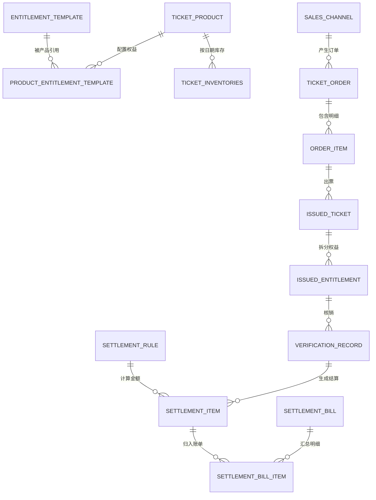
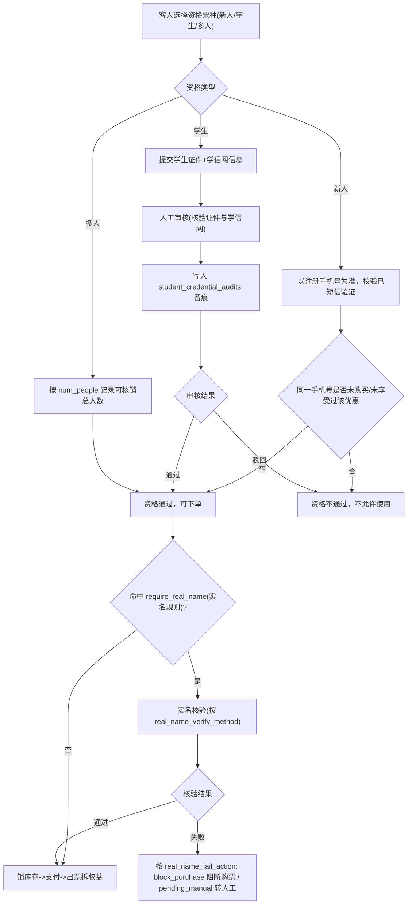
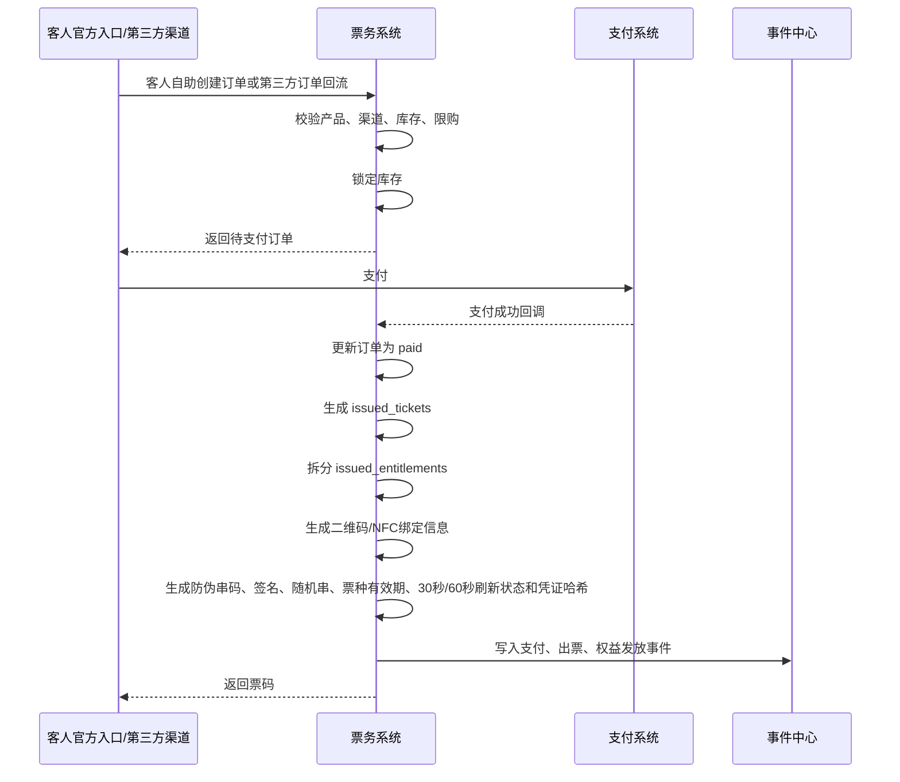
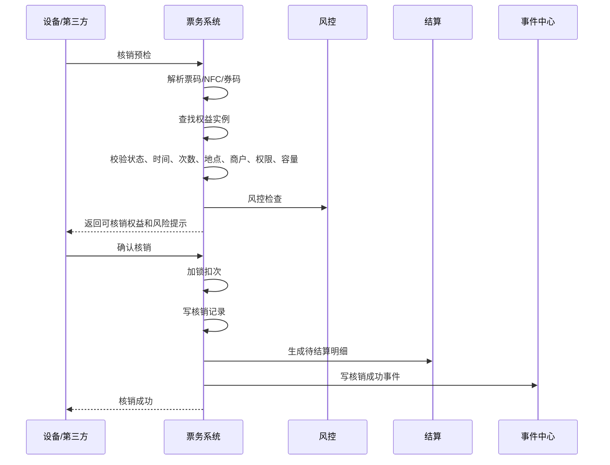

# 票务通票、权益、核销与结算开发设计

> 版本：V0.x ｜ 最后更新：2026-06-20 ｜ 覆盖迁移基线：见各小节迁移号（最新 V124）｜ 状态：现行
> 新功能承接见 docs/v099-v124-feature-implementation-and-acceptance-spec-v0.1.md
> <!-- 文档goalP3(2026-06-20)：补版本/日期/覆盖迁移头，未改正文 -->

> **✅ R7 复审上修标注（2026-06-19，只读核验真实迁移/代码后回填）**
> R5 横幅原标注的多数缺口已在本会话 P0 实现并落库（V066/V067/V075/V076/V078），以下逐条上修；仅"第三方真实回流"保持部分覆盖。原 R5 现状描述见行内删除线说明，已不再代表当前实现。
> - **二维码折中防伪（§6.2.3）已落地（V066）**：`ticket_credentials` 补刷新窗口锚点 `window_started_at`，`refreshCredential` 的 `expires_at` 与票种级 `refresh_interval_seconds`(V064, {30,60}) 联动替换硬编码 300s，截图超窗口即失效；`ticket_verifications` 补 `nonce` + 唯一索引 `uq_ticket_verifications_nonce(entitlement_id,nonce) WHERE status='success'` 防重放，重放第二次撞唯一键被拒；核销端补事后核对维度 `window_valid`/`staff_id`/`merchant_id`。HMAC 数字签名版本化预留 `signature_value`/`signature_version` 列（schema 已落、`signature_valid` 恒 NULL），按裁决降 **P1**，本期不写签名算法/校验逻辑。
> - **联合通票跨商户归属已落地（V075）**：`entitlement_templates` 补 `merchant_id`/`venue_id`/`point_id`，`ticket_types` 补 `validity_days`；`issueEntitlements` 按模板各自商户/场地/点位归属、按票种有效期天数生效（为空时回退出票方商户 / 1 天，向后兼容），不再硬设出票方 + `now+1` 天。
> - **多人票/核销冲正已落地（V067）**：`issued_entitlements.num_people`（来源 `ticket_type_entitlements.num_people`，V076）+ `ticket_verifications.verified_people`；冲正 `POST /verifications/{id}/reverse` 回滚 `used_times`、原记录置 `reversed`、新建 `status=reversed` 记录指向原 id，事件 `ticket.verification_reversed`，权限 `ticket.verify.reverse`(high)。
> - **通票收入业态拆分已落地（V078）**：`ticket_type_entitlements.component_price_cent` + `issued_entitlements.allocated_revenue_cent`，出票时按分项单价比例把订单实付拆到各权益（仅作业态拆分展示/双实体对账，不并入 `revenue.net`，避免重复计净收入）。
> - **仍开放（部分覆盖）—第三方团购回流真实闭环**：无真实渠道语义解析 / `external_order_no` / 双对账自动匹配，"两类订单"实做仍只承接自营单。本期按"凡第三方一律预留接口 + 后台开关（默认 off）+ 不阻塞"处理（V071 骨架 + 开关已落），真实回流/对账实做归 **P1（r5-spec-T14）**，待厂商资料 + 后台开启后交付，不把骨架当真实回流。
> - **验收口径（已正式）**：篡改/过刷新窗口/重放的二维码核销被拒；权益按模板各自 merchant 归属与票种有效期；多人票按 `num_people` 核销、冲正可回滚。

本文档用于指导【票务通票：权益、核销、结算】子系统进入 Java Spring Boot 后端开发。

关联文档：

- `docs/system-breakdown.md`
- `docs/foundation-systems-breakdown.md`
- `docs/foundation-database-design.md`
- `docs/ticketing-entitlement-settlement-breakdown.md`
- `docs/ticketing-database-implementation-notes.md`
- `backend/src/main/resources/db/migration/`（票务正式 Flyway 迁移：V006/V009/V031 等）

## 1. 设计结论

票务系统的核心不是“卖一张大通票”，而是：

```text
销售产品 -> 出票 -> 拆权益 -> 按权益核销 -> 按权益归属结算 -> 全过程留痕
```

必须坚持以下规则：

| 规则 | 说明 |
|---|---|
| 通票是销售包装 | 一张通票可以包含酒吧通票、游乐通票、酒吧 + 游乐通票，以及含餐饮/零售优惠折扣的组合通票；餐饮/零售只作为第三方优惠、折扣、券或权益 |
| 权益是核销最小单位 | 核销时必须核销某一个权益实例，不能只核销订单 |
| 权益是结算最小单位 | 商户结算必须基于权益归属、核销结果或权益协议价 |
| 酒吧和游乐必须隔离 | 酒吧公司、游乐公司、餐饮商户、零售商户必须使用不同 `merchant_id` |
| 第三方只能看授权范围 | 第三方渠道、POS、闸机、机器人、监控系统都必须走开放平台鉴权 |
| 留痕优先自动化 | 二维码、NFC、设备、视频、第三方回调优先，自动失败时才允许人工补录 |

## 2. 系统边界

### 2.1 本子系统负责

| 范围 | 负责内容 |
|---|---|
| 票务产品 | 单票、通票、活动票、酒吧票、游乐票、团体票、赠票 |
| 权益配置 | 权益模板、权益归属、可用范围、可用次数、有效期、可退款规则 |
| 售票库存 | 票种库存、日期库存、场次库存、权益容量、项目容量引用 |
| 渠道售票 | 官方 App/小程序为主购票路径；少量到店服务场景由授权服务人员通过售票型一体机辅助购票；第三方 P0 只接美团、大众点评、抖音团购售票结果同步；不包含工作人员平板代客售票 |
| 出票拆权 | 支付成功后生成票实例，并拆出多个权益实例 |
| 核销 | P0 使用在线二维码、安卓终端和第三方回传；二维码 30 秒或 60 秒刷新、截图无效，必须在线核验；离线核销不进入 P0 |
| 退款改期 | 全退、部分退、权益退、改期、冲正、审批 |
| 分账结算 | 按销售、按核销、固定金额、比例、协议价、保底加分成 |
| 对账 | 订单、支付、渠道、核销、第三方POS、结算账单差异 |
| 事件留痕 | 票务全链路写入事件中心，支持审计和风控分析 |

### 2.2 本子系统不直接负责

| 范围 | 边界 |
|---|---|
| 酒吧完整点单 | 由酒吧经营系统负责；票务只提供酒吧入场、酒水券核销和结算依据；卡座预约入场名额由酒吧预约/卡座系统控制 |
| 酒吧库存库房 | 由酒吧库存系统负责；票务只记录权益兑换导致的消耗事件 |
| 游乐排队巡检 | 由游乐系统负责；票务只提供项目权益、快速通道、入场核销结果 |
| 餐饮零售POS | 第三方负责；票务只负责券发放、券核销回传、对账和结算 |
| 支付机构清算 | 微信、支付宝、银行卡等由支付机构负责；票务记录支付和退款流水 |
| 视频监控保存 | 监控系统负责；票务保存视频证据引用和事件关联 |

## 3. 领域模型

### 3.1 聚合划分

| 聚合 | 主要对象 | 职责 |
|---|---|---|
| 票务产品聚合 | `TicketProduct`、`ProductEntitlementTemplate` | 定义卖什么、卖给谁、包含哪些权益 |
| 购票资格聚合 | `TicketEligibilityRule`、`StudentCredentialAudit` | 定义新人/学生/多人资格的判定方式、人工审核与凭证留痕（D9 P0） |
| 权益模板聚合 | `EntitlementTemplate`、`VerificationRule` | 定义权益归属、核销范围、次数、有效期 |
| 销售库存聚合 | `SalesChannel`、`TicketInventory`、`EntitlementInventory` | 控制可售库存和可用容量 |
| 订单聚合 | `TicketOrder`、`OrderItem`、`PaymentRecord` | 负责下单、支付、出票入口 |
| 出票聚合 | `IssuedTicket`、`IssuedEntitlement`、`TicketCredential` | 负责票实例、权益实例、二维码/NFC凭证 |
| 核销聚合 | `VerificationRecord`、`OfflineVerificationSync` | 负责核销校验、扣次、冲正、离线同步 |
| 退款改期聚合 | `RefundOrder`、`RefundEntitlementItem`、`ChangeRequest` | 负责退款、改期、权益冻结和恢复 |
| 结算聚合 | `SettlementRule`、`SettlementItem`、`SettlementBill` | 负责待结算明细、账单、调整、确认 |
| 对账聚合 | `ReconciliationRecord`、`ChannelOrderMapping` | 负责内外部流水比对 |

### 3.2 核心对象说明

| 对象 | 中文名 | 关键字段 | 说明 |
|---|---|---|---|
| `TicketProduct` | 票务产品 | 产品编码、产品类型、售价、销售时间、有效期、状态 | 对外售卖的商品，可以是单票或通票 |
| `EntitlementTemplate` | 权益模板 | 权益类型、归属商户、场地、项目、默认次数、默认结算规则 | 可复用的权益定义 |
| `ProductEntitlementTemplate` | 产品权益配置 | 产品ID、权益模板ID、数量、次数、价值、排序、`num_people` | 描述一个票种包含哪些权益；`num_people` 为多人票核销人数（默认 1） |
| `TicketEligibilityRule` | 购票资格规则 | 资格类型、判定主体、判定方式、复用限制、是否人工审核 | 新人=手机号自动判定、学生=人工审核、多人=人数与同时段约束（D9） |
| `StudentCredentialAudit` | 学生凭证留痕 | 客户、核验方式、凭证引用、审核人、结果、审核时间 | 学生票人工审核证件+学信网的留痕（D9 P0） |
| `TicketInventory` | 票库存 | 产品ID、日期、总量、已售、锁定、已退 | 控制产品可售数量 |
| `SalesChannel` | 销售渠道 | 渠道类型、开放应用、商户、状态 | 自营和第三方渠道统一建模 |
| `TicketOrder` | 票务订单 | 订单号、游客、渠道、金额、状态、外部单号 | 承载游客购买行为 |
| `OrderItem` | 订单明细 | 产品、数量、单价、优惠、状态 | 支持一个订单购买多个票种 |
| `IssuedTicket` | 票实例 | 票号、订单、产品、游客、票码、NFC、状态 | 真正发给游客的一张票 |
| `IssuedEntitlement` | 权益实例 | 票ID、权益模板、归属商户、次数、有效期、状态、`num_people` | 核销和结算的最小对象；`num_people` 为多人票应核销总人数（默认 1，D9） |
| `VerificationRecord` | 核销记录 | 权益、商户、点位、员工、设备、方式、结果 | 所有核销成功和失败都记录 |
| `RefundOrder` | 退款单 | 原订单、原支付、退款类型、金额、审批、状态 | 控制退款流程 |
| `SettlementItem` | 结算明细 | 商户、规则、订单、权益、核销、金额、状态 | 结算账单的原始明细 |
| `SettlementBill` | 结算单 | 商户、周期、应结、扣减、调整、应付、状态 | 面向商户财务确认 |
| `ReconciliationRecord` | 对账记录 | 来源、系统金额、外部金额、差异、结果 | 支持渠道、支付、第三方POS对账 |

### 3.3 对象关系



## 4. 状态机

### 4.1 票务产品状态

| 状态 | 中文 | 允许动作 |
|---|---|---|
| `draft` | 草稿 | 编辑、绑定权益、配置库存、发布 |
| `active` | 已上架 | 售卖、暂停、售罄、下架 |
| `paused` | 暂停 | 恢复、下架 |
| `sold_out` | 售罄 | 补库存、下架 |
| `archived` | 已归档 | 只读 |

约束：

- `active` 后不能直接修改已发布版本的核心价格和权益组成。
- 如需修改，创建新版本或复制新产品，避免已售票权益被篡改。

### 4.2 订单状态

| 状态 | 中文 | 说明 |
|---|---|---|
| `pending_payment` | 待支付 | 已锁库存，等待支付 |
| `paid` | 已支付 | 支付成功，待出票或出票中 |
| `ticket_issued` | 已出票 | 已生成票和权益 |
| `partially_verified` | 部分核销 | 至少一个权益已核销 |
| `completed` | 已完成 | 权益全部使用或订单自然完成 |
| `refunding` | 退款中 | 正在退款或审批 |
| `partially_refunded` | 部分退款 | 部分权益或金额已退 |
| `refunded` | 已全退 | 全部退款完成 |
| `cancelled` | 已取消 | 未支付取消，释放库存 |
| `closed` | 已关闭 | 超时关闭或异常关闭 |

关键约束：

- 支付成功后才能出票。
- 出票后退款必须检查权益使用情况（F-TXN-03 已强制：`TicketRefundService.requestRefund` 发起退款前核查本订单权益核销状态）。
- 退款按**票实例**判断（业务 HTML `business-system-map` 退款行 / `business-enum` 退款规则，2026-06-29 用户裁决）：一张「票」= 一行 `issued_entitlements`（一人票 `total_times=1`；多人票/多次票 `total_times>1`）。可退性按**每张票**判定——该票 `used_times=0`（被冲正回滚归零视为未核销）可退，可一次退多张或只退一张；`used_times>0` 则该票整张不可退（多人/多次票任一权益或门票已核销同此）；**同一订单内其他完全未核销的票仍可退**，不再整单一刀切。已核销票拒退用票实例级错误码 `TICKET_ENTITLEMENT_VERIFIED_NO_REFUND`（不再用订单级 `TICKET_ORDER_VERIFIED_NO_REFUND`）；全未核销票的 pending 积分从未 confirmed，天然不计分。
  - ✅ **已落地（2026-06-30）**：`TicketRefundService.requestRefund` 已改为**按票实例**判退——`resolveRefundTargets` 解析 `entitlement_ids`（不传=退订单全部未核销票、已核销不连坐；传入已核销票按票实例拒退 `TICKET_ENTITLEMENT_VERIFIED_NO_REFUND`），退款行只覆盖所选未核销票，积分冲减按退款额/原单额比例（=被退票实例份额）。
  - 注：积分「按核销次数精确计分」（多次/多人票按核销张数比例 confirm）**已完成（V151，F-TXN-03 收尾）**：`customer_points_ledger.confirmed_amount` 记已确认份额，`LoyaltyService.confirmPoints` 改 set-confirmed-to-target（`target=floor(总额×Σused/Σtotal)`），`TicketVerificationService` 核销与冲正两路均按订单 Σused/Σtotal 对齐确认份额（冲正一张按份回滚 1/Σtotal，取代原冲正全额 deduct）；单次票（1/1）口径与原「支付 pending → 核销 confirm」等价。
- 门票到期生命周期（F-TXN-03，piece②）：系统定时任务 `TicketingService.processExpiredPaidEntitlements`（按权益 `valid_to < now` 实时判定，由 `TicketOrderExpiryJob` 触发、开关 `ticket.order.expiry.scheduled.enabled` 默认关）——
  - **到期按票实例处理（2026-06-29 用户裁决，业务 HTML 到期处理行）**：到期未用的票按**每张** `issued_entitlements` 判定、不再看整单——`used_times=0` 的票逐张**原渠道自动退款**（`autoRefundExpiredUnusedOrder` 同款动作：建 approved 退款 + 权益 active→refunded + 回补库存 + 打款事件；系统动作跳过商户范围闸；未核销无已确认积分、不发 points deduct）；已有退款在途/完成则跳过。
  - **已核销票作废、不连坐未核销票**：`used_times>0` 的到期票置 `forfeited`（`forfeitEntitlement`，不退款，与「核销后不可退」一致）；**同单其他完全未核销的票不受影响、仍按上一条逐张自动退款**（旧口径「同单有核销则其余未核销一律作废」已废止）。0 元 / 非 paid 的到期未用权益亦作废以止反复扫描。`issued_entitlements.status` 无 DB CHECK，新增 `forfeited` 值无需迁移。
  - ✅ **已落地（2026-06-30）**：`processExpiredPaidEntitlements` 不再因同单有核销而连坐作废；到期未核销票经 `autoRefundExpiredUnusedTickets` **逐张原渠道自动退款**（份额合计、全覆盖则整单额、库存累计达全额回补一次），已核销票不受影响。69+142 测试绿。

### 4.3 票实例状态

| 状态 | 中文 | 说明 |
|---|---|---|
| `unused` | 未使用 | 票内权益均未使用 |
| `partially_used` | 部分使用 | 至少一个权益已使用 |
| `used` | 已使用 | 票内权益全部使用或主权益已完成 |
| `expired` | 已过期 | 超出有效期 |
| `frozen` | 已冻结 | 风控、退款中、人工冻结 |
| `refunded` | 已退款 | 已退款不可用 |
| `voided` | 已作废 | 作废票 |

### 4.4 权益实例状态

| 状态 | 中文 | 说明 |
|---|---|---|
| `unused` | 未使用 | 可核销 |
| `partially_used` | 部分使用 | 多次权益已用一部分 |
| `used` | 已使用 | 次数用完或一次性权益已核销 |
| `expired` | 已过期 | 超出有效期 |
| `frozen` | 已冻结 | 风控、退款中、人工冻结 |
| `refunded` | 已退款 | 已退不可核销 |
| `voided` | 已作废 | 作废不可用 |

扣次规则：

- 一次性权益：核销成功后 `unused -> used`。
- 多次权益：核销成功后扣减 `remaining_times`，大于 0 时为 `partially_used`，等于 0 时为 `used`。
- 核销冲正：恢复次数，并把状态恢复为 `unused` 或 `partially_used`，同时生成冲正记录和结算冲正。

### 4.5 核销记录状态

| 状态 | 中文 | 说明 |
|---|---|---|
| `preview_passed` | 预检通过 | 只做校验，不扣次 |
| `success` | 成功 | 已扣次、已写事件、已触发结算 |
| `failed` | 失败 | 失败原因必须记录 |
| `pending_sync` | 待同步 | 离线核销本地记录，等待上传（P1 预留，P0 不启用） |
| `conflict` | 冲突 | 离线同步时发现重复或超额（P1 预留，P0 不启用） |
| `reversed` | 已冲正 | 已撤销原核销 |

### 4.6 退款状态

| 状态 | 中文 | 说明 |
|---|---|---|
| `requested` | 已申请 | 游客、客服或平台发起 |
| `reviewing` | 审批中 | 需要人工审批 |
| `approved` | 已通过 | 已批准并已发起不可逆兑付（冻结权益、回补名额、发打款拨付事件）；**钱尚未确认到账，不计入「已退金额」**，财务/经营分析不按此扣减经营收入 |
| `rejected` | 已驳回 | 退款结束 |
| `processing` | 处理中 | 支付机构退款中 |
| `success` | 成功 | **最终完成态**：财务确认实际打款成功（`POST /api/v1/ticketing/refunds/{refund_id}/confirm-payout`）后才置此态；只有「成功」的退款才计入「已退金额」并冲减经营净收入 |
| `failed` | 失败 | 需要重试或人工处理 |
| `cancelled` | 已取消 | 申请人取消 |

> **兑付确认口径（2026-08-03，依据 `business-enum-quick-reference-v0.1.html`「退款单状态」行「退款以“成功”为最终完成态，只有“成功”的退款才计入“已退金额”；“已通过”表示已批准并已发起不可逆兑付」+ `business-system-map-for-operations-v0.1.html`「退款授权与留痕」行「系统完整记录……原路退回结果」）**：退款审批通过（人工审批 / 额度内自助 / 系统批量，三条路径共用 `finalizeApprovedRefund`）一律停在 `approved`；财务实际打款成功后调 `POST /api/v1/ticketing/refunds/{refund_id}/confirm-payout`（权限 `ticket.refund.approve`，`reason` 填**原路退回结果**，审计事件 `ticket_refund.payout_confirmed`）做 CAS `approved→success`，重复确认命中 0 行拒（`TICKET_REFUND_NOT_PAYOUT_CONFIRMABLE`）。此前审批通过在同一方法里内联置 `success`——钱一分没出账，当天经营净收入已被 `status='success'` 口径扣减。真实支付渠道适配器尚无厂商（`ReservedPaymentGateway` 接缝已留），`processing`/`failed` 待渠道回调接入后再落地。后台入口：ADM-TKT-003「出票与核销追踪」页的「退款待确认拨付」区（默认只列 `approved`，数据源 `GET /api/v1/ticketing/refunds`）。

### 4.7 结算单状态

| 状态 | 中文 | 说明 |
|---|---|---|
| `draft` | 草稿 | 系统生成，财务未确认 |
| `pending_confirm` | 待确认 | 商户或平台财务待确认 |
| `confirmed` | 已确认 | 锁定金额，准备打款 |
| `paying` | 打款中 | 已进入付款流程 |
| `paid` | 已付款 | 完成付款 |
| `disputed` | 有争议 | 商户提出异议 |
| `adjusted` | 已调整 | 调账后重新确认 |
| `cancelled` | 已取消 | 作废账单 |

## 5. 核心业务流程

### 5.0 购票资格校验流程（D9 P0）

> 修订说明（2026-06-07）：新增本节落地《统一口径基准》D9。新人/学生/多人三类资格均 P0，消除"自动/人工/P1"冲突。依据 finding ticket-1/2/3/4。

资格校验在下单创单前置触发，命中资格票种时必须先判定通过才能锁库存出票：



资格规则要点：

| 资格 | 判定主体 | 判定方式 | P级 |
|---|---|---|---|
| 新人优惠 | 手机号 | 注册须登记手机号并短信验证；同一手机号未购买/未享受过即判新人，**系统自动判定**，不符不可用 | P0 |
| 学生票 | 客户身份 | **人工审核**：核验学生证件 + 学信网，结果与凭证写入 `student_credential_audits` 留痕 | P0 |
| 多人票 | 票/权益 | 记录 `num_people`，核销时必须**同一时段全部核销**（见 §5.3 多人票约束） | P0 |

- 新人复用限制以手机号为唯一防刷依据；换号视为不同身份（PIPL 数据最小化，仅留手机号与历史订单关联，不额外采集）。
- 学生票人工审核为前置门槛，审核未通过的订单不得出票。
- **实名核验接线（合规 C7）**：资格通过后、锁库存前，按 `ticket_real_name_rules`（§6.2.1.3）判定是否命中 `require_real_name`；命中则按 `real_name_verify_method` 核验，失败按 `real_name_fail_action` 处理（`block_purchase` 阻断购票 / `pending_manual` 转人工复核）。强制开关默认 inactive，仅国家法令强制要求的票种/场次/场所启用；其余场景不强制实名。采集证件/人脸前须先取得单独同意（C2），仅留不可逆哈希/凭证引用（C5）。

> 修订说明（2026-06-08 三轮收口）：在购票资格流程图与要点中**接入实名核验节点**（资格通过→命中 require_real_name→实名核验→失败按 block_purchase/pending_manual），使 §6.2.1.3/§5.2 的实名规则在 P0 购票链路有真实触发点，消除"有规则无触发"。依据 compliance-wired-1、合规 C7。

### 5.1 票种配置流程

1. 平台运营创建票务产品。
2. 配置销售时间、有效期、平日/周末/节假日基础价和渠道范围。
2a. 配置多人票、新人票、学生票和渠道价的派生策略；默认基于对应基础价按折扣、减免、加价或固定金额计算，也允许运营输入固定价格覆盖。
3. 创建或选择权益模板。
4. 将多个权益模板绑定到票务产品。
5. 为每个权益确认归属商户、可核销场所、核销规则、结算规则。
6. 配置票库存和权益容量。
7. 提交审核。
8. 审核通过后发布。
9. 发布动作写入事件中心。

校验重点：

- 联合通票必须至少包含一个权益。
- P0 通票组合支持酒吧通票、游乐通票、酒吧 + 游乐通票，以及含餐饮/零售优惠折扣的组合通票。
- 餐饮和零售由第三方系统承接，票务系统只生成优惠、折扣、券或权益，不做完整餐饮/零售 POS。
- 每个权益模板必须绑定 `merchant_id`，平台权益也要绑定平台组织或平台商户。
- 酒吧权益不能绑定游乐项目，游乐权益不能绑定酒吧点位。
- 发布后必须锁定价格策略版本；订单创建时保存基础日历价、派生价策略、固定价覆盖标记、最终价、渠道、资格判定和审批快照。
- 已发布产品不可直接修改权益组成。

### 5.2 售票与出票流程



幂等要求：

- 支付回调必须按 `external_payment_no` 幂等。
- 出票必须按 `order_item_id + 序号` 幂等。
- 权益拆分必须按 `issued_ticket_id + entitlement_template_id + 序号` 幂等。

### 5.3 核销流程



核销校验顺序：

1. 鉴权：员工、设备、开放应用是否有效。
2. 防伪：校验二维码签名、防伪串码、随机串、票种有效期、30 秒/60 秒刷新状态、凭证哈希和是否被替换/禁用；截图或重放必须拒绝。
3. 解析：票码、NFC、券码是否能找到票或权益。
4. 状态：票和权益是否可用。
5. 时间：是否在销售、有效期、场次、时段内。
6. 地点：核销点位是否允许该权益。
7. 商户：核销商户是否与权益归属或授权关系匹配。
8. 实名核验：命中强制实名时（`ticket_real_name_rules.require_real_name`，§6.2.1.3），按 `real_name_verify_method` 核验，未通过按 `real_name_fail_action`=`block_checkin` 阻断核销（或 `pending_manual` 转人工）；强制开关默认 inactive，启用后生效（合规 C7）。
9. 次数：剩余次数是否足够。
10. 多人票人数：多人票（`num_people > 1`）必须一次性核销 `num_people` 人，且 `verifiedPeople` 等于应核销人数；不允许跨日期/场次拆分核销（D9）。
11. 容量：场次、项目、区域容量是否允许。
12. 风控：是否重复、异常设备、异常频次、黑名单。
13. 扣次：事务内扣减权益次数并写核销记录。
14. 留痕：写事件中心、关联视频或设备证据。
15. 结算：按规则生成 `settlement_items`。

> 修订说明（2026-06-07）：新增多人票人数约束步骤。按《统一口径基准》D9，多人票 P0 必须同一时段全部核销，核销请求携带 `verifiedPeople`。依据 finding ticket-4。
>
> 修订说明（2026-06-08 三轮收口）：在核销校验序列插入第 8 步"实名核验"（命中强制实名时失败按 block_checkin/pending_manual），原第 8–14 步顺延为第 9–15 步，使 §6.2.1.3/§5.2 的实名规则在 P0 核销链路有真实校验节点。依据 compliance-wired-1、合规 C7。

多人票同一时段全部核销约束：

- 多人票出票时 `issued_entitlements.num_people` 记录应核销总人数（默认 1）。
- P0 一次核销必须 `verifiedPeople = num_people`，校验通过后该权益直接置 `used`，不保留剩余人数。
- 不允许把同一张多人票拆到不同日期、不同场次或多次核销；拆分多人多次核销为 P1。

### 5.4 联合通票跨商户核销流程

示例：游客购买“全场夜玩通票”，其中包括：

| 权益 | 归属 | 核销点 | 结算 |
|---|---|---|---|
| 夜场入园 1 次 | 平台 | 园区入口闸机 | 平台留存 |
| 酒吧入场 1 次 | 酒吧公司 B | 酒吧入口 | 固定金额 |
| 酒水兑换 1 杯 | 酒吧公司 B | 吧台 | 协议价 |
| 游乐项目 3 次 | 游乐公司 A | 项目入口 | 按次核销 |
| 餐饮代金券 30 元 | 餐饮商户 C | 第三方POS | 实核实结 |

处理规则：

- 订单只属于一次销售交易。
- 出票后拆为多个 `issued_entitlements`。
- 每个权益单独记录 `merchant_id`。
- 酒吧只能核销酒吧入场、酒水、卡座相关权益。
- 游乐只能核销游乐项目、快速通道相关权益。
- 餐饮第三方只能核销餐饮券。
- 结算时每个商户只看自己的结算明细。

### 5.5 第三方餐饮零售券核销流程

1. 票务系统出票时生成餐饮/零售券权益。
2. 通过开放平台同步券摘要给第三方POS，或第三方实时查询券状态。
3. 游客在第三方POS消费。
4. 第三方POS请求核销或回传核销结果。
5. 票务系统校验开放应用、动态鉴权、商户授权、券状态、幂等号。
6. 核销成功后写入核销记录。
7. 写入第三方调用审计和事件中心。
8. 生成餐饮/零售商户待结算明细。
9. 日终按第三方流水进行对账。

### 5.6 退款流程

1. 创建退款申请。
2. 系统计算可退权益和不可退权益。
3. 若涉及已核销权益，按规则判断是否禁止退款、允许冲正或需要审批。
4. 冻结待退款权益，防止退款期间继续核销。
5. 审批通过（`approved`）= 已批准并已发起不可逆兑付：冻结权益、回补限量票名额、发打款拨付事件；此时**尚未**计入「已退金额」。
6. 财务实际打款成功后走「确认拨付」（`POST /api/v1/ticketing/refunds/{refund_id}/confirm-payout`，`reason` 留痕原路退回结果）置 `success`；退款到此才是最终完成态，才更新订单/票/权益的对外「已退」口径并计入结算冲正。
7. 对已生成结算明细做冲正。
8. 写入退款、冲正、权益状态变化事件。

退款粒度口径（D9 + 2026-06-29 票实例裁决，P0 默认）：

> 修订说明（2026-06-07）：补退款 P0 默认粒度。按《统一口径基准》D9，P0 客人侧按订单/票发起退款，系统内部按权益逐项冲正与金额拆分。
> 修订说明（2026-06-29，用户裁决）：**票实例级可退判定升为 P0**（不再降级为 P1 复杂引擎）——退款申请必须能按 `issued_entitlements`（票）选择要退该订单下的哪几张：未核销票可退、可退子集，已核销票整张拒退，同单其他未核销票仍可退；仅「比例引擎、自定义可退规则」仍列 P1。依据业务 HTML `business-system-map` 退款/到期行、`business-enum` 退款规则。

- 客人侧：P0 退款入口按**订单或票实例**发起（`POST /api/refunds` 传订单号，并可传 `entitlement_ids` 指定要退的票实例；不传则退该单全部可退票）。
- 系统内部：按 `refund_entitlement_items` 对**被选中且未核销**的票实例逐项冲正并做金额拆分（单位：分）；已核销票实例按 `TICKET_ENTITLEMENT_VERIFIED_NO_REFUND` 拒退。
- 复杂退款规则（比例引擎、自定义可退判定）列 P1（见 §14）。

退款金额计算原则：

- 未核销权益可按权益配置金额、票价拆分比例或规则金额退款。
- 已核销权益默认不可退。
- 第三方已核销券需要第三方确认冲正后才能退款。
- 已结算商户款项需要生成反向结算明细。

> **✅ 已实现修复（F-TXN-01，2026-06-22，已在 .160 编译通过）**：退款 `requestRefund` / `approveRefund` **校验原票务订单的 `merchant`（商户）归属**——发起/审批退款时核对该退款对应的原票务订单所属商户，**跨商户操作抛 `CROSS_MERCHANT_FORBIDDEN`**。与 §8.3 强约束「商户后台任何查询都必须自动追加 `merchant_id` 数据范围」「核销员不能跨商户核销」一致：退款链路同样不允许跨商户越权对他人订单发起或审批退款。

### 5.7 改期流程

1. 游客或客服发起改期。
2. 系统检查票种是否允许改期。
3. 检查目标日期和场次库存。
4. 冻结原票权益。
5. 锁定新日期库存。
6. 更新票和权益有效期或重新出票。
7. 释放原库存或记录库存迁移。
8. 写入改期事件。

### 5.8 结算流程

1. 核销成功、销售成功、退款成功或调账时生成 `settlement_items`。
2. 每条明细绑定商户、规则、订单、权益、核销或退款来源。
3. 按结算周期筛选待结算明细。
4. 生成商户结算单。
5. 平台财务审核。
6. 商户确认或提出异议。
7. 异议处理后调整账单。
8. 打款后标记已付款。
9. 写入结算全流程事件。

## 6. 数据库设计

### 6.1 已有第一批表

当前迁移 `002_ticketing_entitlement_settlement.sql` 已包含：

| 表 | 作用 |
|---|---|
| `ticket_products` | 票务产品 |
| `entitlement_templates` | 权益模板 |
| `product_entitlement_templates` | 票务产品与权益模板关系 |
| `ticket_inventories` | 票库存 |
| `sales_channels` | 销售渠道 |
| `ticket_orders` | 票务订单 |
| `order_items` | 订单明细 |
| `issued_tickets` | 已出票实例 |
| `issued_entitlements` | 已发放权益实例 |
| `verification_records` | 核销记录 |
| `payment_records` | 支付流水 |
| `refund_orders` | 退款单 |
| `settlement_rules` | 结算规则 |
| `settlement_items` | 结算明细 |
| `settlement_bills` | 结算单 |
| `settlement_bill_items` | 结算单与明细关系 |
| `reconciliation_records` | 对账记录 |

### 6.2 第一版建议补充表

这些表建议在进入正式 Java 开发前补齐，避免后续硬改核心表。

#### 6.2.1 `ticket_product_versions` 票务产品版本表

用于保证发布后的产品配置不可变。

| 字段 | 类型 | 说明 |
|---|---|---|
| `id` | uuid | 主键 |
| `ticket_product_id` | uuid | 产品ID |
| `version_no` | int | 版本号 |
| `snapshot_json` | jsonb | 产品、权益、价格、规则快照 |
| `published_by` | uuid | 发布人 |
| `published_at` | timestamptz | 发布时间 |
| `status` | varchar | `active`、`archived` |

唯一约束：`ticket_product_id + version_no`。

#### 6.2.1.0 `ticket_price_rules` 票务价格规则表

> 修订说明（2026-06-10 总控拍板）：新增价格规则执行口径。平日/周末/节假日价为最高优先级基础价格；多人票、新人票、学生票和渠道价基于对应基础价派生，或由运营输入固定价格覆盖。订单必须保存价格快照，避免后续调价影响已售订单。

| 字段 | 类型 | 说明 |
|---|---|---|
| `id` | uuid | 主键 |
| `ticket_product_id` | uuid | 票务产品 |
| `calendar_price_type` | varchar | `weekday`、`weekend`、`holiday` |
| `base_price_amount` | bigint | 基础价，单位分 |
| `derived_type` | varchar | `none`、`multi_people`、`new_customer`、`student`、`channel` |
| `derive_mode` | varchar | `discount`、`minus`、`markup`、`fixed` |
| `derive_value` | bigint | 折扣基点、减免金额、加价金额或固定金额；按 `derive_mode` 解释 |
| `fixed_override_amount` | bigint | 运营固定价格覆盖，单位分，可为空 |
| `channel_code` | varchar | 渠道码，官方渠道为空或 `official` |
| `approval_record_id` | uuid | 固定价或特殊价审批记录 |
| `effective_from` | timestamptz | 生效开始 |
| `effective_to` | timestamptz | 生效结束 |
| `version_no` | int | 价格规则版本 |
| `status` | varchar | `draft`、`active`、`archived` |

订单快照 `ticket_order_items.snapshot_json` 至少记录：`calendar_price_type`、`base_price_amount`、`derived_type`、`derive_mode`、`derive_value`、`fixed_override_amount`、`final_price_amount`、`channel_code`、`price_rule_version`、`approval_record_id`。

#### 6.2.1.1 `ticket_eligibility_rules` 资格规则表

> 修订说明（2026-06-07）：新增本表落地 D9 资格规则聚合，统一新人/学生/多人三类资格的判定方式（与 gap-analysis §4.5 的 `ticket_customer_eligibility_rules` 同源，本子系统侧聚合）。依据 finding ticket-1/2。
>
> 修订说明（2026-06-07 收口）：明确权威边界——**本表 `ticket_eligibility_rules`（单表覆盖新人/学生/多人三类）为执行侧（票务子系统）权威落点**，编码以本表为准；gap-analysis §4.5 的 `ticket_customer_eligibility_rules` + `ticket_bundle_rules` 两表为**营销/定价策略侧聚合视图**，不作为执行侧建表依据。字段映射见下表。`num_people` 的唯一落点为 `product_entitlement_templates` / `issued_entitlements`（多人票应核销人数），**本规则表只存约束性的 `min_people` / `max_people`，不存 `num_people`**，消除重复。依据 finding decision-land-6。

资格规则表与 gap-analysis §4.5 两表的字段映射（执行侧 ← 策略侧）：

| 本表（执行侧权威）字段 | gap-analysis §4.5（策略侧聚合）来源 | 说明 |
|---|---|---|
| `eligibility_type=new_customer/student` | `ticket_customer_eligibility_rules.eligibility_type` | 新人/学生资格 |
| `eligibility_type=multi_people` | `ticket_bundle_rules.bundle_type`（多人/套餐） | 多人资格归并入本单表 |
| `verification_method`（auto_by_phone/manual_review/session_all） | `ticket_customer_eligibility_rules.verification_method` | 学生票 `manual_review` |
| `reuse_limit` | `ticket_customer_eligibility_rules.reuse_limit` | 新人防刷复用限制 |
| `min_people` / `max_people` | `ticket_bundle_rules.min_people` / `max_people` | 多人票人数区间约束 |
| （不落 `num_people`） | `ticket_bundle_rules.num_people` | `num_people` 唯一落点为 `product_entitlement_templates`/`issued_entitlements`，规则表不重复存 |

| 字段 | 类型 | 说明 |
|---|---|---|
| `id` | uuid | 主键 |
| `ticket_product_id` | uuid | 适用票务产品，可为空表示通用 |
| `eligibility_type` | varchar | `new_customer`、`student`、`multi_people` |
| `judge_subject` | varchar | 判定主体：`phone`（新人）、`identity`（学生）、`ticket`（多人） |
| `verification_method` | varchar | `auto_by_phone`（系统自动）、`manual_review`（人工审核）、`session_all`（同时段全部核销） |
| `manual_review_required` | boolean | 是否需要人工审核（学生票为 true） |
| `reuse_limit` | int | 复用限制（新人票以手机号为唯一防刷依据，通常为 1） |
| `min_people` | int | 多人票最小人数 |
| `max_people` | int | 多人票最大人数 |
| `rule_config_json` | jsonb | 时段、渠道、年龄段等扩展条件 |
| `status` | varchar | `active`、`inactive` |

#### 6.2.1.2 `student_credential_audits` 学生凭证留痕表

> 修订说明（2026-06-07）：新增本表落地 D9 学生票人工审核留痕，字段含 verify_method/credential_ref/verified_by/result/verified_at。依据 finding ticket-3、compliance（仅留凭证引用与哈希，不存原始证件影像明文）。

| 字段 | 类型 | 说明 |
|---|---|---|
| `id` | uuid | 主键 |
| `customer_id` | uuid | 客户ID |
| `ticket_order_id` | uuid | 关联订单，可为空（购买前预审时为空） |
| `verify_method` | varchar | 核验方式：`student_card`、`chsi`（学信网）、`manual` |
| `credential_ref` | varchar | 凭证引用（证件影像对象存储地址或哈希，不存原始明文） |
| `verified_by` | uuid | 审核人（人工审核员工ID） |
| `result` | varchar | 审核结果：`pending`、`passed`、`rejected` |
| `reject_reason` | varchar | 驳回原因，可为空 |
| `verified_at` | timestamptz | 审核时间 |

索引：`customer_id + result`、`ticket_order_id`。

#### 6.2.1.3 `ticket_real_name_rules` 实名规则配置表

> 修订说明（2026-06-07 收口）：新增本表落地合规 C7（PRD §5.2 实名规则配置）。按票种/场次/场所维度配置是否强制实名、核验方式与失败处理；敏感证件信息仅留不可逆哈希/凭证引用（PIPL 数据最小化，与 C2 同意、C5 留存对齐）。依据 finding compliance-land-4、合规 C7。

| 字段 | 类型 | 说明 |
|---|---|---|
| `id` | uuid | 主键 |
| `project_id` | uuid | 综合体归属，可为空（平台统一规则为空，门店/活动专属必填，原始需求"核心对象预留 project_id"） |
| `scope_type` | varchar | 配置维度：`ticket_product`（票种）、`session`（场次）、`venue`（场所/区域） |
| `ticket_product_id` | uuid | 适用票务产品，`scope_type=ticket_product` 时必填 |
| `session_ref` | varchar | 适用场次标识，`scope_type=session` 时必填，可为空 |
| `venue_id` | uuid | 适用场所/区域，`scope_type=venue` 时必填，可为空 |
| `require_real_name` | boolean | 是否强制实名；三个维度任一命中 true 即按强制实名处理（取严） |
| `real_name_verify_method` | jsonb | 核验方式集合：`id_card_ocr`、`id_card_manual`、`gov_auth`、`phone_real_name`，可单选或组合 |
| `real_name_fail_action` | varchar | 失败处理：`block_purchase`（阻断购票，中：阻断购票）、`block_checkin`（阻断核销，中：阻断核销）、`pending_manual`（转人工复核，中：转人工）、`allow_with_warn`（放行预警，中：放行预警，仅非强制场景） |
| `status` | varchar | `active`（启用，中：启用）、`inactive`（停用，中：停用）；强制开关默认 inactive，仅国家法令强制要求的票种/场次/场所启用 |
| `created_at` | timestamptz | 创建时间（审计字段） |
| `updated_at` | timestamptz | 更新时间（审计字段） |
| `deleted_at` | timestamptz | 软删除标记，可为空 |

索引：`scope_type + ticket_product_id`、`scope_type + venue_id`。

> 说明：实名核验结果留痕复用 `student_credential_audits` 同样的"仅存凭证引用/哈希、不存原始证件影像明文"口径；若需独立实名核验流水，可在 P1 扩展 `real_name_verification_audits`（结果/方式/时间/操作人/凭证哈希），P0 以规则配置 + 同意采集 + 购票/核销前置校验节点（已接入 §5.0 购票资格流程与 §5.3 核销序列第 8 步）闭环。命中国家法令强制实名的票种/场次/场所在购票/核销前必须先核验通过，失败按 `real_name_fail_action`（购票 block_purchase / 核销 block_checkin / 转人工 pending_manual）处理；强制开关默认 inactive，其余场景不强制实名。

> 修订说明（2026-06-08 三轮收口）：上条"购票/核销前必须先核验通过/闭环"措辞已由真实校验节点支撑——校验节点已接入 §5.0 购票资格流程图与 §5.3 核销校验序列第 8 步，消除原"有规则无触发"的 overclaim。依据 compliance-wired-1、合规 C7。

#### 6.2.2 `verification_rules` 核销规则表

用于把核销规则从权益模板中独立出来。

| 字段 | 类型 | 说明 |
|---|---|---|
| `id` | uuid | 主键 |
| `entitlement_template_id` | uuid | 权益模板 |
| `rule_type` | varchar | `once`、`multi_times`、`time_window`、`session`、`reservation_required` |
| `allowed_methods` | jsonb | 允许二维码、NFC、闸机、第三方 |
| `allowed_merchant_ids` | jsonb | 允许核销商户 |
| `allowed_venue_ids` | jsonb | 允许核销场地 |
| `allowed_project_ids` | jsonb | 允许项目 |
| `allowed_point_ids` | jsonb | 允许点位 |
| `time_window_json` | jsonb | 可用时间配置 |
| `risk_policy_json` | jsonb | 风控配置 |
| `status` | varchar | `active`、`inactive` |

#### 6.2.3 `ticket_credentials` 票码与NFC凭证表

> 修订说明（2026-06-07 收口）：声明 **`ticket_credentials` 的唯一权威定义 = 本节（票务子系统开发设计 §6.2.3）+ ticketing 迁移**（票务域核心安全表）。foundation-database §6A.3 仅作地基侧核对承载、引用本节字段，不另立第二套。状态字段统一用 `credential_status`（active/lost/replaced/disabled），防伪串码与凭证一律**只存不可逆哈希（`anti_fake_code_hash`/`credential_hash`），不存明文**（与 D8/合规 C5 数据最小化一致）。地基若与本节并存的 `anti_fake_serial`（明文）字段须改为哈希存储或删除。依据 finding dup-tables-5/6、overclaim-6。

用于支持一个票可以有二维码、NFC腕带、实体卡等多个凭证。

| 字段 | 类型 | 说明 |
|---|---|---|
| `id` | uuid | 主键 |
| `issued_ticket_id` | uuid | 票实例 |
| `credential_type` | varchar | `qr`、`nfc`、`card`、`wristband` |
| `credential_hash` | varchar | 凭证哈希，不存明文 |
| `anti_fake_code_hash` | varchar | 防伪串码哈希，不存明文 |
| `signature_algorithm` | varchar | 签名算法，如 `HMAC-SHA256`、`EdDSA` |
| `signature_version` | varchar | 签名密钥版本 |
| `nonce_hash` | varchar | 随机串哈希 |
| `issued_payload_hash` | varchar | 原始签名载荷哈希 |
| `valid_from` | timestamptz | 凭证生效时间 |
| `valid_until` | timestamptz | 凭证失效时间 |
| `refresh_count` | int | 二维码刷新次数，P0 支持 30 秒或 60 秒自动刷新 |
| `last_presented_at` | timestamptz | 最近展示或校验时间 |
| `credential_status` | varchar | `active`、`lost`、`replaced`、`disabled` |
| `bound_device_id` | uuid | 绑定设备，可为空 |
| `bound_at` | timestamptz | 绑定时间 |
| `disabled_at` | timestamptz | 禁用时间 |

索引：`credential_hash` 唯一或高选择性索引。

防伪要求：

- 二维码展示内容必须是签名载荷或短码换取签名载荷，不能只展示可猜测票号。
- 二维码有效期按票种配置，例如日票、周票、月票、年票；展示凭证按 30 秒或 60 秒刷新。
- 现场必须在线核验，截图无效，P0 不做离线核验。
- 签名载荷至少包含 `issued_ticket_id`、`issued_entitlement_id`、`credential_id`、`nonce`、`valid_until`、`signature_version`。
- 后端只保存哈希、签名版本和状态，不保存可直接复用的明文防伪串码。
- 二维码过期、签名不匹配、随机串不匹配、刷新状态失效、凭证被替换或禁用时必须拒绝核销并写入风险事件。

#### 6.2.3.1 `ticket_credential_verification_audits` 票码防伪核对表

用于记录每一次票码展示、预检、核销、失败和事后核对结果。

| 字段 | 类型 | 说明 |
|---|---|---|
| `id` | uuid | 主键 |
| `credential_id` | uuid | 凭证 |
| `issued_ticket_id` | uuid | 票实例 |
| `issued_entitlement_id` | uuid | 权益实例，可为空 |
| `verification_record_id` | uuid | 核销记录，可为空 |
| `check_type` | varchar | `present`、`precheck`、`verify`、`reconcile`、`failed` |
| `credential_hash` | varchar | 本次提交凭证哈希 |
| `signature_valid` | boolean | 签名是否有效 |
| `nonce_valid` | boolean | 随机串是否有效 |
| `time_valid` | boolean | 是否在有效期内 |
| `tamper_result` | varchar | `normal`、`suspected_tampered`、`replayed`、`expired`、`disabled` |
| `device_id` | uuid | 校验设备 |
| `staff_id` | uuid | 操作员工 |
| `location_point_id` | uuid | 校验点位 |
| `checked_at` | timestamptz | 校验时间 |
| `raw_summary_json` | jsonb | 摘要，不保存可复用明文 |

事后核对口径：

- 可按订单、票号、权益、凭证、员工、设备、点位、时间查询。
- 可识别签名失败、过期使用、重复提交、异常设备、高频刷新和核销点位不匹配。
- 核对结果进入事件中心和风控预警。

#### 6.2.4 `channel_ticket_mappings` 渠道订单映射表

用于第三方渠道订单和平台订单映射。

| 字段 | 类型 | 说明 |
|---|---|---|
| `id` | uuid | 主键 |
| `channel_id` | uuid | 渠道ID |
| `open_app_id` | uuid | 开放应用 |
| `internal_order_id` | uuid | 平台订单 |
| `external_order_no` | varchar | 第三方订单号 |
| `external_ticket_no` | varchar | 第三方票号 |
| `payload_json` | jsonb | 第三方原始数据摘要 |
| `sync_status` | varchar | `pending`、`synced`、`failed`、`cancelled` |

唯一约束：`channel_id + external_order_no`。

#### 6.2.5 `refund_entitlement_items` 退款权益明细表

用于准确处理部分退款。

| 字段 | 类型 | 说明 |
|---|---|---|
| `id` | uuid | 主键 |
| `refund_order_id` | uuid | 退款单 |
| `issued_entitlement_id` | uuid | 权益实例 |
| `refund_amount` | bigint | 退款金额，单位分 |
| `refund_times` | int | 退款次数 |
| `before_status` | varchar | 退款前状态 |
| `after_status` | varchar | 退款后状态 |
| `status` | varchar | `pending`、`success`、`failed`、`cancelled` |

#### 6.2.6 `ticket_change_requests` 改期申请表

| 字段 | 类型 | 说明 |
|---|---|---|
| `id` | uuid | 主键 |
| `request_no` | varchar | 改期单号 |
| `issued_ticket_id` | uuid | 原票 |
| `from_valid_start_at` | timestamptz | 原有效开始 |
| `from_valid_end_at` | timestamptz | 原有效结束 |
| `to_valid_start_at` | timestamptz | 新有效开始 |
| `to_valid_end_at` | timestamptz | 新有效结束 |
| `change_fee_amount` | bigint | 改期费，单位分（D1） |
| `approval_status` | varchar | 审批状态 |
| `status` | varchar | 改期状态 |

#### 6.2.7 `offline_verification_syncs` 离线核销同步表（P1 预留，P0 不启用）

| 字段 | 类型 | 说明 |
|---|---|---|
| `id` | uuid | 主键 |
| `client_request_id` | varchar | 终端本地唯一ID |
| `device_id` | uuid | 设备 |
| `staff_id` | uuid | 员工 |
| `issued_entitlement_id` | uuid | 权益 |
| `payload_json` | jsonb | 离线核销原始数据（P1 预留，P0 不写入） |
| `sync_status` | varchar | `pending`、`accepted`、`conflict`、`rejected` |
| `conflict_reason` | varchar | 冲突原因 |
| `client_verified_at` | timestamptz | 终端核销时间 |
| `synced_at` | timestamptz | 服务端同步时间 |

唯一约束：`device_id + client_request_id`。

#### 6.2.8 `settlement_adjustments` 结算调整表

| 字段 | 类型 | 说明 |
|---|---|---|
| `id` | uuid | 主键 |
| `merchant_id` | uuid | 商户 |
| `settlement_bill_id` | uuid | 结算单，可为空 |
| `adjustment_type` | varchar | `deduct`、`add`、`penalty`、`subsidy`、`correction` |
| `amount` | bigint | 调整金额，单位分（D1） |
| `reason` | text | 原因 |
| `approval_status` | varchar | 审批状态 |
| `created_by` | uuid | 创建人 |
| `approved_by` | uuid | 审批人 |

### 6.3 关键索引和并发控制

| 场景 | 建议 |
|---|---|
| 票码查询 | `ticket_credentials.credential_hash` 建唯一或高选择性索引 |
| 防伪串码查询 | `ticket_credentials.anti_fake_code_hash` 建高选择性索引 |
| 事后核对查询 | `ticket_credential_verification_audits.credential_id + checked_at` 建组合索引 |
| 防重复支付回调 | `payment_records.external_payment_no` 建唯一约束，允许空值时用部分唯一索引 |
| 防重复第三方订单 | `channel_ticket_mappings.channel_id + external_order_no` 唯一 |
| 防重复离线核销 | `offline_verification_syncs.device_id + client_request_id` 唯一（P1 预留，P0 不触发） |
| 权益扣次 | 对 `issued_entitlements` 使用行级锁或乐观锁版本号 |
| 库存扣减 | 使用库存桶行级锁，或 Redis 预扣 + PostgreSQL 最终落账 |
| 核销幂等 | 核销请求必须带 `idempotency_key`，服务端保存处理结果 |

> 历史修订说明（2026-06-07，已废止）：曾建议由地基新增单数 `ticket_inventory` 库存桶表承载并发一致性；该口径已在 2026-06-08 收口时废止，后续编码不得按单数表或地基新增表实现。
>
> 修订说明（2026-06-08 三轮收口）：上条口径更正——票务库存**唯一权威 = ticketing 既有 `ticket_inventories`（复数，迁移 002，settlement-breakdown §8.4 完整 DDL）**，非 foundation 单数新表；foundation §6B.6 改为"指针：以本表为权威，不重复建表"。乐观锁 `version` 字段已就地补入本表（settlement-breakdown §8.4），字段名沿用既有 `ticket_product_id`/`inventory_date`/`total_quantity`/`sold_quantity`/`locked_quantity` 口径，不另起 `product_id`/`session_date`/`total`/`sold` 等别名。依据 R1、finding newtable-fk-1。

## 7. API 设计

> 执行口径：本章历史表格中的 `/api/admin/*` 是早期管理端页面口径，不再作为正式后端路径。P0 编码、联调和验收必须使用 `docs/openapi/openapi-p0.yaml`、`docs/openapi/openapi-p0.json` 中的 `/api/v1/ticketing`、`/api/v1/customer`、`/api/v1/finance` 路径，以及 `p0-openapi-operation-acceptance-matrix-v0.1.md`、`p0-openapi-contract-closure-appendix-v0.1.md`、`p0-operation-permission-matrix-v0.1.md` 的精确 operation、权限码、鉴权上下文、终端限制、幂等、审计事件、任务簇和样例准入。表格中未被 OpenAPI 和追溯附录覆盖的票务库存、渠道导入、凭证替换等能力按后续 P1/P2 补契约后开发。
>
> 本章表格的路径列统一按“历史能力路径”理解；权限列为早期权限命名参考，不得反向约束正式权限矩阵。凡未能在 OpenAPI、operation 验收矩阵和 OpenAPI 追溯附录中定位到 exact path 或 operationId 的行，不得进入正式 Java Controller、SDK/mock 或接口自动化；新增或改动后必须通过 `npm run verify:openapi-closure`。

### 7.1 管理端接口

#### 票务产品

| 方法 | 历史能力路径 | 说明 | 历史权限/能力参考 |
|---|---|---|---|
| `POST` | `/api/admin/ticket-products` | 创建票务产品 | `ticket.product.create` |
| `GET` | `/api/admin/ticket-products` | 查询票务产品 | `ticket.product.read` |
| `GET` | `/api/admin/ticket-products/{id}` | 查看详情 | `ticket.product.read` |
| `PUT` | `/api/admin/ticket-products/{id}` | 修改草稿 | `ticket.product.update` |
| `POST` | `/api/admin/ticket-products/{id}/publish` | 发布产品 | `ticket.product.publish` |
| `POST` | `/api/admin/ticket-products/{id}/pause` | 暂停售卖 | `ticket.product.update` |
| `POST` | `/api/admin/ticket-products/{id}/archive` | 归档 | `ticket.product.archive` |

#### 权益与核销规则

| 方法 | 历史能力路径 | 说明 | 历史权限/能力参考 |
|---|---|---|---|
| `POST` | `/api/admin/entitlement-templates` | 创建权益模板 | `ticket.entitlement.create` |
| `GET` | `/api/admin/entitlement-templates` | 查询权益模板 | `ticket.entitlement.read` |
| `PUT` | `/api/admin/entitlement-templates/{id}` | 修改权益模板 | `ticket.entitlement.update` |
| `POST` | `/api/admin/ticket-products/{id}/entitlements` | 绑定产品权益 | `ticket.product.update` |
| `PUT` | `/api/admin/ticket-products/{id}/entitlements/{relId}` | 修改产品权益配置 | `ticket.product.update` |
| `POST` | `/api/admin/verification-rules` | 创建核销规则 | `ticket.verification_rule.create` |
| `PUT` | `/api/admin/verification-rules/{id}` | 修改核销规则 | `ticket.verification_rule.update` |

#### 库存和渠道

| 方法 | 历史能力路径 | 说明 | 历史权限/能力参考 |
|---|---|---|---|
| `POST` | `/api/admin/ticket-inventories` | 创建或调整库存 | `ticket.inventory.update` |
| `GET` | `/api/admin/ticket-inventories` | 查询库存 | `ticket.inventory.read` |
| `POST` | `/api/admin/sales-channels` | 创建销售渠道 | `ticket.channel.create` |
| `GET` | `/api/admin/sales-channels` | 查询销售渠道 | `ticket.channel.read` |
| `POST` | `/api/admin/channel-ticket-mappings/import` | 导入第三方票 | `ticket.channel.import` |

#### 票码防伪与事后核对

| 方法 | 历史能力路径 | 说明 | 历史权限/能力参考 |
|---|---|---|---|
| `GET` | `/api/admin/ticket-credentials` | 查询票码凭证、防伪状态和绑定关系 | `ticket.credential.read` |
| `GET` | `/api/admin/ticket-credentials/{id}/audit-trail` | 查看票码生成、刷新、展示、预检、核销和失败记录 | `ticket.credential.audit` |
| `POST` | `/api/admin/ticket-credentials/{id}/disable` | 禁用疑似被盗用或被变造的凭证 | `ticket.credential.disable` |
| `POST` | `/api/admin/ticket-credentials/{id}/replace` | 更换二维码/NFC/卡凭证 | `ticket.credential.replace` |
| `GET` | `/api/admin/ticket-credential-audits` | 事后核对报表，按订单、票号、员工、设备、点位、时间查询 | `ticket.credential.audit` |

### 7.2 官方购票和游客侧接口

2026-06-12 收口口径：本节原 `/api/public/*`、`/api/ticket-orders`、`/api/issued-tickets/*`、`/api/refunds` 等路径只作为历史能力参考，不再作为当前开发路径。P0 正式接口以 `docs/openapi/openapi-p0.yaml` 为准，客人侧统一走 `/api/v1/customer/*`，票务后台/内部动作统一走 `/api/v1/ticketing/*`。

| 方法 | 路径 | 说明 |
|---|---|---|
| `GET` | `/api/v1/customer/ticket-products` | 客人端查询可售票种 |
| `POST` | `/api/v1/customer/ticket-orders` | 客人端创建订单 |
| `POST` | `/api/v1/ticketing/orders` | 后台/内部创建票务订单 |
| `POST` | `/api/v1/ticketing/orders/{order_id}/pay-intents` | 生成票务支付意图 |
| `POST` | `/api/v1/finance/payment-intents` | 发起聚合支付 |
| `GET` | `/api/v1/customer/orders` | 客人端查询订单、票、权益和退款状态 |
| `GET` | `/api/v1/customer/tickets/{ticket_id}/qr` | 客人端查询票二维码 |
| `GET` | `/api/v1/ticketing/tickets/{ticket_id}/credential` | 票务域查询票凭证 |
| `POST` | `/api/v1/ticketing/refunds` | 申请退款 |
| `POST` | `/api/v1/ticketing/refunds/{refund_id}/approve` | 审批退款（到 `approved`，尚未计入已退金额） |
| `POST` | `/api/v1/ticketing/refunds/{refund_id}/confirm-payout` | 确认拨付（财务实际打款后 `approved→success`，`reason` 填原路退回结果） |
| `GET` | `/api/v1/ticketing/refunds` | 查询退款单台账（后台「待确认拨付」看板数据源） |
| 后续扩展 | OpenAPI 后续扩展字段/流程 | 申请改期 |

说明：以上接口只服务官方 App/小程序的客人自助购票和订单查询，不提供工作人员平板代客购票入口。

### 7.3 核销端接口

| 方法 | 历史能力路径 | 说明 | 历史权限/能力参考 |
|---|---|---|---|
| `POST` | `/api/verifications/preview` | 核销预检 | `ticket.verify.preview` |
| `POST` | `/api/verifications` | 执行核销 | `ticket.verify.execute` |
| `POST` | `/api/verifications/{id}/reverse` | 核销冲正 | `ticket.verify.reverse` |
| `GET` | `/api/verifications` | 查询核销记录 | `ticket.verify.read` |
| `POST` | `/api/offline-verification-syncs` | 上传离线核销，P1 预留；P0 不启用 | `ticket.verify.offline_sync` |

核销请求必须包含：

| 字段 | 说明 |
|---|---|
| `idempotencyKey` | 幂等键 |
| `credentialType` | `qr`、`nfc`、`card`、`voucher_code` |
| `credentialValue` | 原始凭证，服务端只保存哈希 |
| `expectedEntitlementType` | 期望核销的权益类型 |
| `merchantId` | 当前核销商户 |
| `venueId` | 当前场地 |
| `projectId` | 当前项目，可为空 |
| `locationPointId` | 当前核销点 |
| `deviceId` | 设备 |
| `staffId` | 员工 |
| `verifyTimes` | 本次扣减次数 |
| `verifiedPeople` | 本次核销放行人数；多人票（`num_people > 1`）必须等于应核销总人数，同一时段全部核销（D9） |
| `evidence` | 视频、照片、设备流水、第三方流水引用 |

### 7.4 商户端接口

| 方法 | 路径 | 说明 |
|---|---|---|
| `GET` | `/api/merchant/issued-entitlements` | 查询本商户权益 |
| `GET` | `/api/merchant/verifications` | 查询本商户核销 |
| `GET` | `/api/merchant/settlement-items` | 查询待结算明细 |
| `GET` | `/api/merchant/settlement-bills` | 查询结算单 |
| `POST` | `/api/merchant/settlement-bills/{id}/confirm` | 商户确认账单 |
| `POST` | `/api/merchant/settlement-bills/{id}/dispute` | 提出账单异议 |

### 7.5 开放平台接口

开放接口不得自建票务专用 token。第三方必须先调用统一开放平台鉴权接口 `/api/open/auth/token` 获取 `access_token`、`endpoint_key` 与有效期，再通过动态业务入口 `/api/open/d/{endpoint_key}/ticketing/**` 调用票务能力。

| 方法 | 路径 | 说明 |
|---|---|---|
| `POST` | `/api/open/auth/token` | 统一开放平台鉴权，获取动态访问凭证和 `endpoint_key` |
| `GET` | `/api/open/d/{endpoint_key}/ticketing/products` | 第三方查询授权票种 |
| `POST` | `/api/open/d/{endpoint_key}/ticketing/orders` | 第三方创建订单 |
| `POST` | `/api/open/d/{endpoint_key}/ticketing/orders/{externalOrderNo}/paid` | 第三方同步支付成功 |
| `GET` | `/api/open/d/{endpoint_key}/ticketing/tickets/{code}/status` | 查询票或券状态 |
| `POST` | `/api/open/d/{endpoint_key}/ticketing/verifications/preview` | 第三方核销预检 |
| `POST` | `/api/open/d/{endpoint_key}/ticketing/verifications` | 第三方执行核销 |
| `POST` | `/api/open/d/{endpoint_key}/ticketing/verifications/callback` | 第三方回传核销结果 |
| `POST` | `/api/open/d/{endpoint_key}/ticketing/refunds/callback` | 第三方回传退款结果 |

开放接口要求：

- 每个开放应用必须绑定 `open_app_id`、商户、门店或项目授权范围。
- 连续 3 次鉴权失败必须锁定开放应用或动态凭证。
- 锁定后必须人工解锁。
- 请求必须包含签名、时间戳、nonce、幂等键。
- 第三方只能读取和操作授权商户、授权渠道、授权权益。
- 每次调用写入开放平台调用审计。

## 8. 权限边界

### 8.1 角色权限

| 角色 | 可做事项 | 不可做事项 |
|---|---|---|
| 平台超级管理员 | 全局配置、权限、账单、解锁 | 不建议参与日常核销 |
| 平台票务运营 | 票种、权益、库存、渠道、核销规则 | 不能确认打款 |
| 平台财务 | 结算、退款审批、对账、调账 | 不能随意修改权益规则 |
| 平台客服 | 查询订单、发起退款改期、人工补录 | 不能发布票种、确认账单 |
| 商户管理员 | 查看本商户权益、核销、账单、员工 | 不能查看其他商户数据 |
| 商户核销员 | 在授权点位核销指定权益 | 不能退款、调账、跨商户核销 |
| 第三方开放应用 | 按 API 授权访问 | 不能越权查询其他商户和游客数据 |

### 8.2 数据范围

| 数据 | 平台 | 商户 | 核销员 | 第三方应用 |
|---|---|---|---|---|
| 票务产品 | 全部 | 与本商户权益相关产品摘要 | 无或只读摘要 | 授权产品 |
| 订单 | 全部 | 只看涉及本商户权益的订单摘要 | 不可看金额 | 授权渠道订单 |
| 权益实例 | 全部 | 本商户权益 | 授权点位可核销权益 | 授权权益 |
| 核销记录 | 全部 | 本商户核销 | 本人/本设备核销 | 授权回传记录 |
| 结算明细 | 全部 | 本商户 | 不可看 | 不可看或授权摘要 |
| 退款 | 全部 | 涉及本商户权益的退款摘要 | 不可看 | 授权订单退款状态 |

### 8.3 强约束

- 商户后台任何查询都必须自动追加 `merchant_id` 数据范围。
- 核销接口必须校验员工、设备、点位、权益类型四重授权。
- 第三方接口必须校验开放应用授权范围和动态鉴权状态。
- 财务类接口必须记录审批人和操作原因。
- 人工补录必须绑定原因、证据、审核状态。

## 9. 事件留痕点

### 9.1 票务事件

| 事件编码 | 触发点 | 关键载荷 |
|---|---|---|
| `ticket.product.created` | 创建票种 | 产品ID、创建人 |
| `ticket.product.published` | 发布票种 | 产品ID、版本、权益快照 |
| `ticket.inventory.locked` | 下单锁库存 | 产品ID、日期、数量、订单 |
| `ticket.inventory.released` | 取消或退款释放库存 | 产品ID、日期、数量、原因 |
| `ticket.order.created` | 创建订单 | 订单号、渠道、金额 |
| `ticket.order.paid` | 支付成功 | 订单号、支付流水、金额 |
| `ticket.issued` | 出票 | 票号、订单、产品 |
| `ticket.entitlement.issued` | 权益发放 | 权益ID、归属商户、类型 |
| `ticket.credential.created` | 生成二维码/NFC/卡凭证 | 凭证ID、票号、签名版本、防伪哈希 |
| `ticket.credential.refreshed` | 二维码刷新 | 凭证ID、刷新次数、有效期 |
| `ticket.credential.replaced` | 凭证更换 | 原凭证、新凭证、原因 |
| `ticket.credential.disabled` | 凭证禁用 | 凭证ID、禁用人、原因 |
| `ticket.credential.audit_checked` | 事后核对 | 凭证ID、核对结果、异常类型 |

### 9.2 核销事件

| 事件编码 | 触发点 | 关键载荷 |
|---|---|---|
| `verification.previewed` | 预检通过 | 权益、点位、设备；不扣次 |
| `verification.failed` | 核销失败 | 原因、票码哈希、设备、员工；签名失败、疑似变造等进入 `reason_code/event_subtype` |
| `verification.succeeded` | 核销成功 | 权益、扣次、商户、点位 |
| `verification.reversed` | 核销冲正 | 原核销记录、冲正人、原因 |
| `verification.offline_uploaded` | 离线核销上传 | 设备、本地ID、同步状态（P1 预留，P0 不触发） |
| `verification.conflict` | 离线核销冲突 | 冲突原因、权益、设备（P1 预留，P0 不触发） |

### 9.3 退款结算事件

| 事件编码 | 触发点 | 关键载荷 |
|---|---|---|
| `ticket.refund.requested` | 退款申请 | 退款单、订单、金额 |
| `ticket.refund.approved` | 审批通过 | 审批人、金额 |
| `ticket.refund.executed` | 退款成功 | 支付机构流水、金额 |
| `ticket.refund.failed` | 退款失败 | 失败原因 |
| `ticket.settlement.item_created` | 生成结算明细 | 商户、来源、金额 |
| `ticket.settlement.item_reversed` | 结算冲正 | 原明细、冲正金额 |
| `ticket.settlement.bill_generated` | 生成账单 | 商户、周期、金额 |
| `ticket.settlement.bill_confirmed` | 账单确认 | 商户、确认人 |
| `ticket.settlement.bill_paid` | 标记付款 | 财务、金额 |
| `ticket.reconciliation.different` | 对账差异 | 来源、系统金额、外部金额 |

### 9.4 证据字段

事件中心建议保留以下证据引用：

| 字段 | 说明 |
|---|---|
| `device_id` | 员工工作手机、闸机、售票型/非售票型一体机、第三方设备；平板不参与门票售卖，原则上也不作为门票核销设备 |
| `staff_id` | 操作员工 |
| `open_app_id` | 第三方应用 |
| `location_point_id` | 核销点位 |
| `camera_id` | 关联摄像头 |
| `video_clip_ref` | 视频片段索引或对象存储地址 |
| `photo_ref` | 人工补录照片 |
| `request_id` | 内部请求ID |
| `idempotency_key` | 幂等键 |
| `external_trace_id` | 第三方流水或追踪ID |

## 10. 与其他系统关系

### 10.1 与多商户系统

票务系统依赖多商户系统提供：

- `merchant_id`：权益归属、销售渠道归属、结算主体。
- `venue_id`：园区、酒吧、游乐区域、门店。
- `project_id`：游乐项目、活动项目。
- `location_point_id`：闸机、入口、吧台、POS、游乐项目入口。
- 合同和合作模式：结算规则基础。

### 10.2 与权限系统

票务接口必须接入统一权限：

- 登录账号身份。
- 岗位角色。
- 数据范围。
- 设备绑定。
- 班次状态。
- 操作审计。

现场核销建议要求员工处于上班状态，且使用公司统一配发设备。

### 10.3 与开放平台

第三方系统通过开放平台接入票务能力：

- 第三方渠道售票结果回流，P0 仅覆盖美团、大众点评、抖音团购购票。
- 第三方POS券核销。
- 酒吧或游乐第三方运营方系统核销回传。
- 闸机、NFC、机器人、监控系统事件回传。

开放平台负责：

- 动态鉴权。
- 动态地址或动态令牌。
- 连续 3 次失败锁定。
- 人工解锁。
- API权限。
- SDK和接口文档。
- 调用审计。

票务系统负责：

- 业务校验。
- 权益扣次。
- 核销记录。
- 结算明细。
- 票务事件。

### 10.4 与酒吧系统

| 酒吧业务 | 票务关系 |
|---|---|
| 酒吧入场 | `bar_entry` 权益核销 |
| 吧台酒水兑换 | `drink_redeem` 权益核销，后续通知酒吧库存系统扣减 |
| 卡座预约入场名额 | 不作为通票低消抵扣权益；由酒吧预约/卡座系统按卡座配置名额控制，仅限进入预定卡座所在酒吧 |
| 简餐套餐 | 可作为餐饮券或酒吧简餐权益，库存由酒吧系统负责 |
| 存酒 | 不属于票务核心，但可把“取酒资格”作为权益或事件关联 |

注意：

- 酒吧的点单、桌台、库存、存酒由酒吧经营系统维护。
- 票务只提供权益核销入口和结算依据。
- 酒吧内酒水消耗需要由酒吧系统写库存事件，票务记录权益使用事件。
- 卡座预约入场名额不生成可转移的票务通票权益，不抵扣最低消费，不参与票务分账；超出卡座名额或进入其他酒吧必须按正常票务/入场规则处理。

#### 10.4.1 存酒登记与取酒核身字段（契约对齐）<!-- 修正(2026-06-19 R5业务HTML缺口审计 F4/F7)：F4 存酒核身契约对齐，权威小节，bar-operations 设计指向本小节口径 -->

存酒（saved bottle）虽不属于票务核心，但"取酒资格 / 取酒核身"会作为权益或事件被票务/终端引用，故在此统一登记契约口径，酒吧经营子系统（`bar-operations-development-design.md` §5.3 / §6.11 / §7.5）须与本小节一致。

- **登记必填字段（缺任一被拒）**：
  - `customer_name_or_nickname`：客户姓名或昵称（散客无会员时落此，作核身比对项之一）。
  - `bottle_label_value`：瓶底标签数值（取酒核身的强制比对项）。
  - `registration_photo_refs`（array）：登记时刻照片证据引用（区别于取酒/作废流水证据 `saved_bottle_movements.evidence_ref`）。
  - `manual_note`：人工备注（区别于通用 `remark`）。
  - `customer_phone`：客户手机号（散客核身主键之一）。
- **`customer_id` 改为可空**：散客（无会员）允许存酒，核身改用 `customer_phone` + `customer_name_or_nickname` + `bottle_label_value`，外键指向 foundation `customers.id`，可空。
- **取酒核身规则**：不再仅凭"手机号 + 验证码"。取酒必须比对 `bottle_label_value`（瓶底标签数值）**且** 比对 `customer_name_or_nickname`（姓名/昵称）通过，方可放行；原 `claim_by_phone` / `verification_code` 作为附加校验项保留。
- ~~**操作 `transferSavedBottle`（转赠）**~~：**已下线（2026-06-24，同积分转赠，HTML 未授权存酒对外转赠）**；端点/方法/测试已移除，`saved_bottle_transfers` 表留孤儿待清理。散客存酒登记/取酒核身/争议处置保留。
- **新增状态 `disputed`（争议）及入口**：存酒归属/数量争议进入 `disputed`，提供争议登记入口，待人工/主管处置后流转。
- **事件**：`saved_bottle.registered` / `saved_bottle.claimed` / `saved_bottle.transferred` / `saved_bottle.voided` / `saved_bottle.disputed`。

**验收**：①登记缺 4 必填（`bottle_label_value` / `registration_photo_refs` / `customer_name_or_nickname` 任一缺失，含 `manual_note` / `customer_phone` 按业务必填校验）被拒；②取酒须"标签数值 + 姓名/昵称"比对通过方可放行；③散客（无 `customer_id`）可存酒。

> **待业务确认**：散客（无 `customer_id`）存酒的上限/风控策略（单散客可存瓶数、有效期、高价值散客存酒是否强制升级核身）。
>
> **业务确认(2026-06-19)** `R6 业务确认回填(2026-06-19)`：散客存酒**不限瓶数**（取消原 R6 默认"单手机号≤3 瓶"上限），仅按**存期默认 90 天（后台可配）+ 到期提醒 + 作废须主管复核**管控；即散客存酒风控口径 = 不限瓶数 + 存期 90 天(后台可配) + 到期提醒 + 作废主管复核。

**契约变更清单（待同步 `openapi-p0.json`）**：本小节字段口径需同步到契约 `SavedBottleRequest` / `SavedBottleClaimRequest`，详见下表（与 `openapi-p0.json` 的处理方式见本仓库 §15 变更日志及 openapi 文件处理说明）。

| 契约 schema | 变更 | 字段 |
|---|---|---|
| `SavedBottleRequest` | 新增属性 | `customer_name_or_nickname`、`bottle_label_value`、`registration_photo_refs`（array）、`manual_note`、`customer_phone` |
| `SavedBottleRequest` | required 调整 | 移除 `customer_id`（改可空）；required 含 `bottle_label_value`、`registration_photo_refs`、`customer_name_or_nickname` |
| `SavedBottleClaimRequest` | 新增比对属性 | `bottle_label_value`、`customer_name_or_nickname`（保留原 `claim_by_phone` / `verification_code`） |
| paths | ~~已删~~ | `transferSavedBottle`（转赠）端点 2026-06-24 已下线（HTML 未授权存酒对外转赠，同积分转赠） |

### 10.5 与游乐系统

| 游乐业务 | 票务关系 |
|---|---|
| 项目入场 | `amusement_once` 权益核销 |
| 多项目通玩 | `amusement_pass` 权益按项目扣次 |
| 快速通道 | `fast_pass` 权益核销 |
| 预约排队 | 票务校验权益，游乐系统管理预约和队列 |
| 场次容量 | 票务引用游乐系统容量或场次 |

注意：

- 游乐项目运营、安全巡检、事故处理由游乐系统负责。
- 票务必须记录项目权益核销结果，供客流、结算、风控使用。

### 10.6 与餐饮零售第三方系统

| 第三方业务 | 票务关系 |
|---|---|
| 餐饮代金券 | 出票生成餐饮权益，POS 核销回传 |
| 餐饮套餐券 | POS 核销套餐券，票务记录权益使用 |
| 零售折扣券 | POS 查询券状态并回传核销 |
| 零售兑换券 | POS 核销兑换券，结算按协议价 |

票务系统不接管商品、菜品、库存、收银细节，只做券权益和对账。

### 10.7 与安卓终端

安卓终端在票务链路中的职责必须拆开：

| 终端 | 票务职责 |
|---|---|
| 员工工作手机 | 扫客人 App/小程序或第三方票码，完成门票、赠饮、礼物和其他权益核销 |
| 售票型触摸屏一体机 | 作为授权服务人员辅助售票终端，复用票务产品、平日/周末/节假日基础价及派生价、库存锁定、聚合支付、出票、防伪二维码、订单查询和取票能力；绑定酒吧门口/前台时只能售卖本酒吧单店门票 |
| 非售票型触摸屏一体机 | 在票务链路中扫码后展示可领取的酒水、礼物和权益状态，可记录领取确认结果；订台、吧台买酒和游乐状态属于酒吧/游乐链路 |
| 工作人员平板 App | 不参与门票售卖和门票核销，只接收酒吧系统的点酒、最低消费和支付引导能力 |

票务需要给员工工作手机和触摸屏一体机提供：

- 售票型一体机可售票产品、价格、库存、订单创建、支付二维码、出票和取票接口；服务端必须按一体机绑定点位过滤可售票种。
- 今日可核销权益摘要。
- 核销预检接口。
- 核销执行接口。
- 离线权益缓存，P1 预留。
- 离线核销上传，P1 预留；P0 不做离线核验。
- 设备和员工权限校验。
- 核销结果和异常提示。

### 10.8 与事件中心和风控

票务系统所有关键动作必须写事件中心。风控可订阅：

- 同一票短时间多次失败。
- 同一设备高频核销失败。
- 离线核销冲突（P1 预留，P0 不启用离线核销）。
- 跨商户越权核销。
- 退款后继续核销。
- 第三方回调金额或次数异常。

## 10A. 积分入账引擎（earn）规格<!-- 修正(2026-06-19 R5业务HTML缺口审计 F4/F7)：F7 积分入账引擎规格，闭合"有表无引擎"(PTS-001 待编码)缺口 -->

> 背景：积分底层表已落库（`customer_points_accounts` V009 / `customer_points_ledger` V025 / `customer_redemption_catalog_items` V025 / `customer_points_rules` V060 / `frozen_points`+过期字段 V089），但消费事件→积分入账的引擎仍为 `p0-implementation-task-list.md` §12A 的 PTS-001/002/003 待编码任务。本章把 earn（入账）规格落到设计层，消除"有表无引擎"的验收风险。本章为票务侧引擎口径权威，与 PTS-001 任务、foundation §6B.5 一致。

### 10A.1 触发与计分

- **触发事件**：消费 / 出票 / 核销事件 → 命中 `customer_points_rules` 计分。消费金额（实付金额）只是规则的**可配置条件之一**，不是唯一计分依据；规则可按动作类型、票种、商户/场地、时段等条件命中。
- **计分金额口径**：按实付金额计分时，须明确含/不含赠送部分、不含已退部分（与 PTS-001 一致）。
- 命中规则后写 `customer_points_ledger.change_type=earn`、更新 `customer_points_accounts.balance`，发 `points.earned` 事件。

### 10A.2 退款冲减（deduct）

- 订单退款 / 部分退款时，按比例（按金额）或按行（按已计积分行）`deduct` 冲减；写 `customer_points_ledger.change_type=deduct`，关联原入账记录，回扣 `customer_points_accounts.balance`，发 `points.deducted` 事件。

### 10A.3 防超兑 / 并发

- 兑换扣积分与扣库存（`customer_redemption_catalog_items.stock_quantity` / 供应链 `stock_movements`）须在同一事务内以**行锁或乐观锁**保护，禁止超兑、禁止负库存。
- 高价值/可撤销场景走 `frozen_points` 冻结—回滚流程：发起兑换先冻结积分（`frozen_points`），成功提交再实扣，失败/超时回滚解冻。

### 10A.4 幂等

- 按来源单据幂等：以 `source_doc_type` + `source_doc_id` 去重，防消费事件重放导致重复入账/重复冲减。

### 10A.5 事件

- `points.earned`（入账）/ `points.deducted`（退款冲减/冲正）；兑换/过期事件 `points.redeemed` / `points.expired` 见 PTS-002/003。

### 10A.6 统一表名权威源（废弃旧名）

以**实际迁移表名为权威**，分析域/契约/文档统一引用，旧名废弃：

| 权威表名（迁移来源） | 语义 | 废弃旧名 |
|---|---|---|
| `customer_points_accounts`（V009） | 积分账户（余额/等级/`frozen_points` V089） | — |
| `customer_points_ledger`（V025） | 积分明细（earn/deduct/redeem_consume/expire/adjust） | — |
| `customer_redemption_catalog_items`（V025/V060） | 可兑换礼物/目录（承接礼物语义） | `point_gifts` |
| `customer_points_rules`（V060） | 积分规则引擎 | `points_rules` |
| 兑换记录（明细 redeem_consume + 兑换表，V025/V060） | 兑换扣减/扣库存联动 | `point_redemptions` |

> 注：字面 `points_rules` / `point_gifts` / `point_redemptions` 按 V060 收敛口径**不建表**，文档与契约引用须改为上表真实表名。

### 10A.7 验收

- **E2E**：下单 → 支付 → +积分（earn 入账写 ledger、更新 balance、发 `points.earned`）→ 退款 → 冲减（deduct 写 ledger、回扣 balance、发 `points.deducted`），同一来源单据重放不重复入账/冲减。
- **并发**：并发兑换不超兑、不出现负库存；冻结—回滚在失败/超时后积分与库存均一致。

> **待业务确认**：earn 触发点以"支付成功"还是"核销"为准（影响幂等键来源单据类型与计分时点；可能两者皆需，按规则条件区分）。

## 10B. 防伪签名 P0 例外标注 + 积分审计接线 + 核销 reversed 态收口（R6 全闭环(2026-06-19)）

> 背景（依据 R6 审计）：防伪二维码设计承诺"校验二维码签名"（§5.3 第 2 步、§6.2.3 防伪要求），但 P0 实现现状为 `signature_valid` 恒 NULL 且不阻断核销（见顶部 R7 横幅"signature_valid 恒 NULL"），形成"设计要求校验 vs 实现不校验"的误实现风险，且口径未在核销序列正文标注例外。同时，积分入账/冲减事件（§10A `points.earned`/`points.deducted`）只发业务事件，未进 `audit_events` 跨域审计时间线，审计断点；核销 `reversed` 态（§4.5）有状态枚举但缺状态机与冲正事件落点。本节就地收口三项，与 §5.3、§6.2.3、§10A、§4.5 对齐，引用 R6-D06（积分 earn）、R6-D13（revenue.net）。

### 10B.1 防伪签名 P0/P1 例外标注（消除"设计要求校验 vs 实现不校验"误实现风险）

**P0 防伪基线（不依赖 HMAC 数字签名，必须阻断）：**

- P0 以"凭证哈希 + 刷新窗口锚点（`window_started_at`，V066）+ nonce 防重放 + 在线核验"为防伪基线，**不以 HMAC 数字签名为 P0 阻断条件**。
- 截图/过刷新窗口：展示凭证按票种级 `refresh_interval_seconds`（V064，{30,60}）刷新，`expires_at` 与刷新窗口联动，**过窗口即失效、核销被拒**（事后核对维度 `window_valid`）。
- 重放：`ticket_verifications.nonce` + 唯一索引 `uq_ticket_verifications_nonce(entitlement_id,nonce) WHERE status='success'`，**同一 nonce 第二次核销撞唯一键被拒**。
- 在线核验：P0 不做离线核验，凭证原始值不落客户端。

**P1 防伪增强（HMAC 签名版本化，`signature_valid` 阻断）：**

- `ticket_credentials.signature_value`/`signature_version`（schema 已落，V066）+ `ticket_credential_verification_audits.signature_valid` 列**已就位但 P0 不写签名算法/校验逻辑**，`signature_valid` P0 恒 NULL（不参与阻断判定）。
- HMAC-SHA256/EdDSA 签名生成与校验、密钥版本轮换、`signature_valid=false` 阻断核销并写风险事件，**列为 P1**（裁决降级，见顶部 R7 横幅第 1 条）。

**口径修正（消除误实现风险）：**

- §5.3 核销校验顺序第 2 步"防伪：校验二维码签名…"中的"签名"在 **P0 指哈希/刷新窗口/nonce 校验，不指 HMAC 数字签名**；HMAC 数字签名校验（`signature_valid` 阻断）为 P1。编码时不得因 §5.3/§6.2.3 出现"签名"字样而误把 HMAC 校验当 P0 必做，也不得把"P0 不校验 HMAC 签名"误读为"P0 无防伪"。
- §6.2.3 防伪要求"签名不匹配…必须拒绝核销"在 P0 由"哈希不匹配/过刷新窗口/nonce 重放"承接拒绝；HMAC"签名不匹配"拒绝为 P1。

**验收口径：**

| 维度 | P0 验收（必过） | P1 验收（HMAC 上线后） |
|---|---|---|
| 截图/过窗口 | 过 `refresh_interval_seconds` 刷新窗口的二维码核销被拒（`window_valid=false`） | 同 P0 |
| 重放 | 同一 nonce 第二次核销撞唯一键被拒 | 同 P0 |
| 篡改载荷 | 凭证哈希不匹配被拒（`tamper_result=suspected_tampered`） | 额外校验 HMAC `signature_valid=false` 被拒 |
| HMAC 签名 | `signature_valid` 恒 NULL，不参与阻断（不视为缺陷） | `signature_valid=false` 阻断核销并写风险事件 |

### 10B.2 积分留痕接入 audit_events（跨域审计时间线可查，R6-D06）

> 背景：§10A 积分入账/冲减只发 `points.earned`/`points.deducted` 业务事件，未进 `audit_events`，跨域审计（按客户/订单/操作追溯积分变动）时间线断。本小节把积分动作接入统一审计事件中心，与票务核销、退款等动作在同一审计时间线可查。

- **接线**：`points.earned`（入账）/`points.deducted`（退款冲减/冲正）在写 `customer_points_ledger` 同事务内写入 `audit_events`，保证业务事件与审计留痕一致（同幂等键 `source_doc_type`+`source_doc_id`，§10A.4）。
- **`audit_events` 枚举补齐**：
  - `event_category` 补 `points` 类目（与现有 `ticketing`/`finance` 等并列）。
  - `subject_type` 补 `points`（主体定位到 `customer_points_accounts`/`customer_points_ledger`）。
- **审计字段最小集**：`event_category=points`、`event_type`∈{`points.earned`,`points.deducted`}、`subject_type=points`、`subject_id`（ledger 记录 id 或账户 id）、`customer_id`、`source_doc_type`/`source_doc_id`、`change_amount`（积分变动，正入账/负冲减）、`occurred_at`、`actor`（系统/操作人）。
- **跨域时间线**：可按 `customer_id` 或 `source_doc_id`（订单/退款单）在 `audit_events` 串起"下单→支付→earn 入账→退款→deduct 冲减"全链路，与 §10A.7 E2E 一致。
- 兑换/过期事件 `points.redeemed`/`points.expired`（PTS-002/003）同口径接入 `audit_events`，P0 先接 earn/deduct，redeem/expire 随 PTS-002/003 编码同步接入。

> 与 R6-D13（`revenue.net`）边界：积分入账/冲减进 `audit_events` 仅作审计留痕与跨域追溯，**不并入 `revenue.net` 净收入**（与 V078 通票收入拆分"不并入 revenue.net"同口径，避免重复计净收入）。

**验收口径：**

- earn/deduct 写 ledger 成功后，`audit_events` 必有对应 `event_category=points`、`subject_type=points` 记录，且 `source_doc_*` 与 ledger 一致；同一来源单据重放不重复写审计（幂等）。
- 按 `customer_id` 查 `audit_events` 可还原该客户积分变动完整时间线，与 `customer_points_ledger` 逐条对应。

### 10B.3 核销 reversed 态收口（状态机 + 冲正事件，与退款联动）

> 背景：§4.5 核销记录状态已含 `reversed`（已冲正），但状态机迁移与冲正事件落点未在本子系统正文显式收口。本小节补 `ticket_verifications`（核销记录）reversed 状态机与冲正事件 `verification.reversed`，与退款流程（§5.6）联动。

- **状态机**：`success → reversed`。冲正时原核销记录 `status: success → reversed`，新建一条 `status=reversed` 的冲正记录指向原记录 id（与顶部 R7 横幅 V067 冲正实现一致：回滚 `used_times`、原记录置 `reversed`、新记录指向原 id）。`failed`/`preview_passed` 不可冲正（无成功扣次，无需冲正）。
- **权益联动**：冲正回滚权益次数（§4.4 扣次规则"核销冲正：恢复次数…状态恢复为 unused 或 partially_used"），并生成结算冲正（§5.8）。
- **冲正事件**：写 `verification.reversed`（核销冲正），载荷含原核销记录 id、冲正记录 id、`issued_entitlement_id`、回滚次数/人数、操作人、原因；同步进 `audit_events`（`event_category=ticketing`、`subject_type=verification`）。
- **与退款联动（§5.6）**：退款涉及已核销权益且配置允许冲正时，退款流程触发核销冲正 → 写 `verification.reversed` → 回滚权益与结算 → 再走退款资金流；已核销权益默认不可退，仅在配置冲正+审批规则时联动（§5.6"已核销权益默认不可退，除非配置了冲正和审批规则"）。
- **权限/接口**：冲正走 `POST /verifications/{id}/reverse`、权限 `ticket.verify.reverse`(high)（顶部 R7 横幅 V067），核销冲正列 P1 扩展（§12.2 第 4 项），P0 预留状态机与事件落点、不强制启用客人侧自助冲正。

**验收口径：**

- 冲正一条 `success` 核销：原记录 → `reversed`、新建 `reversed` 冲正记录指向原 id、权益次数/人数回滚、结算冲正生成、写 `verification.reversed` 且进 `audit_events`。
- 对 `failed`/`preview_passed`/已 `reversed` 记录发起冲正：拒绝并提示不可冲正。
- 退款联动：已核销权益按配置触发冲正后再退款，`verification.reversed` 与退款事件可在 `audit_events` 按 `source_doc_id` 串联。

> **✅ 已实现修复（F-TXN-03，2026-06-22，已在 .160 编译通过）**：核销冲正 `reverseVerification` **发 `VerificationReversedEvent` → customer 域 `LoyaltyPointsConsumer` 冲减该订单已确认积分**，补齐冲正侧的积分回扣链路（与 §10A.2 退款 `deduct` 冲减、§10B.2 积分进 `audit_events` 同方向）：
> - 冲正成功后发 `VerificationReversedEvent`，customer 域 `LoyaltyPointsConsumer` 消费该事件，按原订单**冲减其已确认（earn 入账）的积分**，写 `customer_points_ledger.change_type=deduct` 并回扣 `customer_points_accounts.balance`。
> - **冲正专用幂等键 `ticket_verification_reversal`**，**区别于退款 `deduct` 的幂等键**——同一订单"退款冲减"与"核销冲正冲减"走不同幂等键，互不抵消、互不去重，避免冲正与退款两条路径误判为同一来源单据而漏扣或重复扣。
>
> **✅ 已实现修复（F-TXN-04，2026-06-22，已在 .160 编译通过）**：核销冲正 `markVerificationReversed` 与退款审批 `markTicketRefundApproved` **均改为状态 CAS（compare-and-set）**——以 `UPDATE … WHERE status = <expected>` 的**返回行数**判定是否抢闸成功：
> - 并发下**只有一路**（返回行数=1）过闸执行后续副作用，其余路（返回行数=0）直接失败，**防止同一票多次冲正导致 `used_times` 重复双减**、或**同一退款单重复审批导致拨付事件双发**。
> - 与本节状态机 `success → reversed`（冲正）、§4.6 退款 `reviewing → approved`（退款审批）一致：状态前置条件由 CAS 在 SQL 层原子保证，不依赖应用层先读后写（消除 check-then-act 竞态）。

## 11. Java 后端模块建议

Spring Boot 项目建议按业务模块拆包，不按数据库表拆包。

```text
com.complex.ticketing
  product
    TicketProductController
    TicketProductService
    TicketProductRepository
    dto
  entitlement
    EntitlementTemplateController
    EntitlementIssueService
    EntitlementRepository
  inventory
    TicketInventoryService
    InventoryLockService
  order
    TicketOrderController
    TicketOrderService
    PaymentCallbackService
  credential
    TicketCredentialService
    CredentialHashService
  verification
    VerificationController
    VerificationPreviewService
    VerificationExecuteService
    OfflineVerificationSyncService
  refund
    RefundController
    RefundService
    RefundPolicyService
  settlement
    SettlementRuleService
    SettlementItemService
    SettlementBillService
  reconciliation
    ReconciliationService
  openapi
    OpenTicketingController
    OpenTicketingFacade
  event
    TicketingEventPublisher
  policy
    TicketingPermissionPolicy
    TicketingRiskPolicy
```

服务拆分原则：

- `VerificationPreviewService` 只校验，不扣次。
- `VerificationExecuteService` 负责事务内扣次、记录、事件、结算。
- `EntitlementIssueService` 负责出票后拆权益。
- `SettlementItemService` 不直接打款，只生成可追溯明细。
- `OpenTicketingFacade` 只做开放平台入站适配，核心业务仍调用内部服务。

## 12. 第一阶段开发顺序

### 12.1 P0 闭环

1. 票务产品管理。
2. 权益模板管理。
3. 产品绑定权益。
4. 票库存配置。
5. 官方 App/小程序创建订单并锁库存，第三方渠道订单支持回流预留。
6. 模拟官方线上支付成功。
7. 出票并拆权益。
8. 二维码核销预检。
9. 二维码核销执行。
10. 核销后生成结算明细。
11. 生成商户结算单。
12. 票务事件写入事件中心。

### 12.2 P1 扩展

1. 第三方渠道订单映射。
2. 开放平台核销回传。
3. 退款权益明细。
4. 核销冲正。
5. NFC凭证绑定。
6. 安卓离线核销同步（P1 预留，P0 不启用）。
7. 商户账单确认和异议。
8. 第三方POS券核销对账。

### 12.3 P2 增强

1. 复杂促销和优惠拆分。
2. 保底加分成。
3. 自动对账文件导入。
4. 风控规则引擎。
5. 视频证据自动关联。
6. 经营分析看板。

## 13. 开发验收标准

第一阶段完成时，必须能演示以下场景：

1. 创建一张“夜场联合通票”。
2. 通票包含平台入园、酒吧入场、酒水兑换、游乐项目次数、餐饮券。
3. 每个权益绑定不同商户或平台主体。
4. 客人通过官方 App/小程序或第三方渠道自助购买，或由授权服务人员在售票型一体机上辅助购票后，生成一张票和多个权益实例。
5. 员工工作手机能核销门票和权益，售票型一体机能由授权服务人员辅助售票/取票/订单查询，工作人员平板不能代客购票。
6. 酒吧员工只能核销酒吧权益。
7. 游乐员工只能核销游乐权益。
8. 餐饮第三方只能通过开放平台核销餐饮券。
9. 每次核销都写核销记录和事件中心。
10. 核销后生成对应商户结算明细。
11. 平台财务能生成商户结算单。
12. 商户后台只能看到自己的核销和结算。
13. 重复核销、过期核销、越权核销会失败并留痕。

## 14. 已确认编码口径

以下事项已按统一口径和总控拍板收口，进入编码时不再作为开放问题：

| 事项 | 已确认口径 |
|---|---|
| 平台主体是否作为特殊商户建档 | 建立 `merchant_type = platform` 的平台商户 |
| 产品发布后是否允许改价 | 不允许修改已发布版本，只能新版本 |
| 部分退款金额如何拆分 | 已按 D9 定调：P0 客人侧按订单/票发起，内部按权益冲正与金额拆分（单位：分）；比例和复杂规则引擎列 P1（见 §5.6） |
| 第三方POS是平台主动推券还是实时查询 | 第一版支持实时查询 + 核销回传 |
| 离线核销是否第一阶段做 | 不做 P0；P1 预留能力，P0 必须在线核验 |
| 酒水兑换是否直接扣酒吧库存 | 已确认：票务只记录权益核销和事件；酒吧系统在生成 0 元兑换点单并出品时扣减对应吧台库存 |
| 视频证据是否强制 | 高价值权益和人工补录强制，普通核销可选 |

## 15. 变更日志

| 日期 | 类型 | 位置 | 内容 | 原因/依据 |
|---|---|---|---|---|
| 2026-06-07 | 增 | §3.1 聚合划分 | 新增"购票资格聚合"（`TicketEligibilityRule`、`StudentCredentialAudit`） | 落地 D9 资格规则；finding ticket-1/2/3 |
| 2026-06-07 | 改 | §3.2 核心对象 | `ProductEntitlementTemplate`/`IssuedEntitlement` 增 `num_people`；新增资格与学生留痕对象 | 多人票人数落地；finding ticket-1/3/4 |
| 2026-06-07 | 增 | §5.0 购票资格校验流程 | 新增新人(自动)/学生(人工审核)/多人资格校验流程节点 | 落地 D9，消除"自动/人工/P1"冲突；finding ticket-1/2/3/4 |
| 2026-06-07 | 改 | §5.3 核销校验顺序 | 新增多人票人数约束步骤与"同一时段全部核销"说明 | D9 多人票 P0；finding ticket-4 |
| 2026-06-07 | 改 | §5.6 退款流程 | 补退款 P0 默认粒度（订单/票发起、内部按权益冲正） | D9 退款口径；finding ticket-7 |
| 2026-06-07 | 增 | §6.2.1.1/6.2.1.2 | 新增 `ticket_eligibility_rules` 资格规则表、`student_credential_audits` 学生凭证留痕表 | 落地 D9 资格与学生留痕；finding ticket-1/2/3 |
| 2026-06-07 | 改 | §7.3 核销请求 | 新增 `verifiedPeople` 字段 | 多人票核销人数；finding ticket-4 |
| 2026-06-10 总控拍板 | 增/改 | §5.1/§6.2.1.0 | 新增票务价格规则表与价格快照口径，明确平日/周末/节假日基础价优先，派生价或固定价覆盖 | 总控最新票务策略拍板 |
| 2026-06-07 | 改 | §6.2.6/6.2.8、§14 | 金额字段补"单位分(D1)"；退款拆分项对齐 D9 | 金额单位统一 D1、退款 D9；finding ticket-7、devtech-3 |
| 2026-06-07 | 增 | §6.2.1.3 实名规则表 | 新增 `ticket_real_name_rules`：按票种/场次/场所维度 `require_real_name`、核验方式、失败处理，敏感信息仅存哈希/引用 | 落地合规 C7（PRD §5.2）；finding compliance-land-4 |
| 2026-06-07 | 改 | §6.2.1.1 资格规则表 | 明确本表单表为执行侧权威、gap-analysis §4.5 两表为策略侧聚合并给字段映射；`num_people` 唯一落点为模板/`issued_entitlements`，规则表只存 min/max_people | 统一资格规则口径、消除重复；finding decision-land-6 |
| 2026-06-07 | 增 | §6.2.3 票码凭证表 | 声明 `ticket_credentials` 权威=ticketing(§6.2.3+迁移)，防伪串码只存哈希不存明文，foundation 仅核对承载 | 唯一权威源、防伪不存明文；finding dup-tables-5/6、overclaim-6 |
| 2026-06-07 | 增 | §6.3 并发控制 | 曾指明单数 `ticket_inventory` 表由地基新增；该行已被 2026-06-08 更正行废止 | 历史记录保留，正式编码不得采用 |
| 2026-06-08 | 改 | §6.3 并发控制 | 更正库存权威：唯一权威=ticketing `ticket_inventories`(复数,迁移002)，foundation §6B.6 仅指针；`version` 乐观锁已补入 settlement-breakdown §8.4 本表，字段名沿用既有口径 | 票务库存唯一权威；R1、finding newtable-fk-1 |
| 2026-06-08 对抗式复核 | 改 | §4.1/§5.4/§6.2.7/§6.4/§9.2/§10/§11/§13 | ER 图库存实体改为 `TICKET_INVENTORIES`；离线核销状态、同步表、幂等、事件、风控和 P1 排期逐项标注 P1 预留、P0 不启用 | 避免外部实施方按片段把单数库存表或离线核销误做成 P0；对齐票务库存唯一权威和在线核验规则 |
| 2026-06-08 | 增 | §5.0 购票资格流程 | 接入实名核验节点（资格通过→命中 require_real_name→核验→失败按 block_purchase/pending_manual） | 实名规则在购票链路有触发点；compliance-wired-1、合规 C7 |
| 2026-06-08 | 增 | §5.3 核销校验序列 | 插入第 8 步"实名核验"（命中强制实名失败按 block_checkin/pending_manual），原 8–14 步顺延为 9–15 | 实名规则在核销链路有校验节点；compliance-wired-1、合规 C7 |
| 2026-06-08 | 注 | §6.2.1.3 说明 | 明确"购票/核销前必须先核验通过/闭环"已由 §5.0/§5.3 校验节点支撑，消除 overclaim | 措辞与已接线流程一致；compliance-wired-1 |
| 2026-06-07 | 注 | §6.2.3/PRD §12 | 确认 P0 不支持权益转赠，开发设计不引入转赠流程与 transfer_* 字段 | 与 PRD critic-12 裁决一致；finding critic-12 |
| 2026-06-12 可编码收口 | 改 | §7 | 将旧管理端/核销端接口表头改为历史能力路径和历史权限参考；强调未进入 OpenAPI 与 operation 验收矩阵的能力不得开发 Controller、SDK/mock 或接口自动化 | 防止早期 `/api/admin/*`、`/api/verifications/*` 路径反向约束正式票务接口 |
| 2026-06-13 OpenAPI 追溯闸口 | 改 | §7 | 票务历史能力路径必须能在 OpenAPI、operation 验收矩阵和 `p0-openapi-contract-closure-appendix-v0.1.md` 定位 exact path 或 operationId；否则只能按 P1/P2 补契约后开发 | 防止票务库存、渠道导入、凭证替换等历史能力绕过权限、事件、任务和样例准入追溯 |
| 2026-06-19 R5业务HTML缺口审计 F4 | 增 | §10.4.1 | 新增"存酒登记与取酒核身字段（契约对齐）"小节：登记 4 必填、`customer_id` 可空（散客存酒）、取酒须比对瓶底标签数值+姓名/昵称、`transferSavedBottle` 转赠与 `disputed` 争议态、saved_bottle.* 五事件；附契约变更清单（待同步 openapi-p0.json） | F4 存酒核身契约对齐；bar-operations §5.3 指向本小节 |
| 2026-06-19 R5业务HTML缺口审计 F7 | 增 | §10A | 新增"积分入账引擎（earn）规格"章节：触发/计分、退款冲减、防超兑并发（行锁/乐观锁+frozen_points 冻结回滚）、source_doc 幂等、points.earned/deducted 事件、统一表名权威源（customer_points_* 真实表，废弃 point_gifts/point_redemptions/points_rules 字面名） | F7 闭合"有表无引擎"(PTS-001 待编码) |
| 2026-06-19 R6 全闭环 | 增 | §10B | 新增"防伪签名 P0 例外标注 + 积分审计接线 + 核销 reversed 态收口"章节：①§5.3/§6.2.3"签名"在 P0 指哈希/刷新窗口/nonce 校验、HMAC 数字签名(signature_valid 阻断)为 P1，给 P0/P1 各自验收口径，消除"设计要求校验 vs 实现不校验"误实现；②points.earned/deducted 接入 audit_events(event_category 补 points、subject_type 补 points)，跨域审计时间线可查，不并入 revenue.net；③核销 reversed 态补状态机(success→reversed)+冲正事件 verification.reversed，与退款联动 | R6 审计：防伪口径未标例外、积分未进 audit_events、reversed 态缺；引用 R6-D06/R6-D13 |
| 2026-06-22 已实现修复回写 | 注 | §5.6 | F-TXN-01：退款 requestRefund/approveRefund 校验原票务订单 merchant 归属，跨商户抛 CROSS_MERCHANT_FORBIDDEN | 回写 .160 已编译通过的修复（F-TXN-01） |
| 2026-06-22 已实现修复回写 | 注 | §10B.3 | F-TXN-03：核销冲正 reverseVerification 发 VerificationReversedEvent → customer 域 LoyaltyPointsConsumer 冲减该订单已确认积分，冲正专用幂等键 ticket_verification_reversal（区别于退款 deduct） | 回写 .160 已编译通过的修复（F-TXN-03） |
| 2026-06-22 已实现修复回写 | 注 | §10B.3 | F-TXN-04：markVerificationReversed + markTicketRefundApproved 均改状态 CAS（UPDATE … WHERE status=expected 返回行数），并发只一路过闸，防多次票重复冲正双减 used_times / 退款双发拨付事件 | 回写 .160 已编译通过的修复（F-TXN-04） |
