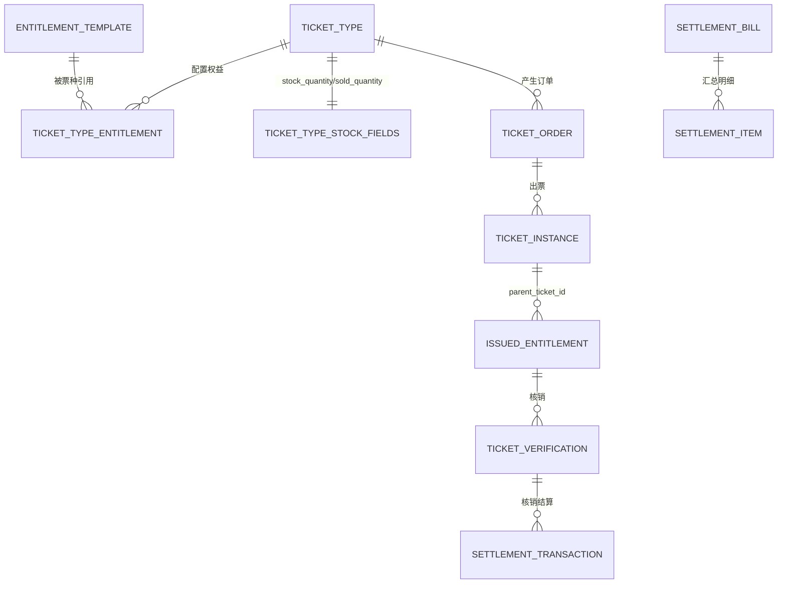
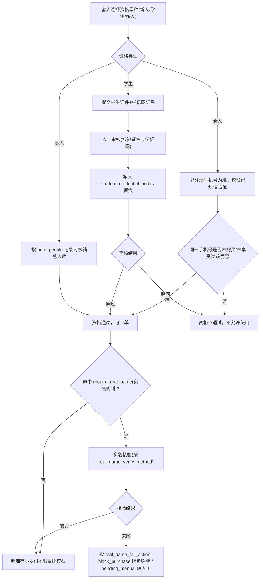
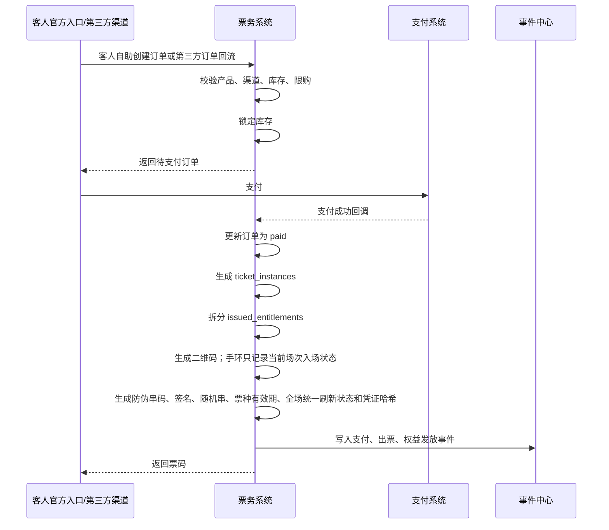
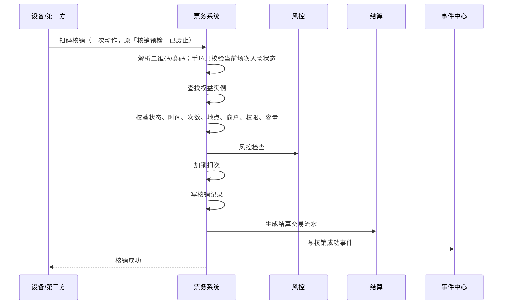

# 票务通票、权益、核销与结算开发设计 V0.11

> **核销口径**：核销记录只有成功／拒绝（规则不允许）／失败（设备或网络原因）／已冲正／待复核／异常六态。检票环节内部扫码即核销，不设先校验、后确认的两次操作，也不设中间态；系统不提供人工放行。

> **口径修订（2026-08-06 R10）：「场次容量」已废止**——BSM「容量控制」条 明确「**只按单个游乐项目的实时在玩人数控制容量，不再按场次/时段或点位/设备另设容量；排队人数不占用容量**」（DEC-R5-2026-08-04-04；R8 用户裁决 D-02）。本文原「场次容量」一律改称「**项目容量（实时在玩人数）**」；双阈值不变（运营容量软上限告警放行、安全容量硬上限阻断并自动停运）。仍按场次/时段或点位/设备维度罗列的页面、接口、组件与字段只作历史结构参考，容量口径一律以本条为准，相关字段待代码轮下线，期间不得据以新增受控维度。

> 版本：V0.11 ｜ 最后更新：2026-08-30 ｜ 覆盖迁移基线：见各小节迁移号（当前仓库最新 V385）｜ 状态：现行
> 新功能承接见 docs/v099-v124-feature-implementation-and-acceptance-spec-v0.1.md
> <!-- 文档goalP3(2026-06-20)：补版本/日期/覆盖迁移头，未改正文 -->

> **✅ R7 复审上修标注（2026-06-19，只读核验真实迁移/代码后回填）**
> R5 横幅原标注的多数缺口已在本会话 P0 实现并落库（V066/V067/V075/V076/V078），以下逐条上修；仅"第三方真实回流"保持部分覆盖。原 R5 现状描述见行内删除线说明，已不再代表当前实现。
> - **二维码防伪（§6.2.3）**：`ticket_credentials` 以全场统一的 `refresh_interval_seconds` 读取刷新间隔，按 5 秒为单位可调、最长 60 秒、默认 15 秒；截图超窗口即失效。`ticket_verifications` 以 `nonce` 唯一约束防重放，并保留 `window_valid`/`staff_id`/`merchant_id` 事后核对维度。现行生产路径已由 `TicketCredentialSigner` 实现 HMAC-SHA256 签发与常量时间校验，签名缺失或不匹配时记录 `signature_valid=false` 并拒绝核销；旧构造兼容测试路径可不注入签名器，不代表生产口径。
> - **联合通票跨商户归属（V075，当前缺口登记）**：`entitlement_templates` 已补 `merchant_id`/`venue_id`/`point_id`，但 `ticket_types` 只有 `validity_days`，不足以承载永久、固定天数、按自然月、按自然年、按场次五种有效期。有效期按日票、周票、月票、年票等票种规则配置；票务二维码按日票、周票、月票、年票等票种设置有效期。正式实现须补显式 `validity_type` 及其对应配置值；`issueEntitlements` 必须按模板记录的经营域与实际提供商户归属，并按票种明确配置的有效期类型和值生效。有效期或权益归属缺失时必须拒绝发布或出票，不得回退出票方商户，也不得回退 1 天；现有回退行为是待修实现缺口，不得反向定义业务规则。
> - **多人票/核销冲正已落地（V067）**：`issued_entitlements.num_people`（来源 `ticket_type_entitlements.num_people`，V076）+ `ticket_verifications.verified_people`；冲正 `POST /verifications/{id}/reverse` 回滚 `used_times`、原记录置 `reversed`、新建 `status=reversed` 记录指向原 id，事件 `ticket.verification_reversed`，权限 `ticket.verify.reverse`(high)。
> - **通票收入业态拆分已落地（V078）**：`ticket_type_entitlements.component_price_cent` + `issued_entitlements.allocated_revenue_cent`，出票时按分项单价比例把订单实付拆到各权益（仅作业态拆分展示/双实体对账，不并入 `revenue.net`，避免重复计净收入）。
> - **仍开放（部分覆盖）—第三方团购回流真实闭环**：无真实渠道语义解析 / `external_order_no` / 双对账自动匹配，"两类订单"实做仍只承接自营单。本期按"凡第三方一律预留接口 + 后台开关（默认 off）+ 不阻塞"处理（V071 骨架 + 开关已落），真实回流/对账实做归 **P1（r5-spec-T14）**，待厂商资料 + 后台开启后交付，不把骨架当真实回流。
> - **验收口径（已正式）**：篡改/过刷新窗口/重放的二维码核销被拒；权益按模板各自 merchant 归属与票种有效期；多人票按 `num_people` 核销、冲正可回滚。

本文档用于指导【票务通票：权益、核销、结算】子系统进入 Java Spring Boot 后端开发。

关联文档：

- `docs/system-breakdown.md`
- `docs/foundation-systems-breakdown.md`
- `docs/foundation-database-design.md`
- `docs/ticketing-entitlement-settlement-breakdown.md`
- `docs/ticketing-database-implementation-notes.md`
- `backend/src/main/resources/db/migration/`（票务正式 Flyway 迁移：V006/V009/V031 等）

## 1. 设计结论

票务系统的核心不是“卖一张大通票”，而是：

```text
销售产品 -> 出票 -> 拆权益 -> 按权益核销 -> 按权益归属结算 -> 全过程留痕
```

必须坚持以下规则：

| 规则 | 说明 |
|---|---|
| 通票是销售包装 | 一张通票可以包含酒吧通票、游乐通票、酒吧 + 游乐通票，以及含餐饮/零售优惠折扣的组合通票；餐饮/零售只作为第三方优惠、折扣、券或权益 |
| 权益是核销最小单位 | 核销时必须核销某一个权益实例，不能只核销订单 |
| 权益是结算最小单位 | 商户结算必须基于权益归属、核销结果或权益协议价 |
| 酒吧和游乐必须隔离 | 酒吧公司、游乐公司、餐饮商户、零售商户必须使用不同 `merchant_id` |
| 第三方只能看授权范围 | 第三方渠道、POS、闸机、机器人、监控系统都必须走开放平台鉴权 |
| 留痕优先自动化 | 二维码、设备、视频、第三方回调优先，自动失败时只允许补录事实，不允许人工放行 |

## 2. 系统边界

### 2.1 本子系统负责

| 范围 | 负责内容 |
|---|---|
| 票务产品 | 平日票、周末票、节假日票、成人票、学生票、多人票（含双人/团队）、新人票、一人多次票、单日票、夜场票、酒吧票、游乐票、演出票、派对票/活动票（两者等价）、通票、赠票 |
| 权益配置 | 入场、游乐、酒水、卡座免通票入场名额、餐饮券、零售券、服务权益、积分兑换虚拟券；简餐套餐作为餐饮券或酒吧简餐权益。各权益配置归属、可用范围、可用次数、有效期和可退款规则 |
| 售票库存 | 票种库存；容量控制只引用单个游乐项目的实时在玩人数，不另设日期、场次、时段、点位或设备容量 |
| 渠道售票 | 官方 App/小程序为主购票路径；少量到店服务场景由授权服务人员通过售票型一体机辅助购票；第三方 P0 只接美团、大众点评、抖音团购售票结果同步；不包含工作人员平板代客售票 |
| 出票拆权 | 支付成功后生成票实例，并拆出多个权益实例 |
| 核销 | 使用在线二维码、安卓终端和第三方回传；二维码按全场统一设置刷新（5 秒为单位、最长 60 秒、默认 15 秒），截图无效，必须在线核验，不做离线核销 |
| 退款 | 全退、部分退、权益退、冲正、审批 |
| 分账结算 | 按核销、固定金额、固定单价、比例或既有规则组合；售票成功本身不确认实际提供商户的履约结算收入 |
| 对账 | 订单、支付、渠道、核销、第三方POS、结算账单差异 |
| 事件留痕 | 票务全链路写入事件中心，支持审计和风控分析 |

### 2.2 本子系统不直接负责

| 范围 | 边界 |
|---|---|
| 酒吧完整点单 | 由酒吧经营系统负责；票务只提供酒吧入场、酒水券核销和结算依据；卡座预约入场名额由酒吧预约/卡座系统控制 |
| 酒吧库存库房 | 由酒吧库存系统负责；票务只记录权益兑换导致的消耗事件 |
| 游乐排队巡检 | 由游乐系统负责；票务只提供项目权益和入场核销结果 |
| 餐饮零售POS | 第三方负责；票务只负责券发放、券核销回传、对账和结算 |
| 支付机构清算 | 微信、支付宝、银行卡等由支付机构负责；票务记录支付和退款流水 |
| 视频监控保存 | 监控系统负责；票务保存视频证据引用和事件关联 |

## 3. 领域模型

### 3.1 聚合划分

| 聚合 | 主要对象 | 职责 |
|---|---|---|
| 票务产品聚合 | `TicketTypeRecord`、`TicketTypeEntitlementRecord` | 定义卖什么、卖给谁、包含哪些权益 |
| 购票资格聚合 | `TicketEligibilityRule`、`StudentCredentialAudit`（目标载体，尚未建表） | 定义新人/学生/多人资格的判定方式、人工审核与凭证留痕 |
| 权益模板聚合 | `EntitlementTemplate`、`VerificationRule` | 定义权益归属、核销范围、次数、有效期 |
| 销售库存聚合 | `TicketType.stockQuantity/soldQuantity` | 控制票种可售库存；不承载项目容量 |
| 订单聚合 | `TicketOrderRecord`、`TicketPaymentIntentRecord` | 负责下单、支付、出票入口；无订单明细物理表 |
| 出票聚合 | `TicketInstanceRecord`、`IssuedEntitlement`、`TicketCredentialRecord` | 负责父票实例、权益实例和动态凭证；手环只承载当前场次内允许入场的状态 |
| 核销聚合 | `ticket_verifications` | 负责在线核销校验、扣次和冲正 |
| 退款聚合 | `TicketRefundRecord`、`TicketRefundLineRecord` | 负责整票退款、临时可用性阻断和恢复 |
| 结算聚合 | `SettlementTransactionRecord`、`SettlementItemRecord`、`SettlementBillRecord` | 负责结算交易、账单明细、调整和确认 |
| 对账聚合 | `settlement_reconciliation_status`、渠道订单映射 | 负责内外部流水比对；未建表的渠道映射继续标为缺口 |

### 3.2 核心对象说明

| 对象 | 中文名 | 关键字段 | 说明 |
|---|---|---|---|
| `TicketTypeRecord` | 票务产品 | 票种ID、名称、基础价、库存、有效期、状态 | 对外售卖的票种，可以是单票或通票 |
| `EntitlementTemplate` | 权益模板 | 权益类型、归属商户、场地、项目、默认次数、默认结算规则 | 可复用的权益定义 |
| `TicketTypeEntitlementRecord` | 产品权益配置 | 票种ID、权益模板ID、数量、次数、价值、`num_people` | 描述一个票种包含哪些权益；`num_people` 为多人票核销人数（默认 1） |
| `TicketEligibilityRule` | 购票资格规则 | 资格类型、判定主体、判定方式、复用限制、是否人工审核 | 新人=手机号自动判定、学生=人工审核、多人=人数与同一场次约束（D9） |
| `StudentCredentialAudit` | 学生凭证留痕 | 客户、核验方式、凭证引用、审核人、结果、审核时间 | 学生票人工审核证件+学信网的留痕（D9 P0） |
| `TicketType` 库存字段 | 票库存 | `stock_quantity`、`sold_quantity` | 当前 Flyway/Java 的原子防超卖承载 |
| `ticket_orders.sales_channel` | 销售渠道 | 渠道代码 | 当前没有独立 `sales_channels` 表；P0 第三方渠道为美团、大众点评、抖音 |
| `TicketOrderRecord` | 票务订单 | 订单号、游客、票种、数量、渠道、金额、状态 | 承载游客购买行为；当前一个订单绑定一个票种，仓库已删除订单明细表 |
| `TicketInstanceRecord` | 父票实例 | 票号、订单、票种、序号、人数、次数、持有人、状态 | 订单中每购买一张票形成一行；动态二维码由凭证表承载 |
| `IssuedEntitlement` | 权益实例 | 票ID、权益模板、归属商户、次数、有效期、状态、`num_people` | 核销和结算的最小对象；`num_people` 为多人票应核销总人数（默认 1，D9） |
| `ticket_verifications` | 核销记录 | 权益、商户、点位、员工、设备、凭证、结果 | 所有核销成功和失败都记录 |
| `TicketRefundRecord` | 退款单 | 原订单、金额、渠道、申请、审批、状态 | 控制退款流程；业务退款分类尚无物理字段 |
| `SettlementTransactionRecord` | 结算交易 | 订单、权益、核销、已核销金额、未核销金额、受益主体、状态 | 核销和到期未核销归属的原始结算流水 |
| `SettlementItemRecord` | 结算单明细 | 结算单、商户、分配方式、计算金额、最终金额、状态 | 由账期汇总生成，不由售票成功直接生成 |
| `SettlementBillRecord` | 结算单 | 项目、周期、票款、费用、池、分配、状态 | 面向财务和商户确认 |

### 3.3 对象关系



## 4. 状态机

### 4.1 票务产品状态

| 状态 | 中文 | 允许动作 |
|---|---|---|
| `draft` | 草稿 | 编辑、绑定权益、配置库存、发布 |
| `active` | 已上架 | 售卖、暂停、下架；库存为零时派生展示「售罄」，不新增持久化状态 |
| `paused` | 暂停 | 恢复、下架 |
| `archived` | 已归档 | 只读 |

约束：

- `active` 后不能直接修改已发布版本的核心价格和权益组成。
- 如需修改，创建新版本或复制新产品，避免已售票权益被篡改。

### 4.1A 票务策略状态

票务策略状态为：草稿（规则未发布）、待启用（规则已配置但未到生效时间）、售卖中（当前可售卖）、暂停售卖（临时停止售卖）、已结束（售卖周期结束）、归档（历史策略）。该六态属于票务策略对象，不得与上节 `ticket_types` 的四种现行技术状态混为一套状态机；当前 `ticket_price_rules.status` 尚未完整承载六态，属于实现缺口。

### 4.2 订单状态

下表是对客订单展示态，由支付、出票、生命周期、核销和退款事实派生，不得落成一列独立持久化枚举。

| 状态 | 中文 | 说明 |
|---|---|---|
| `pending_payment` | 待支付 | 已锁库存，等待支付 |
| `paid` | 已支付 | 支付成功，待出票或出票中 |
| `ticket_issued` | 已出票 | 已生成票和权益 |
| `partially_verified` | 部分核销 | 至少一个权益已核销 |
| `completed` | 已完成 | 权益全部使用或订单自然完成 |
| `refunding` | 退款中 | 正在退款或审批 |
| `partially_refunded` | 部分退款 | 完全未核销的多票订单中，部分完整票实例已退 |
| `refunded` | 已全退 | 全部退款完成 |
| `cancelled` | 已取消 | 未支付取消，释放库存 |
| `closed` | 已关闭 | 超过支付时限系统自动关闭，无人工干预 |
| `exception` | 异常 | 支付、渠道或权益生成存在问题 |

支付时限是全平台统一可配的业务参数，出厂默认 5 分钟，上下限出厂为 1 至 30 分钟。

> **当前实现缺口**：`TicketOrderExpiryJob` 对 `ticket.order.expiry.unpaid-timeout-minutes` 的 Java 缺省值仍是 30 分钟，生产配置未覆盖为出厂默认 5 分钟，也未实现 1 至 30 分钟的配置边界校验；须按上句修复，当前代码不得反向定义业务默认值。

关键约束：

- 支付成功后才能出票。
- 出票后退款必须检查本订单全部票实例的权益使用情况；现行 `TicketRefundService.requestRefund` 只检查请求列出的 `ticket_instance_ids`，尚未在解析前强制整单核销守卫，属于待修实现缺口。
- 退款按**票实例**判断：一张「票」= 一行 `ticket_instances`，一张票可拆出一至多行通过 `issued_entitlements.parent_ticket_id` 归属的权益；多人票人数和一人多次票次数属于票及其子权益属性，不得把单个权益行当成一张票。普通退款只允许发生在订单完全未核销时；门票或权益一经开始核销（含部分核销），除通票安全例外外，该订单不得形成“部分核销 + 部分退款”。
  - **实现约束**：`TicketRefundService.requestRefund` 的 `resolveRefundInstances` 解析 `ticket_instance_ids` 前须先检查订单是否存在任何核销事实；订单完全未核销时，`ticket_refund_lines` 才可展开所选 `ticket_instances` 的全部 `issued_entitlements` 做冲正和金额拆分。
  - **当前积分耦合缺口**：现行 `TicketVerificationService` / `LoyaltyService` 仍直接按订单核销比例确认积分。业务边界应改为票务只提交核销人次事实，由积分域按已生效票务规则计算；当前代码不得反向成为业务规则。
- 门票到期生命周期（F-TXN-03，piece②）：系统定时任务 `TicketingService.processExpiredPaidEntitlements`（按权益 `valid_to < now` 实时判定，由 `TicketOrderExpiryJob` 触发、开关 `ticket.order.expiry.scheduled.enabled` 默认关）——
  - **到期不退款（业务 HTML 为准）**：到期未核销款先扣一次通路费，经第三方渠道售出的再扣一次销售渠道费，再扣一次票务积分发行成本，余额按票种经营域归属。目标业务态只允许「已过期」；当前 `processExpiredPaidEntitlements` / `forfeitEntitlement` 实际写入技术值 `forfeited`，是待修实现缺口，不得把该值解释为第七个票/权益业务状态。
  - **~~到期按票实例自动退款（2026-06-29 口径）~~ 已废止（2026-08-03）**：该口径把「到期未用」当成了退款理由，与上面两条 HTML 原文直接冲突。`TicketRefundService.autoRefundExpiredWholeTickets` 已随之删除（删前全仓 grep 确认零调用点、`npm run verify:tenant-isolation` PASS）。票种 `refundable` 只表示「**客人可申请**整票退款」，勾选与否都不影响到期处置；客人仍走人工申请 → 审批 → 确认拨付的退款链。后台勾选框与 OpenAPI `refundable` 描述已同步去掉「到期未用自动退」。
  - **退款在途与到期并行**：退款申请使用独立的 `usage_blocked`/`block_reason` 可用性阻断字段，票和权益业务状态仍只取六态。到期任务可置 `expired`，退款流程按退款单状态继续处理，不以新增 `refund_pending` 或 `forfeited` 票/权益状态承载。

### 4.3 票实例状态

| 状态 | 中文 | 说明 |
|---|---|---|
| `unused` | 未使用 | 票内权益均未使用 |
| `partially_used` | 部分使用 | 至少一个权益已使用 |
| `used` | 已使用 | 票内权益全部使用或主权益已完成 |
| `expired` | 已过期 | 超出有效期 |
| `refunded` | 已退款 | 已退款不可用 |
| `voided` | 已作废 | 作废票 |

当前 `ticket_instances.status` 的 `active/refund_pending/refunded/forfeited/transferring` 是尚未完成映射的技术工作流值，不是对外票状态枚举；其中 `refund_pending`、`transferring` 只能表达在途处理，`forfeited` 与到期应映射「已过期」的业务口径不一致，均不得对外扩成新业务状态。

### 4.4 权益实例状态

| 状态 | 中文 | 说明 |
|---|---|---|
| `unused` | 未使用 | 可核销 |
| `partially_used` | 部分使用 | 多次权益已用一部分 |
| `used` | 已使用 | 次数用完或一次性权益已核销 |
| `expired` | 已过期 | 超出有效期 |
| `refunded` | 已退款 | 已退不可核销 |
| `voided` | 已作废 | 作废不可用 |

退款、风控或争议期间的临时不可用由独立的 `usage_blocked`、`block_reason` 与对应业务单据表达，不改变上述六种票/权益业务状态。

当前 `issued_entitlements.status` 仍使用 `active/refunded/forfeited` 技术值；应用层须派生并对外呈现上述六态，`forfeited` 到期路径是待修缺口，不得显示为「已作废」或新增第七态。

扣次规则：

- 一次性权益：核销成功后 `unused -> used`。
- 多次权益：核销成功后扣减 `remaining_times`，大于 0 时为 `partially_used`，等于 0 时为 `used`。
- 核销冲正：恢复次数，并把状态恢复为 `unused` 或 `partially_used`，同时生成冲正记录和结算冲正。

### 4.5 核销记录状态

下表是 HTML 中文业务态的目标编码，不代表现行 `ticket_verifications.status` 已落库值域。

| 状态 | 中文 | 说明 |
|---|---|---|
| `success` | 成功 | 已扣次、已写事件、已触发结算 |
| `rejected` | 拒绝（规则不允许） | 业务规则不允许，未放行 |
| `failed` | 失败（设备或网络原因） | 设备或网络原因导致核销未完成 |
| `reversed` | 已冲正 | 已撤销原核销 |
| `pending_review` | 待复核 | 核销结果待主管处置，不构成人工放行 |
| `exception` | 异常 | 设备、网络、规则或凭证异常 |

`pending_review` 必须在按项目配置且同时配置上下限的复核时限内处置，出厂默认沿用异常首响时限：特急 15 分钟、紧急 30 分钟、其余 60 分钟；超时自动逐级升级并保留原记录、原时间、原责任人与每次升级留痕，升级不改变核销结论。逐级升级到最高一级仍超时的，转 `exception` 并进入票务异常队列，不得自动通过、不得自动作废。

> **当前实现缺口**：V067 的 `ticket_verifications.status` 仍约束为 `success/failed/rejected/reversed/manual_overridden`，缺 `pending_review/exception` 且保留 HTML 禁止的人工放行态；Java 仍暴露核销 `preview`、`manual-override`，终端同步 `offline_verification` 仍调用核销。须移除或禁用预检、人工放行和离线核销入口，并迁移数据库值域到上述六态；这些现行代码不得反向定义业务流程。

### 4.6 退款状态

| 状态 | 中文 | 说明 |
|---|---|---|
| `requested` | 已申请 | 游客、客服或平台发起 |
| `reviewing` | 审批中 | 需要人工审批 |
| `approved` | 已通过 | 已批准并已发起不可逆兑付（设置退款处理阻断、回补名额、发打款拨付事件）；**钱尚未确认到账，不计入「已退金额」**，财务/经营分析不按此扣减经营收入 |
| `rejected` | 已驳回 | 退款结束 |
| `processing` | 处理中 | 支付机构退款中 |
| `success` | 成功 | **最终完成态**：财务确认实际打款成功（`POST /api/v1/ticketing/refunds/{refund_id}/confirm-payout`）后才置此态；只有「成功」的退款才计入「已退金额」并冲减经营净收入 |
| `failed` | 失败 | 需要重试或人工处理 |
| `cancelled` | 已取消 | 申请人取消 |

> **兑付确认口径（2026-08-03，依据 `business-enum-quick-reference-v0.1.html`「退款单状态」行「退款以“成功”为最终完成态，只有“成功”的退款才计入“已退金额”；“已通过”表示已批准并已发起不可逆兑付」+ `business-system-map-for-operations-v0.1.html`「退款授权与留痕」行「系统完整记录……原路退回结果」）**：人工申请、额度内自助和系统批量三条发起路径都必须进入同一授权与复核链，申请人不得审批自己的申请；审批通过后共用 `finalizeApprovedRefund` 并停在 `approved`。财务实际打款成功后调 `POST /api/v1/ticketing/refunds/{refund_id}/confirm-payout`（权限 `ticket.refund.approve`，`reason` 填**原路退回结果**，审计事件 `ticket_refund.payout_confirmed`）做 CAS `approved→success`，重复确认命中 0 行拒（`TICKET_REFUND_NOT_PAYOUT_CONFIRMABLE`）。此前审批通过在同一方法里内联置 `success`——钱一分没出账，当天经营净收入已被 `status='success'` 口径扣减。真实支付渠道适配器尚无厂商（`ReservedPaymentGateway` 接缝已留），`processing`/`failed` 待渠道回调接入后再落地。后台入口：ADM-TKT-003「出票与核销追踪」页的「退款待确认拨付」区（默认只列 `approved`，数据源 `GET /api/v1/ticketing/refunds`）。

### 4.7 结算单状态

| 状态 | 中文 | 说明 |
|---|---|---|
| `draft` | 草稿 | 系统生成，财务未确认 |
| `pending_review` | 待复核 | 商户或财务复核中 |
| `confirmed` | 已确认 | 金额已经确认 |
| `adjusted` | 已调整 | 调账后重新确认 |
| `archived` | 已归档 | 结算单完成归档 |

## 5. 核心业务流程

### 5.0 购票资格校验流程（D9 P0）

> 修订说明（2026-06-07）：新增本节落地《统一口径基准》D9。新人/学生/多人三类资格均 P0，消除"自动/人工/P1"冲突。依据 finding ticket-1/2/3/4。

资格校验在下单创单前置触发，命中资格票种时必须先判定通过才能锁库存出票：



资格规则要点：

| 资格 | 判定主体 | 判定方式 | P级 |
|---|---|---|---|
| 新人优惠 | 手机号 | 注册须登记手机号并短信验证；同一手机号未购买/未享受过即判新人，**系统自动判定**，不符不可用 | P0 |
| 学生票 | 客户身份 | **人工审核**：核验学生证件 + 学信网，结果与凭证写入 `student_credential_audits` 留痕 | P0 |
| 多人票 | 票/权益 | 记录 `num_people`；所有人须在同一场次内完成入场，但可在该场次内分别核销，不要求同一时刻 | P0 |

- 新人复用限制以手机号为唯一防刷依据；换号视为不同身份（PIPL 数据最小化，仅留手机号与历史订单关联，不额外采集）。
- 学生票人工审核为前置门槛，审核未通过的订单不得出票。
- **实名核验接线（合规 C7）**：资格通过后、锁库存前，按 `ticket_real_name_rules`（§6.2.1.3）判定是否命中 `require_real_name`；命中则按 `real_name_verify_method` 核验，失败按 `real_name_fail_action` 处理（`block_purchase` 阻断购票 / `pending_manual` 转人工复核）。强制开关默认 inactive，仅国家法令强制要求的票种/场次/场所启用；其余场景不强制实名。采集证件/人脸前须先取得单独同意（C2），仅留不可逆哈希/凭证引用（C5）。

> 修订说明（2026-06-08 三轮收口）：在购票资格流程图与要点中**接入实名核验节点**（资格通过→命中 require_real_name→实名核验→失败按 block_purchase/pending_manual），使 §6.2.1.3/§5.2 的实名规则在 P0 购票链路有真实触发点，消除"有规则无触发"。依据 compliance-wired-1、合规 C7。

### 5.1 票种配置流程

1. 平台运营创建票务产品。
2. 配置销售时间、有效期、平日/周末/节假日基础价和渠道范围。
2a. 配置多人票、新人票、学生票和渠道价的派生策略；默认基于对应基础价按折扣、减免、加价或固定金额计算，也允许运营输入固定价格覆盖。
3. 创建或选择权益模板。
4. 将多个权益模板绑定到票务产品。
5. 为每个权益确认归属商户、可核销场所、核销规则、结算规则。
6. 配置票库存；游乐容量只引用项目实时在玩人数，不另设权益容量。
7. 提交审核。
8. 审核通过后发布。
9. 发布动作写入事件中心。

校验重点：

- 联合通票必须至少包含一个权益。
- P0 通票组合支持酒吧通票、游乐通票、酒吧 + 游乐通票，以及含餐饮/零售优惠折扣的组合通票。
- 餐饮和零售由第三方系统承接，票务系统只生成优惠、折扣、券或权益，不做完整餐饮/零售 POS。
- 每个权益模板必须绑定实际提供商户的 `merchant_id`，并记录票种经营域和域主管公司；不得以顶层平台作为票种或权益归属主体。
- 酒吧权益不能绑定游乐项目，游乐权益不能绑定酒吧点位。
- 发布后必须锁定价格策略版本；订单创建时保存基础日历价、会员价、动态价、派生价策略、固定价覆盖标记、最终价、渠道、全部命中资格、资格判定结果和审批快照。
- 发布后的购票页必须在客人付款前以门票守则展示能否退款、有效期、年龄限制和可使用范围。
- 综合通票售价由各业态价格相加后乘票种折扣自动算出；运营凑整后的整数尾数须命中全平台允许尾数集合（出厂默认 8／9／0），与系统价的差额不得超过配置误差（出厂默认 5 元，须配置上下限），否则拒绝发布。凑整差额按各业态价格比例随折扣分摊，并随票种规则版本锁定。
- 单一酒吧门票发布前必须为每个物理项目选定门票综合服务费的“按比例”或“固定金额”互斥方式并填写数值；初始为空，不继承酒吧通票默认比例，缺方式或缺数值时拒绝发布。
- 已发布产品不可直接修改权益组成。

### 5.2 售票与出票流程



幂等要求：

- 支付回调必须按 `external_payment_no` 幂等。
- 出票必须按 `order_id + seq_in_order` 幂等。
- 权益拆分必须按 `parent_ticket_id + entitlement_template_id + slot_index + 序号` 幂等。
- 付款成功必须得到出票成功结果，不得留下 `paid + not_issued` 的悬挂订单；确因出票失败时自动原路退款，并由支付渠道校验出票状态。

### 5.3 核销流程



核销校验顺序：

1. 鉴权：员工、设备、开放应用是否有效。
2. 防伪：校验二维码签名、防伪串码、随机串、票种有效期、全场统一刷新状态（5 秒为单位、最长 60 秒、默认 15 秒）、凭证哈希和是否被替换/禁用；截图或重放必须拒绝。
3. 解析：二维码或券码是否能找到票或权益；有手环时只校验是否属于当前场次，不把手环作为首次检票凭证。
4. 状态：票和权益是否可用。
5. 时间：是否在销售、有效期、场次、时段内。
6. 地点：核销点位是否允许该权益。
7. 商户：核销商户是否与权益归属或授权关系匹配。
8. 实名核验：命中强制实名时（`ticket_real_name_rules.require_real_name`，§6.2.1.3），按 `real_name_verify_method` 核验，未通过按 `real_name_fail_action`=`block_checkin` 阻断核销（或 `pending_manual` 转人工）；强制开关默认 inactive，启用后生效（合规 C7）。
9. 次数：剩余次数是否足够。
10. 多人票人数：多人票（`num_people > 1`）的各人须在同一场次内完成入场，可在该场次内分别核销，不要求同一时刻；不允许跨日期或跨场次。
11. 容量：具体游乐项目的实时在玩人数是否超过项目容量；不按场次、时段、点位或设备另设容量，排队人数不占容量。
12. 风控：是否重复、异常设备、异常频次、黑名单。
13. 扣次：事务内扣减权益次数并写核销记录。
14. 留痕：写事件中心、关联视频或设备证据。
15. 结算：按规则向 `settlement_transactions` 追加不可变交易事实。

> 修订说明（2026-08-30）：多人票按冻结 HTML 现行口径修正为同一场次内可分别入场，不要求同一时刻核销；`verifiedPeople` 记录本次实际放行人数。
>
> 修订说明（2026-06-08 三轮收口）：在核销校验序列插入第 8 步"实名核验"（命中强制实名时失败按 block_checkin/pending_manual），原第 8–14 步顺延为第 9–15 步，使 §6.2.1.3/§5.2 的实名规则在 P0 核销链路有真实校验节点。依据 compliance-wired-1、合规 C7。

多人票同一场次内分别核销约束：

- 多人票出票时 `issued_entitlements.num_people` 记录应核销总人数（默认 1）。
- 每次核销以 `verifiedPeople` 记录本次实际放行人数，累计完成 `num_people` 后该权益置 `used`；未完成人数继续保留在同一场次窗口内。
- 不允许把同一张多人票拆到不同日期或不同场次；允许同一场次内不同人分别核销。

### 5.3.1 入场三环节、场次窗口与营业兜底

- 综合体入场依次完成安检、年龄核验、检票三道环节；前两道不产生票务核销记录，检票环节扫码即核销。
- 安检环节设备（X 光）尚未安装或发生故障时，由现场人员以人工开包、目视方式查验，查验标准与设备安检一致；不生成按人安检记录，只记录设备状态、故障事件与维修工单。
- 年龄核验设备尚未安装或故障时进入人工抽查，不得写成已完成年龄核验；抽查期间未被拒入的视同通过，检票凭设备不可用时段留痕豁免，设备恢复后自动恢复校验。人脸误拒经人工复核放行时，只记录复核时间、执行人员和放行结果，并当场签发不含身份信息、核销即作废且不可复用的一次性放行凭据；学生票仍须满足 18 岁限制。
- 客人进入任何一家酒吧都必须先核销该店入场权益，再核销该店酒水权益；邀请函、通票和单张门票均不存在免核销入场。每家酒吧各有独立入场与赠酒权益，一家一份、互不占用。
- 一个场次是一次开门到关门；跨夜场次以实际闭店时间为准，不按自然日切分。完成检票后票绑定当前场次，不得再开启其他场次；同一场次内可不限次数进出，每次仍依次通过三道环节，但不重复扣减票面入场次数。场次结束时，已完成检票但未核销的附带权益按场次终结制处理；多人票中从未完成检票的人份按「到期未核销款」于该场次结束时处理，两者分别立项、不合并。
- 一人多次票每完成一次检票环节消耗一次入场次数并开启独立场次窗口；剩余入场次数跨场次保留至用尽或票面有效期届满，前后场次之间不得挪用附带权益。
- 大楼门票检查或权益核验系统损坏、下一班次开始前仍未修复时进入营业兜底：免票供所有人员进入，卡座与散台不受影响，兜底期间通票不得兑换酒水权益；受影响时段或场次按全园故障补偿规则延长原票核销权，不发新票、不改变核销次数。
- 游乐全园故障批量发放补偿通票前，须由游乐公司负责人与工程／安全共同确认；故障一经生效，停售所有纯游乐票和含游乐权益通票的新销售。
- 高频出入达到配置阈值时系统自动预警，由楼宇保安团队调阅出入录像核查疑似借票；阈值按项目可配，出厂默认为一个营业日 4 次、连续两个营业日合计 7 次，并须配置上下限。查实借票后关闭该客人账户、该账号作废，并列入黑名单不允许再进入。

### 5.3.2 权益转赠

- 转赠必须按完整权益单位：单人通票全部权益一并转；多人票只可把其中某一人的完整票务权益整份转出；一人多次票首次核销前须整张及全部可用次数一并转出，首次核销后绑定使用人且剩余次数不得转赠。
- 接收人点击确认领取后才取得权益。确认领取前不冻结权益；接收人确认领取、原持有人自行核销、原持有人再次转赠，以最先成功的动作为准，其余自动失效并提示。
- 转赠完成后，立即撤销原持有人名下全部现存凭证；原持有人手里的码全部作废，新持有人只使用为其重新签发的码。
- 转赠窗口逐人计算，截止于该人完成检票环节；受赠人继承同一场次限制，场次已结束时确认领取不可点击，但转赠动作本身不因此被阻止；转赠不得改变到期未核销或场次终结的归属处理。

### 5.4 联合通票跨商户核销流程

示例：游客购买“全场夜玩通票”，其中包括：

| 权益 | 归属 | 核销点 | 结算 |
|---|---|---|---|
| 夜场入园 1 次 | 按票种经营域 | 园区检票环节 | 酒吧相关归娱乐平台公司、纯游乐归游乐公司、演出归传媒公司、餐饮与零售归城市项目公司 |
| 酒吧入场 1 次 | 酒吧公司 B | 酒吧入口 | 进入酒吧通票可分配池，按已生效的两段规则分配 |
| 酒水兑换 1 杯 | 酒吧公司 B | 吧台 | 协议价 |
| 游乐项目 3 次 | 游乐公司 A | 项目入口 | 按次核销 |
| 餐饮代金券 30 元 | 餐饮商户 C | 第三方POS | 实核实结 |

处理规则：

- 订单只属于一次销售交易。
- 出票后拆为多个 `issued_entitlements`。
- 每个权益单独记录 `merchant_id`。
- 酒吧只能核销酒吧入场、酒水、卡座相关权益。
- 游乐只能核销游乐项目相关权益。
- 餐饮第三方只能核销餐饮券。
- 结算时每个商户只看自己的结算明细。

### 5.5 第三方餐饮零售券核销流程

1. 票务系统出票时生成餐饮/零售券权益，并区分折扣型与券核销型。
2. 折扣型由平台系统完成核销并写平台核销记录；商户只在自身 POS 录入折扣率或扣减金额，不需要第三方逐张回传。
3. 券核销型通过开放平台同步券摘要给第三方 POS，或由第三方实时查询券状态。
4. 游客在第三方 POS 消费后，由第三方 POS 请求核销或回传券核销结果。
5. 票务系统校验开放应用、动态鉴权、商户授权、券状态、幂等号。
6. 核销成功后写入核销记录、第三方调用审计和事件中心，并向餐饮/零售商户结算交易流水（`settlement_transactions`）追加不可变交易事实。
7. 日终按第三方流水进行对账；折扣型只对订单级回流，券核销型同时对券核销级回流。

### 5.6 退款流程

1. 创建退款申请。
2. 系统计算订单内可退与不可退的完整票实例。
3. 若涉及已核销权益，除通票安全例外外直接拒绝退款；核销冲正只撤销核销事实，不形成普通退款入口。
4. 以独立可用性阻断字段阻止退款期间继续核销，不新增票/权益业务状态。
5. 人工申请、额度内自助和系统批量三条发起路径都进入同一授权与复核链，申请人不得审批自己的申请；审批通过（`approved`）= 已批准并已发起不可逆兑付：设置退款处理阻断、回补限量票名额、发打款拨付事件；此时**尚未**计入「已退金额」。
6. 财务实际打款成功后走「确认拨付」（`POST /api/v1/ticketing/refunds/{refund_id}/confirm-payout`，`reason` 留痕原路退回结果）置 `success`；退款到此才是最终完成态，才更新订单/票/权益的对外「已退」口径并计入结算冲正。
7. 对已生成结算明细做冲正。
8. 写入退款、冲正、权益状态变化事件。

退款粒度口径（D9 + 2026-06-29 票实例裁决，P0 默认）：

> 修订说明（2026-06-07）：补退款 P0 默认粒度。按《统一口径基准》D9，P0 客人侧按订单/票发起退款，系统内部按权益逐项冲正与金额拆分。
> 修订说明（2026-08-30）：票实例级退款明细用于表达订单完全未核销时退哪几张票；除通票安全例外外，只要订单内任一门票或权益已开始核销，该订单不得形成“部分核销 + 部分退款”。仅比例引擎、自定义可退规则列 P1。

- 客人侧：P0 退款入口按**订单或票实例**发起（`POST /api/v1/ticketing/refunds` 传订单号，并可传 `ticket_instance_ids` 指定订单完全未核销时要退的 `ticket_instances`；不传表示申请退该订单的全部可退票）。
- 目标实现：先做订单核销事实总检查；通过后再按 `ticket_refund_lines` 将每个被选中的 `ticket_instance` 展开其 `parent_ticket_id` 对应的全部 `issued_entitlements`，逐项做冲正与金额拆分（单位：分）。发现已开始核销时按现行 Java 错误码 `TICKET_INSTANCE_VERIFIED_NO_REFUND` 拒退，通票安全例外走唯一例外链路。
- **当前实现缺口**：`TicketRefundService.resolveRefundInstances` 在未传 `ticket_instance_ids` 时会跳过已核销票、继续退同单其他未核销票，尚未执行“订单内任一票已开始核销即整单拒绝”；分级自助完成路径还可能把同一操作人同时写入 `requested_by` 与 `approved_by`。两处都不得反向覆盖 HTML 的整单禁退和申请审批分离规则。
- 复杂退款规则（比例引擎、自定义可退判定）列 P1（见 §14）。

退款金额计算原则：

- 完全未核销的票只有在票种规则明确允许、活动或场次取消、平台或履约方无法提供服务、重复扣款、法律法规要求五种情形下，或由持授权 U 盘密钥的最高权限对五种情形之外的未核销票逐笔放行时，才可退款；通票安全例外由夜班值班经理及以上批准，即使已核销也退款并完整留痕。
- 门票或权益一经开始核销（含部分核销）即不可退款，唯一例外是通票安全例外。
- 冲正只撤销原核销事实，不得扩展成普通已核销退款入口。
- 已结算商户款项需要生成反向结算明细。

> **✅ 已实现修复（F-TXN-01，2026-06-22，已在 .160 编译通过）**：退款 `requestRefund` / `approveRefund` **校验原票务订单的 `merchant`（商户）归属**——发起/审批退款时核对该退款对应的原票务订单所属商户，**跨商户操作抛 `CROSS_MERCHANT_FORBIDDEN`**。与 §8.3 强约束「商户后台任何查询都必须自动追加 `merchant_id` 数据范围」「核销员不能跨商户核销」一致：退款链路同样不允许跨商户越权对他人订单发起或审批退款。

### 5.7 结算流程

1. 核销成功后向 `settlement_transactions` 追加不可变交易事实；退款成功生成反向结算，调账进入获批调整链；售票成功本身不生成提供商户履约结算明细。
2. 每条结算交易绑定责任主体、订单、权益、核销或退款来源。
3. 按结算周期和已生效配置汇总交易。
4. 生成 `settlement_bills` 与 `settlement_items`。
5. 平台财务审核。
6. 商户确认或提出异议。
7. 异议处理后调整账单。
8. 金额确认完成后归档结算单。
9. 写入结算全流程事件。

## 6. 数据库设计

### 6.1 当前正式 Flyway 已落地表

下列逻辑表须以 `backend/src/main/resources/db/migration/` 内正式 Flyway 迁移为准；已删除的原型 `database/migrations/002_ticketing_entitlement_settlement.sql` 不得作为现行实现依据：

| 表 | 作用 |
|---|---|
| `ticket_types` | 票种／票务产品 |
| `ticket_price_rules` | 票务价格规则 |
| `ticket_dynamic_pricing_rules` | 动态价格规则 |
| `entitlement_templates` | 权益模板 |
| `ticket_type_entitlements` | 票种与权益模板关系 |
| `ticket_orders` | 票务订单 |
| `ticket_payment_intents` | 支付意图 |
| `ticket_instances` | 每次购票产生的完整票实例 |
| `issued_entitlements` | 已发放权益实例 |
| `ticket_credentials` | 动态二维码凭证 |
| `ticket_verifications` | 核销记录 |
| `ticket_refunds` | 退款单 |
| `ticket_refund_lines` | 退款明细 |
| `settlement_transactions` | 结算交易流水 |
| `settlement_items` | 结算明细 |
| `settlement_bills` | 结算单 |
| `settlement_reconciliation_status` | 结算对账状态 |

### 6.2 当前缺口与目标载体

Java/Flyway 主链已经存在；本节只记录现行表的字段缺口，以及尚未创建但由冻结 HTML 规则要求承载的目标载体。未有正式迁移的表一律不得写成已落地。

#### 6.2.1 `ticket_product_versions` 票务产品版本表

用于保证发布后的产品配置不可变。

| 字段 | 类型 | 说明 |
|---|---|---|
| `id` | uuid | 主键 |
| `ticket_type_id` | varchar | 票种ID，对齐现行 `ticket_types.id` |
| `version_no` | int | 版本号 |
| `snapshot_json` | jsonb | 产品、权益、价格、规则快照 |
| `published_by` | uuid | 发布人 |
| `published_at` | timestamptz | 发布时间 |
| `status` | varchar | `active`、`archived` |

唯一约束：`ticket_type_id + version_no`。

#### 6.2.1.0 `ticket_price_rules` 票务价格规则表与快照缺口

> 平日/周末/节假日价是基础价格；多人、新人、学生、会员、渠道和动态等条件可派生价格或命中固定价。订单必须锁定最终选中价、全部命中资格和规则版本，避免后续调价回改已售订单。

| 当前字段 | 类型 | 说明 |
|---|---|---|
| `id` | varchar | 主键 |
| `ticket_type_id` | varchar | 适用票种 |
| `variant_type` | varchar | 当前价格变体分类 |
| `price_mode` | varchar | 当前价格计算方式 |
| `weekday_price_cent` / `weekend_price_cent` / `holiday_price_cent` | bigint | 三类基础日历价，单位分 |
| `discount_rate` | numeric | 折扣率，可为空 |
| `channel_id` | varchar | 渠道，可为空 |
| `eligibility_rule` | jsonb | 资格规则；须覆盖并保留全部命中资格，不得把资格压成一个互斥类型 |
| `status` | varchar | 规则状态；业务票务策略六态见 §4.1A，当前物理状态映射仍须收口 |

现行 `ticket_orders` 通过 `price_rule_id`、`dynamic_pricing_rule_id`、`base_amount_cent`、`dynamic_adjustment_cent`、`amount_cent` 和 `sales_channel` 留痕，仓库已删除 `ticket_order_items`，不存在 `ticket_order_items.snapshot_json`。目标价格快照还必须保存最终选中价、规则版本以及多人、新人、学生、会员、渠道、动态等全部命中资格；当前字段不足，须明确作为实现缺口，不能虚构已落地快照列。

#### 6.2.1.1 `ticket_eligibility_rules` 资格规则表

> 修订说明（2026-06-07）：新增本表落地 D9 资格规则聚合，统一新人/学生/多人三类资格的判定方式（与 gap-analysis §4.5 的 `ticket_customer_eligibility_rules` 同源，本子系统侧聚合）。依据 finding ticket-1/2。
>
> 修订说明（2026-06-07 收口；2026-08-30 现状更正）：`ticket_eligibility_rules` 仍是执行侧目标表，当前正式 Flyway 尚未创建，不能称为已落地权威。gap-analysis §4.5 的 `ticket_customer_eligibility_rules` + `ticket_bundle_rules` 两表只作策略侧聚合视图参考。`num_people` 当前落在 `ticket_type_entitlements` / `issued_entitlements`，本目标规则表只拟存 `min_people` / `max_people`，不重复保存 `num_people`。

资格规则表与 gap-analysis §4.5 两表的字段映射（执行侧 ← 策略侧）：

| 本表（执行侧权威）字段 | gap-analysis §4.5（策略侧聚合）来源 | 说明 |
|---|---|---|
| `eligibility_type=new_customer/student` | `ticket_customer_eligibility_rules.eligibility_type` | 新人/学生资格 |
| `eligibility_type=multi_people` | `ticket_bundle_rules.bundle_type`（多人票） | 多人资格归并入本单表 |
| `verification_method`（auto_by_phone/manual_review/same_session_separate） | `ticket_customer_eligibility_rules.verification_method` | 学生票 `manual_review`；多人票各人同场次内分别核销 |
| `reuse_limit` | `ticket_customer_eligibility_rules.reuse_limit` | 新人防刷复用限制 |
| `min_people` / `max_people` | `ticket_bundle_rules.min_people` / `max_people` | 多人票人数区间约束 |
| （不落 `num_people`） | `ticket_bundle_rules.num_people` | `num_people` 当前落点为 `ticket_type_entitlements`/`issued_entitlements`，规则表不重复存 |

| 字段 | 类型 | 说明 |
|---|---|---|
| `id` | uuid | 主键 |
| `ticket_type_id` | varchar | 适用票种，可为空表示通用 |
| `eligibility_type` | varchar | `new_customer`、`student`、`multi_people` |
| `judge_subject` | varchar | 判定主体：`phone`（新人）、`identity`（学生）、`ticket`（多人） |
| `verification_method` | varchar | `auto_by_phone`（系统自动）、`manual_review`（人工审核）、`same_session_separate`（多人票各人在同一场次内分别核销） |
| `manual_review_required` | boolean | 是否需要人工审核（学生票为 true） |
| `reuse_limit` | int | 复用限制（新人票以手机号为唯一防刷依据，通常为 1） |
| `min_people` | int | 多人票最小人数 |
| `max_people` | int | 多人票最大人数 |
| `rule_config_json` | jsonb | 时段、渠道、年龄段等扩展条件 |
| `status` | varchar | `active`、`inactive` |

#### 6.2.1.2 `student_credential_audits` 学生凭证留痕表

> 修订说明（2026-06-07）：新增本表落地 D9 学生票人工审核留痕，字段含 verify_method/credential_ref/verified_by/result/verified_at。依据 finding ticket-3、compliance（仅留凭证引用与哈希，不存原始证件影像明文）。

| 字段 | 类型 | 说明 |
|---|---|---|
| `id` | uuid | 主键 |
| `customer_id` | uuid | 客户ID |
| `ticket_order_id` | uuid | 关联订单，可为空（购买前预审时为空） |
| `verify_method` | varchar | 核验方式：`student_card`、`chsi`（学信网）、`manual` |
| `credential_ref` | varchar | 凭证引用（证件影像对象存储地址或哈希，不存原始明文） |
| `verified_by` | uuid | 审核人（人工审核员工ID） |
| `result` | varchar | 审核结果：`pending`、`passed`、`rejected` |
| `reject_reason` | varchar | 驳回原因，可为空 |
| `verified_at` | timestamptz | 审核时间 |

索引：`customer_id + result`、`ticket_order_id`。

#### 6.2.1.3 `ticket_real_name_rules` 实名规则配置表

> 修订说明（2026-06-07 收口）：新增本表落地合规 C7（PRD §5.2 实名规则配置）。按票种/场次/场所维度配置是否强制实名、核验方式与失败处理；敏感证件信息仅留不可逆哈希/凭证引用（PIPL 数据最小化，与 C2 同意、C5 留存对齐）。依据 finding compliance-land-4、合规 C7。

| 字段 | 类型 | 说明 |
|---|---|---|
| `id` | uuid | 主键 |
| `project_id` | uuid | 综合体归属，可为空（平台统一规则为空，门店/活动专属必填，原始需求"核心对象预留 project_id"） |
| `scope_type` | varchar | 配置维度：`ticket_product`（票种）、`session`（场次）、`venue`（场所/区域） |
| `ticket_type_id` | varchar | 适用票种，`scope_type=ticket_product` 时必填 |
| `session_ref` | varchar | 适用场次标识，`scope_type=session` 时必填，可为空 |
| `venue_id` | uuid | 适用场所/区域，`scope_type=venue` 时必填，可为空 |
| `require_real_name` | boolean | 是否强制实名；三个维度任一命中 true 即按强制实名处理（取严） |
| `real_name_verify_method` | jsonb | 核验方式集合：`id_card_ocr`、`id_card_manual`、`gov_auth`、`phone_real_name`，可单选或组合 |
| `real_name_fail_action` | varchar | 失败处理：`block_purchase`（阻断购票，中：阻断购票）、`block_checkin`（阻断核销，中：阻断核销）、`pending_manual`（转人工复核，中：转人工）、`allow_with_warn`（放行预警，中：放行预警，仅非强制场景） |
| `status` | varchar | `active`（启用，中：启用）、`inactive`（停用，中：停用）；强制开关默认 inactive，仅国家法令强制要求的票种/场次/场所启用 |
| `created_at` | timestamptz | 创建时间（审计字段） |
| `updated_at` | timestamptz | 更新时间（审计字段） |
| `deleted_at` | timestamptz | 软删除标记，可为空 |

索引：`scope_type + ticket_type_id`、`scope_type + venue_id`。

> 说明：实名核验结果留痕复用 `student_credential_audits` 同样的"仅存凭证引用/哈希、不存原始证件影像明文"口径；若需独立实名核验流水，可在 P1 扩展 `real_name_verification_audits`（结果/方式/时间/操作人/凭证哈希），P0 以规则配置 + 同意采集 + 购票/核销前置校验节点（已接入 §5.0 购票资格流程与 §5.3 核销序列第 8 步）闭环。命中国家法令强制实名的票种/场次/场所在购票/核销前必须先核验通过，失败按 `real_name_fail_action`（购票 block_purchase / 核销 block_checkin / 转人工 pending_manual）处理；强制开关默认 inactive，其余场景不强制实名。

> 修订说明（2026-06-08 三轮收口）：上条"购票/核销前必须先核验通过/闭环"措辞已由真实校验节点支撑——校验节点已接入 §5.0 购票资格流程图与 §5.3 核销校验序列第 8 步，消除原"有规则无触发"的 overclaim。依据 compliance-wired-1、合规 C7。

#### 6.2.2 `verification_rules` 核销规则表

用于把核销规则从权益模板中独立出来。

| 字段 | 类型 | 说明 |
|---|---|---|
| `id` | uuid | 主键 |
| `entitlement_template_id` | uuid | 权益模板 |
| `rule_type` | varchar | `once`、`multi_times`、`time_window`、`session` |
| `allowed_methods` | jsonb | 允许二维码或第三方回传；闸机/工作手机记录为设备，不另立核销方式 |
| `allowed_merchant_ids` | jsonb | 允许核销商户 |
| `allowed_venue_ids` | jsonb | 允许核销场地 |
| `allowed_project_ids` | jsonb | 允许项目 |
| `allowed_point_ids` | jsonb | 允许点位 |
| `time_window_json` | jsonb | 可用时间配置 |
| `risk_policy_json` | jsonb | 风控配置 |
| `status` | varchar | `active`、`inactive` |

#### 6.2.3 `ticket_credentials` 票码凭证表

本节按正式 Flyway 与当前 Java 实现记录现状，字段权威仍是 `backend/src/main/resources/db/migration/`。现行首次检票凭证为在线动态二维码；有手环时只表示当前场次内允许入场。

| 字段 | 类型 | 说明 |
|---|---|---|
| `id` | varchar(64) | 主键 |
| `entitlement_id` | varchar(64) | 权益实例；由 `issued_entitlements.parent_ticket_id` 追到 `ticket_instances` |
| `order_id` | varchar(64) | 原订单 |
| `credential_token` | varchar(128) | 库内持久化为 NULL；当前展示 token 只返回客户端，不保存可复用明文 |
| `nonce` | varchar(128) | 当前随机串，参与签名与防重放 |
| `credential_hash` | varchar(128) | 当前展示 token 的不可逆哈希，活动凭证唯一索引 |
| `credential_type` | varchar(64) | `dynamic_qr`；手环不进入凭证类型 |
| `issued_at` / `expires_at` | timestamptz | 本次展示窗口起止 |
| `status` | varchar(32) | 凭证状态 |
| `refreshed_count` | integer | 已刷新次数 |
| `refresh_interval_seconds` | integer | 全场统一配置，5 秒为单位、最长 60 秒、默认 15 秒 |
| `window_started_at` | timestamptz | 刷新窗口锚点 |
| `signature_value` | varchar(256) | `TicketCredentialSigner` 生成的 HMAC-SHA256 签名 |
| `signature_version` | varchar(16) | 签名密钥版本 |
| `created_at` / `updated_at` | timestamptz | 创建与更新时间 |

索引：活动凭证按 `credential_hash` 唯一；核销成功记录按 `(entitlement_id, nonce)` 唯一防重放。

防伪要求：

- 二维码展示内容必须是签名载荷或短码换取签名载荷，不能只展示可猜测票号。
- 二维码有效期按票种配置；展示凭证按全场统一设置的刷新间隔自动刷新（5 秒为单位、最长 60 秒、默认 15 秒）。
- 现场必须在线核验，截图无效，不做离线核验。
- 当前 HMAC 规范串覆盖展示 token、`entitlement_id`、`nonce`、`window_started_at`、`expires_at`；密钥版本随凭证保存。
- 服务端数据库不保存可直接复用的展示 token；客户端接收当前窗口 token 用于展示，窗口过期即不可用。
- 二维码过期、签名不匹配、随机串不匹配、刷新状态失效、凭证被替换或禁用时必须拒绝核销并写入风险事件。

#### 6.2.3.1 防伪核对的当前落地

当前正式迁移未建立 `ticket_credential_verification_audits`。防伪核对随核销记录落在 `ticket_verifications`：`nonce`、`device_id`、`point_id`、`staff_id`、`merchant_id`、`window_valid`、`signature_valid`、`status`、`result_reason`、`created_at`；签名失配写 `failed/signature_invalid` 且不消费权益。

事后核对口径：

- 可按订单、票号、权益、凭证哈希、员工、设备、点位、时间查询。
- 可识别签名失败、过期使用、重复提交、异常设备、高频刷新和核销点位不匹配。
- 核对结果进入事件中心和风控预警。

#### 6.2.4 `channel_ticket_mappings` 渠道订单映射表

用于第三方渠道订单和平台订单映射。

| 字段 | 类型 | 说明 |
|---|---|---|
| `id` | uuid | 主键 |
| `channel_id` | uuid | 渠道ID |
| `open_app_id` | uuid | 开放应用 |
| `internal_order_id` | uuid | 平台订单 |
| `external_order_no` | varchar | 第三方订单号 |
| `external_ticket_no` | varchar | 第三方票号 |
| `payload_json` | jsonb | 第三方原始数据摘要 |
| `sync_status` | varchar | `pending`、`synced`、`failed`、`cancelled` |

唯一约束：`channel_id + external_order_no`。

#### 6.2.5 `ticket_refund_lines` 退款明细表

当前请求通过 `ticket_instance_ids` 选择完整 `ticket_instances`；服务端按 `issued_entitlements.parent_ticket_id` 展开每张被退票的全部子权益，再写入现有 `ticket_refund_lines`。表内没有独立 `ticket_instance_id` 列，不得把单个权益行当作客人可选择的退款单位。

| 字段 | 类型 | 说明 |
|---|---|---|
| `id` | varchar(80) | 主键 |
| `refund_id` | varchar(64) | `ticket_refunds.id` |
| `order_id` | varchar(64) | 原票务订单 |
| `entitlement_id` | varchar(64) | 被退完整票下的一条权益；同票全部子权益必须成组写入 |
| `entitlement_type` | varchar(64) | 权益类型快照 |
| `line_type` | varchar(32) | `order` 或 `entitlement` |
| `refund_amount_cent` | bigint | 本行退款金额，单位分 |
| `remaining_times_before` / `used_times_before` | integer | 退款前次数快照 |
| `status` | varchar(32) | 当前正式迁移允许的退款明细状态 |
| `created_at` / `updated_at` | timestamptz | 创建与更新时间 |

#### 6.2.8 `settlement_adjustments` 结算调整表

| 字段 | 类型 | 说明 |
|---|---|---|
| `id` | uuid | 主键 |
| `merchant_id` | uuid | 商户 |
| `settlement_bill_id` | uuid | 结算单，可为空 |
| `adjustment_type` | varchar | `deduct`、`add`、`penalty`、`domain_gap`、`merchant_concession`、`correction` |
| `amount` | bigint | 调整金额，单位分（D1） |
| `reason` | text | 原因 |
| `approval_status` | varchar | 审批状态 |
| `created_by` | uuid | 创建人 |
| `approved_by` | uuid | 审批人 |

### 6.3 关键索引和并发控制

| 场景 | 建议 |
|---|---|
| 票码查询 | `ticket_credentials.credential_hash` 建唯一或高选择性索引 |
| 防伪核对 | `ticket_credentials.credential_hash` 活动凭证唯一索引；`ticket_verifications(entitlement_id, nonce)` 成功记录唯一索引 |
| 事后核对查询 | 按 `ticket_verifications` 的权益、员工、设备、点位、时间与签名结果查询 |
| 防重复支付回调 | 现行 `ticket_payment_intents` 尚无外部支付流水唯一键；接入支付回调前须在正式 Flyway 增加可幂等定位的外部流水字段与唯一约束，不得引用不存在的 `payment_records` |
| 防重复第三方订单 | `channel_ticket_mappings.channel_id + external_order_no` 唯一 |
| 权益扣次 | 对 `issued_entitlements` 使用行级锁或乐观锁版本号 |
| 库存扣减 | 使用库存桶行级锁，或 Redis 预扣 + PostgreSQL 最终落账 |
| 核销幂等 | 核销请求必须带 `idempotency_key`，服务端保存处理结果 |

> 历史修订说明（2026-06-07，已废止）：曾建议由地基新增单数 `ticket_inventory` 库存桶表承载并发一致性；该口径已在 2026-06-08 收口时废止，后续编码不得按单数表或地基新增表实现。
>
> 当前库存实现：正式 Flyway `V133__ticket_type_stock_quantity.sql` 在 `ticket_types` 上以 `stock_quantity` / `sold_quantity` 承载票种库存，Java 使用守卫式原子更新防超卖；当前仓库没有 `ticket_inventories` 物理表。需要日期库存时必须先补正式迁移和代码，不得把已删除的原型迁移当成现行实现。

## 7. API 设计

> 执行口径：本章历史表格中的 `/api/admin/*` 是早期管理端页面口径，不再作为正式后端路径。P0 编码、联调和验收必须使用 `docs/openapi/openapi-p0.yaml`、`docs/openapi/openapi-p0.json` 中的 `/api/v1/ticketing`、`/api/v1/customer`、`/api/v1/finance` 路径，以及 `p0-openapi-operation-acceptance-matrix-v0.1.md`、`p0-openapi-contract-closure-appendix-v0.1.md`、`p0-operation-permission-matrix-v0.1.md` 的精确 operation、权限码、鉴权上下文、终端限制、幂等、审计事件、任务簇和样例准入。表格中未被 OpenAPI 和追溯附录覆盖的票务库存、渠道导入、凭证替换等能力按后续 P1/P2 补契约后开发。
>
> 本章表格的路径列统一按“历史能力路径”理解；权限列为早期权限命名参考，不得反向约束正式权限矩阵。凡未能在 OpenAPI、operation 验收矩阵和 OpenAPI 追溯附录中定位到 exact path 或 operationId 的行，不得进入正式 Java Controller、SDK/mock 或接口自动化；新增或改动后必须通过 `npm run verify:openapi-closure`。

### 7.1 管理端接口

#### 票务产品

| 方法 | 历史能力路径 | 说明 | 历史权限/能力参考 |
|---|---|---|---|
| `POST` | `/api/admin/ticket-products` | 创建票务产品 | `ticket.product.create` |
| `GET` | `/api/admin/ticket-products` | 查询票务产品 | `ticket.product.read` |
| `GET` | `/api/admin/ticket-products/{id}` | 查看详情 | `ticket.product.read` |
| `PUT` | `/api/admin/ticket-products/{id}` | 修改草稿 | `ticket.product.update` |
| `POST` | `/api/admin/ticket-products/{id}/publish` | 发布产品 | `ticket.product.publish` |
| `POST` | `/api/admin/ticket-products/{id}/pause` | 暂停售卖 | `ticket.product.update` |
| `POST` | `/api/admin/ticket-products/{id}/archive` | 归档 | `ticket.product.archive` |

#### 权益与核销规则

| 方法 | 历史能力路径 | 说明 | 历史权限/能力参考 |
|---|---|---|---|
| `POST` | `/api/admin/entitlement-templates` | 创建权益模板 | `ticket.entitlement.create` |
| `GET` | `/api/admin/entitlement-templates` | 查询权益模板 | `ticket.entitlement.read` |
| `PUT` | `/api/admin/entitlement-templates/{id}` | 修改权益模板 | `ticket.entitlement.update` |
| `POST` | `/api/admin/ticket-products/{id}/entitlements` | 绑定产品权益 | `ticket.product.update` |
| `PUT` | `/api/admin/ticket-products/{id}/entitlements/{relId}` | 修改产品权益配置 | `ticket.product.update` |
| `POST` | `/api/admin/verification-rules` | 创建核销规则 | `ticket.verification_rule.create` |
| `PUT` | `/api/admin/verification-rules/{id}` | 修改核销规则 | `ticket.verification_rule.update` |

#### 库存和渠道

| 方法 | 历史能力路径 | 说明 | 历史权限/能力参考 |
|---|---|---|---|
| `POST` | `/api/admin/ticket-inventories` | 创建或调整库存 | `ticket.inventory.update` |
| `GET` | `/api/admin/ticket-inventories` | 查询库存 | `ticket.inventory.read` |
| `POST` | `/api/admin/sales-channels` | 创建销售渠道 | `ticket.channel.create` |
| `GET` | `/api/admin/sales-channels` | 查询销售渠道 | `ticket.channel.read` |
| `POST` | `/api/admin/channel-ticket-mappings/import` | 导入第三方票 | `ticket.channel.import` |

#### 票码防伪与事后核对

| 方法 | 历史能力路径 | 说明 | 历史权限/能力参考 |
|---|---|---|---|
| `GET` | `/api/admin/ticket-credentials` | 查询票码凭证、防伪状态和绑定关系 | `ticket.credential.read` |
| `GET` | `/api/admin/ticket-credentials/{id}/audit-trail` | 查看票码生成、刷新、展示、扫码核销和失败记录 | `ticket.credential.audit` |
| `POST` | `/api/admin/ticket-credentials/{id}/disable` | 禁用疑似被盗用或被变造的凭证 | `ticket.credential.disable` |
| `POST` | `/api/admin/ticket-credentials/{id}/replace` | 更换二维码凭证 | `ticket.credential.replace` |
| `GET` | `/api/admin/ticket-credential-audits` | 事后核对报表，按订单、票号、员工、设备、点位、时间查询 | `ticket.credential.audit` |

### 7.2 官方购票和游客侧接口

2026-06-12 收口口径：本节原 `/api/public/*`、`/api/ticket-orders`、`/api/issued-tickets/*`、`/api/refunds` 等路径只作为历史能力参考，不再作为当前开发路径。P0 正式接口以 `docs/openapi/openapi-p0.yaml` 为准，客人侧统一走 `/api/v1/customer/*`，票务后台/内部动作统一走 `/api/v1/ticketing/*`。

| 方法 | 路径 | 说明 |
|---|---|---|
| `GET` | `/api/v1/customer/ticket-products` | 客人端查询可售票种 |
| `POST` | `/api/v1/customer/ticket-orders` | 客人端创建订单 |
| `POST` | `/api/v1/ticketing/orders` | 后台/内部创建票务订单 |
| `POST` | `/api/v1/ticketing/orders/{order_id}/pay-intents` | 生成票务支付意图 |
| `POST` | `/api/v1/finance/payment-intents` | 发起聚合支付 |
| `GET` | `/api/v1/customer/orders` | 客人端查询订单、票、权益和退款状态 |
| `GET` | `/api/v1/customer/tickets/{ticket_id}/qr` | 客人端查询票二维码 |
| `GET` | `/api/v1/ticketing/tickets/{ticket_id}/credential` | 票务域查询票凭证 |
| `POST` | `/api/v1/ticketing/refunds` | 申请退款 |
| `POST` | `/api/v1/ticketing/refunds/{refund_id}/approve` | 审批退款（到 `approved`，尚未计入已退金额） |
| `POST` | `/api/v1/ticketing/refunds/{refund_id}/confirm-payout` | 确认拨付（财务实际打款后 `approved→success`，`reason` 填原路退回结果） |
| `GET` | `/api/v1/ticketing/refunds` | 查询退款单台账（后台「待确认拨付」看板数据源） |

说明：以上接口只服务官方 App/小程序的客人自助购票和订单查询，不提供工作人员平板代客购票入口。

### 7.3 核销端接口

| 方法 | 历史能力路径 | 说明 | 历史权限/能力参考 |
|---|---|---|---|
| `POST` | `/api/verifications` | 执行核销 | `ticket.verify.execute` |
| `POST` | `/api/verifications/{id}/reverse` | 核销冲正 | `ticket.verify.reverse` |
| `GET` | `/api/verifications` | 查询核销记录 | `ticket.verify.read` |

核销请求必须包含：

| 字段 | 说明 |
|---|---|
| `idempotencyKey` | 幂等键 |
| `credentialType` | `qr`、`voucher_code`；手环只校验当前场次状态 |
| `credentialValue` | 原始凭证，服务端只保存哈希 |
| `expectedEntitlementType` | 期望核销的权益类型 |
| `merchantId` | 当前核销商户 |
| `venueId` | 当前场地 |
| `projectId` | 当前项目，可为空 |
| `locationPointId` | 当前核销点 |
| `deviceId` | 设备 |
| `staffId` | 员工 |
| `verifyTimes` | 本次扣减次数 |
| `verifiedPeople` | 本次实际放行人数；多人票在同一场次内可分别核销，累计不得超过 `num_people` |
| `evidence` | 视频、照片、设备流水、第三方流水引用 |

### 7.4 商户端接口

| 方法 | 路径 | 说明 |
|---|---|---|
| `GET` | `/api/merchant/issued-entitlements` | 查询本商户权益 |
| `GET` | `/api/merchant/verifications` | 查询本商户核销 |
| `GET` | `/api/merchant/settlement-items` | 查询待结算明细 |
| `GET` | `/api/merchant/settlement-bills` | 查询结算单 |
| `POST` | `/api/merchant/settlement-bills/{id}/confirm` | 商户确认账单 |
| `POST` | `/api/merchant/settlement-bills/{id}/dispute` | 提出账单异议 |

### 7.5 开放平台接口

开放接口不得自建票务专用 token。第三方必须先调用统一开放平台鉴权接口 `/api/open/auth/token` 获取 `access_token`、`endpoint_key` 与有效期，再通过动态业务入口 `/api/open/d/{endpoint_key}/ticketing/**` 调用票务能力。

| 方法 | 路径 | 说明 |
|---|---|---|
| `POST` | `/api/open/auth/token` | 统一开放平台鉴权，获取动态访问凭证和 `endpoint_key` |
| `GET` | `/api/open/d/{endpoint_key}/ticketing/products` | 第三方查询授权票种 |
| `POST` | `/api/open/d/{endpoint_key}/ticketing/orders` | 第三方创建订单 |
| `POST` | `/api/open/d/{endpoint_key}/ticketing/orders/{externalOrderNo}/paid` | 第三方同步支付成功 |
| `GET` | `/api/open/d/{endpoint_key}/ticketing/tickets/{code}/status` | 查询票或券状态 |
| `POST` | `/api/open/d/{endpoint_key}/ticketing/verifications` | 第三方执行核销 |
| `POST` | `/api/open/d/{endpoint_key}/ticketing/verifications/callback` | 第三方回传核销结果 |
| `POST` | `/api/open/d/{endpoint_key}/ticketing/refunds/callback` | 第三方回传退款结果 |

开放接口要求：

- 每个开放应用必须绑定 `open_app_id`、商户、门店或项目授权范围。
- 请求必须包含签名、时间戳、nonce、幂等键。
- 第三方只能读取和操作授权商户、授权渠道、授权权益。
- 每次调用写入开放平台调用审计。

## 8. 权限边界

### 8.1 角色权限

| 角色 | 可做事项 | 不可做事项 |
|---|---|---|
| 平台超级管理员 | 全局配置、权限、账单 | 不建议参与日常核销 |
| 平台票务运营 | 票种、权益、库存、渠道、核销规则 | 不能确认打款 |
| 平台财务 | 结算、退款审批、对账、调账 | 不能随意修改权益规则 |
| 平台客服 | 查询订单、发起退款、补录事实 | 不能发布票种、确认账单或人工放行 |
| 商户管理员 | 查看本商户权益、核销、账单、员工 | 不能查看其他商户数据 |
| 商户核销员 | 在授权点位核销指定权益 | 不能退款、调账、跨商户核销 |
| 第三方开放应用 | 按 API 授权访问 | 不能越权查询其他商户和游客数据 |

### 8.2 数据范围

| 数据 | 平台 | 商户 | 核销员 | 第三方应用 |
|---|---|---|---|---|
| 票务产品 | 全部 | 与本商户权益相关产品摘要 | 无或只读摘要 | 授权产品 |
| 订单 | 全部 | 只看涉及本商户权益的订单摘要 | 不可看金额 | 授权渠道订单 |
| 权益实例 | 全部 | 本商户权益 | 授权点位可核销权益 | 授权权益 |
| 核销记录 | 全部 | 本商户核销 | 本人/本设备核销 | 授权回传记录 |
| 结算明细 | 全部 | 本商户 | 不可看 | 不可看或授权摘要 |
| 退款 | 全部 | 涉及本商户权益的退款摘要 | 不可看 | 授权订单退款状态 |

### 8.3 强约束

- 商户后台任何查询都必须自动追加 `merchant_id` 数据范围。
- 核销接口必须校验员工、设备、点位、权益类型四重授权。
- 第三方接口必须校验开放应用授权范围和动态鉴权状态。
- 财务类接口必须记录审批人和操作原因。
- 人工补录必须绑定原因、证据、审核状态。

## 9. 事件留痕点

### 9.1 票务事件

| 事件编码 | 触发点 | 关键载荷 |
|---|---|---|
| `ticket.product.created` | 创建票种 | 产品ID、创建人 |
| `ticket.product.published` | 发布票种 | 产品ID、版本、权益快照 |
| `ticket.inventory.locked` | 下单锁库存 | 产品ID、日期、数量、订单 |
| `ticket.inventory.released` | 取消或退款释放库存 | 产品ID、日期、数量、原因 |
| `ticket.order.created` | 创建订单 | 订单号、渠道、金额 |
| `ticket.order.paid` | 支付成功 | 订单号、支付流水、金额 |
| `ticket.issued` | 出票 | 票号、订单、产品 |
| `ticket.entitlement.issued` | 权益发放 | 权益ID、归属商户、类型 |
| `ticket.credential.created` | 生成二维码凭证 | 凭证ID、票号、签名版本、防伪哈希 |
| `ticket.credential.refreshed` | 二维码刷新 | 凭证ID、刷新次数、有效期 |
| `ticket.credential.replaced` | 凭证更换 | 原凭证、新凭证、原因 |
| `ticket.credential.disabled` | 凭证禁用 | 凭证ID、禁用人、原因 |
| `ticket.credential.audit_checked` | 事后核对 | 凭证ID、核对结果、异常类型 |

### 9.2 核销事件

| 事件编码 | 触发点 | 关键载荷 |
|---|---|---|
| `verification.failed` | 核销失败 | 原因、票码哈希、设备、员工；签名失败、疑似变造等进入 `reason_code/event_subtype` |
| `verification.succeeded` | 核销成功 | 权益、扣次、商户、点位 |
| `verification.reversed` | 核销冲正 | 原核销记录、冲正人、原因 |

### 9.3 退款结算事件

| 事件编码 | 触发点 | 关键载荷 |
|---|---|---|
| `ticket.refund.requested` | 退款申请 | 退款单、订单、金额 |
| `ticket.refund.approved` | 审批通过 | 审批人、金额 |
| `ticket.refund.executed` | 退款成功 | 支付机构流水、金额 |
| `ticket.refund.failed` | 退款失败 | 失败原因 |
| `ticket.settlement.item_created` | 生成结算明细 | 商户、来源、金额 |
| `ticket.settlement.item_reversed` | 结算冲正 | 原明细、冲正金额 |
| `ticket.settlement.bill_generated` | 生成账单 | 商户、周期、金额 |
| `ticket.settlement.bill_confirmed` | 账单确认 | 商户、确认人 |
| `ticket.settlement.bill_archived` | 结算单归档 | 商户、归档人 |
| `ticket.reconciliation.different` | 对账差异 | 来源、系统金额、外部金额 |

### 9.4 证据字段

事件中心建议保留以下证据引用：

| 字段 | 说明 |
|---|---|
| `device_id` | 员工工作手机、闸机、售票型/非售票型一体机、第三方设备；平板不参与门票售卖，原则上也不作为门票核销设备 |
| `staff_id` | 操作员工 |
| `open_app_id` | 第三方应用 |
| `location_point_id` | 核销点位 |
| `camera_id` | 关联摄像头 |
| `video_clip_ref` | 视频片段索引或对象存储地址 |
| `photo_ref` | 人工补录照片 |
| `request_id` | 内部请求ID |
| `idempotency_key` | 幂等键 |
| `external_trace_id` | 第三方流水或追踪ID |

## 10. 与其他系统关系

### 10.1 与多商户系统

票务系统依赖多商户系统提供：

- `merchant_id`：权益归属、销售渠道归属、结算主体。
- `venue_id`：园区、酒吧、游乐区域、门店。
- `project_id`：游乐项目、活动项目。
- `location_point_id`：闸机、入口、吧台、POS、游乐项目入口。
- 合同和合作模式：结算规则基础。

### 10.2 与权限系统

票务接口必须接入统一权限：

- 登录账号身份。
- 岗位角色。
- 数据范围。
- 设备绑定。
- 班次状态。
- 操作审计。

现场核销建议要求员工处于上班状态，且使用公司统一配发设备。

### 10.3 与开放平台

第三方系统通过开放平台接入票务能力：

- 第三方渠道售票结果回流，P0 仅覆盖美团、大众点评、抖音团购购票。
- 第三方POS券核销。
- 酒吧或游乐第三方运营方系统核销回传。
- 闸机、机器人、监控系统事件回传；闸机是设备，核销方式仍为在线二维码。

开放平台负责：

- 动态鉴权。
- 动态地址或动态令牌。
- API权限。
- SDK和接口文档。
- 调用审计。

票务系统负责：

- 业务校验。
- 权益扣次。
- 核销记录。
- 结算明细。
- 票务事件。

### 10.4 与酒吧系统

| 酒吧业务 | 票务关系 |
|---|---|
| 酒吧入场 | `bar_entry` 权益核销 |
| 吧台酒水兑换 | `drink_redeem` 权益核销，后续通知酒吧库存系统扣减 |
| 卡座预约入场名额 | 不作为通票低消抵扣权益；由酒吧预约/卡座系统按卡座配置名额控制，仅限进入预定卡座所在酒吧 |
| 简餐套餐 | 简餐套餐作为餐饮券或酒吧简餐权益。库存由酒吧系统负责 |
| 存酒 | 不属于票务核心，但可把“取酒资格”作为权益或事件关联 |

注意：

- 酒吧的点单、桌台、库存、存酒由酒吧经营系统维护。
- 票务只提供权益核销入口和结算依据。
- 酒吧内酒水消耗需要由酒吧系统写库存事件，票务记录权益使用事件。
- 卡座预约入场名额不生成可转移的票务通票权益，不抵扣最低消费，不参与票务分账；超出卡座名额或进入其他酒吧必须按正常票务/入场规则处理。

#### 10.4.1 存酒登记与取酒核身字段（契约对齐）<!-- 修正(2026-06-19 R5业务HTML缺口审计 F4/F7)：F4 存酒核身契约对齐，权威小节，bar-operations 设计指向本小节口径 -->

存酒（saved bottle）虽不属于票务核心，但"取酒资格 / 取酒核身"会作为权益或事件被票务/终端引用，故在此统一登记契约口径，酒吧经营子系统（`bar-operations-development-design.md` §5.3 / §6.11 / §7.5）须与本小节一致。

- **登记**：先取得隐私同意，必填手机号、姓名/昵称、瓶底标签数值、登记照片和人工备注，并记录存入时间、适用有效期及到期时间；`customer_id` 可为空。散客存酒不限瓶数。
- **有效期与提醒**：有效期是按项目可配的业务参数，出厂默认 30 天并须配置上下限；登记时固化配置版本和到期日。提醒节点同粒度可配，出厂默认到期前第 14、7、3、1 天，超出实际有效期的节点跳过。
- **转存（延期）**：仅可在当前到期日前办理，次数上限按项目可配、出厂默认 2 次并须配置上下限；每次从当前到期日起顺延该酒吧当前配置的期限（按酒吧可配、出厂默认 30 天并须配置上下限），固化配置版本、顺延天数、新到期日、累计次数、经办人和客人确认方式。客人本人以短信验证码确认；员工代办还须当班营销主管复核。达到上限后不设例外通道。
- **转让（换人）**：与转存独立。转让只变更权益人，不消耗转存次数、不改变到期日；受让人继承剩余有效期和已用转存次数。出让人短信验证码确认成功即生效，受让人无需确认，不设等待领取或领取前冻结，生效后原客户不得单方撤回。单个存酒标签对应的酒瓶是最小转让单位，剩余酒量不得拆给多人。
- **取酒和检索**：取酒必须核验当前客户短信验证码，或已登录官方 App/小程序出示的动态取酒码；检索只能输入手机号，姓名和昵称不得检索，手机号也不得单独作为放酒凭证。核验方式、对应标签、取用前后剩余量、员工和时间全部留痕。
- **人工例外取酒**：只限客户手机遗失、停机等无法取得验证码或动态码时，由店长发起、另一名主管复核；该手机号须满足按项目配置并由最高权限审批留痕的任一有效卡座消费历史条件（出厂默认近 1 个月至少 2 笔、近 3 个月至少 3 笔或历史累计至少 5 笔，须配置上下限），店长本人经专门通道鉴权查询脱敏信息并留痕；客户对应营销人员确认，营销离职由其主管确认，无归属营销由当班营销主管确认，找不到责任确认人不得通过；只允许存酒客户本人到场，不允许代领，代领需求须先恢复验证能力后走正常转让。
- **到期与门店范围**：到期后结束客户存酒权益并转为所在酒吧自有库存资产，转库存时不确认收入，日后重新销售时才确认收入；作废酒品按内部结算价计入该酒吧经营损失，员工责任经复核认定后照价赔偿。存酒只能在存入酒吧取用，不跨店取酒或转移库存；客人端可跨店汇总展示并标明所属酒吧。
- **事件**：`saved_bottle.registered` / `saved_bottle.claimed` / `saved_bottle.transferred` / `saved_bottle.voided` / `saved_bottle.disputed`。

**验收**：登记字段、有效期与提醒、转存、转让、取酒验证、人工例外、到期归属和单店取用均按上述规则校验；不得用姓名/昵称检索，不得以手机号单独放酒，不得设置散客瓶数上限。

**契约变更清单（待同步 `openapi-p0.json`）**：本小节字段口径需同步到契约 `SavedBottleRequest` / `SavedBottleClaimRequest` / `SavedBottleTransferRequest`，不得保留已被 HTML 废止的姓名/昵称取酒比对或转让下线口径。

| 契约 schema | 变更 | 字段 |
|---|---|---|
| `SavedBottleRequest` | 新增属性 | `customer_name_or_nickname`、`bottle_label_value`、`registration_photo_refs`（array）、`manual_note`、`customer_phone` |
| `SavedBottleRequest` | required 调整 | 移除 `customer_id`（改可空）；required 含 `bottle_label_value`、`registration_photo_refs`、`customer_name_or_nickname` |
| `SavedBottleClaimRequest` | 核身属性 | `verification_code` 或已登录官方 App/小程序的 `dynamic_claim_code`；查询参数只允许手机号，手机号不得单独放酒 |
| `SavedBottleTransferRequest` | 转让属性 | 出让人手机号短信验证码、受让人标识、存酒标签；验证成功即生效，不要求受让人确认 |
| paths | 恢复现行能力 | `transferSavedBottle` 承载存酒转让，与转存（延期）分开 |

### 10.5 与游乐系统

| 游乐业务 | 票务关系 |
|---|---|
| 项目入场 | `amusement_once` 权益核销 |
| 多项目通玩 | `amusement_pass` 权益按项目扣次 |
| 预约排队 | 票务校验权益，游乐系统管理预约和队列 |
| 项目容量（实时在玩人数）（原称「场次容量」，已废止·见文首口径） | 票务引用游乐系统的项目实时在玩人数容量 |

注意：

- 游乐项目运营、安全巡检、事故处理由游乐系统负责。
- 票务必须记录项目权益核销结果，供客流、结算、风控使用。

### 10.6 与餐饮零售第三方系统

| 第三方业务 | 票务关系 |
|---|---|
| 餐饮代金券 | 出票生成餐饮权益，第三方 POS 逐张核销回传 |
| 餐饮优惠券 | 平台完成折扣型券核销，餐饮 POS 只录入折扣率或扣减金额，不逐张回传 |
| 零售折扣券 | 平台完成折扣型券核销，零售 POS 只录入折扣率或扣减金额，不逐张回传 |
| 零售兑换券 | 第三方 POS 逐张核销回传，结算按协议价 |

票务系统不接管商品、菜品、库存、收银细节，只做券权益和对账。

### 10.7 与安卓终端

安卓终端在票务链路中的职责必须拆开：

| 终端 | 票务职责 |
|---|---|
| 员工工作手机 | 扫客人 App/小程序或第三方票码，完成门票、赠饮、礼物和其他权益核销 |
| 售票型触摸屏一体机 | 作为授权服务人员辅助售票终端，复用票务产品、平日/周末/节假日基础价及派生价、库存锁定、聚合支付、出票、防伪二维码和订单查询能力；绑定酒吧门口/前台时只能售卖本酒吧单店门票，不得售卖综合体通票；门票为动态二维码，不提供取票功能 |
| 非售票型触摸屏一体机 | 在票务链路中扫码后展示可领取的酒水、礼物和权益状态，可记录领取确认结果；订台、吧台买酒和游乐状态属于酒吧/游乐链路 |
| 工作人员平板 App | 不参与门票售卖和门票核销，只接收酒吧系统的点酒、最低消费和支付引导能力 |

票务需要给员工工作手机和触摸屏一体机提供：

- 售票型一体机可售票产品、价格、库存、订单创建、支付二维码、出票和订单查询接口；服务端必须按一体机绑定点位过滤可售票种。
- 今日可核销权益摘要。
- 核销执行接口。
- 设备和员工权限校验。
- 核销结果和异常提示。

### 10.8 与事件中心和风控

票务系统所有关键动作必须写事件中心。风控可订阅：

- 同一票短时间多次失败。
- 同一设备高频核销失败。
- 跨商户越权核销。
- 退款后继续核销。
- 第三方回调金额或次数异常。

## 10A. 票务事实与积分域接线

> 边界：票务系统只提供订单、支付、核销、退款和冲正事实，不定义积分算法、不直接计算或扣减积分；积分系统按票务已生效规则处理这些事实。多人票每一人次、多次票每一次有效核销人次都按一张完整票处理，积分按实际核销的张（人次）比例确认。

### 10A.1 事实触发

- 票务核销成功后发布对应票实例、人次、订单、票种和规则版本事实；未核销、过期或退款的不提交为已核销事实。
- 积分域接收事实后按已生效票务积分规则计算，写 `customer_points_ledger`、更新 `customer_points_accounts` 并发布积分事件；这些写操作不属于票务域。

### 10A.2 退款与冲正事实

- 退款或核销冲正时，票务只发布被退或被冲正的完整票实例／对应人次及原核销事实；积分域按已经确认的对应人次份额冲减，不允许票务侧按任意金额比例自行计算。

### 10A.3 防超兑 / 并发

- 以下并发控制属于积分／兑换域：兑换扣积分与扣库存须在该域事务内防止超兑和负库存；票务只接收兑换形成的虚拟券履约事实。

### 10A.4 幂等

- 票务事实以原订单、票实例、核销或退款／冲正记录标识幂等；积分域对同一来源事实不得重复入账或重复冲减。

### 10A.5 事件

- 票务发布核销、退款和冲正事实；`points.earned`、`points.deducted`、兑换和过期事件由积分域负责。

### 10A.6 统一表名权威源（废弃旧名）

以**实际迁移表名为权威**，分析域/契约/文档统一引用，旧名废弃：

| 权威表名（迁移来源） | 语义 | 废弃旧名 |
|---|---|---|
| `customer_points_accounts`（V009） | 积分账户（余额/等级/`frozen_points` V089） | — |
| `customer_points_ledger`（V025） | 积分明细（earn/deduct/redeem_consume/expire/adjust） | — |
| `customer_redemption_catalog_items`（V025/V060） | 可兑换礼物/目录（承接礼物语义） | `point_gifts` |
| `customer_points_rules`（V060） | 积分规则引擎 | `points_rules` |
| 兑换记录（明细 redeem_consume + 兑换表，V025/V060） | 兑换扣减/扣库存联动 | `point_redemptions` |

> 注：字面 `points_rules` / `point_gifts` / `point_redemptions` 按 V060 收敛口径**不建表**，文档与契约引用须改为上表真实表名。

### 10A.7 验收

- **E2E**：下单 → 支付 → 核销成功 → 票务发布核销人次事实 → 积分域确认对应人次积分；发生 HTML 允许的退款或冲正后，票务发布对应完整票／人次事实，积分域冲减同一已确认份额。同一来源事实重放不得重复处理。

> **现行口径**：票务积分只按实际核销的张（人次）确认，未核销、过期或退款的不计分；支付成功或出票不是积分确认时点。

## 10B. 防伪签名、积分审计接线与核销冲正

> 当前实现事实：生产 Spring 路径已注入 `TicketCredentialSigner`，动态二维码由 HMAC-SHA256 签发并在核销端校验；积分入账与冲减仍由积分域处理；核销冲正已具备状态机与事件。

### 10B.1 防伪签名现行实现

- 截图/过刷新窗口：展示凭证按全场统一 `refresh_interval_seconds` 刷新（5 秒为单位、最长 60 秒、默认 15 秒），`expires_at` 与刷新窗口联动，**过窗口即失效、核销被拒**（事后核对维度 `window_valid`）。
- 重放：`ticket_verifications.nonce` + 唯一索引 `uq_ticket_verifications_nonce(entitlement_id,nonce) WHERE status='success'`，**同一 nonce 第二次核销撞唯一键被拒**。
- HMAC：`TicketCredentialSigner` 对展示 token、权益、nonce、刷新窗口锚点和失效时间生成 HMAC-SHA256，保存 `signature_value`/`signature_version`；核销端以常量时间比较复核。生产路径动态凭证签名缺失或不匹配时写 `failed/signature_invalid`、`signature_valid=false`，并且不消费权益。
- 在线核验：不做离线核验。客户端只接收当前窗口的展示 token；服务端数据库只保存不可逆 `credential_hash`，不保存可复用的 token 明文。
- 验收：过窗口、nonce 重放、签名缺失或签名不匹配均拒绝并留痕；有效签名写 `signature_valid=true` 后才继续核销。

### 10B.2 积分留痕接入 audit_events（跨域审计时间线可查，R6-D06）

> 边界：票务发布核销、退款和冲正事实；积分域完成积分入账/冲减后，把自己的结果写入统一审计事件中心，与票务事实按来源单据串联。

- **接线**：积分域在写 `customer_points_ledger` 的处理事务内写入 `audit_events`；票务域不直接写积分账，只保证来源订单、票实例、核销、退款和冲正标识完整且幂等。
- **`audit_events` 枚举补齐**：
  - `event_category` 补 `points` 类目（与现有 `ticketing`/`finance` 等并列）。
  - `subject_type` 补 `points`（主体定位到 `customer_points_accounts`/`customer_points_ledger`）。
- **审计字段最小集**：`event_category=points`、`event_type`∈{`points.earned`,`points.deducted`}、`subject_type=points`、`subject_id`（ledger 记录 id 或账户 id）、`customer_id`、`source_doc_type`/`source_doc_id`、`change_amount`（积分变动，正入账/负冲减）、`occurred_at`、`actor`（系统/操作人）。
- **跨域时间线**：可按 `customer_id` 或 `source_doc_id`（订单/退款单）在 `audit_events` 串起"下单→支付→earn 入账→退款→deduct 冲减"全链路，与 §10A.7 E2E 一致。
- 兑换/过期事件 `points.redeemed`/`points.expired`（PTS-002/003）同口径接入 `audit_events`，P0 先接 earn/deduct，redeem/expire 随 PTS-002/003 编码同步接入。

> 与 R6-D13（`revenue.net`）边界：积分入账/冲减进 `audit_events` 仅作审计留痕与跨域追溯，**不并入 `revenue.net` 净收入**（与 V078 通票收入拆分"不并入 revenue.net"同口径，避免重复计净收入）。

**验收口径：**

- earn/deduct 写 ledger 成功后，`audit_events` 必有对应 `event_category=points`、`subject_type=points` 记录，且 `source_doc_*` 与 ledger 一致；同一来源单据重放不重复写审计（幂等）。
- 按 `customer_id` 查 `audit_events` 可还原该客户积分变动完整时间线，与 `customer_points_ledger` 逐条对应。

### 10B.3 核销 reversed 态收口（状态机 + 冲正事件，与退款联动）

> 背景：§4.5 核销记录状态已含 `reversed`（已冲正），但状态机迁移与冲正事件落点未在本子系统正文显式收口。本小节补 `ticket_verifications`（核销记录）reversed 状态机与冲正事件 `verification.reversed`，与退款流程（§5.6）联动。

- **状态机**：`success → reversed`。冲正时原核销记录 `status: success → reversed`，新建一条 `status=reversed` 的冲正记录指向原记录 id（与顶部 R7 横幅 V067 冲正实现一致：回滚 `used_times`、原记录置 `reversed`、新记录指向原 id）。`failed` 不可冲正（无成功扣次，无需冲正）。
- **权益联动**：冲正回滚权益次数（§4.4 扣次规则"核销冲正：恢复次数…状态恢复为 unused 或 partially_used"），并生成结算冲正（§5.7）。
- **冲正事件**：写 `verification.reversed`（核销冲正），载荷含原核销记录 id、冲正记录 id、`issued_entitlement_id`、回滚次数/人数、操作人、原因；同步进 `audit_events`（`event_category=ticketing`、`subject_type=verification`）。
- **与退款联动（§5.6）**：核销冲正只撤销原核销事实并回滚对应权益与结算，不形成普通退款入口。门票或权益一经开始核销即不可退款，只有冻结 HTML 规定的通票安全例外可以在已核销后退款。
- **权限/接口**：冲正走 `POST /verifications/{id}/reverse`、权限 `ticket.verify.reverse`(high)；现行代码已实现状态 CAS、次数回滚、结算冲正与 `VerificationReversedEvent`，属于当前 P0 闭环，不再列为 P1。

**验收口径：**

- 冲正一条 `success` 核销：原记录 → `reversed`、新建 `reversed` 冲正记录指向原 id、权益次数/人数回滚、结算冲正生成、写 `verification.reversed` 且进 `audit_events`。
- 对 `failed`、`rejected`、`pending_review`、`exception` 或已 `reversed` 记录发起冲正：拒绝并提示不可冲正。
- 退款联动：只有通票安全例外可在已核销后退款；该例外涉及核销冲正时，`verification.reversed` 与退款事件可在 `audit_events` 按 `source_doc_id` 串联。

> **✅ 已实现修复（F-TXN-03，2026-06-22，已在 .160 编译通过）**：核销冲正 `reverseVerification` **发 `VerificationReversedEvent` → customer 域 `LoyaltyPointsConsumer` 冲减该订单已确认积分**，补齐冲正侧的积分回扣链路（与 §10A.2 退款 `deduct` 冲减、§10B.2 积分进 `audit_events` 同方向）：
> - 冲正成功后发 `VerificationReversedEvent`，customer 域 `LoyaltyPointsConsumer` 消费该事件，按原订单**冲减其已确认（earn 入账）的积分**，写 `customer_points_ledger.change_type=deduct` 并回扣 `customer_points_accounts.balance`。
> - **冲正专用幂等键 `ticket_verification_reversal`**，**区别于退款 `deduct` 的幂等键**——同一订单"退款冲减"与"核销冲正冲减"走不同幂等键，互不抵消、互不去重，避免冲正与退款两条路径误判为同一来源单据而漏扣或重复扣。
>
> **✅ 已实现修复（F-TXN-04，2026-06-22，已在 .160 编译通过）**：核销冲正 `markVerificationReversed` 与退款审批 `markTicketRefundApproved` **均改为状态 CAS（compare-and-set）**——以 `UPDATE … WHERE status = <expected>` 的**返回行数**判定是否抢闸成功：
> - 并发下**只有一路**（返回行数=1）过闸执行后续副作用，其余路（返回行数=0）直接失败，**防止同一票多次冲正导致 `used_times` 重复双减**、或**同一退款单重复审批导致拨付事件双发**。
> - 与本节状态机 `success → reversed`（冲正）、§4.6 退款 `reviewing → approved`（退款审批）一致：状态前置条件由 CAS 在 SQL 层原子保证，不依赖应用层先读后写（消除 check-then-act 竞态）。

## 11. Java 后端模块建议

Spring Boot 项目建议按业务模块拆包，不按数据库表拆包。

```text
com.complex.ticketing
  product
    TicketProductController
    TicketProductService
    TicketProductRepository
    dto
  entitlement
    EntitlementTemplateController
    EntitlementIssueService
    EntitlementRepository
  inventory
    TicketInventoryService
    InventoryLockService
  order
    TicketOrderController
    TicketOrderService
    PaymentCallbackService
  credential
    TicketCredentialService
    CredentialHashService
  verification
    VerificationController
    VerificationExecuteService
  refund
    RefundController
    RefundService
    RefundPolicyService
  settlement
    SettlementRuleService
    SettlementItemService
    SettlementBillService
  reconciliation
    ReconciliationService
  openapi
    OpenTicketingController
    OpenTicketingFacade
  event
    TicketingEventPublisher
  policy
    TicketingPermissionPolicy
    TicketingRiskPolicy
```

服务拆分原则：

- `VerificationExecuteService` 负责事务内扣次、记录、事件、结算。
- `EntitlementIssueService` 负责出票后拆权益。
- `SettlementItemService` 不直接打款，只生成可追溯明细。
- `OpenTicketingFacade` 只做开放平台入站适配，核心业务仍调用内部服务。

## 12. 第一阶段开发顺序

### 12.1 P0 闭环

1. 票务产品管理。
2. 权益模板管理。
3. 产品绑定权益。
4. 票库存配置。
5. 官方 App/小程序创建订单并锁库存，第三方渠道订单支持回流预留。
6. 模拟官方线上支付成功。
7. 出票并拆权益。
8. 二维码扫码即核销（一次动作）（原两步「预检 + 确认」流程，**已废止·见文首口径**）。
9. 二维码核销执行；有手环则当前场次内允许入场。
10. 核销后生成结算交易流水。
11. 生成商户结算单。
12. 票务事件写入事件中心。
13. 完整票实例退款明细与退款状态链。
14. 核销冲正、次数回滚和反向结算。

### 12.2 P1 扩展

1. 第三方渠道订单映射。
2. 开放平台核销回传。
3. 商户账单确认和异议。
4. 第三方POS券核销对账。

### 12.3 P2 增强

1. 复杂促销和优惠拆分。
2. 组合使用已生效的固定金额、固定单价或比例规则。
3. 自动对账文件导入。
4. 风控规则引擎。
5. 视频证据自动关联。
6. 经营分析看板。
7. 黄牛识别。
8. 客流预测。
9. 跨业态权益优化。

## 13. 开发验收标准

第一阶段完成时，必须能演示以下场景：

1. 创建一张“夜场联合通票”。
2. 通票包含按票种经营域归属的入园、酒吧入场、酒水兑换、游乐项目次数、餐饮券。
3. 每个权益按经营域绑定域主管公司和实际提供商户。
4. 客人通过官方 App/小程序或第三方渠道自助购买，或由授权服务人员在售票型一体机上辅助购票后，生成一张票和多个权益实例。
5. 员工工作手机能核销门票和权益，售票型一体机能由授权服务人员辅助售票和查询订单，工作人员平板不能代客购票。
6. 酒吧员工只能核销酒吧权益。
7. 游乐员工只能核销游乐权益。
8. 餐饮第三方只能通过开放平台核销餐饮券。
9. 每次核销都写核销记录和事件中心。
10. 核销后生成对应商户结算交易流水。
11. 平台财务能生成商户结算单。
12. 商户后台只能看到自己的核销和结算。
13. 重复核销、过期核销、越权核销会失败并留痕。

## 14. 已确认编码口径

以下事项已按统一口径和总控拍板收口，进入编码时不再作为开放问题：

| 事项 | 已确认口径 |
|---|---|
| 票种和权益归属主体如何建档 | 按冻结 HTML 的业态—主管公司与域归属对照，记录对应域主管公司和实际提供商户；顶层平台只按既定权限审批，不取得票款份额 |
| 产品发布后是否允许改价 | 不允许修改已发布版本，只能新版本 |
| 部分退款金额如何拆分 | 已按 D9 定调：P0 客人侧按订单/票发起，内部按权益冲正与金额拆分（单位：分）；比例和复杂规则引擎列 P1（见 §5.6） |
| 第三方POS是平台主动推券还是实时查询 | 第一版支持实时查询 + 核销回传 |
| 核销是否允许离线 | 不允许；必须在线核验 |
| 酒水兑换是否直接扣酒吧库存 | 已确认：票务只记录权益核销和事件；酒吧系统在生成 0 元兑换点单并出品时扣减对应吧台库存 |
| 视频证据是否强制 | 人工补录强制，普通核销可选 |

## 15. 变更日志

| 日期 | 类型 | 位置 | 内容 | 原因/依据 |
|---|---|---|---|---|
| 2026-08-30 | 改 | 文首/§5.3/§5.5–§5.7/全文版本 | 版本升至 V0.11；同步页内版本横幅；结算交易改为追加不可变事实；退款守卫改为目标实现并对齐现行错误码 | M03 Grok Build FULL3 修复切片复审 |
| 2026-08-30 | 改 | §4.2/§4.5/全文版本 | 版本升至 V0.10；如实登记支付时限、整单退款守卫、核销状态值域及预检/人工放行/离线核销入口的现行实现缺口 | M03 Grok Build 最终全文交叉审计 |
| 2026-08-30 | 改 | §5.5/全文版本 | 版本升至 V0.09；第三方餐饮零售券核销成功后改为写 `settlement_transactions`，不在核销阶段生成待结算明细 | M03 Grok Build 修复切片审计 |
| 2026-08-30 | 改 | 文首/§5.3/§9.1/§10B.3/§12–§14/全文版本 | 版本升至 V0.08；承接日票/周票/月票/年票有效期；核销阶段改写结算交易流水；修正 §5.7 引用与凭证事件；执行高价值视频“去、不写 HTML”裁决 | M03 第二次全文全量双审与 James 裁决 |
| 2026-08-30 | 改 | §5.2/全文版本 | 版本升至 V0.07；出票幂等键改为现行 `ticket_instances (order_id, seq_in_order)` 唯一键 | M03 Grok Build 修复切片审计 ADV-S-002 |
| 2026-08-30 | 改 | 全文 | 版本升至 V0.06；按当前 Flyway/Java 修正票实例、退款、库存、HMAC、防伪留痕、积分域边界和 P0/P1；补 HTML 的购票披露、出票原子性、年龄故障、转赠撤码、全园故障、服务费发布闸及 POS 双模式 | M03 全量再审与 Grok 交叉审计 |
| 2026-06-07 | 增 | §3.1 聚合划分 | 新增"购票资格聚合"（`TicketEligibilityRule`、`StudentCredentialAudit`） | 落地 D9 资格规则；finding ticket-1/2/3 |
| 2026-06-07 | 改 | §3.2 核心对象 | `ProductEntitlementTemplate`/`IssuedEntitlement` 增 `num_people`；新增资格与学生留痕对象 | 多人票人数落地；finding ticket-1/3/4 |
| 2026-06-07 | 增 | §5.0 购票资格校验流程 | 新增新人(自动)/学生(人工审核)/多人资格校验流程节点 | 落地 D9，消除"自动/人工/P1"冲突；finding ticket-1/2/3/4 |
| 2026-06-07 | 改 | §5.3 核销校验顺序 | 新增多人票人数约束步骤；各人须在同一场次内完成入场并可分别核销 | D9 多人票 P0；finding ticket-4 |
| 2026-06-07 | 改 | §5.6 退款流程 | 补退款 P0 默认粒度（订单/票发起、内部按权益冲正） | D9 退款口径；finding ticket-7 |
| 2026-06-07 | 增 | §6.2.1.1/6.2.1.2 | 新增 `ticket_eligibility_rules` 资格规则表、`student_credential_audits` 学生凭证留痕表 | 落地 D9 资格与学生留痕；finding ticket-1/2/3 |
| 2026-06-07 | 改 | §7.3 核销请求 | 新增 `verifiedPeople` 字段 | 多人票核销人数；finding ticket-4 |
| 2026-06-10 总控拍板 | 增/改 | §5.1/§6.2.1.0 | 新增票务价格规则表与价格快照口径，明确平日/周末/节假日基础价优先，派生价或固定价覆盖 | 总控最新票务策略拍板 |
| 2026-06-07 | 改 | §6.2.6/6.2.8、§14 | 金额字段补"单位分(D1)"；退款拆分项对齐 D9 | 金额单位统一 D1、退款 D9；finding ticket-7、devtech-3 |
| 2026-06-07 | 增 | §6.2.1.3 实名规则表 | 新增 `ticket_real_name_rules`：按票种/场次/场所维度 `require_real_name`、核验方式、失败处理，敏感信息仅存哈希/引用 | 落地合规 C7（PRD §5.2）；finding compliance-land-4 |
| 2026-06-07 | 改 | §6.2.1.1 资格规则表 | 明确本表单表为执行侧权威、gap-analysis §4.5 两表为策略侧聚合并给字段映射；`num_people` 唯一落点为模板/`issued_entitlements`，规则表只存 min/max_people | 统一资格规则口径、消除重复；finding decision-land-6 |
| 2026-06-07 | 增 | §6.2.3 票码凭证表 | 声明 `ticket_credentials` 权威=ticketing(§6.2.3+迁移)，防伪串码只存哈希不存明文，foundation 仅核对承载 | 唯一权威源、防伪不存明文；finding dup-tables-5/6、overclaim-6 |
| 2026-06-07 | 增 | §6.3 并发控制 | 曾指明单数 `ticket_inventory` 表由地基新增；该行已被 2026-06-08 更正行废止 | 历史记录保留，正式编码不得采用 |
| 2026-08-30 | 改 | §6.3 并发控制 | 更正库存现状：当前由 `ticket_types.stock_quantity/sold_quantity` 与 Java 守卫式更新承载，仓库没有 `ticket_inventories` 物理表；原型迁移 002 不作为权威 | M03 全量再审修复 |
| 2026-06-08 对抗式复核 | 改 | §4.1/§5.4/§6.2.7/§6.4/§9.2/§10/§11/§13 | 历史上曾把 ER 图库存实体改为 `TICKET_INVENTORIES`；该物理表假设已由本版撤回，当前库存见 §6.3 | 历史记录，不作为现行表名依据 |
| 2026-06-08 | 增 | §5.0 购票资格流程 | 接入实名核验节点（资格通过→命中 require_real_name→核验→失败按 block_purchase/pending_manual） | 实名规则在购票链路有触发点；compliance-wired-1、合规 C7 |
| 2026-06-08 | 增 | §5.3 核销校验序列 | 插入第 8 步"实名核验"（命中强制实名失败按 block_checkin/pending_manual），原 8–14 步顺延为 9–15 | 实名规则在核销链路有校验节点；compliance-wired-1、合规 C7 |
| 2026-06-08 | 注 | §6.2.1.3 说明 | 明确"购票/核销前必须先核验通过/闭环"已由 §5.0/§5.3 校验节点支撑，消除 overclaim | 措辞与已接线流程一致；compliance-wired-1 |
| 2026-08-30 | 改 | §5.3.2/§6.2.3/PRD §12 | 权益转赠按完整权益单位、确认领取竞态、逐人转赠窗口和场次窗口约束承载；实现字段只能细化该口径 | M03 第一轮切片复审修复 |
| 2026-06-12 可编码收口 | 改 | §7 | 将旧管理端/核销端接口表头改为历史能力路径和历史权限参考；强调未进入 OpenAPI 与 operation 验收矩阵的能力不得开发 Controller、SDK/mock 或接口自动化 | 防止早期 `/api/admin/*`、`/api/verifications/*` 路径反向约束正式票务接口 |
| 2026-06-13 OpenAPI 追溯闸口 | 改 | §7 | 票务历史能力路径必须能在 OpenAPI、operation 验收矩阵和 `p0-openapi-contract-closure-appendix-v0.1.md` 定位 exact path 或 operationId；否则只能按 P1/P2 补契约后开发 | 防止票务库存、渠道导入、凭证替换等历史能力绕过权限、事件、任务和样例准入追溯 |
| 2026-08-30 | 改 | §10.4.1 | 存酒口径改为当前 HTML：登记及隐私同意、30 天有效期与提醒、转存、短信确认后即时转让、验证码/动态码取酒、仅手机号检索、人工例外、到期归属、单店取用；补 James 批准的「散客存酒不限瓶数」 | M03 全量交叉审计修复 |
| 2026-08-30 | 改 | §4/§5/§6/§7/§10 | 票/权益关闭为六态并以独立字段承载临时阻断；修正票实例与权益实例、到期处置、支付超时、迁移权威、退款授权、安检人工开包、一体机边界和开放鉴权三次锁定无出处项 | M03 全量交叉审计修复及 James 裁决 |
| 2026-06-19 R5业务HTML缺口审计 F7 | 增 | §10A | 历史上曾把积分计算与冲减写成票务侧引擎；本版已按 HTML 改为票务只提交事实、积分域按票务规则计算 | 历史记录，现行边界见 §10A |
| 2026-06-19 R6 全闭环 | 增 | §10B | 历史上曾把 HMAC 阻断列为 P1；当前生产 HMAC 签发与校验已经实现，现行事实见 §6.2.3/§10B.1 | 历史记录，不作为当前 P0/P1 依据 |
| 2026-06-22 已实现修复回写 | 注 | §5.6 | F-TXN-01：退款 requestRefund/approveRefund 校验原票务订单 merchant 归属，跨商户抛 CROSS_MERCHANT_FORBIDDEN | 回写 .160 已编译通过的修复（F-TXN-01） |
| 2026-06-22 已实现修复回写 | 注 | §10B.3 | F-TXN-03：核销冲正 reverseVerification 发 VerificationReversedEvent → customer 域 LoyaltyPointsConsumer 冲减该订单已确认积分，冲正专用幂等键 ticket_verification_reversal（区别于退款 deduct） | 回写 .160 已编译通过的修复（F-TXN-03） |
| 2026-06-22 已实现修复回写 | 注 | §10B.3 | F-TXN-04：markVerificationReversed + markTicketRefundApproved 均改状态 CAS（UPDATE … WHERE status=expected 返回行数），并发只一路过闸，防多次票重复冲正双减 used_times / 退款双发拨付事件 | 回写 .160 已编译通过的修复（F-TXN-04） |
