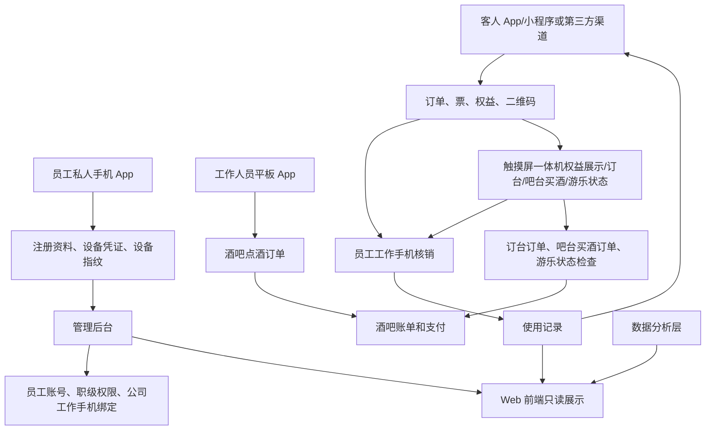

# Web 前端与移动/平板 App 扩展 PRD V0.1

## 1. 文档定位

本文档补充终端展示层的新增需求：增加一个 Web 前端，并明确客人购票 App/小程序、工作人员平板 App、员工工作手机和触摸屏一体机的职责边界。

本文档只做产品需求拆解，不做视觉稿、不做实现方案。它承接 `terminal-page-product-prd-v0.1.md` 和 `terminal-display-layer-*` 系列文档。

## 2. 新增终端范围

| 终端 | 使用对象 | P0 定位 |
|---|---|---|
| Web 前端 | 管理层、运营、财务、业务人员、部分商户人员 | 展示移动端和后台的关键信息，支持非编辑状态查看 |
| 客人购票 App/小程序 | 游客、会员、潜在客户 | 官方购票、预定、查询信息、展示验票二维码、会员积分 |
| 工作人员平板 App | 酒吧现场工作人员、服务员 | 只负责酒吧点酒下单，绑定酒吧和卡座，不负责门票购买 |
| 员工工作手机 | 现场员工、检票员、权益核销人员 | 扫客人二维码核销门票、权益、赠饮和领取资格 |
| 触摸屏一体机 | 客人、现场工作人员 | 分售票型和非售票型：售票型承担官方自助购票/取票/订单查询；非售票型承担扫码展示/领取权益、订台下单、吧台买酒下单、游乐设施状态查看和授权状态检查 |
| 移动管理端 | 管理层、运营主管 | 看关键指标、待办、异常审批 |
| 员工私人手机 App | 员工自有手机 | 注册、通知、状态查看、设备凭证绑定、Root/设备异常检测；不做现场业务操作 |

> 修订说明（2026-06-07）：补"移动管理端"行——本文验收（§9）与待确认（§10）均引用了移动管理端，但范围表此前漏列，文档自身不闭环（finding webmobile-5）。其完整职责沿用 `terminal-page-product-prd-v0.1.md §7`。员工私人手机"NFC绑定"改为"设备凭证绑定"以对齐基准 D8（设备公钥/不可逆设备指纹，废止读取手机本机 NFC 唯一标识）。本表终端与基准 D5《10 端枚举》映射：Web 前端→`web`、客人 App→`app`/小程序→`miniapp`、平板→`tablet`、工作手机→`staff_work_phone`、一体机→`kiosk`、移动管理端→`mobile_admin`、私人手机→`staff_private_phone`、商户侧→`merchant_portal`/`merchant_app`（见 §7.5）。
> 口径补充（2026-06-10）：一体机仍使用 D5 的 `kiosk` 终端枚举，通过 `kiosk_mode=ticketing/service` 或模块开关区分售票型/非售票型，不新增终端枚举。

## 3. Web 前端 P0

### 3.1 产品目标

Web 前端是“轻量展示和只读查看入口”，不是完整管理后台的替代品。

P0 目标：
- 可以展示移动端 App 的主要信息内容。
- 允许业务人员在非编辑状态查看经营、票务、酒吧、游乐、商户、订单、核销、异常等信息。
- 支持按权限查看，不允许越权查看或编辑。
- 可作为后续移动端内容的 Web 版展示底座。
- 所有新增终端都必须调用终端开关接口，开关关闭时，该端或该端上的指定模块不可用。

### 3.2 页面范围

| 页面 | P0 内容 |
|---|---|
| Web 首页 | 综合体概览、今日经营、公告、快捷入口 |
| 信息查询 | 票务、权益、订单、核销、酒吧、游乐、商户摘要 |
| 经营看板只读 | 收入、客流、核销、异常、商户表现 |
| 票务信息只读 | 票种、通票、权益状态、核销记录 |
| 酒吧信息只读 | 桌台状态、账单摘要、赠饮核销 |
| 游乐信息只读 | 项目开放、场次容量、核销状态 |
| 异常与待办只读 | 待复核、风险提示、差异摘要 |
| 我的权限范围 | 当前用户可查看的数据范围 |

### 3.3 非范围

- Web 前端 P0 不承担复杂编辑。
- Web 前端 P0 不替代管理后台配置能力。
- Web 前端 P0 不开放游客购票主流程，游客购票主入口在 App/小程序和售票型一体机，第三方渠道作为外部回流入口。

### 3.4 Web P0 业务确认动作范围（与白名单对齐）

> 修订说明（2026-06-07）：原文仅写"允许少量业务确认动作"而未界定范围，与流程图"纯只读"自相矛盾、无法编码（finding webmobile-1/2）。此处明确范围并指向唯一权威清单。

- Web P0 的"少量业务确认动作"以 `terminal-page-product-prd-v0.1.md §9.1 业务确认动作白名单`为唯一权威，P0 仅含三条：**对账差异确认、异常待办标记已读、结算单查看确认**。
- 排除清单见 `terminal-page-product-prd-v0.1.md §9.2`：不可核销、点酒、放行、退款、配置、结算单确认/争议、异常处置/复核审批。
- 每条确认动作都校验登录态+数据权限、记录确认人/时间/意见并写事件中心；涉及业务对象实质状态变更（核销撤销/放行/退款/结算确认/审批）的动作仍跳转后台、商户侧或移动管理端完成（见 F2 流程图）。

## 4. 客人购票 App/小程序 P0

### 4.1 产品目标

客人购票 App 与小程序需要打通，作为游客侧主要入口。

- 门票购买只能由客人本人通过官方 App/小程序、售票型一体机或第三方平台自助完成，工作人员平板 App 不允许代客购买门票。
- 第三方购票渠道 P0 首批覆盖美团、大众点评、抖音，当前只做团购购票、订单回流、核销和对账。

P0 目标：
- 客人可以查看综合体信息、票种、套餐、通票、游乐项目和酒吧权益说明。
- 客人可以通过官方 App/小程序同步购票和预定，也可以查询第三方团购渠道购票后的票和权益状态。
- 客人可以查询订单、票、权益和使用记录。
- 客人可以展示具备防伪、签名、有效期、30 秒或 60 秒刷新、截图无效和事后核对能力的验票二维码或权益二维码，现场必须在线核验。
- App 和小程序共享订单、票、权益、二维码和使用记录口径。
- App 和小程序 P0 具备会员积分摘要和会员等级展示；积分明细、礼物列表、兑换发起和兑换记录进入 P1。

### 4.2 页面范围

> 修订说明（2026-06-07）：§10 已确认 #4"订台入口包括 App、小程序"，但页面范围此前只有票务"预定入口"，缺酒吧卡座/桌台订台与定金支付页（finding webmobile-6）。故新增"酒吧订台""订台定金支付"两页；定金金额单位为分(整数)（基准 D1），订台/定金的页面字段与一体机、平台订台口径保持一致。

| 页面 | P0 内容 |
|---|---|
| 首页 | 综合体介绍、票务入口、活动/公告、推荐票种 |
| 票务列表 | 平日票、周末票、节假日票、学生票、多人票、通票 |
| 票务详情 | 价格、适用日期、人群、权益组成、使用限制 |
| 预定入口 | 日期、场次、人数、项目或套餐选择 |
| 酒吧订台 | 选择酒吧、日期、时段、卡座/桌台/吧台位、人数、备注（订台需支付定金） |
| 订台定金支付 | 订台位置、定金金额（分）、支付方式、到店/取消/退款状态 |
| 下单确认 | 票种、数量、游客信息、金额、优惠 |
| 支付结果 | 成功、失败、待支付、订单状态 |
| 我的订单 | 订单状态、退款状态、权益生成状态 |
| 我的票/权益 | 入场、游乐、酒水、餐饮/零售券 |
| 验票二维码 | 可用于现场在线核销的防伪二维码，包含签名、有效期、随机串、哈希核对口径和 30 秒/60 秒刷新 |
| 使用记录 | 已核销、退款、失效、撤销 |
| 会员积分 | P0：积分余额、会员等级、最近积分摘要；P1：积分明细、消费获得积分规则详情 |
| 积分兑换 | P1：可兑换礼物、兑换条件、兑换发起、兑换记录；兑换成功必须扣减库存 |
| 信息查询 | 营业时间、游乐项目、酒吧规则、场地说明、常见问题 |

### 4.3 App 与小程序打通口径

| 对象 | 打通要求 |
|---|---|
| 游客身份 | 同一游客在 App 和小程序下应能关联到同一身份 |
| 订单 | App 和小程序均可查看同一订单 |
| 票和权益 | App 和小程序均可展示同一票码和权益 |
| 二维码 | 同一权益二维码在两端状态一致，防伪串码、签名版本、有效期、刷新频率、截图失效和核对状态一致 |
| 使用记录 | 任一端查询到的核销和退款记录一致 |
| 预定记录 | 任一端发起的预定在另一端可查 |
| 会员积分 | P0：App 和小程序看到的积分余额、等级和最近积分摘要一致；P1：积分明细、礼物列表、兑换发起和兑换记录一致 |

## 5. 工作人员平板 App P0

### 5.1 产品目标

工作人员平板 App 面向酒吧现场工作人员，只用于帮助客人在酒吧点酒下单。它不是后台管理端，不是游客自助端，也不是门票销售入口。

业务边界：
- 平板 App 不允许帮助客人购买门票。
- 所有门票必须由客人本人通过官方 App/小程序或第三方渠道购买。
- 平板 App 必须先定位到具体酒吧，再定位到该酒吧内的具体卡座、桌台或吧台位。
- 平板 App 点酒下单必须校验最低消费，未满足最低消费时不能提交订单。
- 酒水订单优先生成支付二维码供客人手机扫码支付，也可由平板扫描客人手机支付码完成支付；现场现金和 POS 机支付必须被允许，但要由授权员工记入酒吧账单和对账。

P0 目标：
- 工作人员可以在绑定酒吧和卡座后，为客人选择酒水、套餐或酒吧消费项目。
- 可以录入人数、备注、服务员和卡座信息。
- 可以校验最低消费并形成酒吧账单。
- 可以生成支付二维码或扫描客人支付码完成支付；如使用现金或 POS 机，必须记录支付方式、经办员工和对账依据。
- 可以查看酒水订单状态、支付状态和卡座账单状态。

### 5.2 页面范围

| 页面 | P0 内容 |
|---|---|
| 工作台首页 | 当前员工、班次、平板设备、当前酒吧、当前卡座/桌台 |
| 酒吧定位 | 选择或确认当前所属酒吧 |
| 卡座/桌台定位 | 选择或确认客人所在卡座、桌台或吧台位 |
| 点酒下单 | 选择酒水、套餐、数量、服务备注 |
| 最低消费校验 | 当前已点金额、最低消费要求、差额提示 |
| 订单确认 | 酒水明细、数量、金额、卡座、服务员、支付方式，支持线上、现金、POS 机口径 |
| 支付二维码 | 生成二维码供客人手机扫码支付 |
| 扫客人付款码 | 平板扫描客人手机支付码完成支付 |
| 订单状态 | 待支付、已支付、已关闭、异常 |
| 卡座账单 | 当前卡座消费、最低消费达成情况、关台状态 |

### 5.3 边界

- 平板 App 只允许做酒吧点酒下单，不能购买门票，不能生成门票或游乐权益。
- 平板 App 生成的酒水订单必须进入酒吧账单、财务流水和经营看板口径。
- 平板 App 的操作必须绑定员工、班次、设备和点位。
- 平板 App 不能成为后台配置入口。

## 6. 员工工作手机 P0

员工工作手机是发给现场员工使用的手持设备，主要用于扫码核销和企业微信工作沟通。

P0 目标：
- 员工可使用工作手机扫描客人 App/小程序或第三方票码二维码。
- 工作手机可核销门票入场权益。
- 工作手机可核销门票附赠的酒水、礼物、餐饮零售券或其他权益领取资格。
- 每次核销必须绑定员工、班次、设备、点位和核销结果。
- 工作手机只能使用企业微信承接工作沟通，企业微信聊天内容每天自动上传后台。
- 正式发放的受管工作手机不允许安装除预装软件之外的任何软件，只允许访问白名单网站。
- 后台对企业微信会话做基础服务分析和违规内容检查。

页面范围：

| 页面 | P0 内容 |
|---|---|
| 上岗 | 员工、班次、岗位、责任区域 |
| 设备确认 | 当前工作手机编号、领用状态 |
| 门票核销 | 扫客人二维码，判断是否可入场 |
| 权益核销 | 扫权益二维码，判断可领取内容 |
| 核销结果 | 成功、拒绝、异常、原因 |
| 核销记录 | 本人、本设备、本班次核销记录 |
| 企业微信状态 | 绑定状态、每日会话上传状态、上传失败提示 |
| 设备策略 | 预装软件清单、应用白名单、网站白名单、违规提示 |

## 6.5 员工私人手机 App P0

员工私人手机 App 安装在员工自有手机上，只用于入职注册、通知、状态查看和设备凭证绑定。它与公司发放的员工工作手机不同，不能作为现场作业设备。

> 修订说明（2026-06-07）：依基准 D8，废止"读取手机本机 NFC 唯一标识"方案（Android 技术不可行，phone-3），私人手机身份改为安装期生成并存于设备 Keystore 的设备公钥/不可逆设备指纹，且仅持久化不可逆哈希/公钥指纹（PIPL 数据最小化）。本节相关措辞同步改为"设备凭证绑定"。

P0 目标：

- 员工可在私人手机提交注册资料、岗位申请和联系方式。
- 员工安装 App 时生成并绑定设备凭证（存于设备 Keystore 的设备公钥/不可逆设备指纹），不读取也不存储手机本机原始唯一标识。
- App 记录设备指纹、系统版本、Root/调试检测结果。
- 后台审核通过后，生成员工账号、角色、职级、权限和数据范围。
- 后台建立员工、私人手机、设备凭证（设备公钥指纹）、公司工作手机的一一对应关系。
- 员工换手机时必须先解绑旧设备凭证，再绑定新设备。
- 员工可查看通知、审批状态、个人岗位和职级摘要。
- 员工进入办公区或现场作业区后，私人手机需要寄存；现场只使用公司工作手机。

页面范围：

| 页面 | P0 内容 |
|---|---|
| 注册提交 | 姓名、手机号、所属主体、岗位申请、资料摘要 |
| 设备凭证绑定 | 设备公钥/不可逆设备指纹生成与绑定结果、重复绑定提示、先解绑旧设备凭证再绑定新设备 |
| 设备检测 | 设备指纹、Root/调试检测、异常提示 |
| 审批状态 | 待审核、已通过、已驳回、需复核、已失效 |
| 通知中心 | 工作通知、制度通知、排班提醒 |
| 个人状态 | 岗位、职级、权限摘要、公司工作手机绑定状态 |

边界：

> 修订说明（2026-06-07）：统一私人手机 App 审批禁项措辞，明确"不承接任何现场作业类审批/复核，管理类审批由移动管理端承载"，与 `terminal-page-product-prd §8.5`、`terminal-display-layer-spec-v0.2.md` 一致（finding webmobile-8）；并将"NFC 不匹配"改为"设备凭证不匹配"对齐基准 D8。

- 不允许核销门票、权益或赠饮。
- 不允许点酒、订台、放行、结算、补录。
- 不承接任何现场作业类审批/复核；管理类待办审批由移动管理端承载，私人手机 App 不承载审批/复核动作。
- Root、调试环境、设备指纹变化、设备凭证不匹配时自动失效并进入后台复核；能被手机端检测出的异常环境均按不可信处理。

## 7. 触摸屏一体机 P0

触摸屏一体机用于固定点位自助服务，分为售票型和非售票型。售票型一体机可以放在入口、票务服务点或游客服务点，承担官方自助购票、取票和订单查询；非售票型一体机可以放在吧台、权益领取点、游乐服务点，支持客人或现场工作人员查看状态、完成部分下单和领取权益。

P0 目标：
- 售票型一体机使用官方票务产品、平日/周末/节假日基础价及其派生价、库存锁定、聚合支付、出票和防伪二维码能力，写入票务订单、支付和出票事件。
- 客人或员工扫码后，一体机展示当前可领取的酒水、礼物或其他权益。
- 一体机展示权益名称、数量、状态、有效期和领取规则。
- 领取完成后回写权益状态和领取记录。
- 支持订台下单：选择酒吧、日期、时段、卡座/桌台/吧台位、人数和备注，订台需要支付定金。
- 支持吧台买酒下单：选择酒水、套餐、数量，生成待支付订单。
- 支持支付引导：优先生成二维码让客人手机扫码支付，或提示工作人员扫码客人付款码；现金和 POS 机支付必须进入账单和日结。
- 支持游乐设施状态查看：开放、排队、容量、暂停、关闭、故障、维护和安全提醒。
- 授权员工可在一体机上做游乐设施状态检查，形成检查记录和异常留痕。
- 非售票型一体机不负责售票；所有一体机均不负责复杂后台配置，售票型一体机也不得绕过票务审批价、库存和支付对账。

## 7.5 商户侧终端口径（商户侧 App 是否 P0）

> 修订说明（2026-06-07）：原 §9 验收引入"商户侧 App"这一移动终端，但全套终端文档只定义了"商户侧页面"（Web），商户侧 App 无职责/页面/边界定义，开发者无法判断其 P0 与否（finding webmobile-7）。本节明确口径。

- **P0 商户侧只做 Web 页面（`merchant_portal`，商户侧 Web 门户）**，不做商户侧移动 App。商户侧职责沿用"在授权业务范围内全开放、不看平台全局和其他商户"口径，页面范围见 `terminal-display-layer-spec-v0.2.md`。
- 基准 D5 保留 `merchant_app`（商户侧 App）枚举位，作为**后续（P1+）**商户侧移动端演进的预留，**P0 不实现**；待落地时再补其职责、页面范围与数据边界（沿用商户侧授权范围全开放口径）。
- 因此本文凡涉及"商户侧"的终端措辞统一为"商户侧页面/商户侧 Web"，不再以"商户侧 App"作为 P0 终端表述。

## 8. 跨端关系

## 9. P0 验收标准

- Web 前端能展示移动端和业务关键信息，但默认不编辑。
- 客人 App/小程序能同步购票、预定/订台、查询订单、展示 30 秒/60 秒刷新的在线防伪验票二维码，并展示会员积分摘要和等级；积分明细、礼物列表、兑换发起和兑换记录进入 P1。
- 美团、大众点评、抖音团购购票结果能进入平台订单、票、权益、核销和对账口径。
- 客人 App 和小程序的订单、票、权益、二维码状态一致。
- 工作人员平板 App 只做酒吧点酒下单，必须绑定酒吧、卡座、员工、班次、设备和点位。
- 平板点酒下单必须校验最低消费，支持客人扫码支付和扫描客人付款码支付；现金/POS 机支付需要进入酒吧账单和财务对账。
- 员工工作手机能扫码核销门票、赠饮和其他权益，并能校验二维码签名、防伪串码、有效期、30 秒/60 秒刷新状态和哈希，截图无效且必须在线核验。
- 员工工作手机能显示企业微信每日上传状态，后台能查看基础违规命中。
- 受管工作手机能执行应用白名单和网站白名单策略；未受管设备只能试点和上报异常，不能作为正式工作手机发放。
- 员工私人手机 App 能完成注册、设备凭证（设备公钥/不可逆设备指纹）绑定、换机解绑重绑、Root/设备异常检测和审批状态查看，但不能核销、点单、放行、结算、补录或审批/复核。
- 售票型触摸屏一体机能完成官方自助购票、取票、订单查询、库存锁定、聚合支付、出票和防伪二维码生成；非售票型触摸屏一体机能展示客人可领取的酒水、礼物或权益，并能形成需定金的订台订单、吧台买酒订单、支付引导和游乐设施状态检查记录。
- 客人 App/小程序能形成需定金的酒吧订台订单，订台定金金额、到店/取消/退款状态可查（金额=分，基准 D1）。
- 移动管理端能处理管理类待办和异常复核（管理概览、待办中心、异常详情、审批/复核），移动审批对齐 P0。
- 新增终端都能与终端展示层已有后台、商户侧、现场端形成边界。
- 客人 App、小程序、Web 前端、工作人员平板 App、员工工作手机、员工私人手机 App、商户侧页面（`merchant_portal`）、触摸屏一体机和移动管理端都具备后台开关控制能力。

## 10. 已确认规则和后续细化事项

已确认：

1. 官方购票入口 App、小程序和售票型一体机同步建设；所有门票必须由客人自助购买，工作人员平板不得代客购票。
2. 美团、大众点评、抖音 P0 只做团购购票、订单回流、核销和对账。
3. 积分兑换礼物必须扣减库存；客人端积分兑换独立页面和接口进入 P1，不作为 P0 验收项。
4. 订台入口包括 App、小程序、非售票型一体机和销售人员工作台，订台需要支付定金。
5. 吧台买酒优先线上支付，同时必须允许现金和 POS 机支付并进入账单和对账。
6. 员工私人手机 App 以设备公钥/不可逆设备指纹（存于设备 Keystore）作为可信标识；换机必须先解绑旧设备凭证再绑定新设备；Root/异常环境失效复核。（依基准 D8 修订：废止"读取手机本机 NFC 唯一标识"方案）
7. 票务二维码按票种设置有效期，30 秒或 60 秒刷新，截图无效，必须在线核验。
8. 工作手机预装软件清单和网站白名单由后台维护，通过 Android Enterprise / Android Management API + 商业 MDM 阻止违规访问并留痕。
9. Web 前端 P0 允许少量业务确认动作，但不承接复杂编辑和现场作业。
10. 会员积分、等级成长和兑换规则由后台定义。
11. 酒吧最低消费按时间、卡座和位置配置，原则上不按人数。
12. 一体机游乐设施检修由工程师填写，检修单位作为供应商记录，主管确认后才能恢复营业。
13. 企业微信工作会话留存期限可配置（非永久），到期归档/销毁/匿名化（按 A7/合规C3、data-risk §11.5）；不脱敏原文仅限最小授权 + 审批的取证/质检场景，普通展示按权限脱敏，查看写审计。<!-- 修订说明（2026-06-08 三轮收口）：原"永久保存"为已确认 P0 规则断言，与 A7/C3 可配置留存相反，就地改正；2026-06-08 复核补充不脱敏原文的最小授权边界。依据 finding residual-scan-3、A7/C3 -->
14. 合同或基础定义违规全部先卡住流程，允许按可配置更高级审核层级放行。
15. 商户侧在授权业务范围内全开放，不看平台全局和其他商户。
16. 酒吧系统和游乐/乐园系统保留未来独立 SaaS 能力。
17. 第三方接口资料当前未确定，先完成自有系统和开放 API/Webhook/SDK 示例，后续再接第三方 SDK/API。
18. 所有端都必须有开关接口，支持按全局、综合体项目、商户、业务系统、模块、设备和版本控制。
19. 酒水和可追责物品从库房出库、订单核验、机器人或人工配送、后厨接收、服务员送达客人，都必须扫码或通过设备事件留痕。
20. 移动管理端 P0 只处理高风险待办和主管复核，不做全后台；普通配置和复杂编辑仍在 Web 后台完成。

后续细化：

无。后续仅根据现场主管使用情况调整移动端待办范围。

## 11. 本版结论

本次补充后，终端展示层从“后台、商户侧、现场端、移动管理端、游客端”扩展为更清晰的多端体系：Web 前端负责查看和少量业务确认，商户侧在授权业务范围内全开放，客人 App/小程序负责游客自助购票预定、会员积分和防伪二维码，第三方渠道负责外部售票回流，员工私人手机 App 负责注册、通知、状态查看和设备凭证绑定，工作人员平板 App 负责员工协助酒吧点酒下单，员工工作手机负责门票和权益防伪核对后的扫码核销、库房和交接扫码，售票型触摸屏一体机负责官方自助购票/取票/订单查询，非售票型触摸屏一体机负责权益展示/领取、订台下单、吧台买酒下单、游乐设施状态查看和定期检修记录，移动管理端负责管理类待办、异常和移动审批。所有端都要通过后台开关控制，为酒吧和乐园独立 SaaS 化预留。

## 12. 变更日志

| 日期 | 类型 | 位置 | 内容 | 原因/依据 |
|---|---|---|---|---|
| 2026-06-07 | 增 | §2 终端范围表 | 补"移动管理端"行+D5 枚举映射说明 | 范围表漏列移动管理端致文档不闭环（webmobile-5）；终端对齐 D5 |
| 2026-06-07 | 增 | §3.4 | 明确 Web P0 业务确认动作范围并指向白名单 | "少量业务确认"范围未界定且与流程图矛盾（webmobile-1/2） |
| 2026-06-07 | 增 | §4.2 客人端页面 | 新增"酒吧订台""订台定金支付"两页 | 客人端为订台入口且需定金，原缺页（webmobile-6）；金额=分(D1) |
| 2026-06-07 | 增 | §7.5 | 新增"商户侧 App 是否 P0"口径：P0 仅 Web、merchant_app 留待 P1+ | "商户侧 App"引入未落地（webmobile-7） |
| 2026-06-07 | 改 | §6.5、§9、§10 #6、§11 | 私人手机 App 审批禁项措辞统一；NFC 绑定改设备凭证绑定 | 审批禁项口径不一致（webmobile-8）；设备身份对齐 D8 |
| 2026-06-07 | 改 | §9 验收 | "商户侧 App/Web"改"商户侧页面"，补移动审批/订台定金验收项 | webmobile-7、webmobile-4/6 |
